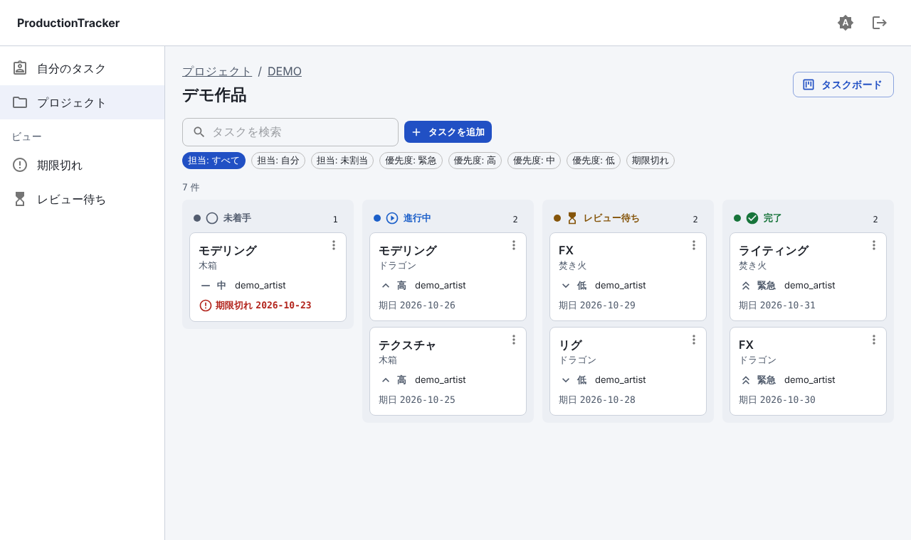
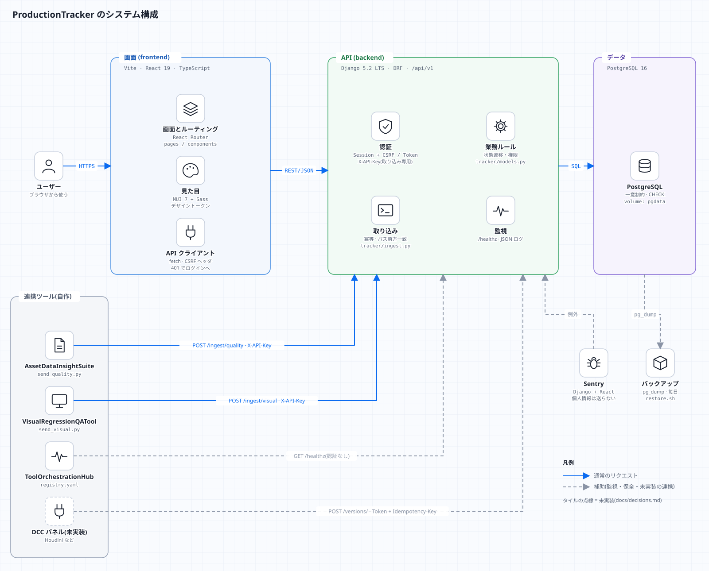
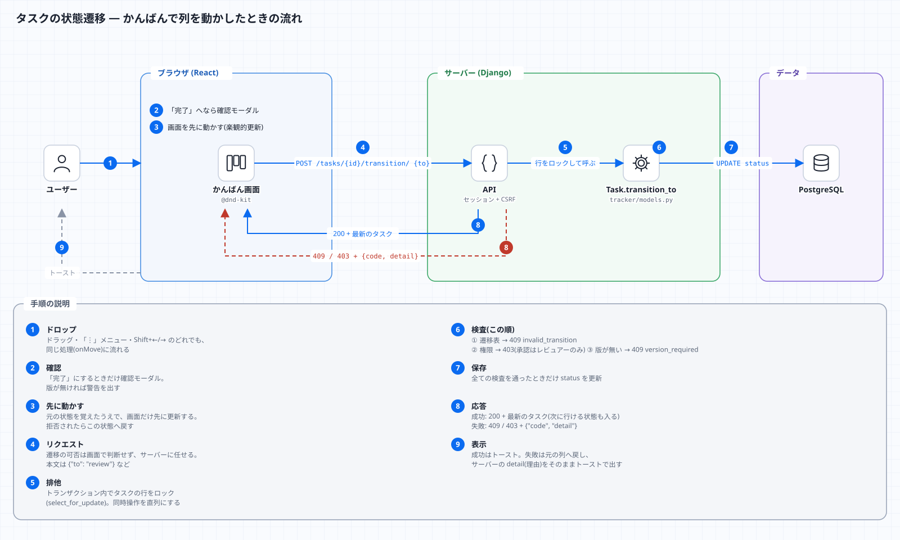
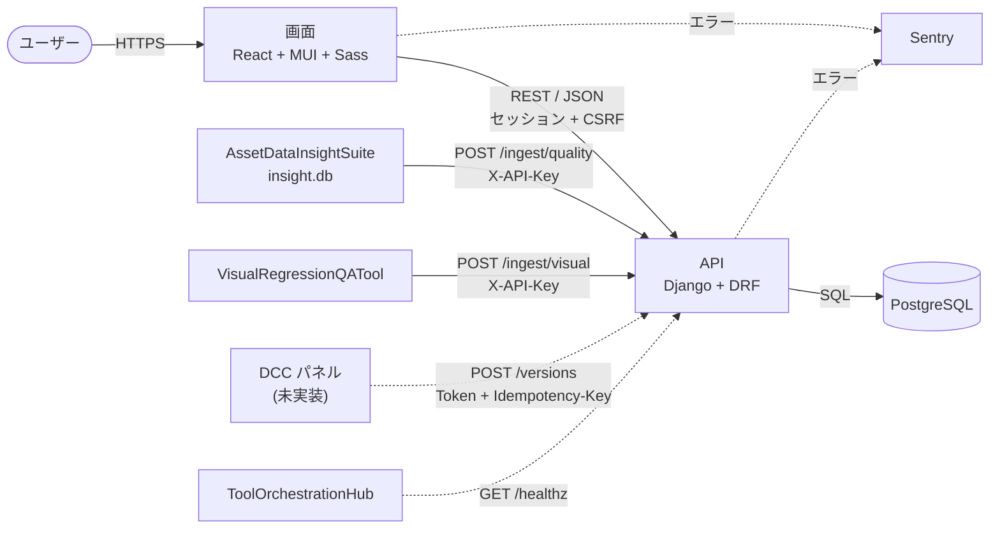
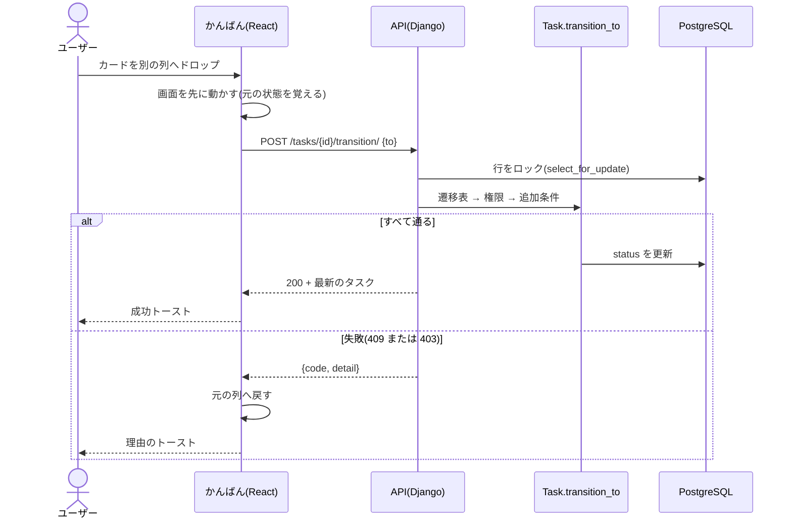
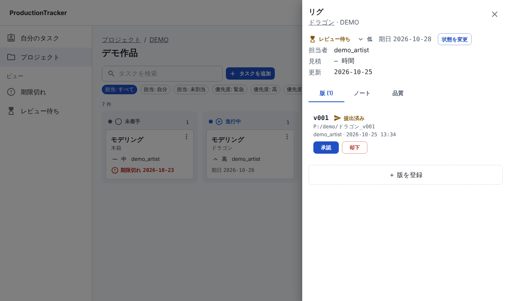
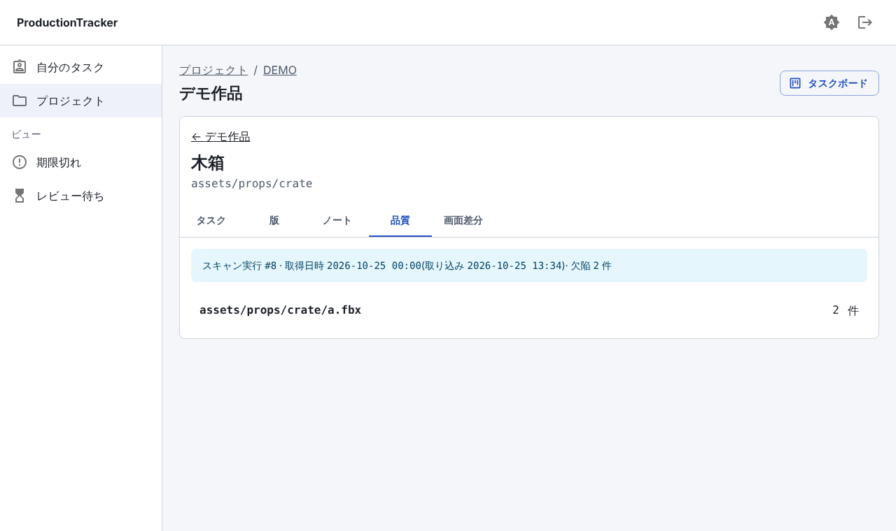
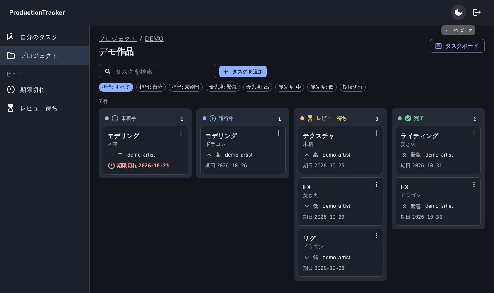

# ProductionTracker

アセット・タスク・版(バージョン)・ノートを管理する、小さな制作進行ボード。ShotGrid(Flow Production Tracking)の「何を管理する道具か」を
データモデルとして理解しつつ、Django / React / MUI / Sass / Sentry / pytest / Docker を一度に実践するための学習用プロジェクトです。
設計書: `ProductionTracker_DESIGN.md`(このリポジトリには含まれていません)。

| 層 | 技術 |
|---|---|
| バックエンド | Django 5.2 LTS + Django REST framework、PostgreSQL 16(テストの既定は SQLite) |
| フロント | Vite + React 19 + TypeScript、React Router、MUI 7、Sass(デザイントークン)、@dnd-kit |
| 監視 | Sentry(Django / React)、`/healthz`、JSON ログ |
| テスト | pytest + pytest-django + factory_boy(877 件(うち文書内コードの検証 約 280 件))/ Vitest(37 件) |
| 起動 | `docker compose`(`db` / `web` / `frontend`) |



## 構成図
図は [`docs/diagrams/build.py`](docs/diagrams/build.py) から作る(SVG を手で編集しない。直し方は [docs/diagrams/README.md](docs/diagrams/README.md))。



| 図 | 何が分かるか |
|---|---|
| [システム構成](docs/diagrams/architecture.svg) | 画面・API・DB と、連携ツール・監視・バックアップの関係(上の図) |
| [状態遷移の流れ](docs/diagrams/transition-flow.svg) | かんばんで列を動かしてから、トーストが出るまでの 9 手順 |
| [取り込みの流れ](docs/diagrams/ingest-flow.svg) | `insight.db` が品質タブに出るまでの 9 手順と、件数の突き合わせ |
| [コードの地図](docs/diagrams/code-map.svg) | どのファイルが何を担当し、どちら向きに呼ぶか |
| [リクエストが通る関門](docs/diagrams/request-pipeline.svg) | Cloudflare → ミドルウェア → 認証 → 制限 → 検証 → 見える範囲 → 権限 → ルール → DB の 9 つの関門と、拒否の応答 |
| [認証の経路](docs/diagrams/auth-flow.svg) | 画面・Access・DCC パネル・外部ツールが、どのヘッダでどの認証クラスに届くか |
| [データモデル](docs/diagrams/data-model.svg) | テーブルと関係、一意制約 |
| [講義の地図](docs/diagrams/lecture-roadmap.svg) | 基礎から総合演習までの 18 回の講義の流れ |
| [運用構成](docs/diagrams/operations.svg) | 自分の PC + Cloudflare Tunnel / Access、バックアップ、監視 |



### 仕組みの要点(mermaid。Markdown だけで読める版)


かんばんで列を動かしたときの流れ(遷移の可否は、画面でなくサーバーが決める):



## 起動(Docker)
```bash
cp .env.example .env            # 任意。無くても開発用の既定値で起動する(公開する前に必ず設定)
docker compose up --build
```
- 画面: <http://localhost:5173>(`FRONTEND_PORT`)/ API: <http://localhost:8000/api/v1/>(`WEB_PORT`)/ 管理画面: <http://localhost:8000/admin/>
- 管理者を作る: `.env` に `DJANGO_SUPERUSER_USERNAME` / `DJANGO_SUPERUSER_PASSWORD` を入れておくと、初回起動で作成される。
- デモデータ: `docker compose exec web python manage.py seed_demo --password <デモユーザーのパスワード>`
  (プロジェクト `DEMO` と、ユーザー `demo_reviewer` / `demo_artist` / `demo_viewer` ができる)
- メンバーの追加・役割の変更は管理画面から(プロジェクト → メンバー)。

> この環境では Docker デーモンが使えず、`docker compose config` による構文確認までしかできていません。
> `docker compose up` での通し起動は、お手元の環境での確認をお願いします。下の「Docker なしで動かす」は実際に動作確認済みです。

## Docker なしで動かす
```bash
# バックエンド(SQLite)
cd backend
python -m venv .venv && . .venv/bin/activate
pip install -r requirements-dev.txt
export DJANGO_DEBUG=1
python manage.py migrate
python manage.py createsuperuser          # または seed_demo --password ...
python manage.py runserver                # http://localhost:8000

# フロント(別の端末)
cd frontend
npm ci
npm run dev                               # http://localhost:5173(/api などは :8000 へプロキシ)
```
PostgreSQL を使うときは `POSTGRES_HOST` / `POSTGRES_DB` / `POSTGRES_USER` / `POSTGRES_PASSWORD`(と必要なら `POSTGRES_PORT`)を設定する。

## テスト
```bash
cd backend  && pytest                     # 全件(SQLite)。POSTGRES_HOST 等を渡すと PostgreSQL で同じテストが走る
cd backend  && ruff check .
cd frontend && npm test && npm run build  # Vitest / 型チェック + ビルド
```

## 画面
| 画面 | ルート |
|---|---|
| プロジェクト一覧(並べ替えチップ) | `/projects` |
| プロジェクト概要(左 アセット / 中央 タブ: 概要・タスク・版・品質 / 右 サマリ) | `/projects/:code` |
| タスクボード(かんばん。列移動で遷移ルールを検査) | `/projects/:code/board` |
| アセット詳細(タスク / 版 / ノート / 品質 / 画面差分) | `/projects/:code/entities/:id` |
| 自分のタスク(期日順。ビュー: 期限切れ・レビュー待ち) | `/me/tasks` |

状態は「色 + アイコン + 文字」で示し、ライト/ダークの切替、幅 360px で横スクロールなし。詳しくは [docs/ui-rules.md](docs/ui-rules.md)。

空の列には、状態に対応した植物の ASCII モチーフ(種 → 芽 → 花 → 実)を飾りとして出す(読み上げ対象外・動きを減らす設定では静止画)。[docs/ui-rules.md](docs/ui-rules.md)。

| ドロワー(版・ノート・品質) | 品質(取得日時の固定表示) | ダーク |
|---|---|---|
|  |  |  |

## 状態遷移と権限
```
未着手 → 進行中 → レビュー待ち → 完了        レビュー待ち → 進行中(差し戻し) / 完了 → 進行中(再開)
```
- 表にない遷移は **409**(`invalid_transition`)。承認(レビュー待ち → 完了)は、そのプロジェクトの**レビュアーのみ**(**403**)。
- 「完了」には版が 1 つ以上必要(**409** `version_required`。`REQUIRE_VERSION_FOR_COMPLETION=0` で外せる)。
- ルールは `backend/tracker/models.py` の `Task.transition_to` の 1 か所。UI は結果(トースト)を表示するだけ。
- 役割は `ProjectMember.role`(reviewer / artist / viewer)。管理者(`is_staff`)は全プロジェクトを見られるが、承認はレビュアーのみ。

## API(`/api/v1`)
| メソッド | パス | 内容 |
|---|---|---|
| GET/POST, GET/PATCH | `/projects/`, `/projects/{id または code}/` | 一覧・作成 / 取得・更新。`/projects/{id}/members/` |
| GET/POST, GET/PATCH | `/entities/?project=`, `/entities/{id}/` | アセット |
| GET/POST, GET/PATCH | `/tasks/?entity=&assignee=&status=&project=&overdue=&q=&ordering=` | タスク(`assignee=me` 可) |
| POST | `/tasks/{id}/transition/` | 状態遷移(本文 `{"to": "..."}`)。不正は 409 |
| GET/POST | `/versions/?task=`、`POST /versions/{id}/transition/` | 版(`Idempotency-Key` 対応) |
| GET/POST | `/notes/?target_type=&target_id=` | ノート(対象は entity / task / version のみ) |
| GET | `/steps/`, `/quality-reports/`, `/visual-results/`, `/me/` | 参照用 |
| POST | `/ingest/quality/`, `/ingest/visual/` | 外部ツールの結果の取り込み(`X-API-Key`、冪等) |
| GET | `/healthz`(ルートにも) | 死活監視(認証なし。DB の可否のみ) |

一覧は全てページネーション(`?page=&page_size=`、既定 50・上限 200)。エラーは `{"code": "...", "detail": "..."}` に統一。
レート制限(ユーザーごと 1200 回/分・ログイン 10 回/分・取り込み 120 回/分。超えると 429)、JSON 以外の本文は 415、応答は `Cache-Control: no-store`。
連携の詳細は [docs/integration.md](docs/integration.md)。

## 構成
```
backend/    Django(config/ 設定、tracker/ アプリ。tests/ に pytest)
frontend/   Vite + React(src/styles にデザイントークン)
scripts/    send_quality.py / send_visual.py(取り込み)、backup.sh / restore.sh
docs/       設計・仕様(*.md)、lectures/(講義)、learning/(実践ガイド)、diagrams/(図)、html/(HTML 版)、tools/(HTML 版の生成)
docker-compose.yml  .env.example
```

## ドキュメント
全ての文書は **Markdown(mermaid 記法つき)と HTML の両方**で読める。HTML 版は [docs/html/index.html](docs/html/index.html)(JavaScript なし・図は埋め込み済み。ブラウザで開く)。
Markdown を直したら `python docs/tools/build_html.py` で HTML を作り直す(手順: [docs/diagrams/README.md](docs/diagrams/README.md)、古くなっていないかはテストが見る)。

- **[docs/lectures/](docs/lectures/README.md) — 講義資料(基礎から。Web・Python・DB・Django・アルゴリズム・React・テスト・運用まで)**
- **[docs/learning/](docs/learning/README.md) — 保守・拡張のための実践ガイド(レシピ・トラブルシューティング)**
- [docs/ui-rules.md](docs/ui-rules.md) — UI の決めごと表 / [docs/er.md](docs/er.md) — ER 図
- [docs/integration.md](docs/integration.md) — AssetDataInsightSuite・VisualRegressionQATool・Hub・Publish API
- [docs/auth.md](docs/auth.md) — 認証(セッション・トークン・API キー・Cloudflare Access)と、差し込み口
- [docs/security.md](docs/security.md) — OWASP API Top 10 での点検結果、ロール別の認可の一覧
- [docs/database.md](docs/database.md) — SQL の指針での点検結果(キー・索引・`ORDER BY`・実行計画)
- [docs/operations.md](docs/operations.md) — バックアップ・復元・更新・秘密情報・公開
- [docs/decisions.md](docs/decisions.md) — バージョン選定・ライブラリ比較・設計書から外れた点
- [docs/learning-log.md](docs/learning-log.md) — 各スキルで詰まった点

## 検証チェックリスト(設計書 §6・追補 D)の結果
| 項目 | 結果 | 根拠 |
|---|---|---|
| 不正な遷移(未着手 → 完了)が 409 | ✅ | pytest(全 4×4 の遷移表 + API) |
| 承認権限のないユーザーが「完了」にできない | ✅ | pytest(403) |
| 取り込み API が API キーなしで 401 | ✅ | pytest、実サーバーに curl |
| `/healthz` が DB 停止で異常を返す | ✅ | pytest + 実際に PostgreSQL を止めて 503 を確認 |
| Sentry に意図的な例外が届く(Django / React) | ⚠️ 未確認 | DSN が無く到達は確認できず。Django の例外が送信直前に 1 件捕捉され、認証情報が落ちていることは確認。React は `scrubEvent` を単体テスト |
| `docker compose up` だけで画面にアクセスできる | ⚠️ 未確認 | Docker デーモンが無く、`compose config` の構文確認のみ |
| ライト/ダークで、色を消しても状態が区別できる | ✅ | 色 + アイコン + 文字。グレースケール表示で目視、コントラスト 4.5:1 以上を計算 |
| 幅 360px で横スクロールが出ない | ✅ | 全 12 画面 × ライト/ダークで `scrollWidth` を計測 |
| 取り込んだ品質結果の件数が元の `insight.db` と一致 | ✅(想定スキーマで) | `send_quality.py` が不一致で終了コード 1。pytest。**実物の `insight.db` は未確認** |
| バックアップから別 DB へ復元し件数が一致 | ✅(ホストの pg_dump で) | `restore.sh` で `件数一致: OK`。docker 経由・R2 保存は未検証 |
| Tunnel + Access 経由の外部アクセス、Access を通らない直接アクセス不可 | ❌ 未検証 | 実環境が必要 |
| Publish が再送しても重複しない | ✅(API 側のみ) | pytest(`Idempotency-Key`)。Houdini パネルは未実装 |
| トークンが設定ファイル・ログ・Sentry に出ていない | ✅(Sentry)/ 該当なし(パネル) | Sentry はヘッダ・クッキー・本文を除去。アプリはリクエストヘッダをログしない |
| 方式 B の 4 項目の測定 / GLB の 3D 表示 | ❌ 未実施 | Phase 9・10 は対象外(`docs/decisions.md`) |

## 未実装・未確認(要点)
- 追補のうち「提案(未実装)」とされた項目、Phase 8 の Houdini パネル本体、Phase 9(3D ビューア)、Phase 10(Cloudflare Containers の検証)。
- `insight.db` と VisualRegressionQATool の実際の出力形式(設計書に記載がなく、想定で作った: [docs/integration.md](docs/integration.md))。
- ToolOrchestrationHub の `registry.yaml` の実スキーマ(登録例は読み替えが必要)。
- Sentry・Cloudflare の無料枠の現在の条件(公式で要確認)。
- **Cloudflare Access の JWT 検証**(`tracker/cf_access.py`)は、手元で作った鍵でのテストのみ。実 Cloudflare では未検証。
- セキュリティ点検の「要確認」(トークンに期限が無い、レート制限のカウンタがプロセスごと、本番の配信ヘッダ(CSP)が未定)は [docs/security.md](docs/security.md) の F5〜F10。
