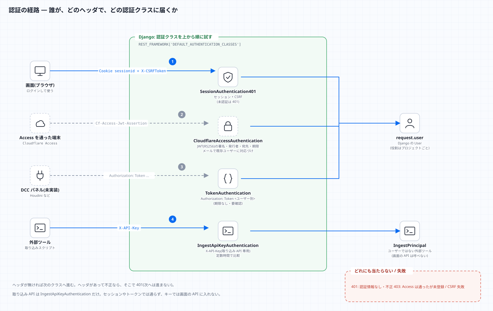
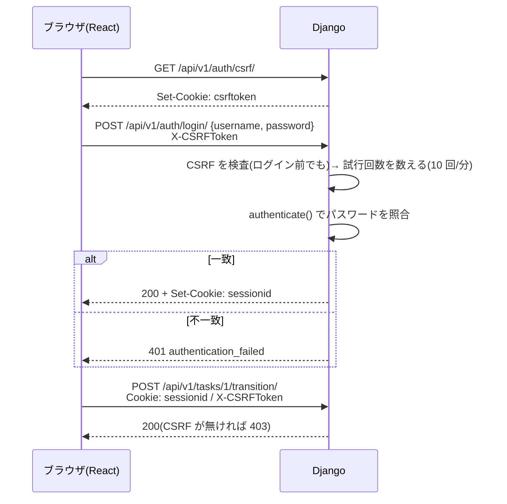
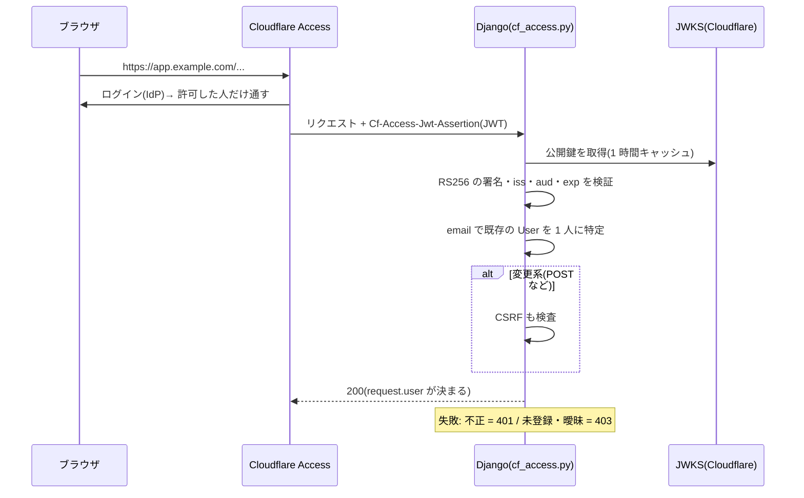

# 認証と、差し替え口(Phase 6)

## 今の認証
| 用途 | 方式 | 備考 |
|---|---|---|
| 画面 → API | Django のセッション + CSRF | 未認証は 401(`SessionAuthentication401`)。ログイン自体も CSRF を検査する(ログイン CSRF 対策) |
| DCC パネル等 → API | `Authorization: Token <ユーザー別トークン>` | `python manage.py drf_create_token <username>` で発行。`-r` を付けると再発行(古いものは無効) |
| 外部ツール → 取り込み API | `X-API-Key` | **取り込み API 専用**。画面の API には使えない。`INGEST_API_KEYS` に無ければ(空なら)常に 401 |



## 画面のログイン(セッション + CSRF)


## ログインの総当たり対策
`POST /auth/login/` は、IP(`X-Forwarded-For` があればその値)ごとに **10 回/分**(`LOGIN_THROTTLE_RATE` で変更)。超えると `429 {"code": "throttled"}`。
キャッシュはプロセスごと(既定の LocMemCache)なので、gunicorn のワーカー数だけ実質の上限は緩くなる。厳密に制限するなら共有キャッシュ(Redis など)を使う。
Cloudflare Access の背後では、そもそも Access を通った人だけがここに届く。

## Cloudflare Access(OIDC)で認証する(任意・既定は無効)
設計書の追補「認証は Cloudflare Access(OIDC)」に対応する認証クラス `tracker.cf_access.CloudflareAccessAuthentication`。
Access を通ったリクエストに付く `Cf-Access-Jwt-Assertion`(署名つき JWT)を検証し、**メールアドレスで既存のユーザーに対応づける**。

**有効にする(環境変数)**
```
CF_ACCESS_TEAM_DOMAIN=myteam.cloudflareaccess.com     # チームのドメイン(https:// は付けても付けなくてもよい)
CF_ACCESS_AUD=<Access のアプリケーションの AUD タグ>
CF_ACCESS_AUTO_CREATE=0                               # 未登録のメールのユーザーを自動で作るか(既定 0)
API_AUTHENTICATION_CLASSES=tracker.auth.SessionAuthentication401,tracker.cf_access.CloudflareAccessAuthentication,rest_framework.authentication.TokenAuthentication
```
チームのドメインと AUD の両方が無ければ、ヘッダがあっても何もしない(うっかり有効にならない)。



**守っていること**(全てテストあり: `tests/test_cf_access.py`)
| 項目 | 内容 |
|---|---|
| 署名・発行者・宛先・期限 | 全て必須。**RS256 だけ**許可(`none` / HS256 の差し替えは 401)。公開鍵は `https://<チーム>/cdn-cgi/access/certs` から取って 1 時間キャッシュ |
| ヘッダの偽装 | 別の鍵で署名したものは 401(Cloudflare の秘密鍵が無ければ作れない) |
| 未登録のメール | **403**(自動では作らない)。`CF_ACCESS_AUTO_CREATE=1` で作る場合も、**どのプロジェクトのメンバーでもない**ので何も見えない(最小権限) |
| メールが一意でない | 403(同じメールのユーザーが複数、または無効なユーザーのみ) |
| CSRF | 変更系(POST など)は、**セッションと同じく CSRF を検査**。Access のクッキーはブラウザが自動で送るため |
| 失敗の理由 | 利用者には「確認できません」とだけ返す。詳細(鍵が取れない・期限切れ)はサーバーのログだけ |

**注意**
- **実際の Cloudflare では未検証**。手元で作った RSA 鍵で署名したトークンでの確認まで。実環境で 1 回、AUD とチームのドメインを入れて確かめること([security.md](security.md) の F10)。
- ユーザーは**事前に作っておく**(管理画面で、Access と同じメールアドレスを登録し、プロジェクトのメンバーにする)。
- Access で入った人のログアウトは Access 側(`/cdn-cgi/access/logout`)。画面の「ログアウト」はアプリのセッションだけを消す。
- `/admin/`(Django の管理画面)は、このクラスの対象外(Django の通常のログイン)。Access のアプリケーションで入口を保護する。

## 差し替え口
認証クラスは環境変数で入れ替えられる(`config/settings.py`):

```
API_AUTHENTICATION_CLASSES=tracker.auth.SessionAuthentication401,rest_framework.authentication.TokenAuthentication
```

外部 ID 基盤(例: Firebase Auth)を足すには:

1. `rest_framework.authentication.BaseAuthentication` を継承したクラスを書く(`Authorization: Bearer <IDトークン>` を検証し、`User` を取得または作成して `(user, token)` を返す)。
2. そのクラスのパスを `API_AUTHENTICATION_CLASSES` に追加する。
3. `ProjectMember` の役割(`role`)は今まで通り Django の `User` に紐づくので、ビュー・権限の変更は不要。

**Firebase は実装していない**(設計書どおり、Django の認証と ORM を学ぶため)。上は差し込み位置の説明であり、動作確認はしていない。
