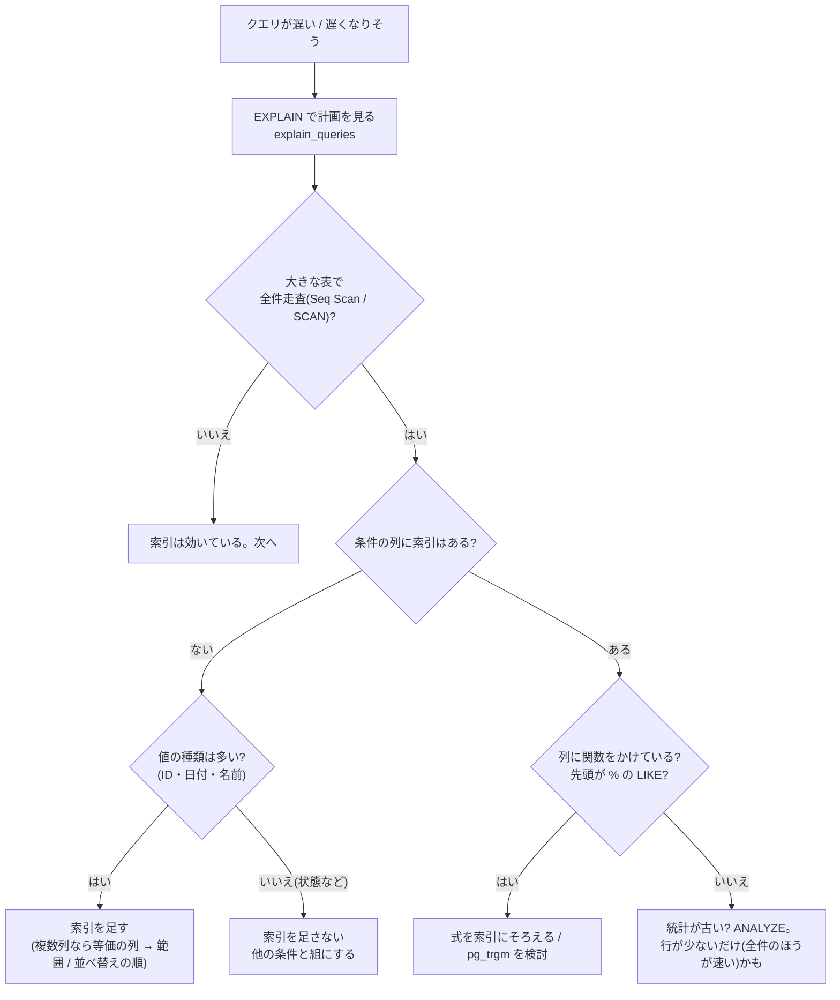

# データベースの点検(SQL の指針)

設計書の追補「第4弾の外部資料(Z32 SQL)」の指針で、データモデルとクエリを点検した結果。
資料は Cloudflare D1(SQLite)向けで、このアプリは PostgreSQL(テストは SQLite)だが、指針そのものは同じように使える。

| 指針 | 結果 |
|---|---|
| 主キー・外部キーを必ず定義 | 対策済み |
| 正規化は 3NF 〜 BCNF を目安 | 対策済み(例外は理由つき) |
| 索引は**値の種類が多い列**に | **確定**(`status` 単独の索引を削除) |
| 関数をかけた列・先頭が `%` の `LIKE` は索引が効かない | **確定**(`iexact` の式を修正)/ 先頭 `%` は許容(理由あり) |
| `LIMIT`(ページ送り)には `ORDER BY` | 対策済み(テストで強制) |
| `COUNT(列)` は NULL を数えない | 対策済み(意図どおり) |
| 実行計画は `EXPLAIN` で確認 | 対策済み(コマンドとテスト) |

## 1. 主キー・外部キー
- 全ての表の主キーは整数の自動採番(`BigAutoField`)。外部への公開識別子は別の項目(`Project.code`)。
- 外部キーは全て定義済みで、Django が外部キーの列に索引を作る。`on_delete` の方針:

| 外部キー | 方針 | 理由 |
|---|---|---|
| Entity → Project、Task → Entity、Version → Task、ProjectMember → Project / User、QualityReport → Project、VisualResult → Version | `CASCADE` | 親が消えたら子は意味を失う |
| Task → Step | `PROTECT` | 使われている工程を消させない |
| Task.assignee、Version.created_by、Note.author | `SET_NULL` | ユーザーを消しても、仕事の記録は残す |
| QualityReport.entity | `SET_NULL` | アセットを消しても、スキャンの記録(パスと件数)は残す |
| Note → 対象 | 外部キーではない(`GenericForeignKey`) | 対象を消すと連鎖して消えるよう、3 つのモデルに `GenericRelation` を足した |

## 2. 正規化(3NF 〜 BCNF)
派生する値は**保存せず、計算する**(プロジェクトの進捗・状態別の件数・`is_overdue`・`next_statuses`・`version_count`)。保存すると、更新のたびにずれる危険が増えるため。

意図的な非正規化(理由つき):
| 項目 | なぜ重複して持つか |
|---|---|
| `QualityReport.asset_path`(`Entity.path` と重複しうる) | 取り込んだ**元データの表記**を残す。アセットに対応しない行(`entity` が NULL)も保存して、元の件数と一致させるため |
| `QualityReport.project`(`entity.project` から分かる) | `entity` が NULL の行でも、どのプロジェクトのスキャンか分かる必要がある |
| `Version.idempotency_key` | 再送の判定のためだけの値 |

## 3. 索引
**索引の方針**: 値の種類が多い列(ID・日付・名前)に付ける。種類が少ない列(状態の 4 種類・真偽)の単独の索引は、ほとんど効かず、書き込みを遅くするだけ。

| 表 | 索引 | 使う場面 |
|---|---|---|
| Task | `entity_id`(外部キー)/ `assignee_id`(外部キー)/ `step_id` / `due` / 一意 `(entity, step)` | アセットのタスク一覧、「自分のタスク」、期限切れ |
| Version | `task_id`(外部キー)/ 一意 `(task, number)` / 一意 `(created_by, idempotency_key)`(鍵があるとき)| 版の一覧、採番、再送の判定 |
| Note | `(content_type, object_id)` | 対象ごとのノート |
| QualityReport | `(entity, -scanned_at)` / 一意 `(project, scan_run_id, asset_path)` | アセットの品質(新しい順)、同じ実行の置き換え |
| VisualResult | 一意 `(run_id, version)` / `version_id` | 再送の判定、版ごとの結果 |
| Project | 一意 `code` / 一意 `LOWER(code)` | URL の指定、大文字小文字を区別しない一意 |
| ProjectMember | 一意 `(project, user)` / `user_id` | 「見えるプロジェクト」の判定(最も頻繁) |

**直したこと(F4)**
1. **`Task.status` 単独の索引を削除**(マイグレーション `0005`)。値が 4 種類しか無く、絞り込みはほぼ必ずプロジェクト・担当者・期日と一緒に使うため、単独では選ばれない。
2. **`Project.code` の大文字小文字を区別しない一意の確認**を、`code__iexact`(PostgreSQL では `UPPER(code) = UPPER(...)`)から、制約の索引と同じ **`LOWER(code)`** の式に変えた。「関数をかけた列には、同じ関数の索引が要る」。

**許容していること**
- 検索(`?q=`)の `icontains` は `LIKE '%…%'`(先頭が `%`)で、索引が効かない。アセット名・工程名の検索で、件数が数千のうちは問題にならない。**増えたら**、PostgreSQL の `pg_trgm`(三文字索引)を検討する。

## 4. `LIMIT` には `ORDER BY`
ページ送りは `LIMIT / OFFSET` なので、並び順が決まっていないと、ページをまたいで同じ行が出たり抜けたりする。
- 一覧は全て並び順を明示している(`apply_ordering`。同順位は id で固定)。
- **テストで強制**: `test_every_list_queryset_is_ordered`(全ての一覧ビューの QuerySet が `ordered`)。新しい一覧を足して並び順を忘れると落ちる。

## 5. `COUNT(列)` は NULL を数えない
集計は全て「**NULL でない行を数える**」意図で、列を指定した `COUNT` を使っている。
| 集計 | 意図 |
|---|---|
| `Count("entities__tasks", filter=..., distinct=True)`(状態別の件数) | 結合で一致しなかった行(NULL)は数えない → タスクが無いプロジェクトは 0 |
| `Count("tasks", distinct=True)`(アセットごと) | 同上 |
| `Count("versions", distinct=True)`(タスクごと) | 同上 |

`distinct=True` は、複数の結合で行が増えても重複して数えないため。

## 6. 実行計画(`EXPLAIN`)
- **自動**: `tests/test_query_plans.py`。主要な 16 のクエリ(`tracker/query_catalog.py`)の `EXPLAIN QUERY PLAN` に、大きくなる表の**全件走査(SCAN)が無い**こと。SQLite は、使える索引があれば小さな表でも使うので、決定的に確かめられる(PostgreSQL では行数が少ないと索引を使わないので、このテストは SQLite のときだけ走る)。
- **実データ**: `python manage.py explain_queries`(`--analyze` で実測)。PostgreSQL では `Seq Scan` が出ていないか、並べ替えの `Sort` が不要になっているか、行数の見積もりが実際と合っているかを見る(`ANALYZE` を先に)。
- 新しいクエリを足したら、`query_catalog.py` に 1 行足す。

## 7. その他
- **CHECK 制約**: `estimate_h >= 0`、`diff_ratio` は 0〜1。**一意制約**: 重複を DB が防ぐ([er.md](er.md))。
- **同時実行**: 状態遷移・版の採番・取り込みは、行のロック(`select_for_update`)と一意制約の併用。
- **マイグレーション**: 制約を足すものは、既存データが違反していると失敗する。バックアップ → 別 DB で試す([operations.md](operations.md))。
