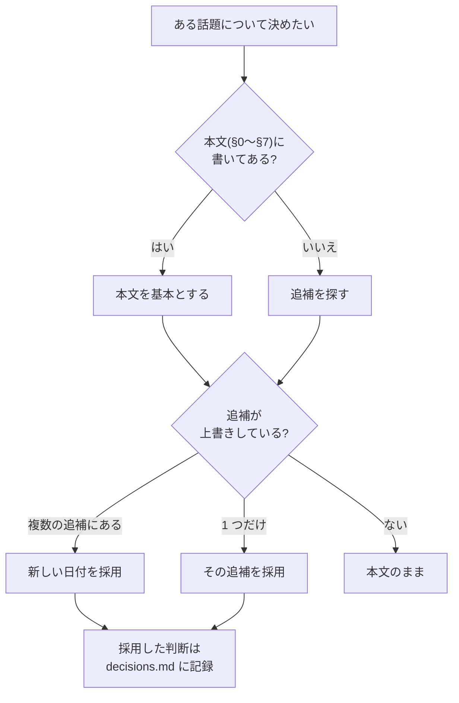

# 設計書の追補と、実装の対応表

設計書(`ProductionTracker_DESIGN.md`)は、本文の下に**日付順の追補**が積み重なっています(2026-11-04 整理で、追補の索引が付きました)。
この文書は、**追補ごとに「このリポジトリで何をしたか」**を 1 か所にまとめたものです。設計書そのものはこのリポジトリに入れていないので、ここが実装側の対応表になります。

## 読み方の規則(設計書の規則と、このリポジトリでの適用)
設計書の索引は、次のように定めています。

> 基本の設計は、索引より上の本文。**同じ話題が複数の追補にあるときは、新しい日付を優先**する。

### 追補どうしが食い違った(または本文を上書きした)箇所と、採った判断
| 話題 | 古い記述 | 新しい記述 | このリポジトリの判断 |
|---|---|---|---|
| Cloudflare Containers | 追補 1(2026-10-11): Phase 10 として半日の検証(スパイク)を行う | 追補 6(2026-10-25): **推奨しない**(ディスクが一時的で Postgres を中に置けない)。方式 A を継続 | **新しい方を採用。Phase 10 は実施しない**([decisions.md](decisions.md)) |
| 認証 | 本文 §2: Django のセッション認証 | 追補 8(2026-10-30): 認証は **Cloudflare Access(OIDC)** | 上書きでなく**追加**: セッション認証を基本に、Access の JWT 検証を**任意の認証クラス**として足した(既定は無効)([auth.md](auth.md)) |
| ASCII モチーフの状態 | 追補 7(2026-10-27): 提案/未実装、出す場所は「UI を作る段階で決める」 | 同じ追補の追記(2026-10-30): 上流の動作は確認済み(型検査・ビルド成功、60fps) | 設計書の表記は「提案/未実装」のまま。**このリポジトリでは実装した**(空の列だけに出す。上流のコードは使わず自前)([decisions.md](decisions.md)) |
| 外部資料の使い方 | 追補 5(2026-10-23): スキルは点検・補助に使う。**最初は自分で書く** | — | そのとおり。自分で書き、追補 4 の点検(OWASP 風の監査)は自動テストにした |

## 追補ごとの対応表
状態の記号は、このリポジトリの文書で共通です。

| 記号 | 意味 |
|---|---|
| ✅ | 実装し、テストか実行で確かめた |
| ⚠️ | 実装したが、実環境では未検証 |
| 🔶 | 一部だけ実装した |
| ❌ | 実装していない(対象外・需要待ち) |

| # | 追補 | 日付 | 設計書の状態 | このリポジトリ | 実装・根拠 |
|---|---|---|---|---|---|
| 1 | 裏取りの結果と、実務で運用するための拡張(Phase 7〜10) | 2026-10-11 | — | 🔶 | Phase 7(運用整備)✅: [operations.md](operations.md)、`scripts/backup.sh`・`restore.sh`。Phase 8 は **API 側のみ** ✅(`Idempotency-Key`。[integration.md](integration.md))、パネル本体 ❌。Phase 9(3D ビューア)❌。Phase 10 は追補 6 で見送り ❌ |
| 2 | カンバンボードの UI・モーション | 2026-10-11 | — | ✅ | `frontend/src/components/Board.tsx`(ドラッグの傾き・影・列の強調、キーボード代替、トースト、確認モーダル、スケルトン、空状態)。[ui-rules.md](ui-rules.md)、[講義 L13](lectures/L13-kanban.md) |
| 3 | TakayuStudio 系リファレンス(T1・T2・T6・T7・T13) | 2026-10-15 | — | 🔶 | **T13(絞り込み・並べ替え・件数・リセット・空状態)✅**: かんばん・概要・自分のタスク・プロジェクト一覧。T7 の URL 共有は、開いているタスク(`?task=`)だけ 🔶(絞り込みの状態は URL に載せていない)。**T1(版の比較)・T2(定型項目)・T6(`j`/`k`)・ウォッチ ❌** |
| 4 | 外部リソース(X8 形式検証・X2 セキュリティ点検) | 2026-10-22 | — | ✅ | X2: [security.md](security.md)(OWASP API Top 10 風の点検)と `test_security_audit.py`。X8: TLA+ は使わず、設計書が「足りる」とした **全遷移の表のテスト**(`test_task_transitions.py`)と、講義の小さなモデル検査([L06](lectures/L06-state-machine.md)) |
| 5 | 外部リソース 第2弾(skills.sh) | 2026-10-23 | — | ❌ | スキルは導入していない(設計書も「最初は自分で書く」)。点検は 4・8 の自動テストで行った |
| 6 | Cloudflare 活用(C9) | 2026-10-25 | — | ⚠️ | 方式 A(compose + Tunnel + Access)。設定と手順は [operations.md](operations.md)。**Tunnel / Access の実環境は未検証** |
| 7 | ASCII モチーフ | 2026-10-27 | 提案/未実装 | ✅ | 植物の成長(種→芽→花→実)を空の列に。`domain/motif.ts`・`components/AsciiPlant.tsx`、静止画は `prefers-reduced-motion`。[ui-rules.md](ui-rules.md)。元資料 `ASCII_MOTIF_MAP` は**リポジトリに無く未確認** |
| 8 | 第4弾の外部資料(Z32 Web API / SQL) | 2026-10-30 | 提案/未実装 | ✅ / ⚠️ | Web API: [security.md](security.md)・[auth.md](auth.md)(401/403/404 の使い分け、最小権限、レート制限)。Cloudflare Access の JWT 検証は **手元の鍵でのテストのみ ⚠️**。SQL: [database.md](database.md)(索引・`ORDER BY`・実行計画) |

> **設計書側の表記について**: 追補 7・8 は設計書で「提案/未実装」のままですが、上の表のとおり実装しています。設計書の状態欄は、設計書の側で更新してください(このリポジトリからは設計書を変更しません)。

## 使いやすさの提案(`USABILITY_ADVICE_2026-11-04.md`・追補の索引の外の別文書)
全プロジェクト共通の提案(UX1〜UX7)です。ProductionTracker は、その文書で「設計だけのもの」に入っており、「実装を始めるときに UX1・UX2・UX4 を最初の部品として入れる」とされています。**元の文書は「提案/未実装」で、アプリを実際に操作して書かれたものではない**(語句の数え上げ)と断られています。次の表は、このリポジトリでの扱いです。

| # | 提案 | このリポジトリ | 実装・根拠 / 見送った理由 |
|---|---|---|---|
| UX1 | 取り消し(Undo)と履歴 | 🔶 | **取り消し**: 状態変更の成功トーストに「元に戻す」(`useTaskTransition.tsx`)。ただし**遷移表が戻り道を許す移動だけ**(未着手→進行中・レビュー→完了・完了→進行中は出さない。ルールを画面に持たないため)。**履歴**(いつ・誰が・何から何へ)❌: 記録用の表・マイグレーション・API・画面が要る。需要が出てから判断する |
| UX2 | 長い処理の進捗・取り消し・完了通知 | ❌ | 長く待つ処理が無い(取り込みは秒単位のスクリプト)。対象外 |
| UX3 | 状態を URL にする | 🔶 | かんばんの絞り込み(担当・優先度・期限切れ・検索)を URL に(`useBoardFilters.ts`)。開いているタスク(`?task=`)は既存。概要の「タスク」タブの絞り込みは URL にしていない |
| UX4 | エラーの書き方の型(何が / なぜ / 次に) | ✅ | `domain/errorGuide.ts`。エラー表示(`ErrorNotice`)と、状態変更・ノート・版のトーストに適用。5xx では内部の文を画面に出さない |
| UX5 | 続きから再開 | ❌ | 学習系・長い処理に当たる機能が無い。対象外 |
| UX6 | 空状態に「次の一手」を 1 つ | ✅ | `EmptyState` の `hint`(ボタンを置けない所の説明)と `actionLabel`。かんばんの空の列・ノート・品質/画面差分・自分のタスク・概要のタスクとアセット |
| UX7 | キー操作とコマンドパレット | 🔶 | 既存: カードの Enter / `Shift + ←→`。コマンドパレットと `j`/`k` は、追補 3 の T6 と同じく ❌(需要が出てから) |

実装の判断は [decisions.md](decisions.md)、画面の決めごとは [ui-rules.md](ui-rules.md)。

## 設計書が参照している文書(このリポジトリには無い)
設計書の索引は、次の文書を指しています。**このリポジトリには含まれていません**。`USABILITY_ADVICE` は受け取って確認しましたが、他は**中身を確認していません**。

| 文書 | 設計書での役割 | このリポジトリでの扱い |
|---|---|---|
| `IMPLEMENTATION_PROGRESS_2026-10-27.md` | 追補ごとの進み具合 | 上の対応表が代わりを務める |
| `DOCS_INDEX_2026-11-04.md` | 文書全体の地図・ID の一覧・状態の語彙 | 状態の語彙は上の 4 記号に揃えた。**元の語彙とは一致しない可能性がある** |
| `USABILITY_ADVICE_2026-11-04.md` | 使いやすさの提案 | **受け取って確認した**。上の「使いやすさの提案」の表のとおり扱った |
| `EXTERNAL_RESOURCES_*.md`・`REFERENCE_TAKAYUSTUDIO_2026-10.md`・`CLOUDFLARE_MIGRATION_PLAN_2026-10-25.md`・`ASCII_MOTIF_MAP_2026-10-27.md` | 追補の元資料 | 設計書の要約だけを根拠にした。元資料と食い違うなら、該当する文書・コードを直す |

## 新しい追補が来たときの手順
1. 追補の日付と話題を、上の「追補ごとの対応表」に 1 行足す(設計書の状態欄は**そのまま**写す)。
2. 既存の話題と重なるなら、**新しい日付を優先**し、「食い違った箇所」の表に判断を書く。
3. 採用・見送りの**理由**を [decisions.md](decisions.md) に書く。
4. 実装したら、テストと、関係する文書(図も)を更新する。実環境でしか確かめられない部分は ⚠️ のまま残す。
5. [README](../README.md) の「検証チェックリスト」と「未実装・未確認」を見直す。
6. `pytest tracker/tests/test_docs.py` と `python docs/tools/build_html.py` を実行する。
