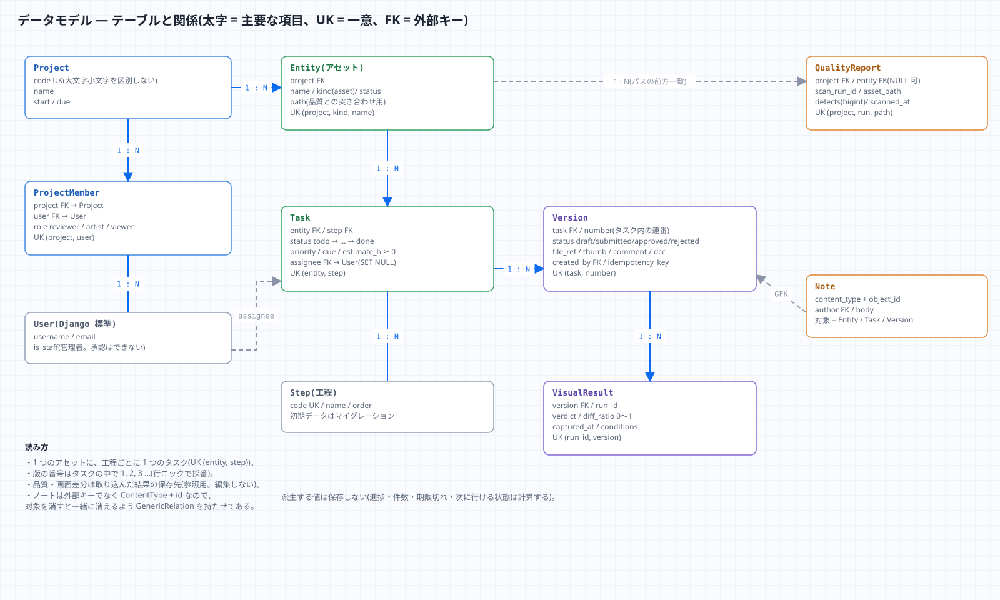
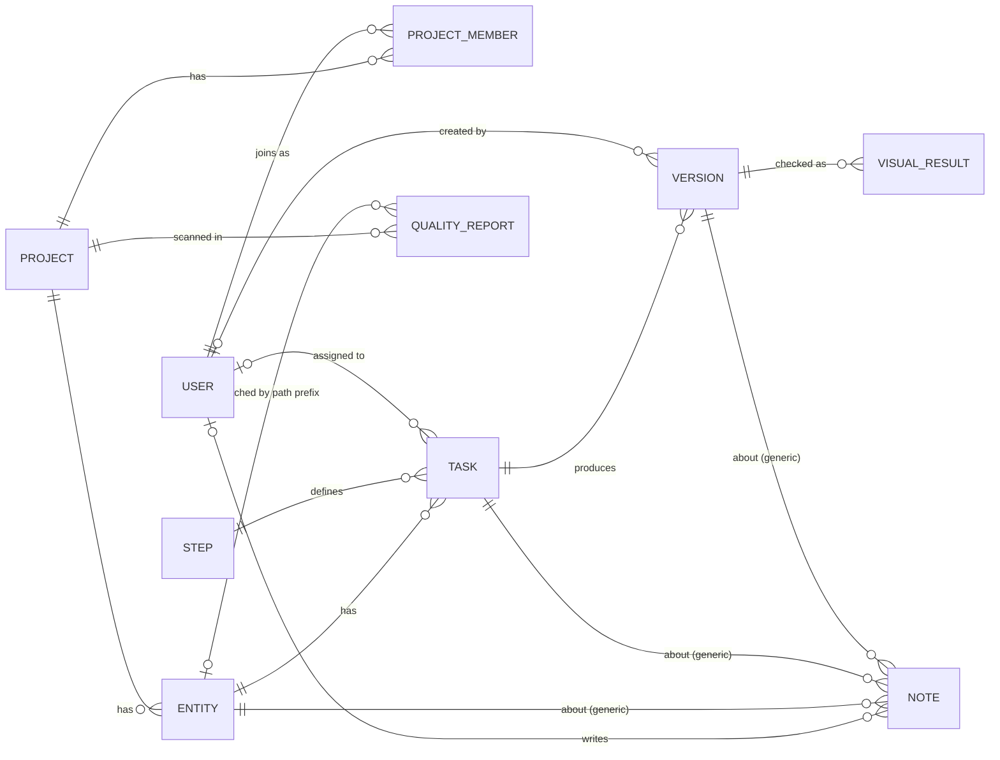
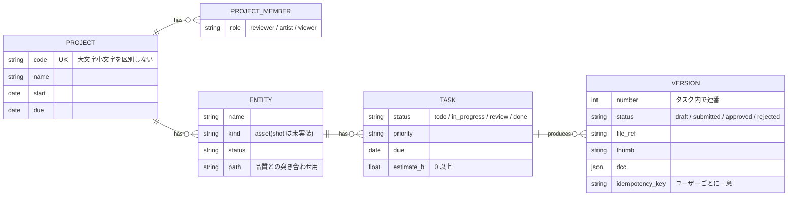
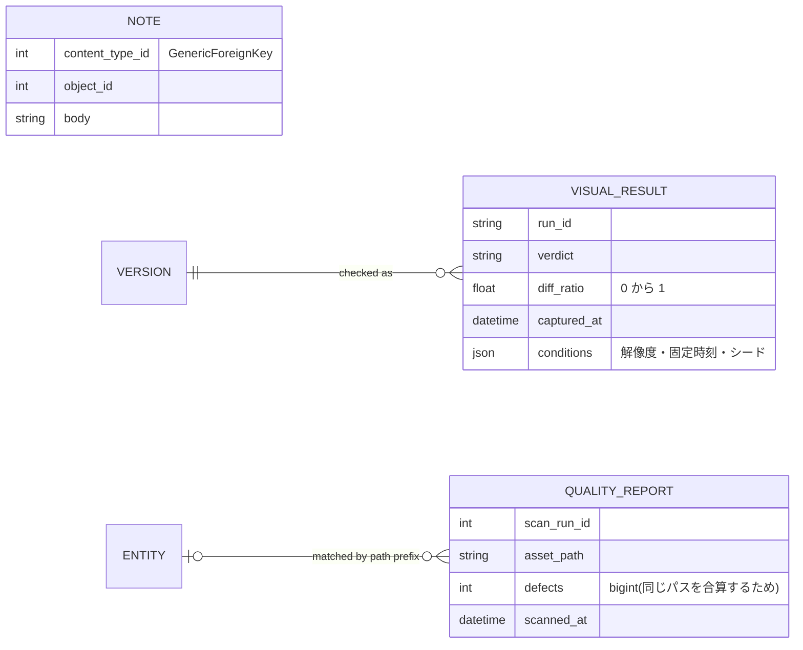
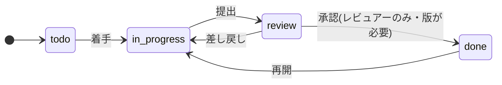
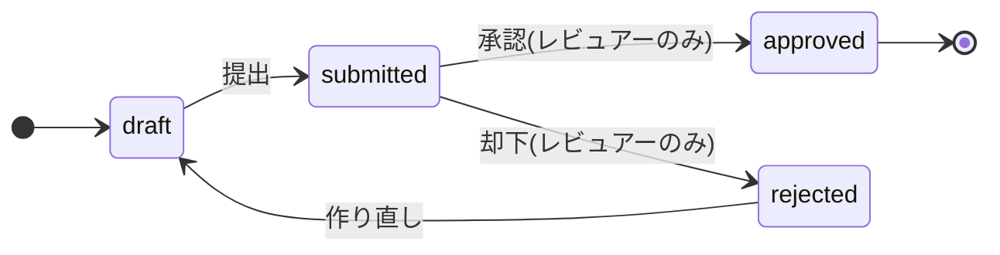

# ER 図(実装済みモデル)

設計書 §1.2 を、実装したモデル(`backend/tracker/models.py`)に合わせて確定したもの。

## 関係(全体)
属性を省いて、関係だけを描いた図(読みやすさのため)。属性は次の節。

読み方: `||--o{` は「1 対 多」、`|o--o{` は「0 または 1 対 多」(担当者なし・作成者なし・アセットに対応しないスキャン行がありうる)。

## 属性(主要なもの)

## 状態(どこからどこへ行けるか)
遷移表は `Task.TRANSITIONS` / `Version.TRANSITIONS`(`backend/tracker/models.py`)。

## 一意制約(重複を DB で防ぐもの)
| 対象 | 制約 |
|---|---|
| Project | `code`(**大文字小文字を区別しない**: `demo` と `DEMO` は同じ。API は 400 を返す) |
| ProjectMember | `(project, user)` |
| Entity | `(project, kind, name)` |
| Task | `(entity, step)` — 1 アセットに同じ工程は 1 つ |
| Version | `(task, number)`、`(created_by, idempotency_key)`(鍵があるとき) |
| QualityReport | `(project, scan_run_id, asset_path)`(同じ実行は「全て置き換え」で冪等) |
| VisualResult | `(run_id, version)` |

## DB の CHECK 制約(API の検証をすり抜けても DB が守るもの)
| 対象 | 制約 |
|---|---|
| Task | `estimate_h` は NULL か 0 以上 |
| VisualResult | `diff_ratio` は 0〜1 |

## 削除の連鎖
アセット → タスク → 版 の順に消える。**ノートは対象と一緒に消える**(`GenericRelation`。孤児を残さない)。
プロジェクトを消すと、アセット・メンバー・品質レポートも消える。ユーザーを消しても、版・ノートは作成者が空(NULL)になるだけで残る。

## 設計書との差分
- `QUALITY_REPORT` は設計書の `ENTITY` 単位ではなく、**アセットパス単位**の行にした。アセットに対応しない行(`entity` = NULL)も残し、元の `insight.db` と欠陥件数が一致することを確認できるようにするため。
- ノートの対象(3 本の線)は `ContentType` + `object_id` の 1 つの関連(Entity / Task / Version のみ。他は API が 400)。
- `Step`(工程)の初期データはマイグレーション `0002_default_steps` で投入(モデリング・テクスチャ・リグ・アニメーション・FX・ライティング)。
