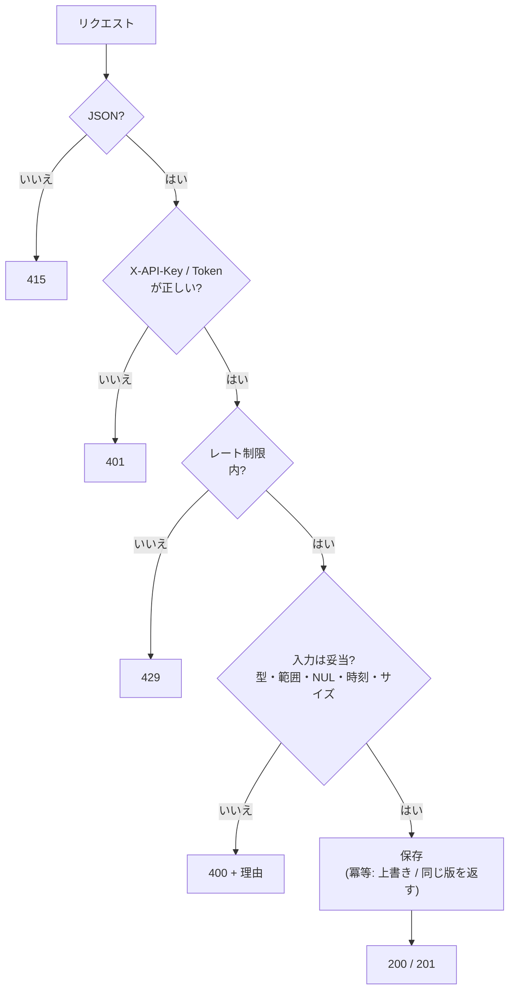
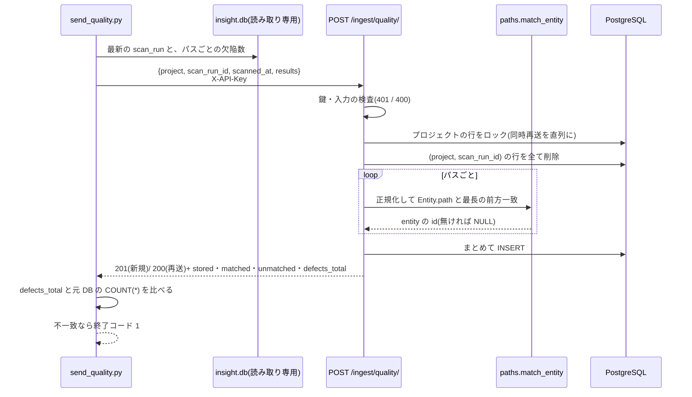
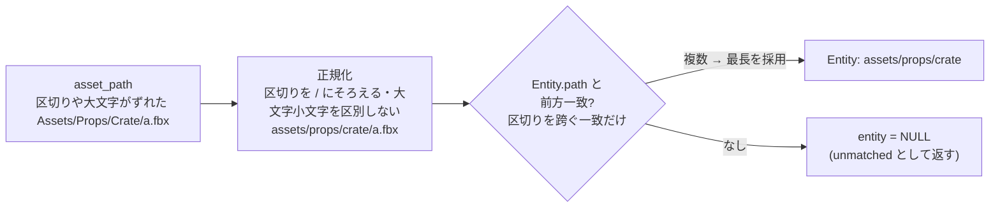
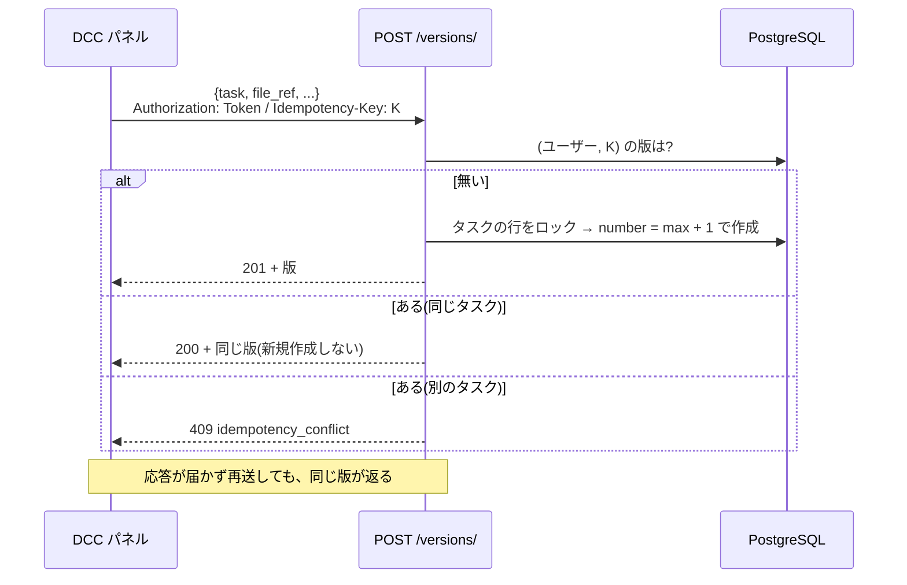

# 既存ツールとの連携

設計書 §4 と追補 Phase 8 の実装メモ。API の基点は `/api/v1`。エラーは全て `{"code": "...", "detail": "..."}`。

## 全ての連携に共通のルール
| 項目 | 内容 |
|---|---|
| 本文の形式 | **JSON だけ**(`Content-Type: application/json`)。フォーム・multipart は **415** |
| 認証 | 取り込み: `X-API-Key`(キーなし・不正は **401**。キーが 1 つも設定されていなければ常に 401)。Publish: ユーザー別トークン |
| 冪等性 | 同じものを再送しても重複しない(取り込み = 上書き、Publish = `Idempotency-Key`) |
| 時刻 | **タイムゾーン付き必須**(`+09:00` または `Z`)。無いと **400** |
| 文字列 | NUL 文字(`\x00`)は **400**(PostgreSQL が保存できないため)。数は bigint の範囲 |
| 大きさ | コメント 5000 字、`dcc` / `conditions` は JSON で 20000 字、取り込みの `results` は 50000 行まで |
| レート制限 | 取り込み全体で 120 回/分(**429** `throttled`)。Publish はユーザーごと 1200 回/分 |
| エラー形式 | `{"code": "...", "detail": "..."}`(検証エラーは `errors` も付く) |



## AssetDataInsightSuite → 品質(`POST /ingest/quality/`)



```
POST /api/v1/ingest/quality/
X-API-Key: <INGEST_API_KEYS のいずれか>
{
  "project": "DEMO",
  "scan_run_id": 42,
  "scanned_at": "2026-10-24T09:00:00+09:00",
  "results": [ {"asset_path": "assets/props/crate/crate.fbx", "defects": 3}, ... ]
}
→ 201(新規) / 200(同じ (project, scan_run_id) の再送 = 上書き)
{"created": true, "stored": 4, "matched": 3, "unmatched": ["assets/other/x.fbx"], "defects_total": 10, ...}
```
- **冪等**: `(project, scan_run_id)` の行を全て置き換える。再送しても重複しない。同じ実行の同時再送は、プロジェクトの行をロックして直列に処理する。
- **時刻はタイムゾーン付き必須**(`+09:00` または `Z`)。無いと 400。黙って補うと、取り込み元と時刻がずれても気づけないため。
- `asset_path` は正規化して空になるもの(`./` など)を 400 で拒否する。
- **アセットとの対応**: `Entity.path` との**前方一致**(最長一致)。区切りは `/` に揃え、大文字小文字は区別しない(Windows のドライブ文字のずれ対策)。`crate` と `crater` は別物(区切りを跨ぐ前方一致はしない)。
- 対応するアセットが無いパスも `entity = NULL` で保存し、`unmatched` で返す(元データと件数を一致させるため)。
- 送信スクリプト: [`scripts/send_quality.py`](../scripts/send_quality.py)

```bash
export INGEST_API_KEY=...           # コマンドラインに鍵を書かない
python scripts/send_quality.py --db path/to/insight.db --project DEMO           # 最新の実行
python scripts/send_quality.py --db path/to/insight.db --project DEMO --dry-run  # 送らずに件数だけ確認
# insight.db の時刻にタイムゾーンが無いとき(日本時間で記録されているなど)は、時差を明示する:
python scripts/send_quality.py --db path/to/insight.db --project DEMO --naive-offset +09:00
```
送信後、API が返した欠陥件数と `insight.db` の `COUNT(*)` を突き合わせ、**一致しなければ終了コード 1**。

> **未確認**: `insight.db` の実スキーマ(表名・列名・アセットパスの書式)は設計書にない。スクリプトは
> `scan_runs(id, scanned_at)` と `defect_records(scan_run_id, asset_path)`(1 欠陥 = 1 行)を仮定している。
> 違う場合は `--runs-table` `--path-column` などで合わせる。パスの基準ディレクトリが `Entity.path` と食い違う場合は、
> `unmatched` に出るので、`backend/tracker/paths.py` に対応表を足す(設計書 §7 の未確認事項)。

## VisualRegressionQATool → 画面差分(`POST /ingest/visual/`)
```
POST /api/v1/ingest/visual/
X-API-Key: ...
{
  "run_id": "run-001", "version": 12, "verdict": "pass" | "fail",
  "diff_ratio": 0.0132,                       // 0〜1 の割合(%ではない)
  "captured_at": "2026-10-11T10:00:00+09:00",      // タイムゾーン付き必須
  "conditions": {"resolution": "1920x1080", "fixed_time": "2026-01-01T00:00:00Z", "seed": 42}
}
→ 201(新規) / 200(同じ (run_id, version) の再送 = 上書き)
```
- 撮影条件も保存し、アセット詳細の「画面差分」タブに固定表示する。
- 送信スクリプト: [`scripts/send_visual.py`](../scripts/send_visual.py)(JSON ファイル → API)。

> **未確認**: VisualRegressionQATool の出力形式は設計書にない。上の形を取り込み側の契約として決めた(ツール側でこの形に出力するか、変換する)。



## ToolOrchestrationHub → 死活監視
`GET /healthz`(認証なし)。DB に `SELECT 1` が通れば `200 {"status":"ok","db":true}`、通らなければ `503 {"status":"error","db":false}`(例外の中身は返さない)。`/api/v1/healthz` でも同じ。

`registry.yaml` への登録例(**ToolOrchestrationHub の実際のスキーマは未確認**。項目名は合わせて読み替えること):

```yaml
- name: production-tracker
  kind: http_bridge
  base_url: http://localhost:8000      # compose の WEB_PORT。Hub 側の使用ポートと衝突しないか確認
  health: /healthz
```

## Publish API(DCC パネル向け、Phase 8 のうち API 側)
ネットワークの不調でパネルが再送しても、版が重複しない仕組み(`Idempotency-Key`)。


POST /api/v1/versions/
Authorization: Token <ユーザー別トークン>
Idempotency-Key: <ファイルのハッシュ + 版番号>
{"task": 123, "file_ref": "P:/project/fx/fluid_v012.hbjson", "thumbnail": "https://…/t.png",
 "comment": "粒子数 48,000", "dcc": {"app": "houdini", "version": "21.0.700", "scene": "fluid_v012.hip"},
 "status": "submitted"}
→ 201 {"id": ..., "number": 12, "status": "submitted", ...}   (同じ Idempotency-Key の再送 → 200 で同じ版)
```
- 鍵はユーザーごとに一意。同じ鍵が**別のタスク**に使われたら `409 idempotency_conflict`。
- 版番号はサーバーがタスク内で連番を付ける(タスク行をロックして同時登録を直列化)。
- 設計書の例にある `"status": "レビュー待ち"` は**タスクの状態名**で、版の状態(`作成中 / 提出済み / 承認 / 却下`)にはない。
  版の応答は版の状態(`submitted` など)にした。タスクを「レビュー待ち」にする操作は別(`POST /tasks/{id}/transition/`)。
- サムネイルは**登録済みの画像の URL/参照のみ**(base64 のアップロードは受けない。設計書の「変換・配信基盤は持たない」に従う)。
- **未実装**: Houdini パネル本体(DCCPanelKit 側)、ローカルキュー、確認ダイアログ。
