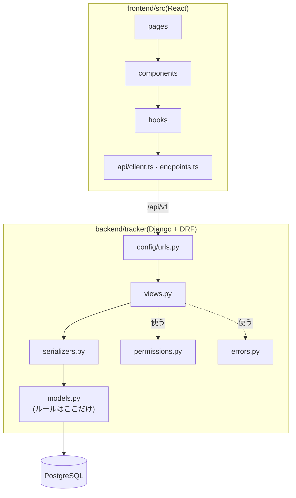
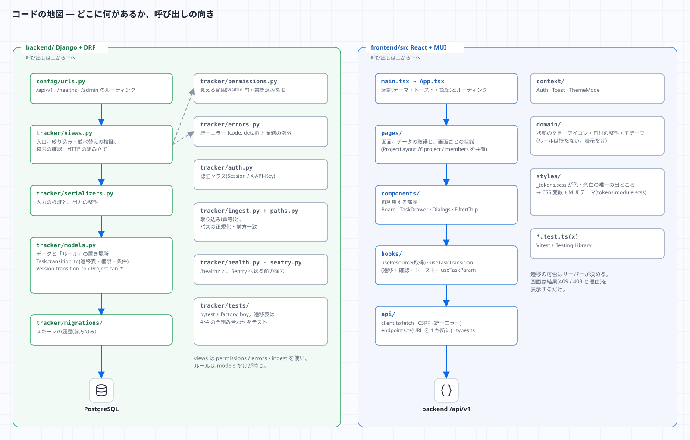

# 1. 全体像

## このシステムは何か
アセット(モデルなどの制作物)ごとに **工程(Step)のタスク** があり、タスクには **版(Version)** と **ノート** が付く、制作進行の管理ボード。
ShotGrid(Flow Production Tracking)の「何を管理する道具か」を、自分で作って理解するための学習用プロジェクトでもある。

## 用語
| このアプリ | ShotGrid での呼び方 | 意味・メモ |
|---|---|---|
| `Project` | Project | 作品・案件。`code`(URL に使う。大文字小文字を区別しない)と `name` |
| `ProjectMember.role` | (権限グループ) | `reviewer`(承認できる)/ `artist`(編集できる)/ `viewer`(見るだけ) |
| `Step` | Pipeline Step | 工程(モデリング・リグ・FX …)。マイグレーションで初期データを入れる |
| `Entity` | Asset / Shot | 今は `asset` のみ。`path` は品質スキャンとの突き合わせ用 |
| `Task` | Task | **アセット × 工程** で 1 つ(一意)。担当者・期日・優先度・状態を持つ |
| `Version` | Version | タスクの成果物の版。`file_ref`(場所)・サムネイル・DCC 情報。番号はタスク内で連番 |
| `Note` | Note | コメント。対象は entity / task / version の 3 種だけ |
| `QualityReport` | (自作) | AssetDataInsightSuite の結果。パスごとの欠陥数 |
| `VisualResult` | (自作) | VisualRegressionQATool の結果。合否・差分率・撮影条件 |

## 5 つの原則(コードはこれに従っている)
1. **ルールは 1 か所**。状態遷移と権限は `backend/tracker/models.py`(`Task.transition_to` など)だけが持つ。
2. **画面はルールを持たない**。画面は「サーバーに頼み、結果(成功 / 409 / 403 と理由)を表示する」だけ。次に行ける状態は `next_statuses` でサーバーから受け取る。
3. **見える範囲を最初に絞る**。`backend/tracker/permissions.py` の `visible_*` が、利用者が見られるものだけの QuerySet を返す。見えないものは「存在しない」(404 / 400)として扱う。
4. **取り込みは冪等**。同じものを再送しても重複しない(`scan_run_id` / `run_id` / `Idempotency-Key`)。
5. **状態は「色 + アイコン + 文字」**。色だけで区別しない(色覚・グレースケール・ダークでも読める)。

## 1 本の操作の旅
かんばんで列を動かしたときの流れ(9 手順)。各手順を **コードのどこが担当するか** は [02](02-backend.md)・[03](03-frontend.md) で追う。

## コードの地図

## 「〜したい」→ どこを開くか
| したいこと | 開く場所 |
|---|---|
| 状態遷移のルールを知りたい / 変えたい | `backend/tracker/models.py` の `Task.TRANSITIONS` と `transition_to`。テストは `tests/test_task_transitions.py` |
| 誰が何をできるか | `Project.can_write_as` / `can_review_as`、`permissions.py` |
| API のエンドポイント一覧 | `backend/config/urls.py`(ルーター)と、各 `ViewSet` |
| エラーの形・コード | `backend/tracker/errors.py` |
| 取り込み(品質・画面差分) | `backend/tracker/ingest.py`、`paths.py`、`views_ingest.py`、`scripts/send_*.py` |
| 画面の部品・かんばん | `frontend/src/components/`(`Board.tsx`、`TaskDrawer.tsx`) |
| 画面ごとの処理 | `frontend/src/pages/` |
| 色・余白・テーマ | `frontend/src/styles/_tokens.scss`(唯一の出どころ) |
| API の呼び出し | `frontend/src/api/endpoints.ts`(URL は全てここ) |
| 設定(環境変数) | `backend/config/settings.py`、`.env.example` |
| 運用(バックアップ・公開) | [docs/operations.md](../operations.md)、`scripts/` |

## 確認
- [ ] `Task` と `Entity` と `Step` の関係を、口で説明できる(「アセット × 工程で 1 タスク」)。
- [ ] 5 つの原則のうち、「画面はルールを持たない」の例を、コードから 1 つ見つける(ヒント: `frontend/src/domain/status.tsx` に遷移表が **無い** こと)。
- [ ] 図の矢印のうち、`X-API-Key` を使うものと、セッションを使うものを区別できる。
