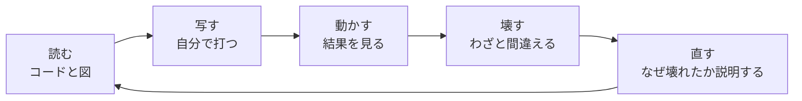
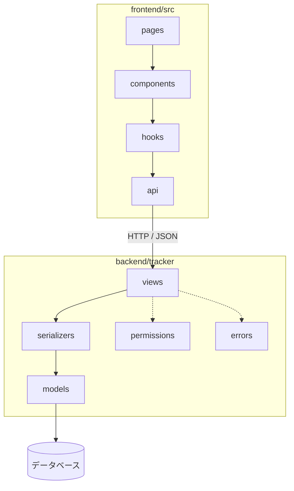

# L00 はじめに ― 進め方・環境づくり・リポジトリの歩き方

**この回の目標**
- 講義の進め方(読む → 写す → 動かす → 壊す → 直す)を知る
- 手元で、アプリとテストを動かせる環境をつくる
- リポジトリのどこに何があるか、地図を頭に入れる

前提: なし(パソコンの基本操作と、ターミナルで文字を打てること)。

---

## 1. なぜ「1 つの実物のアプリ」で学ぶのか
教科書の例は、短くてきれいです。でも、実際の仕事のコードは、**たくさんの部品が絡み合って**います。
「画面でカードを動かすと、サーバーが遷移ルールを調べ、DB を更新し、結果が画面に戻る」という 1 つの操作の中に、
Web・データベース・アルゴリズム・セキュリティ・UI が全部出てきます。

この講義は、ProductionTracker(制作進行管理アプリ)という**動く実物**を、**部品ごとに分解して**学びます。
最後に部品を組み直して、自分で機能を足せるようになるのがゴールです。



**コツは「壊す」こと。** 動くコードを読んだだけでは、本当には分かりません。数字を変える・行を消す・わざと不正な入力を渡す。
「なぜこうなる?」と説明できたとき、理解したと言えます。

## 2. アプリの全体像
ProductionTracker は、**アセット(モデルなどの制作物)ごとに工程のタスクがあり、タスクには版とノートが付く**管理ボードです。


| 部品 | 技術 | この講義で学ぶ回 |
|---|---|---|
| 画面 | React + TypeScript + MUI + Sass | L10〜L13 |
| API | Django + Django REST framework(DRF) | L04〜L05 |
| データベース | PostgreSQL(テストは SQLite) | L03 |
| 状態遷移・並行制御・認証 | アルゴリズム | L06〜L09 |
| テスト | pytest / Vitest | L14 |
| 運用 | Docker / Cloudflare / Sentry | L15〜L16 |

## 3. 環境をつくる
必要なもの: **Python 3.13**、**Node.js 22**、Git。(Docker は、あれば L16 で使う。なくても進められる。)

```bash
# ① ソースを取る
git clone <このリポジトリの URL>
cd ProductionTracker

# ② バックエンド(Python)
cd backend
python -m venv .venv                 # 「仮想環境」: このプロジェクト専用の Python の置き場
. .venv/bin/activate                 # Windows は .venv\Scripts\activate
pip install -r requirements-dev.txt
export DJANGO_DEBUG=1                # 開発モード(本番では 0)
python manage.py migrate             # DB の表を作る(SQLite の db.sqlite3 ができる)
python manage.py seed_demo --password demo-pass-123   # デモデータ
python manage.py runserver           # http://localhost:8000

# ③ フロントエンド(別のターミナルで)
cd frontend
npm ci
npm run dev                          # http://localhost:5173

# ④ テスト
cd backend && pytest -q              # 約 4 秒
cd frontend && npm test
```

ブラウザで <http://localhost:5173> を開き、`demo_reviewer` / `demo-pass-123` でログインします。

> 仮想環境(`.venv`)を使うのは、プロジェクトごとにライブラリの版が違っても衝突しないようにするためです。
> 「`pip install` したのに動かない」の多くは、仮想環境を有効にし忘れています(プロンプトの先頭に `(.venv)` が出ているか確認)。

まず、Python が使えることを確かめましょう。

<!-- test -->
```python
import sys

assert sys.version_info >= (3, 10), "Python 3.10 以上が必要です"
print("Python 3.10 以上 OK")
```

<!-- output -->
```text
Python 3.10 以上 OK
```

## 4. リポジトリの地図
```text
ProductionTracker/
├── backend/            Django(API とデータ)
│   ├── config/         設定・URL(アプリ全体の配線)
│   └── tracker/        アプリ本体
│       ├── models.py       データとルール  ← いちばん大事
│       ├── views.py        API の入口
│       ├── serializers.py  入力の検証・出力の整形
│       ├── permissions.py  「誰に何が見えるか」
│       ├── errors.py       エラーの形
│       ├── ingest.py       外部ツールの結果の取り込み
│       ├── paths.py        パスの正規化・突き合わせ
│       ├── cf_access.py    Cloudflare Access の認証
│       └── tests/          テスト(仕様書でもある)
├── frontend/           React(画面)
│   └── src/
│       ├── pages/          画面
│       ├── components/     部品
│       ├── hooks/          再利用する処理
│       ├── api/            サーバーとの通信
│       ├── domain/         表示用の表(状態の文言など)
│       └── styles/         デザイントークン(Sass)
├── scripts/            取り込み・バックアップのスクリプト
├── docs/               文書(この講義を含む)
└── docker-compose.yml  一括起動
```



**呼び出しは上から下へ**。下の層は、上の層を知らない(`models.py` は、HTTP も画面も知らない)。この向きが、変更に強い構造の基本です。

## 5. 表記の約束
- `等幅` は、ファイル名・関数名・コマンド・コード。
- 「**このアプリでは**」は、ProductionTracker の実際の設計。
- コードブロックの前の `<!-- test -->` は「実行して確かめてある」、`<!-- excerpt: パス -->` は「そのファイルからの抜粋」の印([README](README.md)参照)。
- 確認問題の答えは、**まず自分で考えてから**見ること。

## よくある間違い
| 症状 | 原因 |
|---|---|
| `command not found: python` | Python が入っていない / `python3` と打つ必要がある |
| `ModuleNotFoundError: No module named 'django'` | 仮想環境を有効にしていない(`. .venv/bin/activate`)、または `pip install` していない |
| `RuntimeError: DJANGO_SECRET_KEY が未設定です` | `DJANGO_DEBUG=1` を付けていない(開発のとき) |
| 画面は出るがデータが無い | `seed_demo` を実行していない |
| ブラウザで API が `401` | ログインしていない(正常な動作) |

## 確認問題
1. 仮想環境を使う理由を、一言で説明せよ。
2. `models.py` が「HTTP も画面も知らない」ことには、どんな利点があるか。
3. 「壊す」とは、具体的にどんなことか。例を 2 つ挙げよ。

## 答え
1. プロジェクトごとにライブラリの版が違っても、互いに影響しないようにするため(専用の置き場を持つ)。
2. 画面や API を作り変えても、ルール(モデル)を変えずに済む。テストも、HTTP を使わずに、ルールだけを直接試せる。
3. 例: 遷移表から 1 行消してテストが落ちるのを見る / 不正な値(`"abc"`)を API に送って 400 になるのを見る / `DJANGO_DEBUG` を外して起動しないことを確かめる。

## 次へ
[L01 Web の仕組み](L01-web.md) ― 画面とサーバーが話す言葉(HTTP)を、手で打って確かめます。
