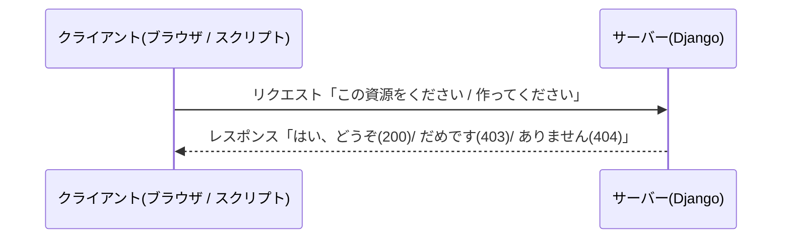
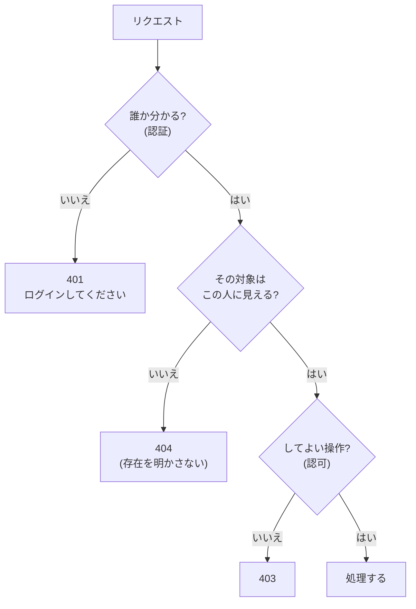
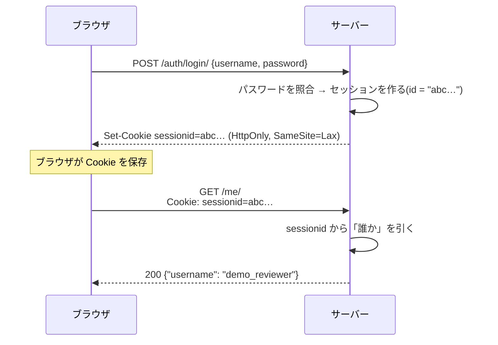
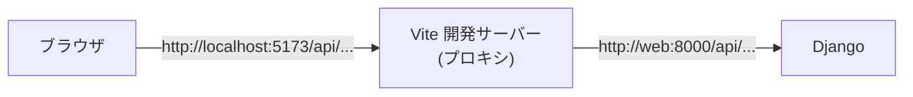

# L01 Web の仕組み ― HTTP・URL・ステータスコード・JSON・Cookie

**この回の目標**
- ブラウザとサーバーが話す言葉(**HTTP**)の形を、自分の手で作れる
- ステータスコードの意味を、**このアプリの設計の理由**とともに説明できる
- JSON・Cookie・セッションが何をしているか分かる
- REST の考え方で、このアプリの API の表を読める

前提: [L00](L00-intro.md)。

---

## 1. クライアントとサーバー
Web は「**頼む側(クライアント)**」と「**答える側(サーバー)**」のやりとりです。



このアプリでは、クライアントが**2 種類**あります。

| クライアント | 何をする | 認証の方法 |
|---|---|---|
| 画面(ブラウザの React) | 人が操作する | ログイン(セッション) |
| 取り込みスクリプト | 機械が結果を送る | `X-API-Key` ヘッダ |

どちらも**同じ言葉(HTTP)**で、同じサーバーに話しかけます。

## 2. URL の構造
```text
https://app.example.com:8000/api/v1/tasks/?status=review&page=2#top
└─┬─┘   └──────┬──────┘└─┬─┘└────────┬────┘└────────┬────────┘└┬┘
スキーム    ホスト   ポート       パス             クエリ     フラグメント
```

| 部分 | 役割 | このアプリの例 |
|---|---|---|
| スキーム | 通信の方式(`https` は暗号化) | `https` |
| ホスト + ポート | どのサーバーか | `localhost:8000` |
| パス | どの資源か | `/api/v1/tasks/12/` |
| クエリ | 絞り込み・並べ替え | `?status=review&page=2` |
| フラグメント | ページ内の位置(**サーバーには送られない**) | `#top` |

<!-- test -->
```python
from urllib.parse import parse_qs, urlsplit

url = "https://app.example.com:8000/api/v1/tasks/?status=review&status=done&page=2#top"
parts = urlsplit(url)
print(parts.scheme, parts.hostname, parts.port)
print(parts.path)
print(parse_qs(parts.query))
print(repr(parts.fragment))
```

<!-- output -->
```text
https app.example.com 8000
/api/v1/tasks/
{'status': ['review', 'done'], 'page': ['2']}
'top'
```

クエリは「キー=値」を `&` でつなぎます。同じキーを繰り返せば、複数の値になります(`status=review&status=done`)。
このアプリは、カンマ区切り(`?status=todo,in_progress`)で複数を受け取る API もあります。**どちらの流儀かは、API ごとに決めて文書にする**ことが大切です。

**日本語や記号は「パーセントエンコード」で送ります**(`日本` → `%E6%97%A5%E6%9C%AC`)。ブラウザや `urllib` が自動でやってくれますが、`%00`(NUL 文字)のような**危険な値も送れてしまう**ので、サーバーは入口で検査します(後の回で出てきます)。

## 3. HTTP メッセージの形
HTTP は**ただの文字列**です。リクエストは 3 つの部分でできています。

```text
POST /api/v1/tasks/12/transition/ HTTP/1.1      ← 1 行目: メソッド・パス・版
Host: localhost:8000                            ← ヘッダ(「キー: 値」の行が並ぶ)
Content-Type: application/json
X-CSRFToken: abc123
                                                ← 空行(ここから本文)
{"to": "review"}                                ← 本文(ボディ)
```

レスポンスも同じ形で、1 行目が「ステータス」になります。

```text
HTTP/1.1 409 Conflict
Content-Type: application/json

{"code": "invalid_transition", "detail": "「未着手」から「完了」へは移行できません。"}
```

文字列だと分かれば、**自分でも作れて、読めます**。小さなパーサを書いてみましょう。

<!-- test -->
```python
def parse_request(text: str) -> dict:
    """HTTP リクエストの文字列を、メソッド・パス・ヘッダ・本文に分ける。"""
    head, _, body = text.partition("\r\n\r\n")      # 空行(CRLF 2 つ)で、ヘッダと本文に分かれる
    request_line, *header_lines = head.split("\r\n")
    method, path, version = request_line.split(" ")
    headers = {}
    for line in header_lines:
        name, _, value = line.partition(":")
        headers[name.strip().lower()] = value.strip()  # ヘッダ名は大文字小文字を区別しない
    return {"method": method, "path": path, "headers": headers, "body": body}


raw = (
    "POST /api/v1/tasks/12/transition/ HTTP/1.1\r\n"
    "Host: localhost:8000\r\n"
    "Content-Type: application/json\r\n"
    "X-CSRFToken: abc123\r\n"
    "\r\n"
    '{"to": "review"}'
)
req = parse_request(raw)
print(req["method"], req["path"])
print(req["headers"]["content-type"])
print(req["body"])
```

<!-- output -->
```text
POST /api/v1/tasks/12/transition/
application/json
{"to": "review"}
```

> 改行は `\r\n`(CRLF)と決まっています。ヘッダ名の大文字小文字を区別しないのも、仕様です(`Content-Type` も `content-type` も同じ)。

## 4. メソッド(動詞)
「何をしたいか」を表します。**安全**(サーバーの状態を変えない)と**冪等**(何度やっても結果が同じ)の性質が大事です。

| メソッド | 意味 | 安全 | 冪等 | このアプリの例 |
|---|---|---|---|---|
| `GET` | 取得 | ○ | ○ | `GET /tasks/` 一覧 |
| `POST` | 作成・実行 | × | ×(そのままでは) | `POST /tasks/` 作成、`POST /tasks/12/transition/` 遷移 |
| `PATCH` | 一部を更新 | × | ○(ふつう) | `PATCH /tasks/12/` 期日の変更 |
| `PUT` | 全体を置き換え | × | ○ | (使っていない) |
| `DELETE` | 削除 | × | ○ | (API には無い) |

**`POST` は何度も送ると、何度も作られます。** ネットワークが不安定で応答が届かず、クライアントが再送したら?
版(Version)が 2 つできてしまいます。これを防ぐのが `Idempotency-Key` で、[L08](L08-concurrency.md) で作ります。

## 5. ステータスコード
レスポンスの 1 行目の数字は、**結果の種類**を表します。百の位で大きく分かれます。

| 範囲 | 意味 |
|---|---|
| 2xx | 成功 |
| 3xx | 別の場所へ(リダイレクト) |
| 4xx | **クライアントが悪い**(送った内容・権限・状態に問題) |
| 5xx | **サーバーが悪い**(想定外の失敗) |

このアプリで使うコードと、**それぞれを選ぶ理由**です。

| コード | 名前 | このアプリで返す場面 |
|---|---|---|
| 200 | OK | 取得・更新・再送(上書き)に成功 |
| 201 | Created | 新しく作った |
| 400 | Bad Request | 入力が不正(型・範囲・NUL 文字・時刻のタイムゾーン無し) |
| 401 | Unauthorized | **誰か分からない**(ログインしていない・キーが違う) |
| 403 | Forbidden | **誰かは分かるが、してはいけない**(閲覧者が書く) |
| 404 | Not Found | 無い。**または、見えないはずのもの**(存在を明かさない) |
| 409 | Conflict | 今の状態と衝突(表にない遷移・版が無いのに完了) |
| 415 | Unsupported Media Type | JSON 以外で送った |
| 429 | Too Many Requests | レート制限を超えた |
| 500 | Internal Server Error | 想定外の失敗(バグ。ログと Sentry に出る) |

<!-- test -->
```python
from http import HTTPStatus

for code in (200, 201, 400, 401, 403, 404, 409, 415, 429, 500):
    print(code, HTTPStatus(code).phrase)
```

<!-- output -->
```text
200 OK
201 Created
400 Bad Request
401 Unauthorized
403 Forbidden
404 Not Found
409 Conflict
415 Unsupported Media Type
429 Too Many Requests
500 Internal Server Error
```

### 401 と 403 と 404 の使い分け
初心者がいちばん迷うところです。



**なぜ「見えないもの」を 403 でなく 404 にするのか。** 403 を返すと、「その ID のものは**存在する**(でもあなたには見せない)」と教えてしまいます。
他のプロジェクトのタスク ID を総当たりで試せば、存在する ID が分かってしまう。404 なら、「無い」のか「見えない」のか区別がつきません。

## 6. JSON
API の本文は **JSON**(JavaScript Object Notation)で送ります。文字列で表現されたデータ構造です。

| JSON | Python | 例 |
|---|---|---|
| オブジェクト | `dict` | `{"to": "review"}` |
| 配列 | `list` | `[1, 2, 3]` |
| 文字列 | `str` | `"進行中"` |
| 数 | `int` / `float` | `12`, `0.5` |
| 真偽 | `bool` | `true` / `false`(小文字) |
| なし | `None` | `null` |

<!-- test -->
```python
import json

task = {"id": 12, "status": "review", "due": None, "overdue": False, "name": "リグ"}
text = json.dumps(task, ensure_ascii=False)       # Python → JSON の文字列
print(text)
back = json.loads(text)                            # JSON の文字列 → Python
print(back["due"] is None, back["overdue"] is False)
print(json.dumps(task))                            # ensure_ascii=True(既定)だと、日本語が \uXXXX になる

# JSON には NaN も Infinity も無い。許さない設定で書き出すと、エラーになる
try:
    json.dumps({"ratio": float("nan")}, allow_nan=False)
except ValueError as error:
    print("ValueError:", error)
```

<!-- output -->
```text
{"id": 12, "status": "review", "due": null, "overdue": false, "name": "リグ"}
True True
{"id": 12, "status": "review", "due": null, "overdue": false, "name": "\u30ea\u30b0"}
ValueError: Out of range float values are not JSON compliant: nan
```

**落とし穴**: Python の `float("nan")` は、JSON の仕様にありません。このアプリの API は `NaN` を受け付けない(400 にする)設計です。
**サーバーは、受け取る値を信用しない**。これは L05 と L14 で、実際に「壊れた入力」を投げて確かめます。

## 7. Cookie とセッション
HTTP は**記憶を持ちません**(ステートレス)。1 回ごとのリクエストは独立で、「さっきログインした人」を覚えていません。
そこで、**サーバーが渡した小さな札(Cookie)を、ブラウザが毎回送り返す**仕組みを使います。



Cookie の属性には、安全のための大事なものがあります。

| 属性 | 意味 | なぜ要る |
|---|---|---|
| `HttpOnly` | JavaScript から読めない | 悪意のスクリプトが `sessionid` を盗めないように |
| `Secure` | https のときだけ送る | 盗聴で見られないように |
| `SameSite=Lax` | 他のサイトからの(ほとんどの)リクエストには付けない | 他サイト経由の悪用(CSRF)を減らす |

<!-- test -->
```python
from http.cookies import SimpleCookie

# サーバーが送る Set-Cookie を作る
cookie = SimpleCookie()
cookie["sessionid"] = "abc123"
cookie["sessionid"]["httponly"] = True
cookie["sessionid"]["samesite"] = "Lax"
cookie["sessionid"]["path"] = "/"
print(cookie.output(header="Set-Cookie:"))

# ブラウザが送ってくる Cookie ヘッダを読む
received = SimpleCookie("sessionid=abc123; csrftoken=xyz789")
print({name: morsel.value for name, morsel in received.items()})
```

<!-- output -->
```text
Set-Cookie: sessionid=abc123; HttpOnly; Path=/; SameSite=Lax
{'sessionid': 'abc123', 'csrftoken': 'xyz789'}
```

このアプリには、Cookie が **2 つ**あります: `sessionid`(HttpOnly。誰かを表す)と `csrftoken`(JavaScript が読める。次の節)。

## 8. 同一オリジンと CSRF
ブラウザには**同一オリジンポリシー**があります。「スキーム + ホスト + ポート」が同じものだけを、同じ「オリジン」と見なします。
`http://localhost:5173`(画面)と `http://localhost:8000`(API)は、ポートが違うので**別のオリジン**です。

別のオリジンへの通信は制限されます(CORS)。このアプリは、これを避けるために、**開発サーバー(Vite)が API をそのまま中継(プロキシ)**します。
ブラウザから見ると、画面も API も `localhost:5173` で、同じオリジンです。



**CSRF(クロスサイト・リクエスト・フォージェリ)**は、こういう攻撃です。あなたが API にログイン中に、悪意のあるサイトを開く。
そのサイトが、あなたのブラウザに「API へ POST しろ」と命じる。ブラウザは `sessionid` Cookie を**自動で付けて**送るので、サーバーは「本人の操作」と誤解してしまう。

対策は**合言葉**(CSRF トークン)です。`csrftoken` を読めるのは、同じオリジンの JavaScript だけ。
それを `X-CSRFToken` ヘッダに入れて送らせれば、他のサイトは真似できません。詳しくは [L09](L09-security-crypto.md)。

## 9. REST の考え方
**REST** は API の設計の流儀です。要点は 3 つ。

1. **URL は「もの(資源)」を表す**(名詞、複数形): `/tasks/`、`/tasks/12/`
2. **メソッドが「操作」を表す**: `GET` 取得、`POST` 作成、`PATCH` 更新
3. **ステータスコードで結果を伝える**(本文でなく)

<!-- excerpt: backend/config/urls.py -->
```python
router = SimpleRouter()
router.register("projects", views.ProjectViewSet, basename="project")
router.register("steps", views.StepViewSet, basename="step")
router.register("entities", views.EntityViewSet, basename="entity")
router.register("tasks", views.TaskViewSet, basename="task")
router.register("versions", views.VersionViewSet, basename="version")
router.register("notes", views.NoteViewSet, basename="note")
```

`router.register("tasks", ...)` の 1 行が、次の URL をまとめて作ります。

| メソッド + URL | 意味 |
|---|---|
| `GET /api/v1/tasks/` | 一覧 |
| `POST /api/v1/tasks/` | 作成 |
| `GET /api/v1/tasks/12/` | 1 件の取得 |
| `PATCH /api/v1/tasks/12/` | 一部を更新 |
| `POST /api/v1/tasks/12/transition/` | 状態遷移(「動詞」だけは、名詞の URL にぶら下げた特別な操作) |

**URL の `v1` は版です。** あとで互換性のない変更をするとき `v2` を作れば、`v1` を使い続ける古いクライアントを壊さずに済みます。

## 10. ページネーション
一覧が 10 万件あるとき、全部を 1 回で返すのは重すぎます。**ページに分けて返す**のが、ページネーションです。

| 方式 | 仕組み | 長所 | 短所 |
|---|---|---|---|
| オフセット(`?page=3&page_size=50`) | 先頭から `(3-1)*50` 件を飛ばして 50 件 | 実装が簡単・好きなページへ飛べる | 後ろのページが遅い・途中で増減するとずれる |
| カーソル(`?after=<最後の id>`) | 「この id より後」を 50 件 | 速い・ずれない | 好きなページへ飛べない |

**このアプリはオフセット方式**(既定 50 件・上限 200 件)です。小さなデータで、ページ番号が分かりやすいから。
ページ送りには、**並び順が決まっていること**が必須です(順序が不定だと、ページをまたいで同じ行が出たり、抜けたりする)。

<!-- test -->
```python
def page_slice(items, page=1, page_size=50, max_page_size=200):
    """オフセット方式のページネーション(DRF と同じ考え方)。"""
    page_size = max(1, min(page_size, max_page_size))   # 上限を超えさせない
    start = (page - 1) * page_size
    return items[start:start + page_size], {"count": len(items), "has_next": start + page_size < len(items)}


rows = list(range(1, 206))             # 205 件
first, meta = page_slice(rows)
print(len(first), meta)
last, meta = page_slice(rows, page=5)  # 5 ページ目 = 201〜205 の 5 件
print(last, meta)
huge, _ = page_slice(rows, page_size=100000)
print(len(huge))                       # 上限 200 に切り詰められる
```

<!-- output -->
```text
50 {'count': 205, 'has_next': True}
[201, 202, 203, 204, 205] {'count': 205, 'has_next': False}
200
```

## 11. 実際の API を叩く
理論はここまで。**本物の API**を叩きます。ターミナルなら `curl` で:

```bash
# ログインしていないので 401
curl -i http://localhost:8000/api/v1/projects/

# 死活監視(認証なし)
curl http://localhost:8000/healthz
```

テストと同じ道具(`APIClient`)でも、同じことができます。ここでは、データを自分で作って確かめます。

<!-- test:django -->
```python
from django.contrib.auth import get_user_model
from rest_framework.test import APIClient

from tracker.models import Entity, Project, ProjectMember, Step, Task

User = get_user_model()
alice = User.objects.create_user("alice", password="pw-12345")
bob = User.objects.create_user("bob", password="pw-12345")           # どのプロジェクトのメンバーでもない人
project = Project.objects.create(code="DEMO", name="デモ")
ProjectMember.objects.create(project=project, user=alice, role="artist")
entity = Entity.objects.create(project=project, name="crate")
task = Task.objects.create(entity=entity, step=Step.objects.get(code="fx"))

anonymous = APIClient()
print("未ログイン      ", anonymous.get("/api/v1/projects/").status_code)

client = APIClient()
client.force_authenticate(alice)
print("メンバー        ", client.get(f"/api/v1/tasks/{task.id}/").status_code)

stranger = APIClient()
stranger.force_authenticate(bob)
print("メンバーでない人", stranger.get(f"/api/v1/tasks/{task.id}/").status_code)   # 403 でなく 404

res = client.post(f"/api/v1/tasks/{task.id}/transition/", {"to": "done"}, format="json")
print("未着手 → 完了   ", res.status_code, res.json()["code"])                      # 409

res = client.post("/api/v1/projects/", "a=b", content_type="application/x-www-form-urlencoded")
print("JSON でない本文 ", res.status_code)                                            # 415
```

<!-- output -->
```text
未ログイン       401
メンバー         200
メンバーでない人 404
未着手 → 完了    409 invalid_transition
JSON でない本文  415
```

**読み方**: 同じ「タスク 1 件を見る」でも、メンバーは 200、メンバーでない人は **404**(403 ではない)。
未着手から完了への遷移は、誰が試しても **409**。フォームで送ると **415**。**どのステータスも、設計の意図があって返している**ことを確かめてください。

## よくある間違い
| 間違い | 正しくは |
|---|---|
| 「エラーなら必ず 500」 | 4xx は**クライアントの問題**、5xx は**サーバーの問題**。入力が悪いのに 500 を返すのは、サーバーの不具合(検証が足りない) |
| 認証できない → 403 | 「誰か分からない」は **401**。403 は「誰かは分かるが許可しない」 |
| `GET` でデータを変える | `GET` は安全(何度呼んでも状態が変わらない)にする。変えるなら `POST` / `PATCH` |
| Cookie を JavaScript で読めると思う | `HttpOnly` の Cookie は読めない(安全のため) |
| API の URL に動詞を入れる(`/getTasks`) | 名詞 + メソッド(`GET /tasks/`)。ただし「遷移」のような特別な操作は `…/transition/` もあり |

## 確認問題
1. URL `https://a.example.com/api/v1/tasks/?page=2#x` の、パス・クエリ・フラグメントを答えよ。フラグメントはサーバーに送られるか。
2. 「ログインしていないユーザー」と「ログインしているが閲覧者のユーザー」が書き込もうとしたとき、返すステータスをそれぞれ答えよ。
3. 他のプロジェクトのタスクを、メンバーでない人が見ようとすると 404 になる。403 にしないのはなぜか。
4. `POST` を再送すると、何が問題か。
5. なぜブラウザの `localhost:5173` から API を呼ぶのに、開発サーバーが中継するのか。
6. ページネーションで、並び順が決まっていないと何が起きるか。

## 答え
1. パス `/api/v1/tasks/`、クエリ `page=2`、フラグメント `x`。フラグメントは**送られない**(ブラウザの中だけで使う)。
2. 前者は **401**、後者は **403**。
3. 403 だと「その ID のタスクは存在する」と教えてしまうから。404 なら、無いのか見えないのか区別できない。
4. 応答が届かず再送すると、同じものが 2 つ作られる(`POST` は冪等でない)。`Idempotency-Key` で防ぐ([L08](L08-concurrency.md))。
5. 画面と API のオリジンが違うと、ブラウザが通信を制限する(CORS)から。中継すれば、ブラウザからは同じオリジンに見える。
6. 同じ行が別のページに出たり、抜けたりする(順序が不定のため、ページごとに並びが変わりうる)。

## 次へ
[L02 Python の基礎](L02-python.md) ― サーバー側のコードを読むための、Python の道具を揃えます。
