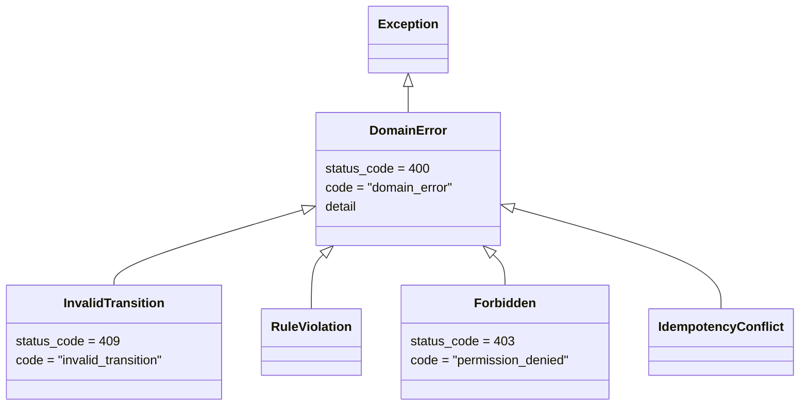

# L02 Python の基礎 ― サーバー側のコードを読むための道具

**この回の目標**
- 値・型・コレクション(`list` / `dict` / `set` / `tuple`)を使い分けられる
- 関数・クラス・継承・例外を読んで書ける
- 内包表記・ジェネレータ・デコレータ・`with` が何をしているか分かる
- このアプリの `models.py` / `errors.py` / `paths.py` の Python の部分を、読み解ける

前提: [L00](L00-intro.md)。Python は、書いたことがなくても読める所から始めます。

> Python を本格的に学ぶ資料ではありません。**このアプリのコードを読み書きするのに必要な範囲**に絞っています。

---

## 1. 値と型
Python では、すべての値が「型」を持ちます。`type()` で調べられます。

<!-- test -->
```python
values = [42, 3.14, "進行中", True, None, [1, 2], {"a": 1}, (1, 2), {1, 2}]
for v in values:
    print(f"{v!r:12} {type(v).__name__}")
```

<!-- output -->
```text
42           int
3.14         float
'進行中'        str
True         bool
None         NoneType
[1, 2]       list
{'a': 1}     dict
(1, 2)       tuple
{1, 2}       set
```

| 型 | 例 | このアプリでの使いどころ |
|---|---|---|
| `int` | `42` | ID(`task.id`)・件数 |
| `float` | `0.5` | 見積(`estimate_h`)・差分率(`diff_ratio`) |
| `str` | `"review"` | 状態・名前・パス |
| `bool` | `True` | `is_overdue`・`is_staff` |
| `None` | `None` | 「値が無い」(担当者なし・期日なし) |
| `list` | `[1, 2]` | 順序のある並び(ページの結果) |
| `dict` | `{"a": 1}` | キーと値(JSON のオブジェクトに対応) |
| `tuple` | `(1, 2)` | 変更できない組(`(entity_id, path)`) |
| `set` / `frozenset` | `{1, 2}` | 重複のない集まり(遷移表の行き先) |

**`None` は「無い」を表す値**です。`if x:` と `if x is not None:` は違います(`0` や `""` も偽として扱われるから)。
「値が無いこと」を確かめるときは、**`is None` / `is not None`** を使います。

## 2. 文字列
文字列は**変更できない**(新しい文字列を返す)。よく使う操作を、パスの正規化で覚えましょう。

<!-- test -->
```python
raw = "  .\\assets\\\\props//Crate/  "          # Windows 風の区切り・余分な空白・二重スラッシュ
p = raw.strip()                              # 前後の空白を取る
p = p.replace("\\", "/")                     # \ を / に
while "//" in p:
    p = p.replace("//", "/")                 # 連続する / を 1 つに
print(repr(p))
print(p.startswith("./"), p.endswith("/"))
print(p.lower(), "|", p.upper())
print("a" in p, "assets" in p)
print(f"パスは {p!r} で、長さは {len(p)}")      # f 文字列: {} の中に式を書ける
print("review".capitalize(), "x,y,z".split(","), "-".join(["a", "b"]))
```

<!-- output -->
```text
'./assets/props/Crate/'
True True
./assets/props/crate/ | ./ASSETS/PROPS/CRATE/
True True
パスは './assets/props/Crate/' で、長さは 21
Review ['x', 'y', 'z'] a-b
```

**大文字小文字を区別せずに比べる**ときは、`lower()` より **`casefold()`** が正確です(ドイツ語の `ß` → `ss` のような言語ごとの規則を扱える)。
このアプリでは、Windows のドライブ文字(`P:` と `p:`)のずれを吸収するために、`casefold()` を使っています([L07](L07-strings-paths.md))。

<!-- test -->
```python
print("STRASSE".casefold() == "straße".casefold())   # True: ß は ss と同じ扱い
print("STRASSE".lower() == "straße".lower())         # False: lower() では違う
```

<!-- output -->
```text
True
False
```

## 3. コレクションと内包表記
`dict`(辞書)は、このアプリのあらゆる所に出てきます(JSON ≒ dict)。

<!-- test -->
```python
task = {"id": 12, "status": "review", "assignee": None}
print(task["status"])                 # キーで引く(無いと KeyError)
print(task.get("due"))                # .get なら、無いとき None(エラーにならない)
print(task.get("due", "期日なし"))      # 第 2 引数が「無いときの値」
task["priority"] = "high"             # 追加・更新
for key, value in task.items():       # 中身を順に
    print(key, "=", value)

# 内包表記: ループで新しいリストを作る、短い書き方
numbers = [1, 2, 3, 4, 5, 6]
print([n * n for n in numbers])                        # 2 乗
print([n for n in numbers if n % 2 == 0])              # 偶数だけ
print({n: n * n for n in numbers[:3]})                 # 辞書も作れる
print(sum(n for n in numbers))                         # ジェネレータ式(カッコ内)
```

<!-- output -->
```text
review
None
期日なし
id = 12
status = review
assignee = None
priority = high
[1, 4, 9, 16, 25, 36]
[2, 4, 6]
{1: 1, 2: 4, 3: 9}
21
```

内包表記は、**「入力のリストから、条件に合うものを取り出して、加工する」**を 1 行で書けます。このアプリでは、たとえば:

<!-- excerpt: backend/tracker/query_catalog.py -->
```python
def catalog(ids: dict | None = None) -> dict:
```

`set`(集合)は**重複を許さず**、「含まれているか」の判定が速い。**遷移表は、行き先を `frozenset`(変更できない集合)で持ちます**。

<!-- excerpt: backend/tracker/models.py -->
```python
TRANSITIONS = {
    Status.TODO: frozenset({Status.IN_PROGRESS}),
    Status.IN_PROGRESS: frozenset({Status.REVIEW}),
    Status.REVIEW: frozenset({Status.IN_PROGRESS, Status.DONE}),  # 差し戻し / 承認
    Status.DONE: frozenset({Status.IN_PROGRESS}),  # 再開
}
```

`to in self.TRANSITIONS[current]` で「その遷移は表にあるか」が分かります。**変更できない**ので、実行中にうっかり書き換わる事故がありません。

## 4. 関数
<!-- test -->
```python
def clamp(value, low, high):
    """value を low 以上 high 以下に収める。"""
    return max(low, min(value, high))


def make_page(items, page=1, page_size=50, *, max_page_size=200):
    # page=1, page_size=50 は「既定値」。* の後ろは、名前を付けて渡さなければならない(キーワード専用)
    size = clamp(page_size, 1, max_page_size)
    return items[(page - 1) * size : page * size]


print(clamp(500, 1, 200))
print(make_page(list(range(10)), page=2, page_size=3))
print(make_page(list(range(10)), 1, 5, max_page_size=3))   # キーワードで渡す
```

<!-- output -->
```text
200
[3, 4, 5]
[0, 1, 2]
```

- 引数の**既定値**(`page=1`)で、省略できるようにする。
- `*` の後ろは**キーワード専用**。呼ぶ側が `max_page_size=3` と名前を書くので、意味が読み取れる。
- 関数の最初の文字列(**docstring**)は、説明。IDE やツールが読む。

**型ヒント**(`def f(x: int) -> str:`)は、人とツールへの注釈です。実行時には強制されません(間違っても、すぐ落ちない)。
このアプリでは、`str | None`(「文字列、または None」)のように書きます。

<!-- excerpt: backend/tracker/paths.py -->
```python
def match_entity(asset_path: str, candidates: list[tuple[int, str]]) -> int | None:
```

読み方: 「`asset_path`(文字列)と `candidates`(`(整数, 文字列)` の組のリスト)を受け取り、整数または `None` を返す」。

## 5. クラスと継承
クラスは「データ + そのデータを扱う関数(メソッド)」の設計図です。

<!-- test -->
```python
class Animal:
    sound = "..."                       # クラス属性(全員が共有)

    def __init__(self, name):           # 作るときに呼ばれる
        self.name = name                # インスタンス属性(自分だけ)

    def speak(self):
        return f"{self.name}: {self.sound}"


class Dog(Animal):                      # Animal を継承: 属性とメソッドを受け継ぎ、上書きできる
    sound = "ワン"


print(Animal("something").speak())
print(Dog("ポチ").speak())
print(isinstance(Dog("ポチ"), Animal))  # 継承関係の確認
```

<!-- output -->
```text
something: ...
ポチ: ワン
True
```

**このアプリの「エラー」は、継承で整理されています。**

<!-- excerpt: backend/tracker/errors.py -->
```python
class DomainError(Exception):
    """業務ルール違反。モデル層から投げ、API 層で HTTP ステータスに変換する。"""

    status_code = status.HTTP_400_BAD_REQUEST
    code = "domain_error"

    def __init__(self, detail: str, code: str | None = None):
        super().__init__(detail)
        self.detail = detail
        if code:
            self.code = code


class InvalidTransition(DomainError):
    """遷移表にない状態変更(409)。"""

    status_code = status.HTTP_409_CONFLICT
    code = "invalid_transition"
```



ねらいは、**「何がダメか」はモデル層が決め、「どう伝えるか(HTTP の番号)」は子クラスが持つ**こと。
モデルは `raise InvalidTransition("…")` と書くだけで、HTTP を知りません。変換は 1 か所(例外ハンドラ)だけがします。

`Enum`(列挙型)も、クラスの一種です。**状態は文字列でなく Enum で持つ**と、打ち間違いが防げます。Django の `TextChoices` はその拡張です。

<!-- excerpt: backend/tracker/models.py -->
```python
class Status(models.TextChoices):
    TODO = "todo", "未着手"
    IN_PROGRESS = "in_progress", "進行中"
    REVIEW = "review", "レビュー待ち"
    DONE = "done", "完了"
```

<!-- test -->
```python
from enum import Enum


class Status(str, Enum):             # str を継承: 文字列としても比べられる
    TODO = "todo"
    DONE = "done"


print(Status.TODO == "todo")          # True: JSON の文字列と直接比べられる
print(Status("done"))                 # 値からメンバーを引く
try:
    Status("finished")                # 無い値は ValueError(打ち間違いが早く見つかる)
except ValueError as error:
    print("ValueError:", error)
```

<!-- output -->
```text
True
Status.DONE
ValueError: 'finished' is not a valid Status
```

## 6. 例外
**例外**は、「通常の流れを続けられない」ことを知らせる仕組みです。`raise` で投げ、`try / except` で受けます。

<!-- test -->
```python
def to_int(text):
    try:
        return int(text)
    except ValueError:                              # int("abc") は ValueError
        raise ValueError(f"整数で指定してください: {text!r}") from None   # 元の例外の連鎖を隠す


print(to_int("42"))
for bad in ("abc", "4.5"):
    try:
        to_int(bad)
    except ValueError as error:
        print("拒否:", error)


def risky():
    try:
        return 1 / 0
    finally:
        print("finally: 成功しても失敗しても必ず実行される(後片付け)")


try:
    risky()
except ZeroDivisionError:
    print("ZeroDivisionError を受け取った")
```

<!-- output -->
```text
42
拒否: 整数で指定してください: 'abc'
拒否: 整数で指定してください: '4.5'
finally: 成功しても失敗しても必ず実行される(後片付け)
ZeroDivisionError を受け取った
```

`raise ... from None` は、「元の例外(`int()` の長いエラー)を表に出さず、読みやすいエラーだけを見せる」書き方です。
このアプリの `int_param`(クエリの数値の検査)も、同じ形です。

<!-- excerpt: backend/tracker/views.py -->
```python
def int_param(request, name):
    raw = request.query_params.get(name)
    if raw in (None, ""):
        return None
    try:
        value = int(raw)
    except ValueError:
        raise serializers.ValidationError({name: "整数で指定してください。"}) from None
    if abs(value) > MAX_ID:
        raise serializers.ValidationError({name: "値が大きすぎます。"})
    return value
```

**例外の鉄則**: 想定できる失敗は、**自分で名前を付けた例外**にして、意味のある 4xx に変える。想定外のもの(バグ)は、**握りつぶさず**に 500 にして、ログに残す。
`except Exception: pass`(何でも握りつぶす)は、バグを隠すので、書いてはいけません。

## 7. 再帰
関数が**自分自身を呼ぶ**のが再帰です。入れ子の構造(辞書の中の辞書…)を扱うのに向いています。
このアプリの、検証エラーの文章を取り出す関数が、その例です。

<!-- excerpt: backend/tracker/errors.py -->
```python
def _flatten(errors) -> str:
    """検証エラーの先頭 1 件を 'field: message' にして detail に使う。"""
    if isinstance(errors, dict):
        for key, value in errors.items():
            inner = _flatten(value)
            return inner if key in {"non_field_errors", "detail"} else f"{key}: {inner}"
    if isinstance(errors, (list, tuple)):
        return _flatten(errors[0]) if errors else ""
    return str(errors)
```

<!-- test -->
```python
def flatten(errors):
    """入れ子のエラーから、最初の 1 件を『項目: 理由』にする(errors.py の _flatten と同じ形)。"""
    if isinstance(errors, dict):
        for key, value in errors.items():
            inner = flatten(value)
            return inner if key in {"non_field_errors", "detail"} else f"{key}: {inner}"
    if isinstance(errors, (list, tuple)):
        return flatten(errors[0]) if errors else ""
    return str(errors)


print(flatten({"due": ["期日は開始日以降にしてください。"]}))
print(flatten({"results": [{"defects": ["0 以上にしてください。"]}]}))     # 入れ子
print(flatten({"non_field_errors": ["組み合わせが不正です。"]}))
print(repr(flatten([])))
```

<!-- output -->
```text
due: 期日は開始日以降にしてください。
results: defects: 0 以上にしてください。
組み合わせが不正です。
''
```

**再帰の 2 つの約束**: ①自分より**小さな問題**に分けて呼ぶ(リストの先頭、辞書の値)、②**これ以上分けない場合(`str(errors)`)で止まる**。
止まる条件が無いと、永遠に呼び続けて `RecursionError` になります。

## 8. ジェネレータとデコレータ
**ジェネレータ**は、`yield` で「値を 1 つずつ渡す」関数です。大きなデータを一度にメモリへ載せずに済みます。

<!-- test -->
```python
def pages(items, size):
    """items を size 個ずつに分けて、1 ページずつ渡す。"""
    for start in range(0, len(items), size):
        yield items[start : start + size]


gen = pages(list(range(7)), 3)
print(next(gen))            # 必要になったときに初めて計算される
print(list(gen))            # 残りを全部
```

<!-- output -->
```text
[0, 1, 2]
[[3, 4, 5], [6]]
```

**デコレータ**(`@名前`)は、「関数を包んで、機能を足す」仕組みです。

<!-- test -->
```python
import time
from functools import wraps


def timed(func):
    @wraps(func)                      # 元の関数の名前・説明を保つ
    def wrapper(*args, **kwargs):     # どんな引数でも受けて、そのまま渡す
        started = time.perf_counter()
        result = func(*args, **kwargs)
        wrapper.last_seconds = time.perf_counter() - started
        return result
    return wrapper


@timed                                # ← sum_to = timed(sum_to) と同じ
def sum_to(n):
    return sum(range(n + 1))


print(sum_to(1000), sum_to.__name__, sum_to.last_seconds >= 0)
```

<!-- output -->
```text
500500 sum_to True
```

このアプリで出てくるデコレータ: `@property`(関数を属性のように読む)、`@staticmethod`(インスタンスなしで呼べる)、
`@action(detail=True, methods=["post"])`(DRF: ViewSet に追加の URL を足す)、`@transaction.atomic`(中の処理を 1 つのトランザクションにする)。

## 9. `with`(後片付けを保証する)
`with` は、「始まりと終わりの処理を、必ずセットにする」仕組みです。ファイルを開いたら閉じる、トランザクションを始めたら終わらせる。

<!-- test -->
```python
from contextlib import contextmanager


@contextmanager
def tracing(name, log):
    log.append(f"{name}: 開始")
    try:
        yield                           # ← ここで with の中身が実行される
        log.append(f"{name}: 成功")
    except Exception:
        log.append(f"{name}: 失敗(元に戻す)")
        raise                           # 例外は、そのまま外へ
    finally:
        log.append(f"{name}: 後片付け")


log = []
with tracing("T1", log):
    pass
try:
    with tracing("T2", log):
        raise RuntimeError("途中で失敗")
except RuntimeError:
    pass
print("\n".join(log))
```

<!-- output -->
```text
T1: 開始
T1: 成功
T1: 後片付け
T2: 開始
T2: 失敗(元に戻す)
T2: 後片付け
```

このアプリの `with transaction.atomic():` は、まさにこの形です。**中で例外が起きたら、DB の変更を丸ごと取り消す**(`T2` の「元に戻す」)。
[L08](L08-concurrency.md) で、状態遷移のロックと組み合わせます。

## 10. モジュールと `import`
Python のファイルは**モジュール**です。`import` で他のファイルの部品を使います。

```python
from rest_framework import exceptions, status     # パッケージ rest_framework から 2 つ
from .errors import Forbidden, InvalidTransition  # 同じ階層(.)の errors.py から
```

`if __name__ == "__main__":` は「このファイルを直接実行したときだけ」の意味で、スクリプト(`scripts/*.py`)の入口に使います([L15](L15-scripts.md))。

## 11. 標準ライブラリ ― 道具箱
よく使うものを、このアプリの用途とともに。

| モジュール | 用途 | このアプリの例 |
|---|---|---|
| `re` | 正規表現 | パスの二重スラッシュの除去 |
| `json` | JSON の読み書き | JSON ログ・`dcc` の大きさの検査 |
| `datetime` | 日時 | 期日・取り込み時刻(タイムゾーン付き) |
| `secrets` | 暗号用の乱数・安全な比較 | API キーの比較(`compare_digest`) |
| `hashlib` | ハッシュ | ドキュメントの更新検出 |
| `sqlite3` | SQLite を読む | `send_quality.py` が `insight.db` を読む |
| `argparse` | コマンドライン引数 | スクリプトの `--db` など |
| `urllib.request` | HTTP を送る | スクリプトが API を呼ぶ |

<!-- test -->
```python
import re
from datetime import datetime, timedelta, timezone

# 正規表現: 「/ が 2 つ以上」を 1 つに
print(re.sub(r"/{2,}", "/", "assets//props///crate"))

# 日時: タイムゾーン付き(aware)と無し(naive)は、比べられない
jst = timezone(timedelta(hours=9))
aware = datetime(2026, 10, 11, 9, 0, tzinfo=jst)
naive = datetime(2026, 10, 11, 9, 0)
print(aware.isoformat(), "|", naive.isoformat())
print(aware.astimezone(timezone.utc).isoformat())      # 同じ瞬間を、UTC で
try:
    aware < naive
except TypeError as error:
    print("TypeError:", error)
```

<!-- output -->
```text
assets/props/crate
2026-10-11T09:00:00+09:00 | 2026-10-11T09:00:00
2026-10-11T00:00:00+00:00
TypeError: can't compare offset-naive and offset-aware datetimes
```

**日時にタイムゾーンを付ける理由**: `2026-10-11 09:00` は、日本時間なのか UTC なのか、これだけでは分かりません(9 時間ずれる)。
このアプリの取り込み API が、**タイムゾーン無しの時刻を 400 で拒否する**のは、このためです。

## よくある間違い
| 間違い | 正しくは |
|---|---|
| `if x:` で「値があるか」を判定 | `0` / `""` / `[]` も偽になる。`None` かを見たいなら `x is None` |
| 可変な既定値 `def f(items=[])` | 呼び出しをまたいで**同じリストが共有**される。`items=None` にして中で作る |
| `except:` / `except Exception: pass` | バグを隠す。想定する例外だけを受ける |
| リストを回しながら、そのリストを変更 | 新しいリストを作る(内包表記) |
| `==` と `is` の混同 | 値が等しいかは `==`、同一のものかは `is`(`None` との比較だけ `is`) |
| 文字列を `+` で何度もつなぐ | `"".join([...])` や f 文字列 |

## 確認問題
1. `task.get("due")` と `task["due"]` の違いは。
2. 遷移表の行き先を `frozenset` で持つ利点は何か。
3. `raise ValueError(...) from None` は、何のためか。
4. 再帰関数に必要な 2 つの約束は。
5. `with transaction.atomic():` の中で例外が起きると、何が起きるか。
6. タイムゾーン付きと無しの `datetime` を比べるとどうなるか。なぜ API は無しを拒否するのか。

## 答え
1. `.get` はキーが無いと `None`(または第 2 引数)を返す。`["due"]` は `KeyError` になる。
2. 変更できないので、実行中に書き換わる事故が無い。集合なので「含まれるか」の判定が速く、重複もない。
3. 元の例外の長い連鎖を隠し、読みやすい 1 つのエラーだけを見せるため。
4. 小さな問題に分けて自分を呼ぶこと。これ以上分けない場合で止まること。
5. 中の DB 変更が全部取り消される(ロールバック)。例外は外へ伝わる。
6. `TypeError`(比べられない)。時刻が日本時間か UTC か分からないと 9 時間ずれても気づけないので、曖昧な入力を受け付けない。

## 次へ
[L03 データベースと SQL](L03-database.md) ― データを「表」で持つ考え方と、SQL を学びます。
