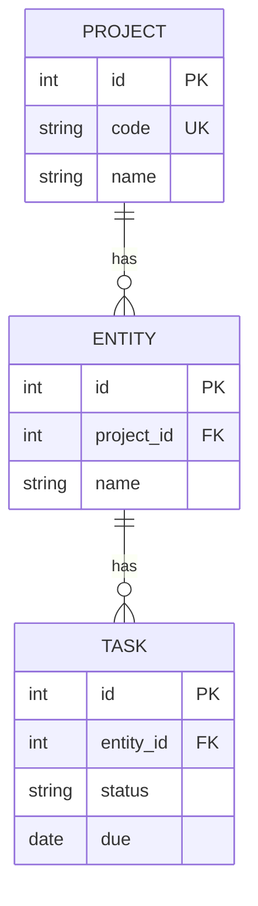
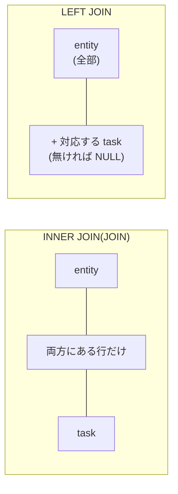
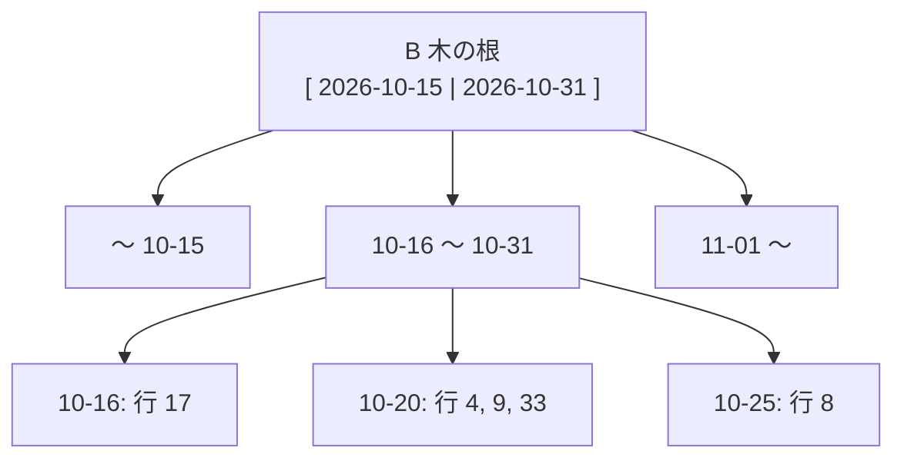
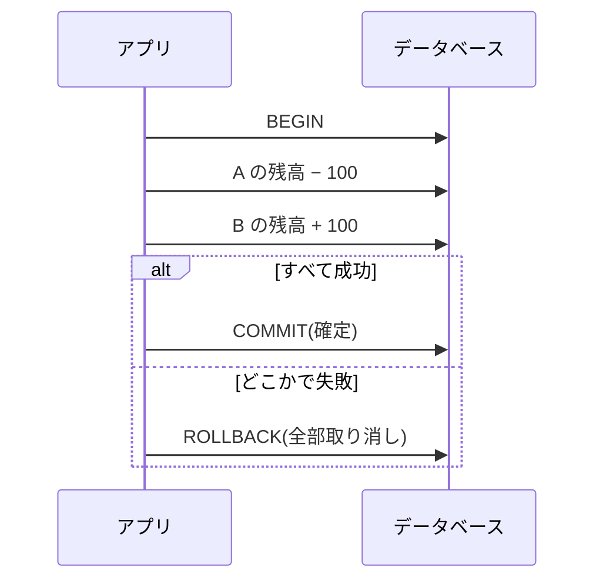
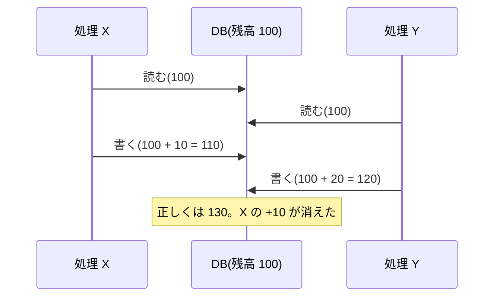

# L03 データベースと SQL ― 表・キー・索引・トランザクション

**この回の目標**
- データを「表」で持つ考え方(リレーショナルモデル)と、**主キー・外部キー・一意制約**を説明できる
- 正規化の考え方で、表の設計の良し悪しを判断できる
- `SELECT` / `JOIN` / `GROUP BY` / `NULL` の扱いを読み書きできる
- **索引**がなぜ速くするのかと、実行計画(`EXPLAIN`)の読み方が分かる
- **トランザクション**と、競合(同時に書く)の問題を説明できる

前提: [L02](L02-python.md)。実習は、Python 標準の `sqlite3`(ファイル 1 つの軽いデータベース)で、**その場で動かして**確かめます。

---

## 1. なぜデータベースか
ファイル(JSON など)に保存するのと、何が違うのでしょう。

| 要求 | ファイルだけだと | データベースだと |
|---|---|---|
| 条件で探す(「自分の期限切れのタスク」) | 全部読んで、自分で絞る | `WHERE` で、索引を使って速く |
| 同時に書く(2 人が同じタスクを更新) | 後から書いた方が、前の変更を**消す** | ロックとトランザクションで守る |
| 壊れた状態を防ぐ(同じ工程のタスクが 2 つ) | 書く側が毎回気をつける | **制約**で、DB が拒否する |
| 途中で失敗した | 半分だけ書かれたファイルが残る | トランザクションで、**全部か、何もなしか** |

このアプリのデータベースは **PostgreSQL**(本番)と **SQLite**(テストの既定)です。SQL の基本は共通です。

## 2. 表(テーブル)・行・列
リレーショナルデータベースは、データを**表**で持ちます。1 行が 1 件、1 列が 1 つの属性。



| 用語 | 意味 | 例 |
|---|---|---|
| **主キー(PK)** | 行を**一意に**特定する列 | `task.id` |
| **外部キー(FK)** | 別の表の主キーを指す列 | `task.entity_id` → `entity.id` |
| **一意制約(UK)** | その列(の組)で**重複を許さない** | `project.code`、`(entity_id, step_id)` |
| **NULL** | 「値が無い」 | 担当者なし(`assignee_id` が NULL) |
| **索引(インデックス)** | 探すのを速くする補助の仕組み | `task.due` の索引 |

## 3. SQL の基本
`sqlite3` で、実際に表を作って動かします。

<!-- test -->
```python
import sqlite3

db = sqlite3.connect(":memory:")                  # メモリ上の使い捨ての DB
db.execute("PRAGMA foreign_keys = ON")            # SQLite は、外部キーの検査を明示的に有効にする
db.executescript("""
    CREATE TABLE project (id INTEGER PRIMARY KEY, code TEXT NOT NULL UNIQUE, name TEXT NOT NULL);
    CREATE TABLE entity  (id INTEGER PRIMARY KEY, project_id INTEGER NOT NULL REFERENCES project(id), name TEXT NOT NULL);
    CREATE TABLE task    (id INTEGER PRIMARY KEY, entity_id INTEGER NOT NULL REFERENCES entity(id),
                          step TEXT NOT NULL, status TEXT NOT NULL DEFAULT 'todo', assignee TEXT, due TEXT,
                          UNIQUE (entity_id, step));
    INSERT INTO project VALUES (1, 'DEMO', 'デモ'), (2, 'OTHER', '別の作品');
    INSERT INTO entity  VALUES (1, 1, 'crate'), (2, 1, 'dragon'), (3, 2, 'lamp');
    INSERT INTO task (entity_id, step, status, assignee, due) VALUES
        (1, 'model',   'done',        'alice', '2026-10-01'),
        (1, 'texture', 'in_progress', 'alice', '2026-10-20'),
        (2, 'model',   'review',      'bob',   '2026-10-15'),
        (2, 'rig',     'todo',        NULL,    NULL),
        (3, 'model',   'todo',        'bob',   '2026-11-01');
""")

# SELECT: 取り出す。WHERE: 条件。ORDER BY: 並べ替え。LIMIT: 件数
rows = db.execute("SELECT id, step, status FROM task WHERE status != 'done' ORDER BY id LIMIT 3").fetchall()
print(rows)
```

<!-- output -->
```text
[(2, 'texture', 'in_progress'), (3, 'model', 'review'), (4, 'rig', 'todo')]
```

### SELECT の基本形
```sql
SELECT 列, ...          -- 何を取り出すか
FROM 表                 -- どの表から
WHERE 条件              -- どの行を
ORDER BY 列             -- 並べ替え(これが無いと順序は不定)
LIMIT 件数 OFFSET 飛ばす件数   -- ページネーション
```

**`ORDER BY` が無い `LIMIT` は危険**です。DB は順序を保証しないので、同じクエリでも**呼ぶたびに違う行**が返りえます。
このアプリが全ての一覧に並び順を付け、テストで強制している理由です([L05](L05-drf.md))。

### JOIN(表をつなぐ)
タスクの一覧に、アセット名とプロジェクト名も付けたい。外部キーで表をつなぎます。

<!-- test -->
```python
import sqlite3

db = sqlite3.connect(":memory:")
db.executescript("""
    CREATE TABLE project (id INTEGER PRIMARY KEY, code TEXT);
    CREATE TABLE entity  (id INTEGER PRIMARY KEY, project_id INTEGER, name TEXT);
    CREATE TABLE task    (id INTEGER PRIMARY KEY, entity_id INTEGER, step TEXT, status TEXT);
    INSERT INTO project VALUES (1, 'DEMO');
    INSERT INTO entity  VALUES (1, 1, 'crate'), (2, 1, 'dragon');
    INSERT INTO task    VALUES (1, 1, 'model', 'done'), (2, 1, 'texture', 'todo');   -- dragon にはタスクが無い
""")

print("INNER JOIN: 両方に対応する行だけ")
for row in db.execute("""
    SELECT p.code, e.name, t.step FROM task t
    JOIN entity e ON e.id = t.entity_id
    JOIN project p ON p.id = e.project_id ORDER BY t.id"""):
    print(" ", row)

print("LEFT JOIN: アセットは全部。タスクが無ければ NULL(None)")
for row in db.execute("""
    SELECT e.name, t.step FROM entity e
    LEFT JOIN task t ON t.entity_id = e.id ORDER BY e.id, t.id"""):
    print(" ", row)
```

<!-- output -->
```text
INNER JOIN: 両方に対応する行だけ
  ('DEMO', 'crate', 'model')
  ('DEMO', 'crate', 'texture')
LEFT JOIN: アセットは全部。タスクが無ければ NULL(None)
  ('crate', 'model')
  ('crate', 'texture')
  ('dragon', None)
```



**使い分け**: 「タスクが無いアセットも一覧に出したい」なら `LEFT JOIN`。
このアプリのプロジェクト一覧が、**タスクが 0 件のプロジェクトも「進捗 0」で出せる**のは、`LEFT JOIN` + `COUNT` のおかげです(次の節)。

### GROUP BY と集計、そして NULL
`GROUP BY` で行をグループにまとめ、`COUNT`・`SUM` などで集計します。

<!-- test -->
```python
import sqlite3

db = sqlite3.connect(":memory:")
db.executescript("""
    CREATE TABLE entity (id INTEGER PRIMARY KEY, name TEXT);
    CREATE TABLE task (id INTEGER PRIMARY KEY, entity_id INTEGER, status TEXT, assignee TEXT);
    INSERT INTO entity VALUES (1, 'crate'), (2, 'dragon'), (3, 'empty');
    INSERT INTO task VALUES (1, 1, 'done', 'alice'), (2, 1, 'todo', NULL), (3, 2, 'review', 'bob');
""")

print("アセットごとのタスク数(COUNT(t.id): NULL を数えない → タスクが無いアセットは 0)")
for row in db.execute("""
    SELECT e.name, COUNT(t.id) FROM entity e LEFT JOIN task t ON t.entity_id = e.id
    GROUP BY e.id ORDER BY e.id"""):
    print(" ", row)

print("COUNT(*) は行数。LEFT JOIN だと、タスクが無いアセットも 1 と数えてしまう")
print(" ", db.execute("""SELECT e.name, COUNT(*) FROM entity e LEFT JOIN task t ON t.entity_id = e.id
                         WHERE e.id = 3 GROUP BY e.id""").fetchall())

print("COUNT(列) は NULL を数えない / = NULL は常に偽 / IS NULL を使う")
print(" ", db.execute("SELECT COUNT(*), COUNT(assignee) FROM task").fetchone())
print(" ", db.execute("SELECT COUNT(*) FROM task WHERE assignee = NULL").fetchone())
print(" ", db.execute("SELECT COUNT(*) FROM task WHERE assignee IS NULL").fetchone())
```

<!-- output -->
```text
アセットごとのタスク数(COUNT(t.id): NULL を数えない → タスクが無いアセットは 0)
  ('crate', 2)
  ('dragon', 1)
  ('empty', 0)
COUNT(*) は行数。LEFT JOIN だと、タスクが無いアセットも 1 と数えてしまう
  [('empty', 1)]
COUNT(列) は NULL を数えない / = NULL は常に偽 / IS NULL を使う
  (3, 2)
  (0,)
  (1,)
```

**NULL の 3 つの規則**(必ず覚える):
1. `NULL = NULL` は真ではない(「不明 = 不明」は不明)。**`IS NULL` / `IS NOT NULL`** で調べる。
2. `COUNT(列)` は NULL の行を**数えない**。`COUNT(*)` は行をすべて数える。
3. NULL を含む計算の結果は、NULL。

このアプリのコードにも、同じ考え方が出てきます。

<!-- excerpt: backend/tracker/views.py -->
```python
def count(status):
    return Count("entities__tasks", filter=Q(entities__tasks__status=status), distinct=True)
```

「プロジェクトの、状態が `status` のタスクの数」。`Count("entities__tasks")` は `COUNT(task.id)` で、**結合で一致しなかった行(NULL)は数えない**ので、タスクが無いプロジェクトは 0 になります。
`distinct=True` は、複数の結合で行が増えても、重複して数えないため。

## 4. 制約 ― 「壊れた状態」を DB に拒否させる
アプリのコードで検査するだけでは、**同時に 2 人が書くと破れる**ことがあります(L08)。DB の制約は、**最後の砦**です。

<!-- test -->
```python
import sqlite3

db = sqlite3.connect(":memory:")
db.execute("PRAGMA foreign_keys = ON")
db.executescript("""
    CREATE TABLE entity (id INTEGER PRIMARY KEY, name TEXT NOT NULL);
    CREATE TABLE task (
        id INTEGER PRIMARY KEY,
        entity_id INTEGER NOT NULL REFERENCES entity(id),       -- 外部キー: 存在しないアセットは指せない
        step TEXT NOT NULL,
        estimate_h REAL CHECK (estimate_h IS NULL OR estimate_h >= 0),   -- CHECK: 値の条件
        UNIQUE (entity_id, step)                                -- 一意: 同じ工程のタスクは 1 つ
    );
    INSERT INTO entity VALUES (1, 'crate');
""")


def attempt(label, sql):
    try:
        db.execute(sql)
        print(f"{label}: OK")
    except sqlite3.IntegrityError as error:
        print(f"{label}: 拒否 ({error})")


attempt("正しい行      ", "INSERT INTO task (entity_id, step, estimate_h) VALUES (1, 'model', 8)")
attempt("同じ工程      ", "INSERT INTO task (entity_id, step) VALUES (1, 'model')")
attempt("存在しない親  ", "INSERT INTO task (entity_id, step) VALUES (99, 'rig')")
attempt("負の見積      ", "INSERT INTO task (entity_id, step, estimate_h) VALUES (1, 'rig', -1)")
attempt("NOT NULL 違反 ", "INSERT INTO task (entity_id, step) VALUES (1, NULL)")
```

<!-- output -->
```text
正しい行      : OK
同じ工程      : 拒否 (UNIQUE constraint failed: task.entity_id, task.step)
存在しない親  : 拒否 (FOREIGN KEY constraint failed)
負の見積      : 拒否 (CHECK constraint failed: estimate_h IS NULL OR estimate_h >= 0)
NOT NULL 違反 : 拒否 (NOT NULL constraint failed: task.step)
```

このアプリの `Task` のモデルにも、同じ制約が書かれています(Django がこれを DB の制約に変換します)。

<!-- excerpt: backend/tracker/models.py -->
```python
constraints = [
    models.UniqueConstraint(fields=["entity", "step"], name="uniq_task_per_step"),
    models.CheckConstraint(
        condition=Q(estimate_h__isnull=True) | Q(estimate_h__gte=0), name="task_estimate_non_negative"
    ),
]
```

## 5. 正規化 ― 同じ事実を 1 か所に
**正規化**は、「同じ情報を何か所にも持たない」ように表を分ける設計の考え方です。

悪い例: タスクの行に、アセット名とプロジェクト名を**毎回コピー**して持つ。

| task_id | step | entity_name | project_code | project_name |
|---|---|---|---|---|
| 1 | model | crate | DEMO | デモ |
| 2 | texture | crate | DEMO | デモ |
| 3 | model | dragon | DEMO | デモ |

何が困るか(**更新時異常**):
- プロジェクト名を変えたい → **すべての行**を直す。1 行でも漏れると、同じプロジェクトで名前が食い違う。
- タスクを全部消すと、プロジェクトの情報も消える(**削除時異常**)。
- 新しいプロジェクトを作ったが、まだタスクが無い → 入れる行が無い(**挿入時異常**)。

解決: **事実ごとに表を分け、外部キーでつなぐ**(`project` / `entity` / `task`)。プロジェクト名は `project` に 1 回だけ。

| 正規形 | ひとことで | 破ると |
|---|---|---|
| 第 1 | 1 つのセルに 1 つの値(`"a,b,c"` を入れない) | 一部だけを探す・更新するのが難しい |
| 第 2 | 主キーの**一部だけ**に決まる列を持たない | 複合キーの表で、重複が増える |
| 第 3 | 主キー以外の列に**決まる列**を持たない(`entity` → `project` の情報) | 上の更新時異常 |
| BCNF | 決める列は、必ずキーになる | まれな例外の異常 |

**このアプリの方針**: **計算できる値は保存しない**(進捗・件数・期限切れ・次に行ける状態)。保存すると、更新のたびにずれる危険が増えます。
例外は**理由をつけて**持つ(`QualityReport.asset_path` は「取り込んだ元データの表記」を残すため)。詳しくは [データベースの点検](../database.md)。

## 6. 索引 ― なぜ速くなるのか
100 万行の表で `WHERE due = '2026-10-20'` を調べるとき、索引が無いと**先頭から全部**を見る(全件走査、`O(N)`)。
索引があると、**並べておいた別の構造**(B 木)で探すので、行数が増えても少ない手数で見つかる(`O(log N)`)。



辞書の索引と同じです。「あ行」から探せば、全ページをめくらずに済みます。

<!-- test -->
```python
import sqlite3

db = sqlite3.connect(":memory:")
db.execute("CREATE TABLE task (id INTEGER PRIMARY KEY, assignee TEXT, status TEXT, due TEXT)")
db.executemany(
    "INSERT INTO task (assignee, status, due) VALUES (?, ?, ?)",
    [(f"user{i % 50}", ["todo", "in_progress", "review", "done"][i % 4], f"2026-{(i % 12) + 1:02d}-{(i % 28) + 1:02d}") for i in range(5000)],
)


def plan(sql):
    return " ".join(row[3] for row in db.execute("EXPLAIN QUERY PLAN " + sql))


query = "SELECT * FROM task WHERE assignee = 'user7'"
print("索引なし: 全件走査?", "SCAN" in plan(query) and "INDEX" not in plan(query))

db.execute("CREATE INDEX task_assignee ON task (assignee)")
print("索引あり: 索引を使う?", "USING INDEX" in plan(query) or "USING COVERING INDEX" in plan(query))

# 値の種類が少ない列(状態は 4 種類)の索引は、効きにくい
print("状態の種類:", db.execute("SELECT COUNT(DISTINCT status) FROM task").fetchone()[0], "/ 担当者の種類:", db.execute("SELECT COUNT(DISTINCT assignee) FROM task").fetchone()[0])
```

<!-- output -->
```text
索引なし: 全件走査? True
索引あり: 索引を使う? True
状態の種類: 4 / 担当者の種類: 50
```

### 索引の指針(このアプリの [データベースの点検](../database.md)から)
| 指針 | 理由 |
|---|---|
| **値の種類が多い列**に付ける(ID・日付・名前) | 1 つの値で行が絞れるほど効く。状態(4 種類)単独の索引は、約 1/4 しか絞れず、書き込みが遅くなるだけ |
| 外部キーには付ける(Django が自動で付ける) | `JOIN` や「親から子を探す」で、必ず使うから |
| 列に**関数をかけた**検索は、索引が効かない | `WHERE LOWER(code) = 'demo'` には、`LOWER(code)` の索引が要る |
| 先頭が `%` の `LIKE '%abc%'` は、索引が効かない | 先頭が決まっていないと、並びを使って探せない |
| 索引は**書き込みを遅くする**(更新のたびに、索引も直す) | だから、使わない索引は作らない |

### 実行計画を読む(`EXPLAIN`)
「このクエリを DB がどう実行するか」を見る道具です。**速いか遅いかを、推測でなく計画で確かめる**。

| 見るもの(PostgreSQL) | 意味 |
|---|---|
| `Seq Scan` | 全件走査。大きな表で出たら要注意 |
| `Index Scan` / `Bitmap Index Scan` | 索引を使っている(良い) |
| `Sort` | 並べ替えをしている(索引の順序で済ませられないか) |

このアプリでは、主要なクエリの一覧を `backend/tracker/query_catalog.py` に持ち、テストで「全件走査が無い」ことを確かめます。

<!-- excerpt: backend/tracker/query_catalog.py -->
```python
"タスク: アセットで": Task.objects.filter(entity_id=ids["entity"]),
"タスク: 担当者で(自分のタスク)": Task.objects.filter(assignee_id=ids["user"]).order_by("due"),
```

## 7. トランザクション ― 全部か、何もなしか
「Aさんから Bさんへ 100 円送る」は、2 つの更新(A を減らす・B を増やす)です。間で失敗したら? **100 円が消えます。**
**トランザクション**は、複数の操作を 1 つの塊にして、**全部成功するか、全部なかったことにするか**を保証します。



**ACID**(トランザクションの 4 つの性質): **A**tomicity(全か無か)・**C**onsistency(制約を保つ)・**I**solation(他の処理と混ざらない)・**D**urability(確定したら消えない)。

<!-- test -->
```python
import sqlite3

db = sqlite3.connect(":memory:")
db.executescript("""
    CREATE TABLE account (name TEXT PRIMARY KEY, balance INTEGER CHECK (balance >= 0));
    INSERT INTO account VALUES ('A', 100), ('B', 0);
""")
db.commit()


def transfer(src, dst, amount):
    try:
        with db:                                   # with db: 成功なら COMMIT、例外なら ROLLBACK
            db.execute("UPDATE account SET balance = balance + ? WHERE name = ?", (amount, dst))   # 先に相手へ加算
            db.execute("UPDATE account SET balance = balance - ? WHERE name = ?", (amount, src))   # 残高不足なら、ここで失敗
        return "成功"
    except sqlite3.IntegrityError:
        return "失敗(取り消した)"


print(transfer("A", "B", 70), dict(db.execute("SELECT name, balance FROM account")))
print(transfer("A", "B", 70), dict(db.execute("SELECT name, balance FROM account")))   # 残高不足 → CHECK 違反
```

<!-- output -->
```text
成功 {'A': 30, 'B': 70}
失敗(取り消した) {'A': 30, 'B': 70}
```

2 回目は、**B への加算が先に実行された**あと、A の減算が CHECK 違反で失敗しました。それでも B は 70 のままです。
`with db:` が例外を見て**ロールバック**し、実行済みの B への加算も取り消したからです。これが「全部か、何もなしか」です。

### 同時に書くと何が起きるか(競合)
2 人が**同時に**同じ行を読み、それぞれ書くと、片方の変更が消えます(**更新の消失**)。



対策は 2 系統です。詳細は [L08](L08-concurrency.md)。

| 方式 | 仕組み | このアプリでの例 |
|---|---|---|
| 悲観的ロック | 先に**行をロック**して、他の処理を待たせる(`SELECT ... FOR UPDATE`) | 状態遷移・版の採番 |
| 楽観的(制約に任せる) | 書いてみて、**一意制約に違反したら失敗**として扱う | 取り込みの再送・Idempotency-Key |

## 8. Django から見る(予告)
SQL を直接書く代わりに、Django は**モデル(Python のクラス)**から SQL を作ります(ORM)。[L04](L04-django.md) で学びます。

```python
Task.objects.filter(assignee_id=1, status="review").order_by("due")[:10]
```

これは、次のような SQL になります。

```sql
SELECT ... FROM tracker_task WHERE assignee_id = 1 AND status = 'review' ORDER BY due ASC LIMIT 10;
```

**ORM を使っても、SQL と索引を理解する必要があります。** ORM が作る SQL が遅ければ、結局は上の指針で直すことになるからです(`.explain()` で計画を見られる)。

## よくある間違い
| 間違い | 正しくは |
|---|---|
| `WHERE col = NULL` | `IS NULL` |
| `ORDER BY` なしの `LIMIT` | 順序が不定。必ず並び順を決める |
| 状態(数種類)に索引を付ける | 値の種類が多い列に |
| 外部キーの検査を有効にし忘れる(SQLite) | `PRAGMA foreign_keys = ON`(PostgreSQL は常に有効) |
| アプリの検査だけで一意性を守る | 同時実行で破れる。**DB の一意制約**を最後の砦に |
| 計算できる値(件数・進捗)を列に保存 | 計算する。ずれる原因になる |

## 確認問題
1. 主キー・外部キー・一意制約を、それぞれ一言で説明せよ。
2. `LEFT JOIN` と `JOIN` の違いを、「タスクが無いアセット」を使って説明せよ。
3. `COUNT(*)` と `COUNT(列)` の違いは。
4. 「状態」(4 種類)の列に索引を付けても、あまり効かないのはなぜか。
5. `WHERE LOWER(code) = 'demo'` を速くするには、どんな索引が要るか。
6. トランザクションがないと、「A から B へ送金」で何が起きうるか。
7. 「更新の消失」とは何か。防ぐ方法を 2 つ挙げよ。

## 答え
1. 主キー: 行を一意に特定する列。外部キー: 別の表の主キーを指す列(存在しない相手を指せない)。一意制約: その列(の組)の重複を許さない。
2. `JOIN` は両方に対応する行だけ。`LEFT JOIN` は左の表(アセット)を全部出し、タスクが無ければ右側が NULL。タスクが無いアセットを出したいなら `LEFT JOIN`。
3. `COUNT(*)` は行数。`COUNT(列)` は、その列が NULL でない行だけを数える。
4. 値が 4 種類しかなく、1 つの値で全体の約 1/4 の行が残る。索引を使うより全件を読むほうが速いことも多く、書き込みだけが遅くなる。
5. `LOWER(code)` に対する索引(式インデックス)。列そのものの索引では、関数をかけた条件に使えない。
6. A の減算だけが済んで、B の加算の前に失敗すると、お金が消える。
7. 2 つの処理が同じ値を同時に読んで、それぞれ書き込み、片方の変更が消える。防ぐ方法: 先に行をロックする(悲観的)/ 一意制約など DB の制約に任せて、違反したら失敗として扱う(楽観的)。

## 次へ
[L04 Django の基礎](L04-django.md) ― SQL を書かずに、Python のクラスで表を作る(ORM)。
