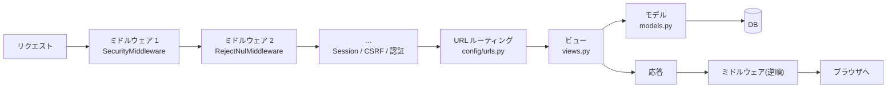
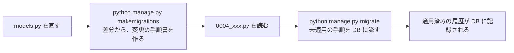

# L04 Django の基礎 ― 設定・ミドルウェア・モデルと ORM・マイグレーション

**この回の目標**
- Django が**何をしてくれて、何を自分で書くのか**を説明できる
- リクエストが入ってから応答が出るまでの道(ミドルウェア → URL → ビュー)を言える
- モデルを書いて、ORM で作成・検索・更新・削除ができる
- **N+1 問題**を、クエリ数を数えて見つけ、直せる
- マイグレーションの仕組みと、触ってはいけない場所が分かる

前提: [L02](L02-python.md)、[L03](L03-database.md)。

---

## 1. Django とは
Django は Python の **Web フレームワーク**です。ライブラリとの違いは「**誰が主導権を持つか**」。

| | 呼び出し方 | 例 |
|---|---|---|
| ライブラリ | **自分のコードが**、必要なときにライブラリを呼ぶ | `json.dumps(...)` |
| フレームワーク | **フレームワークが**、決まった場面で自分のコードを呼ぶ | リクエストが来たら、自分の `view` を呼んでくれる |

Django は、Web アプリに必要な部品が**最初から揃っています**(電池付属)。

| 部品 | 役割 | このアプリで使っている所 |
|---|---|---|
| **ORM** | Python のクラス ↔ DB の表 | `tracker/models.py` |
| マイグレーション | 表の構造の変更を、履歴として管理 | `tracker/migrations/` |
| URL ルーティング | URL → 処理の対応 | `config/urls.py` |
| ミドルウェア | 全リクエストに共通の前後処理 | NUL の拒否・キャッシュ禁止 |
| 認証・セッション | ユーザー・ログイン・権限 | `django.contrib.auth` |
| 管理画面 | データを表で編集できる画面 | `/admin/` |
| テスト支援 | テスト用 DB・クライアント | `pytest-django` |

## 2. プロジェクトの構造
```text
backend/
├── manage.py            ← 「Django への命令」の入口(migrate, runserver, test …)
├── config/              ← プロジェクトの設定(アプリ全体に関わるもの)
│   ├── settings.py          設定
│   ├── urls.py              URL の一覧
│   └── wsgi.py              サーバー(gunicorn)との接点
└── tracker/             ← アプリ(機能のまとまり)
    ├── models.py            データ
    ├── views.py             処理の入口
    ├── admin.py             管理画面の設定
    └── migrations/          表の変更履歴
```

**「プロジェクト」は 1 つ、「アプリ」は機能ごとに複数**、が Django の言葉です。このアプリは、アプリが `tracker` 1 つだけの小さな構成です。

## 3. MTV と、リクエストの道
Django の分担は **MTV**(Model・Template・View)です。(このアプリは画面を React が作るので、Template の代わりに JSON を返します。)

| 役割 | 担当 | このアプリ |
|---|---|---|
| Model | データとルール | `models.py` |
| View | リクエストを受け、応答を作る | `views.py`(DRF の ViewSet) |
| Template | HTML を作る | (使わない。React が画面を作る) |

リクエストが入ってから応答が出るまで:



### ミドルウェア ― 玉ねぎの皮
ミドルウェアは、**全てのリクエストの前後**に挟まる処理です。外側から内側へ入り、応答は**逆順**で外へ出ます(玉ねぎの皮)。

<!-- excerpt: backend/config/settings.py -->
```python
MIDDLEWARE = [
    "django.middleware.security.SecurityMiddleware",
    "tracker.middleware.RejectNulMiddleware",
    "tracker.middleware.ApiNoStoreMiddleware",
    "whitenoise.middleware.WhiteNoiseMiddleware",
    "django.contrib.sessions.middleware.SessionMiddleware",
    "django.middleware.common.CommonMiddleware",
]
```

**順序には意味があります。** 危険なリクエスト(NUL 文字)は、**セッションや DB に触れる前**に弾きたいので、早い位置に置いています。

このアプリのミドルウェアは、たった 1 つのクラスです。

<!-- excerpt: backend/tracker/middleware.py -->
```python
class RejectNulMiddleware:
    def __init__(self, get_response):
        self.get_response = get_response

    def __call__(self, request):
        if "\x00" in unquote(request.META.get("QUERY_STRING", "")) or "\x00" in unquote(request.path):
            return JsonResponse({"code": "validation_error", "detail": "NUL 文字(%00)は使えません。"}, status=400)
        return self.get_response(request)
```

`get_response` は「**次の皮(内側)を呼ぶ関数**」です。`return self.get_response(request)` で内側へ進み、
`return JsonResponse(...)` なら**内側へ進まずに、その場で応答**します(早期リターン)。玉ねぎの仕組みを、純粋な Python で作ってみましょう。

<!-- test -->
```python
def build(layers, view):
    """内側(view)から外側へ、1 枚ずつ皮で包む。"""
    handler = view
    for layer in reversed(layers):
        handler = layer(handler)
    return handler


def logging_layer(get_response):
    def handle(request):
        print("→ logging: 入る", repr(request["path"]))
        response = get_response(request)
        print("← logging: 出る", response["status"])
        return response
    return handle


def reject_nul_layer(get_response):
    def handle(request):
        if "\x00" in request["path"]:
            return {"status": 400}                # 内側へ進まない(view も、後ろの層も呼ばれない)
        return get_response(request)
    return handle


def view(request):
    print("   view: 実行")
    return {"status": 200}


app = build([logging_layer, reject_nul_layer], view)
print(app({"path": "/api/v1/tasks/"})["status"])
print(app({"path": "/api/v1/tasks/\x00"})["status"])
```

<!-- output -->
```text
→ logging: 入る '/api/v1/tasks/'
   view: 実行
← logging: 出る 200
200
→ logging: 入る '/api/v1/tasks/\x00'
← logging: 出る 400
400
```

2 回目は `view` が**一度も呼ばれません**。「早い段階で安く拒否する」と「内側のコードが危険な入力を知らずに済む」が、ミドルウェアの価値です。

### URL とビュー
`config/urls.py` が、URL とビューを結びつけます([L01](L01-web.md) で見たもの)。ビューの中身は、次の [L05](L05-drf.md) で学びます。

## 4. 設定(settings.py)
アプリ全体の設定は 1 ファイルに集まります。**秘密情報は、ファイルに書かず環境変数から読む**のが鉄則です。

<!-- test -->
```python
import os


def env_bool(name, default=False):
    """環境変数を真偽値として読む(このアプリの settings.py と同じ形)。"""
    value = os.environ.get(name)
    if value is None:
        return default
    return value.strip().lower() in {"1", "true", "yes", "on"}


os.environ["DEMO_DEBUG"] = "1"
print(env_bool("DEMO_DEBUG"), env_bool("DEMO_UNSET"), env_bool("DEMO_UNSET", True))
os.environ["DEMO_DEBUG"] = "no"
print(env_bool("DEMO_DEBUG"))
```

<!-- output -->
```text
True False True
False
```

| 設定 | 意味 | 注意 |
|---|---|---|
| `DEBUG` | 開発用の詳しいエラー画面 | **本番では必ず False**(スタックトレースが漏れる) |
| `SECRET_KEY` | 署名(セッション・CSRF)に使う鍵 | 漏れると、セッションを偽造できる。環境変数から。長くランダムに |
| `ALLOWED_HOSTS` | 受け付ける Host ヘッダ | 偽の Host で来たリクエストを拒否 |
| `DATABASES` | DB の接続先 | `POSTGRES_HOST` があれば PostgreSQL、無ければ SQLite |
| `INSTALLED_APPS` | 使うアプリの一覧 | 書かないと、モデルもマイグレーションも認識されない |

`DJANGO_DEBUG=0` で `SECRET_KEY` が空なら、**起動しない**設計にしてあります(うっかり本番で弱い鍵を使わないため)。

## 5. モデルと ORM
**モデル**は、DB の表を表す Python のクラスです。1 クラス = 1 表、1 属性 = 1 列、1 インスタンス = 1 行。

<!-- excerpt: backend/tracker/models.py -->
```python
class Project(models.Model):
    code = models.CharField("コード", max_length=32, unique=True, validators=[code_validator])
    name = models.CharField("名前", max_length=120)
    start = models.DateField("開始日", null=True, blank=True)
    due = models.DateField("期日", null=True, blank=True)
    created_at = models.DateTimeField(auto_now_add=True)
    updated_at = models.DateTimeField(auto_now=True)
```

| 部分 | 意味 |
|---|---|
| `CharField(max_length=32)` | 最大 32 文字の文字列(列の型 `varchar(32)`) |
| `unique=True` | 重複を許さない(一意制約) |
| `validators=[...]` | 値の検査(英字で始まる、など)。**フォームや API の入力で働く**(DB には届かない) |
| `null=True` | DB に NULL を許す |
| `blank=True` | 入力が空でもよい(検証の話。DB とは別) |
| `auto_now_add=True` | 作ったときの時刻を自動で入れる |
| `auto_now=True` | 保存のたびに時刻を更新 |

> **`null` と `blank` の違い**は、初心者がいちばん間違えます。`null` = データベースの話(NULL を入れてよいか)、`blank` = 検証の話(空で通してよいか)。

### QuerySet ― 「あとで SQL にするもの」
ORM の検索結果は、**QuerySet** です。**遅延評価**: 書いただけでは SQL は実行されず、**中身が必要になった瞬間**に 1 回だけ実行されます。

<!-- test:django -->
```python
from django.contrib.auth import get_user_model
from django.db import connection
from django.test.utils import CaptureQueriesContext

from tracker.models import Entity, Project, Step, Task

project = Project.objects.create(code="DEMO", name="デモ")
entity = Entity.objects.create(project=project, name="crate")
steps = list(Step.objects.order_by("order")[:3])
for step in steps:
    Task.objects.create(entity=entity, step=step)

with CaptureQueriesContext(connection) as ctx:
    qs = Task.objects.filter(entity=entity).order_by("id")     # ここでは SQL は実行されない(遅延)
    print("組み立てただけ:", len(ctx.captured_queries), "回")
    first = list(qs)                                           # 中身が要るので、ここで 1 回実行
    print("list() した後 :", len(ctx.captured_queries), "回", "/ 件数", len(first))
    again = list(qs)                                           # 同じ QuerySet はキャッシュされる
    print("もう一度      :", len(ctx.captured_queries), "回")

print(Task.objects.filter(entity=entity).count(), Task.objects.filter(entity=entity, status="done").exists())
print(Task.objects.filter(entity=entity).first().step.code)    # 無ければ None
```

<!-- output -->
```text
組み立てただけ: 0 回
list() した後 : 1 回 / 件数 3
もう一度      : 1 回
3 False
model
```

### CRUD(作る・読む・更新・削除)
| 操作 | ORM | SQL(おおよそ) |
|---|---|---|
| 作成 | `Task.objects.create(entity=e, step=s)` | `INSERT` |
| 取得(1 件) | `Task.objects.get(pk=1)`(無い・複数なら例外) | `SELECT ... WHERE id = 1` |
| 絞り込み | `Task.objects.filter(status="review")` | `WHERE` |
| 除外 | `.exclude(status="done")` | `WHERE NOT` |
| 並べ替え | `.order_by("due")` / `.order_by("-due")` | `ORDER BY` |
| 件数 | `.count()` | `SELECT COUNT(*)` |
| 更新 | `task.status = "review"; task.save()` | `UPDATE` |
| 一括更新 | `qs.update(priority="high")` | `UPDATE ... WHERE` |
| 削除 | `task.delete()` | `DELETE` |
| 無ければ作る | `get_or_create(...)` | `SELECT` → `INSERT` |

### リレーションの辿り方
外部キーは、**`__`(アンダースコア 2 つ)**で辿ります。

<!-- test:django -->
```python
from tracker.models import Entity, Project, Step, Task

project = Project.objects.create(code="DEMO", name="デモ")
entity = Entity.objects.create(project=project, name="crate")
Task.objects.create(entity=entity, step=Step.objects.get(code="fx"), status="review")

# タスク → アセット → プロジェクト を、1 つの条件で辿る(SQL では JOIN になる)
print(Task.objects.filter(entity__project__code="DEMO").count())
print(Task.objects.filter(entity__project__code="OTHER").count())

# 逆向き: 親から子へ(related_name="tasks")
print(entity.tasks.count(), project.entities.count())

# TextChoices: 値・ラベル・一覧
print(Task.Status("review").label, Task.Status.values)
```

<!-- output -->
```text
1
0
1 1
レビュー待ち ['todo', 'in_progress', 'review', 'done']
```

### N+1 問題 ― ORM の最大の落とし穴
「タスクの一覧に、アセット名も出したい」。素直に書くと:

```python
for task in Task.objects.all():       # 1 回目のクエリ: タスクを全部取る
    print(task.entity.name)           # ← タスクごとに、アセットを取りに行く(N 回)
```

タスクが 100 件なら、**1 + 100 = 101 回**のクエリ。これが **N+1 問題**です。`select_related` で、最初から JOIN して取れば 1 回で済みます。

<!-- test:django -->
```python
from django.db import connection
from django.test.utils import CaptureQueriesContext

from tracker.models import Entity, Project, Step, Task

project = Project.objects.create(code="DEMO", name="デモ")
steps = list(Step.objects.order_by("order"))
for i in range(5):
    entity = Entity.objects.create(project=project, name=f"asset{i}")
    Task.objects.create(entity=entity, step=steps[0])


def names_slow():
    return [t.entity.name for t in Task.objects.all()]                         # N+1


def names_fast():
    return [t.entity.name for t in Task.objects.select_related("entity")]      # JOIN で 1 回


with CaptureQueriesContext(connection) as slow:
    names_slow()
with CaptureQueriesContext(connection) as fast:
    names_fast()
print("N+1      :", len(slow.captured_queries), "回")
print("JOIN     :", len(fast.captured_queries), "回")
```

<!-- output -->
```text
N+1      : 6 回
JOIN     : 1 回
```

| 使う場面 | 道具 |
|---|---|
| 「1 対 1」「多 対 1」の相手(`task.entity`)を取る | `select_related("entity")`(JOIN) |
| 「1 対 多」の相手(`project.entities`)を取る | `prefetch_related("entities")`(別のクエリでまとめて取る) |

このアプリの一覧 API は、`select_related` と集計(`annotate`)を使って、**ページ内の件数に依存せず、クエリ数が一定**になるようにしています。

## 6. マイグレーション ― 表の変更を、履歴として管理する
モデルを変えたら、**DB の表も同じように変える**必要があります。これを手でやらず、**変更の手順書(マイグレーション)**を生成して流します。



`tracker/migrations/` には、**番号順の変更履歴**があります。

```text
0001_initial.py           最初の表
0002_default_steps.py     工程の初期データ(データマイグレーション)
0003_integrity_constraints.py   制約の追加
0004_quality_defects_bigint.py  列の型の変更
0005_drop_status_index.py       索引の削除
```

**データそのものを入れるマイグレーション**も書けます(工程の初期データ)。

<!-- excerpt: backend/tracker/migrations/0002_default_steps.py -->
```python
def add_steps(apps, schema_editor):
    Step = apps.get_model("tracker", "Step")
    for order, (code, name) in enumerate(DEFAULT_STEPS, start=1):
        Step.objects.get_or_create(code=code, defaults={"name": name, "order": order * 10})
```

`get_or_create` なので、**何度流しても同じ結果**になります(冪等)。

| 鉄則 | 理由 |
|---|---|
| **生成されたマイグレーションを必ず読む** | 意図しない変更(列の削除など)が混ざっていないか |
| **適用済みのマイグレーションは書き換えない** | 他の環境の DB と履歴が食い違う。変更は、新しい番号で足す |
| 制約を足すものは、**既存データが違反しないか**を先に確かめる | 違反していると、マイグレーションが失敗する(本番では特に危険) |
| 本番に流す前に**バックアップ** | 前方向のみの変更。戻すなら、バックアップから |

## 7. 管理画面(admin)
`admin.py` に登録するだけで、データを表で見て・編集できる**管理画面**が手に入ります。

```python
@admin.register(Project)
class ProjectAdmin(admin.ModelAdmin):
    list_display = ["code", "name", "start", "due"]
    search_fields = ["code", "name"]
```

このアプリでは、**メンバーの追加・役割の変更**は管理画面で行います(API・画面は未実装)。
管理画面は強力なので、**入口(`/admin/`)を Cloudflare Access などで保護**します([L16](L16-operations.md))。

## 8. 管理コマンド
`python manage.py <名前>` の `<名前>` は、**自分で足せます**。このアプリには次のものがあります。

| コマンド | 用途 |
|---|---|
| `seed_demo --password ...` | デモデータの投入 |
| `ensure_admin` | 環境変数から管理者を 1 人作る(初回起動用) |
| `explain_queries` | 主要なクエリの実行計画を出す |

作り方は [L15 スクリプトを読む](L15-scripts.md) で、`seed_demo.py` を読みます。

## よくある間違い
| 間違い | 正しくは |
|---|---|
| `null=True` と `blank=True` の混同 | `null` = DB に NULL を入れてよいか、`blank` = 入力が空でよいか |
| ループの中で関連オブジェクトを取る(N+1) | `select_related` / `prefetch_related`。クエリ数を数える |
| 適用済みのマイグレーションを編集 | 新しいマイグレーションを足す |
| `DEBUG = True` のまま公開 | スタックトレース・設定が丸見えになる |
| `.get()` で「無い」を考えない | `DoesNotExist` を捕まえる、または `.filter().first()`(無ければ `None`) |
| `INSTALLED_APPS` に足し忘れる | モデル・マイグレーションが認識されない |

## 確認問題
1. ライブラリとフレームワークの違いを、「主導権」で説明せよ。
2. `RejectNulMiddleware` が `get_response` を呼ばずに返すと、何が起きるか。なぜ早い位置に置くのか。
3. `null=True` と `blank=True` の違いは。
4. QuerySet が「遅延評価」とは、どういうことか。
5. N+1 問題とは何か。直し方を 1 つ挙げよ。
6. 適用済みのマイグレーションを書き換えてはいけない理由は。
7. 制約を足すマイグレーションが、本番で失敗しうるのはなぜか。

## 答え
1. ライブラリは自分のコードが呼ぶ。フレームワークは、決まった場面(リクエストが来たとき)にフレームワークが自分のコードを呼ぶ。
2. 内側(後ろのミドルウェア・ビュー)が実行されず、その場で応答になる。危険な入力を、セッションや DB に触れる前に安く拒否したいから。
3. `null` は DB に NULL を入れてよいか。`blank` は(フォーム・API の)検証で、空を許すか。
4. 書いただけでは SQL を実行せず、中身が必要になった瞬間に実行する。同じ QuerySet は結果がキャッシュされる。
5. 一覧 N 件の各行で関連オブジェクトを取りに行き、1 + N 回のクエリになる問題。`select_related`(JOIN)/ `prefetch_related` で直す。
6. 他の環境の DB はすでに適用済みで、履歴が食い違う。変更は新しい番号のマイグレーションで足す。
7. 既存のデータが、新しい制約(一意・CHECK)に違反していると、DB が拒否するから。

## 次へ
[L05 Django REST framework](L05-drf.md) ― モデルを、JSON の API として公開する仕組み。
