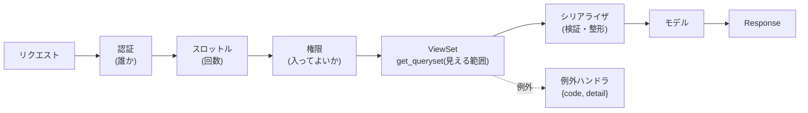
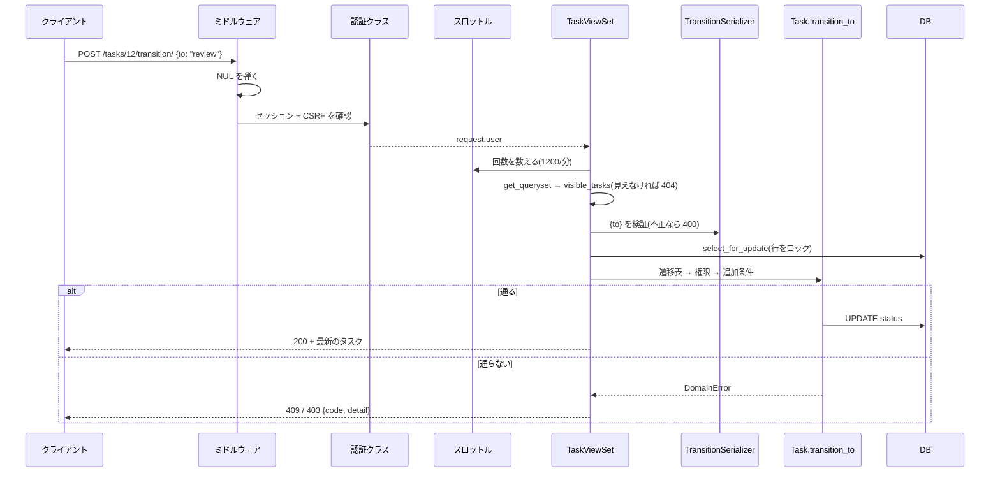

# L05 Django REST framework ― モデルを、安全な JSON の API にする

**この回の目標**
- シリアライザの 2 つの仕事(**入力の検証**と**出力の整形**)を説明できる
- `ViewSet`・ルーター・Mixin が何を自動でやってくれるか分かる
- **認証**(誰か)・**権限**(してよいか)・**見える範囲**(どれが見えるか)を区別して設計できる
- エラーの形を 1 つにそろえる方法(例外ハンドラ)を読める
- 1 本のリクエストが通る道を、コードで追える

前提: [L01](L01-web.md)、[L04](L04-django.md)。

---

## 1. DRF とは
**Django REST framework(DRF)**は、Django の上に作る **JSON API 用の道具**です。

| Django だけだと自分で書く | DRF が用意する |
|---|---|
| JSON の読み書き・検証 | **シリアライザ**(入力の検証 + 出力の整形) |
| `GET` / `POST` ごとの分岐 | **ViewSet**(1 クラスで一覧・作成・取得・更新) |
| URL の一覧 | **ルーター**(ViewSet から URL を自動生成) |
| 認証・権限・レート制限 | **認証クラス・権限クラス・スロットル** |
| エラーの形 | **例外ハンドラ**(1 か所で統一) |
| ページ分け | **ページネーション** |



## 2. シリアライザ ― 入口と出口の番人
シリアライザは、**外から来たデータを検証して Python の値にする**(入力)と、**Python の値を JSON にできる形にする**(出力)の 2 方向の仕事をします。

<!-- test:django -->
```python
from rest_framework import serializers


class EstimateSerializer(serializers.Serializer):
    name = serializers.CharField(max_length=10)                          # 必須・最大 10 文字
    estimate_h = serializers.FloatField(required=False, allow_null=True)  # 省略してよい・null も可
    status = serializers.CharField(read_only=True, default="todo")       # 出力だけ。入力では無視される

    def validate_estimate_h(self, value):                                # validate_<項目名>: その項目だけの検査
        if value is not None and value < 0:
            raise serializers.ValidationError("見積は 0 以上にしてください。")
        return value

    def validate(self, attrs):                                           # 全体の検査(項目の組み合わせ)
        if attrs.get("name") == "admin" and attrs.get("estimate_h"):
            raise serializers.ValidationError("この名前には見積を付けられません。")
        return attrs


def check(data):
    s = EstimateSerializer(data=data)
    ok = s.is_valid()
    return (ok, dict(s.validated_data) if ok else {k: [str(e) for e in v] for k, v in s.errors.items()})


print(check({"name": "リグ", "estimate_h": 8}))
print(check({"name": "リグ", "status": "done"}))      # status は read_only: 入力しても捨てられる(書き換えられない)
print(check({"estimate_h": -1}))                       # name が無い・見積が負
print(check({"name": "x" * 11}))                       # 長すぎる
print(check({"name": "admin", "estimate_h": 1}))       # 組み合わせの検査
print(check({"name": "リグ", "estimate_h": "abc"}))    # 型が違う
```

<!-- output -->
```text
(True, {'name': 'リグ', 'estimate_h': 8.0})
(True, {'name': 'リグ'})
(False, {'name': ['この項目は必須です。'], 'estimate_h': ['見積は 0 以上にしてください。']})
(False, {'name': ['この項目が10文字より長くならないようにしてください。']})
(False, {'non_field_errors': ['この名前には見積を付けられません。']})
(False, {'estimate_h': ['有効な数値を入力してください。']})
```

**読み取り専用(`read_only`)の項目は、入力で来ても無視されます。** このアプリで、タスクの `status` を `PATCH` で書き換えられないのは、この仕組みです。

<!-- excerpt: backend/tracker/serializers.py -->
```python
read_only_fields = ["status", "created_at", "updated_at"]  # 状態は transition でのみ変える
```

状態を変えるには、専用の `transition` を使う。そこで**遷移ルール(表・権限・条件)が必ず検査される**。迂回路を、設計で塞いでいます。
これは「**マスアサインメント**」(送られた項目を無条件にモデルへ流し込む脆弱性)への対策でもあります([L16](L16-operations.md))。

### ModelSerializer ― モデルから自動で作る
モデルの項目から、シリアライザを自動で作れます。

<!-- excerpt: backend/tracker/serializers.py -->
```python
class Meta:
    model = Task
    fields = [
        "id", "entity", "entity_name", "project", "project_code", "step", "step_name",
```

**`fields` に書いた項目だけが、API に出ます。** 書かない項目(パスワードなど)は、出ません。**許可リスト方式**で、出し忘れより出しすぎを防ぎます。

`SerializerMethodField` は、「保存していない値を、計算して出す」ためのものです。

<!-- excerpt: backend/tracker/serializers.py -->
```python
def get_is_overdue(self, obj):
    return bool(obj.due and obj.status != Task.Status.DONE and obj.due < timezone.localdate())
```

**期限切れかどうかは保存せず、読むたびに計算します**([L03](L03-database.md) の「計算できる値は保存しない」)。

## 3. ViewSet ― 1 クラスで一覧・作成・取得・更新
**ViewSet** は、リソース 1 つぶんの操作を 1 つのクラスにまとめます。必要な操作を **Mixin** で選びます。

<!-- excerpt: backend/tracker/views.py -->
```python
class TaskViewSet(
    mixins.ListModelMixin,
    mixins.CreateModelMixin,
    mixins.RetrieveModelMixin,
    mixins.UpdateModelMixin,
    viewsets.GenericViewSet,
):
```

| Mixin | 追加される操作 | HTTP |
|---|---|---|
| `ListModelMixin` | 一覧 | `GET /tasks/` |
| `CreateModelMixin` | 作成 | `POST /tasks/` |
| `RetrieveModelMixin` | 1 件の取得 | `GET /tasks/12/` |
| `UpdateModelMixin` | 更新 | `PATCH /tasks/12/` |
| (`DestroyModelMixin`) | 削除 | **付けていない**(API に削除は無い) |

**付けない Mixin が、「できないこと」の宣言**になります。削除を付けなければ、削除の API は存在しません(`DELETE` は 405)。

`@action` で、標準にない操作を足せます。

<!-- excerpt: backend/tracker/views.py -->
```python
@action(detail=True, methods=["post"])
def transition(self, request, pk=None):
    """状態遷移。不正な遷移は 409、権限が無ければ 403(ルールは Task.transition_to)。"""
    task = self.get_object()
    body = s.TransitionSerializer(data=request.data, choices=Task.Status.values)
    body.is_valid(raise_exception=True)
    with transaction.atomic():
        locked = Task.objects.select_for_update().select_related("entity__project", "step").get(pk=task.pk)
        locked.transition_to(body.validated_data["to"], request.user)
    return Response(self._fresh(task.pk))
```

読み解き(上から順に):
1. `self.get_object()` — **見える範囲の中から** 1 件を引く(見えなければ 404)。
2. `TransitionSerializer` — 本文 `{"to": ...}` を検証(不正な値は 400)。
3. `transaction.atomic()` + `select_for_update()` — **行をロックして**(同時操作を直列に)、
4. `locked.transition_to(...)` — **ルールはモデルに任せる**。ビューはルールを書かない。
5. 最新のタスクを返す。

**ビューは薄く、ルールはモデルに**。これが、ルールが 1 か所に集まる理由です。

## 4. 見える範囲 ― 最初に絞る
**どの行が見えるか**は、`get_queryset` で最初に決めます。

<!-- excerpt: backend/tracker/permissions.py -->
```python
def visible_projects(user):
    """利用者が見られるプロジェクト。管理者は全て、それ以外はメンバーになっているもの。"""
    if user.is_staff:
        return Project.objects.all()
    return Project.objects.filter(pk__in=ProjectMember.objects.filter(user=user).values("project_id"))
```

`TaskViewSet.get_queryset` は、**必ず `visible_tasks(user)` から始めます**。以降の絞り込み(`?status=`)は、その中でだけ働きます。
だから、**他人のプロジェクトの ID を知っていても、引けません(404)**。

3 つの違いを、表で整理します。

| 概念 | 問い | 外れたとき | このアプリ |
|---|---|---|---|
| **認証** | あなたは誰? | **401** | セッション / トークン / API キー |
| **見える範囲** | それは、あなたに見える? | **404** | `visible_*` |
| **権限** | それをしてよい? | **403** | `require_write`・`Task.transition_to` |

## 5. 認証・権限・見える範囲を、実際に確かめる
<!-- test:django -->
```python
from django.contrib.auth import get_user_model
from rest_framework.test import APIClient

from tracker.models import Entity, Project, ProjectMember, Step, Task, Version

User = get_user_model()
project = Project.objects.create(code="DEMO", name="デモ")
entity = Entity.objects.create(project=project, name="crate")
task = Task.objects.create(entity=entity, step=Step.objects.get(code="fx"), status="review")
Version.create_for_task(task, file_ref="P:/x.hip")

people = {}
for name, role in [("viewer", "viewer"), ("artist", "artist"), ("reviewer", "reviewer"), ("outsider", None)]:
    user = User.objects.create_user(name, password="pw-12345")
    if role:
        ProjectMember.objects.create(project=project, user=user, role=role)
    client = APIClient()
    client.force_authenticate(user)
    people[name] = client

print("ログインなし        ", APIClient().get(f"/api/v1/tasks/{task.id}/").status_code)
print("メンバーでない人    ", people["outsider"].get(f"/api/v1/tasks/{task.id}/").status_code)
print("viewer が読む       ", people["viewer"].get(f"/api/v1/tasks/{task.id}/").status_code)
for who in ("viewer", "artist", "reviewer"):
    res = people[who].post(f"/api/v1/tasks/{task.id}/transition/", {"to": "done"}, format="json")
    print(f"{who:8} が承認する ", res.status_code, res.json()["code"] if res.status_code != 200 else res.json()["status"])
```

<!-- output -->
```text
ログインなし         401
メンバーでない人     404
viewer が読む        200
viewer   が承認する  403 permission_denied
artist   が承認する  403 permission_denied
reviewer が承認する  200 done
```

読み取りは viewer でも 200。**承認(レビュー待ち → 完了)は reviewer だけ**(viewer / artist は 403)。
メンバーでない人は、**存在自体が見えない(404)**。

## 6. 例外ハンドラ ― エラーの形を 1 つに
DRF は、エラーを色々な形で返します(`{"detail": ...}`、`{"field": [...]}`、…)。クライアントが全部に対応するのは大変なので、**1 か所で `{code, detail}` にそろえます**。

<!-- excerpt: backend/tracker/errors.py -->
```python
def exception_handler(exc, context):
    if isinstance(exc, DomainError):
        return Response({"code": exc.code, "detail": exc.detail}, status=exc.status_code)
    if isinstance(exc, Http404):
        exc = exceptions.NotFound()

    response = drf_exception_handler(exc, context)
    if response is None:
        return None  # 想定外の例外は 500(Sentry に届く)
```

3 つの経路に注意してください。

| 例外 | 扱い |
|---|---|
| `DomainError`(業務ルール違反) | モデルが投げた例外を、**ここで HTTP に変換**(`exc.status_code`) |
| DRF の例外(`ValidationError` など) | DRF の標準処理のあと、**形を `{code, detail}` に整える** |
| それ以外(バグ) | `None` を返す → **500 になり、Sentry に届く**(握りつぶさない) |

## 7. ページネーションとスロットル
<!-- excerpt: backend/tracker/pagination.py -->
```python
class StandardPagination(PageNumberPagination):
    """一覧は全てページネーション(既定 50・上限 200)。"""

    page_size = 50
    page_size_query_param = "page_size"
    max_page_size = 200
```

**スロットル**は、一定時間内の回数を制限します(超えると 429)。アルゴリズムは [L09](L09-security-crypto.md) で詳しく。

<!-- test:django -->
```python
from django.core.cache import cache
from django.contrib.auth import get_user_model
from rest_framework.test import APIClient
from rest_framework.throttling import ScopedRateThrottle

get_user_model().objects.create_user("alice", password="right-pass-123")
old = ScopedRateThrottle.THROTTLE_RATES["login"]
ScopedRateThrottle.THROTTLE_RATES["login"] = "3/min"       # 実験のため、1 分に 3 回に絞る
cache.clear()
try:
    client = APIClient()
    codes = [client.post("/api/v1/auth/login/", {"username": "alice", "password": "wrong"}, format="json").status_code for _ in range(5)]
    print(codes)                                           # 3 回までは 401(パスワード違い)、4 回目から 429
finally:
    ScopedRateThrottle.THROTTLE_RATES["login"] = old       # 必ず元に戻す
    cache.clear()
```

<!-- output -->
```text
[401, 401, 401, 429, 429]
```

## 8. 入力を信用しない ― パーサと型
DRF は、本文の形式を **パーサ**で読みます。このアプリは **JSON だけ**を許可し、フォームや multipart は **415** で拒否します。

<!-- excerpt: backend/config/settings.py -->
```python
"DEFAULT_PARSER_CLASSES": ["rest_framework.parsers.JSONParser"],
```

**受け付ける形式が少ないほど、検証すべき入口が減ります。** さらに、`NUL` 文字・巨大な数・深すぎる入れ子など、**壊れた入力**でも 500 にならないよう、テストで確かめています([L14](L14-testing.md))。

## 9. 1 本のリクエストを、コードで追う
`POST /api/v1/tasks/12/transition/` が通る道を、これまでの部品で整理します。



## よくある間違い
| 間違い | 正しくは |
|---|---|
| ビューにルールを書く | ルールはモデルのメソッドに。ビューは薄く |
| `get_queryset` を `Model.objects.all()` から始める | **`visible_*` から**。さもないと他人のデータが見える |
| `fields = "__all__"` | 出す項目を**明示**する(許可リスト) |
| `request.data` をそのままモデルに流す | シリアライザで検証してから |
| `except Exception` で全部を 400 にする | 想定外(バグ)は 500 にして、ログ・Sentry に残す |
| 一覧に並び順を付けない | ページ送りでぶれる。必ず `order_by` |
| 認証失敗を 403 にしたい | クラスに `authenticate_header` を返させる(さもないと DRF は 401 を 403 に変える) |

## 確認問題
1. シリアライザの 2 つの仕事は。
2. `read_only` の項目に値を送ると、どうなるか。それがなぜ安全に役立つか。
3. ViewSet に `DestroyModelMixin` を付けないと、何が起きるか。
4. 「認証」「見える範囲」「権限」の違いを、返すステータスとともに述べよ。
5. 例外ハンドラが `None` を返す場合、何が起きるか。なぜ握りつぶさないのか。
6. `transition` が、ルールをビューでなくモデルに任せている利点は。

## 答え
1. 入力の検証(外から来たデータを Python の値にする)と、出力の整形(Python の値を JSON にする)。
2. 無視される(エラーにもならず、値は使われない)。`status` のように、特別な手順(遷移ルール)でだけ変えたい項目を、`PATCH` で書き換えられないようにできる。
3. 削除の API が存在しない(`DELETE` は 405)。付けないことが「できない」の宣言になる。
4. 認証 = 誰か(外れたら 401)。見える範囲 = その対象が見えるか(外れたら 404)。権限 = してよい操作か(外れたら 403)。
5. 500 になり、ログと Sentry に届く。バグを隠さず、気づけるようにするため。
6. ルールが 1 か所に集まり、API・画面・テスト・管理画面のどこから呼んでも同じルールが働く。HTTP を使わずに、ルールだけをテストできる。

## 次へ
[L06 アルゴリズム① 状態機械](L06-state-machine.md) ― `Task.transition_to` の中身を、**考え方から**作ります。
