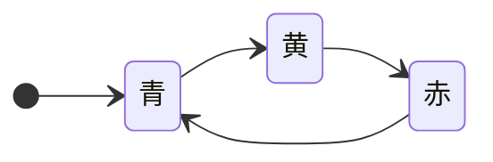
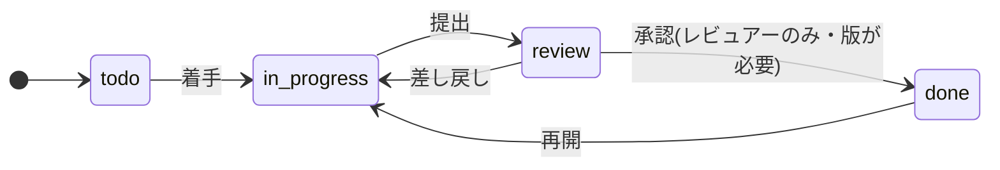
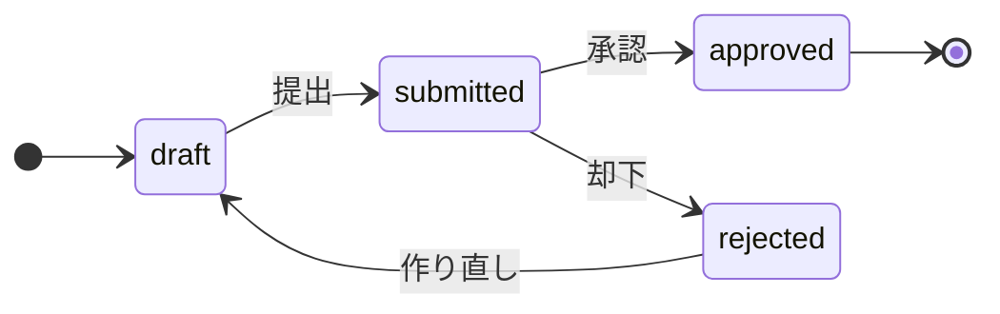
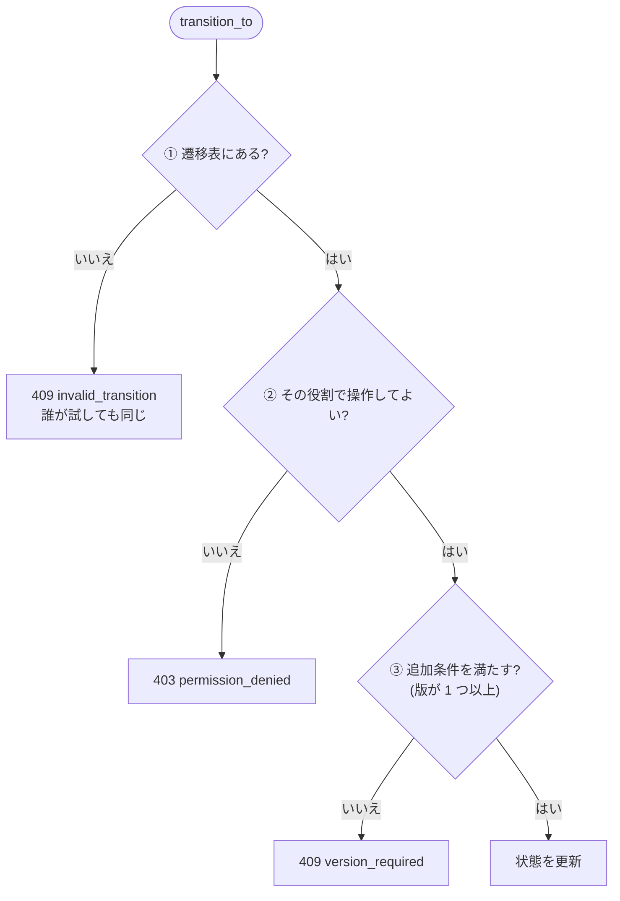
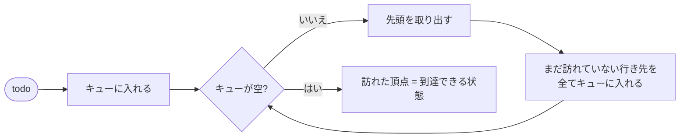

# L06 アルゴリズム① 状態機械 ― 遷移表・全組み合わせの検証・小さなモデル検査

**この回の目標**
- **状態機械**(有限状態機械)の考え方を、言葉と図と表で説明できる
- 遷移の**判定の順序**(表 → 権限 → 条件)を、理由とともに説明できる
- 全組み合わせのテストが**なぜ強力か**を理解し、書ける
- グラフの探索(幅優先)で、状態機械の性質(到達可能性・行き止まり)を**調べる**アルゴリズムを書ける
- **小さなモデル検査**(全ての状態を数え上げて、不変条件を確かめる)を体験する

前提: [L02](L02-python.md)、[L05](L05-drf.md)。

---

## 1. 状態機械とは
**状態機械**は、「今どの状態にあるか」と「どの状態へ移れるか」だけで、振る舞いを表す考え方です。身近な例は信号機です。



| 要素 | 意味 | 信号機 | このアプリのタスク |
|---|---|---|---|
| 状態 | 今の状況(有限個) | 青・黄・赤 | 未着手・進行中・レビュー待ち・完了 |
| 遷移 | 状態から状態への移動 | 青 → 黄 | 進行中 → レビュー待ち |
| 遷移表 | 「どこからどこへ行けるか」の一覧 | (青→黄、黄→赤、赤→青) | `Task.TRANSITIONS` |
| ガード | 遷移してよい**追加条件** | (なし) | 版が 1 つ以上ある・レビュアーである |

**なぜ状態機械で考えるのか。** 「完了のタスクを、いきなり未着手に戻す」のような**ありえない遷移**を、**表にないものは全て禁止**という単純なルールで防げるからです。
`if` の山で書くと、禁止し忘れが必ず出ます。表なら、**許す遷移だけを書く**ので、書き忘れは「禁止」側に倒れます(安全側)。

## 2. このアプリの状態機械


これが、そのままコードの表になっています。

<!-- excerpt: backend/tracker/models.py -->
```python
TRANSITIONS = {
    Status.TODO: frozenset({Status.IN_PROGRESS}),
    Status.IN_PROGRESS: frozenset({Status.REVIEW}),
    Status.REVIEW: frozenset({Status.IN_PROGRESS, Status.DONE}),  # 差し戻し / 承認
    Status.DONE: frozenset({Status.IN_PROGRESS}),  # 再開
}
```

**版(Version)にも、別の状態機械**があります(タスクの状態とは独立)。



<!-- excerpt: backend/tracker/models.py -->
```python
Status.APPROVED: frozenset(),
Status.REJECTED: frozenset({Status.DRAFT}),  # 直して作り直す
```

`approved` の行き先は**空集合**。「終端状態」(そこから出られない)です。

## 3. 判定の順序 ― 表 → 権限 → 条件
遷移できるかの判定には、3 種類の検査があります。**順序**が設計の肝です。



**なぜ表を最初に調べるのか。**
- 「未着手 → 完了」は、**誰が試しても**ありえない遷移です。権限を先に調べると、「閲覧者には 403、レビュアーには 409」のように、**答えが人によって変わります**。
  表を先にすれば、答えは常に 409。**ルールの説明がシンプル**になり、テストも書きやすい。
- 逆に、権限のない人に、**内部のルール(どの遷移が可能か)を細かく教えない**配慮にもなります(ただし表自体は API の `next_statuses` で公開しています)。

実際のコードを読みましょう。

<!-- excerpt: backend/tracker/models.py -->
```python
def transition_to(self, to: str, user) -> None:
    """状態遷移。呼び出し側で行ロック(select_for_update)と atomic を用意すること。"""
    current = self.Status(self.status)
    to = self.Status(to)
    if to not in self.TRANSITIONS[current]:
        raise InvalidTransition(f"「{current.label}」から「{to.label}」へは移行できません。")

    project = self.project
    if not project.can_write(user):
        raise Forbidden("このプロジェクトのタスクを操作する権限がありません。")
    if current == self.Status.REVIEW and to == self.Status.DONE and not project.can_review(user):
        raise Forbidden("承認できるのは、このプロジェクトのレビュアーのみです。")
```

読み解き:
1. `self.Status(to)` — 文字列を Enum に変換(不正な値なら `ValueError`。API 層が先に弾く)。
2. `to not in self.TRANSITIONS[current]` — **表の引き**。これが ① の検査。
3. `project.can_write(user)` — ② 役割。
4. 「レビュー待ち → 完了」(承認)だけ、**レビュアー限定**。管理者(`is_staff`)でもだめ。
5. (この下で ③ 版の有無を調べ、通ったら `status` を更新して保存。)

### ガード付きの状態機械を、自分で作る
同じ考え方を、純粋な Python で作ってみましょう。

<!-- test -->
```python
class InvalidTransition(Exception):
    pass


class Forbidden(Exception):
    pass


class RuleViolation(Exception):
    pass


TABLE = {
    "todo": {"in_progress"},
    "in_progress": {"review"},
    "review": {"in_progress", "done"},
    "done": {"in_progress"},
}


def transition(state, to, *, role, versions, require_version=True):
    """表 → 権限 → 条件 の順に検査して、新しい状態を返す。"""
    if to not in TABLE[state]:
        raise InvalidTransition(f"{state} から {to} へは移行できません")
    if role not in {"artist", "reviewer"}:
        raise Forbidden("操作する権限がありません")
    if state == "review" and to == "done" and role != "reviewer":
        raise Forbidden("承認できるのはレビュアーのみです")
    if to == "done" and require_version and versions == 0:
        raise RuleViolation("完了には版が 1 つ以上必要です")
    return to


def attempt(*args, **kwargs):
    try:
        return transition(*args, **kwargs)
    except (InvalidTransition, Forbidden, RuleViolation) as error:
        return f"{type(error).__name__}"


print(attempt("todo", "done", role="viewer", versions=0))        # 表が先: 閲覧者でも 409 相当
print(attempt("todo", "done", role="reviewer", versions=0))      # 誰が試しても同じ
print(attempt("review", "done", role="artist", versions=1))      # 表は通る → 権限で止まる
print(attempt("review", "done", role="reviewer", versions=0))    # 権限は通る → 条件で止まる
print(attempt("review", "done", role="reviewer", versions=1))    # すべて通る
```

<!-- output -->
```text
InvalidTransition
InvalidTransition
Forbidden
RuleViolation
done
```

1 行目と 2 行目は、役割が違っても**同じ結果**(`InvalidTransition`)。これが「表を先にする」効果です。

## 4. 全組み合わせのテスト
状態が 4 つなら、「どの状態からどの状態へ」は **4 × 4 = 16 通り**。**全部を試せば、抜けはありません。**
しかも、期待する結果を**テスト側で別に書き直す**ので、表と期待値の**二重管理**になります。表を変えると、テストが必ず落ちます。

<!-- excerpt: backend/tracker/tests/test_task_transitions.py -->
```python
ALLOWED = {
    (S.TODO, S.IN_PROGRESS),
    (S.IN_PROGRESS, S.REVIEW),
    (S.REVIEW, S.IN_PROGRESS),
    (S.REVIEW, S.DONE),
    (S.DONE, S.IN_PROGRESS),
}
ALL_PAIRS = [(a, b) for a in S for b in S]
```

`ALL_PAIRS` は、内包表記で **16 通りを自動で作ります**。状態を 1 つ足すと、**25 通り**に自動で増えます(足し忘れが起きない)。
実際のモデルで、16 通りの結果を表にしてみましょう。

<!-- test:django -->
```python
from django.contrib.auth import get_user_model

from tracker.errors import DomainError
from tracker.models import Entity, Project, ProjectMember, Step, Task, Version

reviewer = get_user_model().objects.create_user("rev", password="pw-12345")
project = Project.objects.create(code="DEMO", name="デモ")
ProjectMember.objects.create(project=project, user=reviewer, role="reviewer")
entity = Entity.objects.create(project=project, name="crate")
task = Task.objects.create(entity=entity, step=Step.objects.get(code="fx"))
Version.create_for_task(task, file_ref="P:/x.hip")      # 「完了」の条件(版がある)を満たす

statuses = list(Task.Status.values)
print("from \\ to     " + " ".join(f"{s[:6]:>6}" for s in statuses))
allowed = 0
for src in statuses:
    cells = []
    for dst in statuses:
        task.status = src
        task.save()
        try:
            task.transition_to(dst, reviewer)
            cells.append("     ○")
            allowed += 1
        except DomainError:
            cells.append("     ×")
    print(f"{src:12} " + " ".join(cells))
print("許される遷移:", allowed, "/", len(statuses) ** 2)
```

<!-- output -->
```text
from \ to       todo in_pro review   done
todo              ×      ○      ×      ×
in_progress       ×      ×      ○      ×
review            ×      ○      ×      ○
done              ×      ○      ×      ×
許される遷移: 5 / 16
```

16 通りのうち、通るのは **5 つだけ**(○)。対角線(同じ状態への遷移)も全て ×(「何もしない」遷移も、表にないので拒否)。

## 5. 状態機械を「調べる」アルゴリズム
表は**有向グラフ**です(状態 = 頂点、遷移 = 辺)。だから、グラフのアルゴリズムで、**表の性質を機械的に調べられます**。

### 到達可能性(幅優先探索)
**幅優先探索(BFS)**は、始点から近い順に、辿れる頂点を全て訪れます。キュー(先入れ先出し)を使います。計算量は `O(V + E)`(頂点数 + 辺の数)。



<!-- test -->
```python
from collections import deque


def reachable(table, start):
    """start から辿れる状態の集合(幅優先探索)。"""
    seen = {start}
    queue = deque([start])
    while queue:
        state = queue.popleft()
        for nxt in sorted(table.get(state, ())):       # sorted: 実行のたびに順序が変わらないように
            if nxt not in seen:
                seen.add(nxt)
                queue.append(nxt)
    return seen


TASK = {
    "todo": {"in_progress"},
    "in_progress": {"review"},
    "review": {"in_progress", "done"},
    "done": {"in_progress"},
}
VERSION = {
    "draft": {"submitted"},
    "submitted": {"approved", "rejected"},
    "approved": set(),
    "rejected": {"draft"},
}

print("タスク: todo から到達できる =", sorted(reachable(TASK, "todo")))
print("版    : draft から到達できる =", sorted(reachable(VERSION, "draft")))

# 検査 1: 初期状態から、全ての状態に到達できる(到達できない「死んだ状態」が無い)
assert reachable(TASK, "todo") == set(TASK)
assert reachable(VERSION, "draft") == set(VERSION)

# 検査 2: 行き止まり(行き先が空)の状態 = 終端状態
print("タスクの終端:", [s for s, nxt in TASK.items() if not nxt])
print("版の終端    :", [s for s, nxt in VERSION.items() if not nxt])

# 検査 3: 表の行き先に、表に無い状態が混ざっていない(書き間違いの検出)
for table in (TASK, VERSION):
    for src, targets in table.items():
        assert targets <= set(table), f"{src} の行き先に未定義の状態がある"
print("表の整合性 OK")
```

<!-- output -->
```text
タスク: todo から到達できる = ['done', 'in_progress', 'review', 'todo']
版    : draft から到達できる = ['approved', 'draft', 'rejected', 'submitted']
タスクの終端: []
版の終端    : ['approved']
表の整合性 OK
```

**タスクには終端状態がない**(完了も「再開」で戻れる)のに対し、**版の `approved` は終端**。設計の違いが、表から機械的に読み取れました。
「死んだ状態」(初期状態から行けない)や「書き間違い」は、表を直したときに、**このような検査をテストに入れておけば**すぐ分かります。

## 6. 小さなモデル検査 ― 全部を数え上げて、不変条件を確かめる
**不変条件**は、「どんな順序で操作しても、常に成り立ってほしい性質」です。このアプリの場合:

> **完了のタスクには、版が 1 つ以上ある**

テストは「いくつかの順序」しか試せません。でも状態が少なければ、**全ての順序を数え上げて**確かめられます。これが**モデル検査**の考え方です(大きな分野で、TLA+ などの専用ツールがあります)。

状態を `(タスクの状態, 版の数)` とし、操作を「遷移する」と「版を追加する」だけにして、**到達できる全状態**を数え上げます。版の数は 0〜2 で打ち切ります。

<!-- test -->
```python
from collections import deque

TASK = {
    "todo": {"in_progress"},
    "in_progress": {"review"},
    "review": {"in_progress", "done"},
    "done": {"in_progress"},
}


def successors(state, require_version):
    """今の状態から、1 回の操作で行ける状態(と、その操作の名前)を全て返す。"""
    status, versions = state
    for to in sorted(TASK[status]):
        if to == "done" and require_version and versions == 0:
            continue                                    # ルール: 版が無いと完了にできない
        yield (to, versions), f"{status} → {to}"
    if versions < 2:
        yield (status, versions + 1), "版を追加"


def check(require_version):
    start = ("todo", 0)
    parent = {start: None}                              # どの状態から、どの操作で来たか(反例の復元用)
    queue = deque([start])
    while queue:
        state = queue.popleft()
        if state[0] == "done" and state[1] == 0:        # 不変条件の違反: 完了なのに版が 0
            path = []
            while parent[state]:
                state, action = parent[state]
                path.append(action)
            return list(reversed(path)), len(parent)
        for nxt, action in successors(state, require_version):
            if nxt not in parent:
                parent[nxt] = (state, action)
                queue.append(nxt)
    return None, len(parent)


counter, explored = check(require_version=True)
print("ルールあり: 反例", counter, "/ 調べた状態", explored)

counter, explored = check(require_version=False)
print("ルールなし: 反例", counter, "/ 調べた状態", explored)
```

<!-- output -->
```text
ルールあり: 反例 None / 調べた状態 11
ルールなし: 反例 ['todo → in_progress', 'in_progress → review', 'review → done'] / 調べた状態 9
```

**読み方**:
- ルールあり: 到達できる状態を**全て**調べても、「完了なのに版が 0」には**ならない**(反例なし)。ルールが不変条件を守っている証拠(この小さなモデルの範囲で)。
- ルールなし: **反例**(完了にたどり着く操作の列)が見つかった。`REQUIRE_VERSION_FOR_COMPLETION=0` にすると、このルールが外れる、ということの確認にもなる。

> 実際のシステムは、状態(ユーザー・並行する操作・DB)がもっと多く、全部は数え上げられません。それでも**「状態が少ない核の部分だけを抜き出して、全探索する」**のは強力で、設計書が触れていた形式検証(TLA+ など)の入口です。このアプリでは、まず **pytest の全組み合わせ**で十分、という判断をしています([decisions.md](../decisions.md))。

## 7. 状態を足すとき
状態機械の変更は、**表が最初**です。

| 手順 | 理由 |
|---|---|
| ① 状態を足し、**行き先と戻り先の両方**を表に書く | 行き先が無いと、入ったら出られない(終端)になる |
| ② 全組み合わせのテストの期待値(`ALLOWED`)を直す | 二重管理が、書き間違いを見つける |
| ③ 画面の表(`Record<TaskStatus, ...>`)を直す | 型が、書き忘れを教える |
| ④ 到達可能性・終端の検査を流す | 死んだ状態・行き止まりを作っていないか |

手順の詳細は [実践ガイド レシピ B](../learning/04-recipes.md)。

## よくある間違い
| 間違い | 正しくは |
|---|---|
| `if status == "done" and to == "todo": raise ...` と禁止を並べる | **許す遷移だけを表に書く**。書き忘れが「禁止」側に倒れる |
| 権限を先に調べる | 表を先に。答えが人で変わらないように |
| 状態を文字列で比べる(`"done"`) | Enum(`Status.DONE`)。打ち間違いが即エラーになる |
| 表を書き換えて、テストも一緒に直す | 期待値を**別に**書いているから意味がある。表の変更理由を説明できないなら、直さない |
| 表を `dict` の中の `list` で持つ | 変更できない `frozenset` で。実行中に書き換わらない |
| 画面にも遷移表を写す | 画面はサーバーの結果(`next_statuses`)を表示するだけ。二重のルールは食い違う |

## 確認問題
1. 状態機械の 4 つの要素(状態・遷移・遷移表・ガード)を、このアプリの例で言え。
2. 遷移の判定で、「表 → 権限 → 条件」の順にする理由を 2 つ挙げよ。
3. 状態が 5 つになると、全組み合わせのテストは何通りになるか。
4. 幅優先探索の計算量は。到達可能性の検査で、何が分かるか。
5. 版の `approved` は「終端状態」。そこから、どんな操作でも抜けられないことを、どう確かめるか。
6. モデル検査で「反例」が見つかるとは、どういうことか。

## 答え
1. 状態: 未着手 など / 遷移: 進行中 → レビュー待ち / 遷移表: `Task.TRANSITIONS` / ガード: 版が 1 つ以上・レビュアーである。
2. ①「未着手 → 完了」のようなありえない遷移は誰が試しても同じ結果(409)にでき、説明とテストが単純になる。②権限の無い人に、内部のルールを細かく教えすぎない。
3. 5 × 5 = 25 通り。
4. `O(V + E)`(状態の数 + 遷移の数)。初期状態から到達できない状態(死んだ状態)と、行き先のない状態(終端)が分かる。
5. 表の `approved` の行き先が空集合であることをテストする(`VERSION["approved"] == set()`)。到達可能性の関数で、approved から到達できる集合が `{approved}` だけ、でもよい。
6. 不変条件に違反する状態に至る、具体的な操作の列が見つかったこと。「どの順序で操作すると壊れるか」を、機械が教えてくれる。

## 次へ
[L07 アルゴリズム② 文字列とパス](L07-strings-paths.md) ― 品質スキャンのパスを、アセットに結びつけるアルゴリズム。
