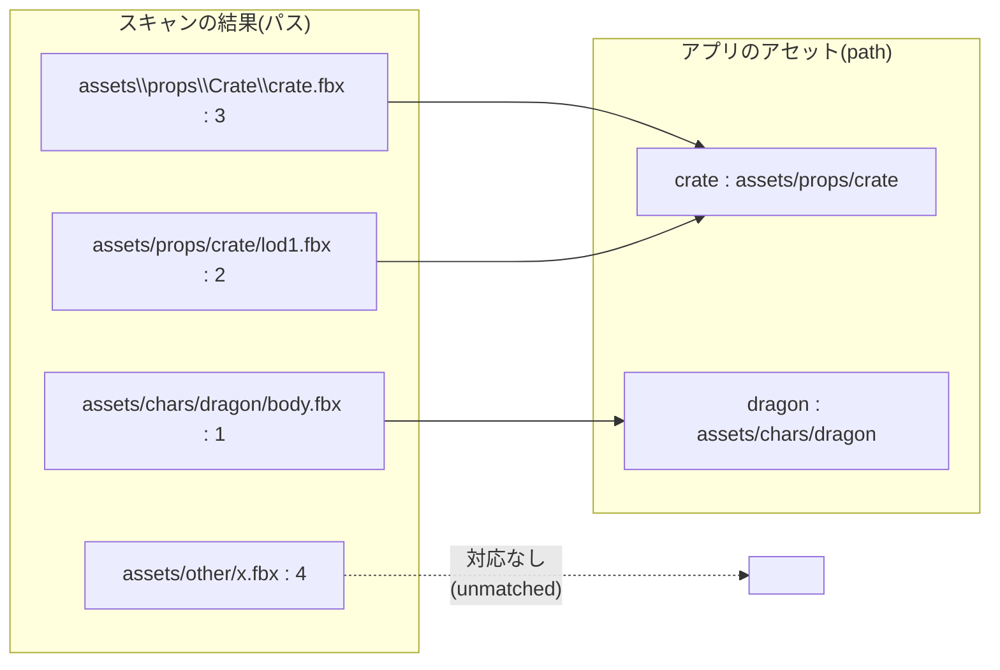
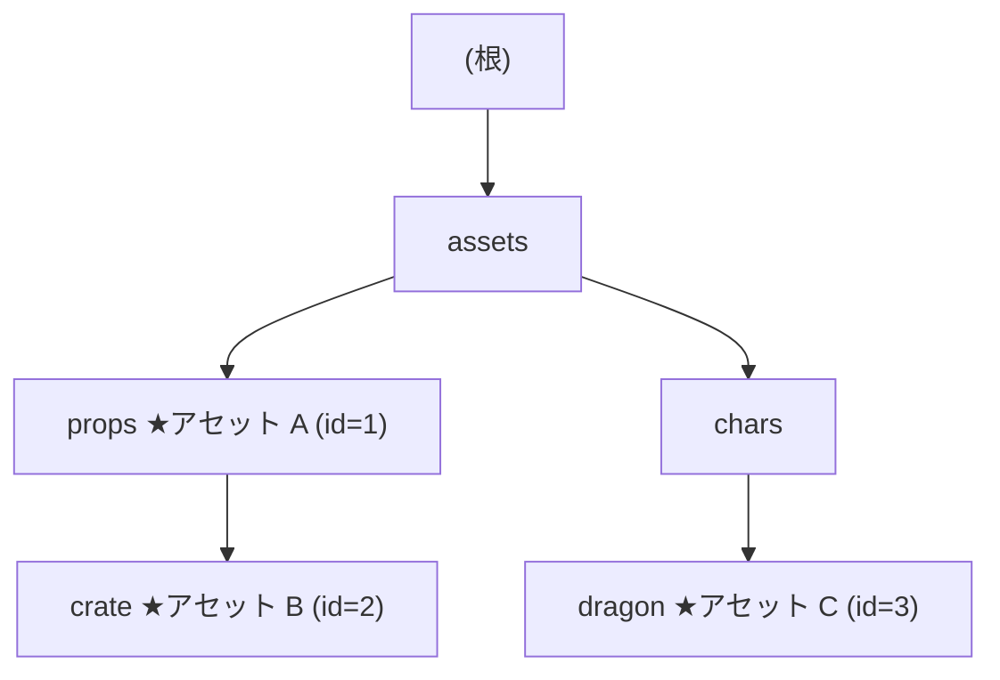
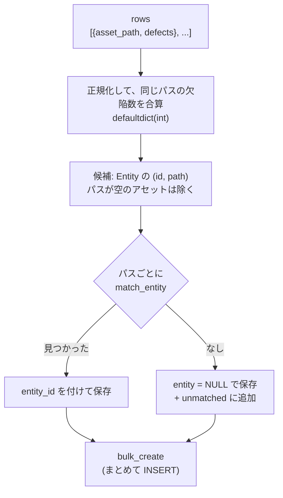

# L07 アルゴリズム② 文字列とパス ― 正規化・最長前方一致・計算量・トライ木

**この回の目標**
- 表記ゆれのある文字列を、**正規化**して比べる考え方を説明できる
- 「前方一致」の落とし穴(`crate` と `crater`)を、コードで示して直せる
- **最長一致**を実装でき、その**計算量**を `O(N · L)` と答えられる
- **トライ木**で、同じ問題を速く解ける理由を説明でき、実装できる
- 取り込み(集計 → 突き合わせ → 保存)の流れを、コードで読み解ける

前提: [L02](L02-python.md)。

---

## 1. 解きたい問題
品質スキャン(AssetDataInsightSuite)は、**ファイルのパスごとに欠陥の数**を出します。
でも、画面は**アセットごと**に見せたい。「このパスは、どのアセットのもの?」を決める必要があります。



**同じアセットの下にあるファイルは、パスの先頭が同じ**です(`assets/props/crate/` で始まる)。だから「**前方一致**」で結びつけます。
ところが、実際のデータには、表記ゆれがあります。

| ゆれ | 例 |
|---|---|
| 区切り文字 | `assets\props\crate`(Windows)と `assets/props/crate` |
| 連続する区切り | `assets//props///crate` |
| 先頭の `./` | `./assets/props/crate` |
| 末尾の `/` | `assets/props/crate/` |
| 大文字小文字 | `P:` と `p:`(Windows のドライブ文字)、`Crate` と `crate` |

**比べる前に、表記を 1 つに揃える(正規化)**。これが最初の考え方です。

## 2. 正規化
<!-- excerpt: backend/tracker/paths.py -->
```python
def normalize_path(path: str) -> str:
    p = path.strip().replace("\\", "/")
    p = _MULTI_SLASH.sub("/", p)
    while p.startswith("./"):
        p = p[2:]
    return p.rstrip("/")
```

1 行ずつ(`_MULTI_SLASH` は `re.compile(r"/{2,}")`、「`/` が 2 つ以上」)。

| 行 | 処理 | 例 |
|---|---|---|
| 1 | 前後の空白を取り、`\` を `/` に | `" assets\\props "` → `"assets/props"` |
| 2 | 連続する `/` を 1 つに | `a//b` → `a/b` |
| 3 | 先頭の `./` を取る(何度でも) | `././a` → `a` |
| 4 | 末尾の `/` を取る | `a/` → `a` |

<!-- test -->
```python
from tracker.paths import normalize_path

for raw in ["assets\\props\\crate\\", "  ./assets//props/crate/  ", "P:\\proj\\a.fbx", "././x", "", "./"]:
    print(repr(raw), "→", repr(normalize_path(raw)))
```

<!-- output -->
```text
'assets\\props\\crate\\' → 'assets/props/crate'
'  ./assets//props/crate/  ' → 'assets/props/crate'
'P:\\proj\\a.fbx' → 'P:/proj/a.fbx'
'././x' → 'x'
'' → ''
'./' → ''
```

**正規化は「冪等」であるべきです**: 2 回かけても、1 回と同じ結果。`normalize(normalize(x)) == normalize(x)`。そうでないと、保存時と比較時で結果が食い違います。

<!-- test -->
```python
from tracker.paths import normalize_path

samples = ["assets\\props\\crate\\", "  ./assets//props/crate/  ", "P:\\proj\\a.fbx", "././x", "", "./", "a//b///c/"]
assert all(normalize_path(normalize_path(x)) == normalize_path(x) for x in samples)
print("冪等:", len(samples), "個すべて OK")
```

<!-- output -->
```text
冪等: 7 個すべて OK
```

### 大文字小文字 ― `lower()` でなく `casefold()`
比べるための「鍵」を作る関数が、これです。

<!-- excerpt: backend/tracker/paths.py -->
```python
def _key(path: str) -> str:
    return normalize_path(path).casefold()
```

**保存するのは元の表記**(正規化のみ)で、**比べるときだけ**大文字小文字を畳みます。「見た目は元のまま、比較は寛容に」。

### 落とし穴: 見た目が同じでも、文字が違う(Unicode)
日本語のファイル名には、もう 1 つ罠があります。**同じ「が」が、2 通りの作り方**があるのです。

<!-- test -->
```python
import unicodedata

composed = "が"                       # U+304C: 1 文字(NFC)
decomposed = "か\u3099"               # か + 濁点(結合文字): 2 文字(NFD)。macOS のファイル名はこちらで来ることがある
print(composed == decomposed, len(composed), len(decomposed))
print(unicodedata.normalize("NFC", decomposed) == composed)
```

<!-- output -->
```text
False 1 2
True
```

画面では同じに見えるのに、`==` は **False**。このアプリの `_key` は、まだ NFC 正規化をしていません(**既知の限界**)。
日本語のアセット名を macOS から取り込む場合は、`unicodedata.normalize("NFC", ...)` を足す必要があります。[総合演習](L17-capstone.md)の候補の 1 つです。

## 3. 前方一致の落とし穴
素直に書くと、こうなります。

<!-- test -->
```python
def naive_match(path, entity_path):
    return path.startswith(entity_path)          # 素朴な前方一致


print(naive_match("assets/props/crate/a.fbx", "assets/props/crate"))     # 正しい
print(naive_match("assets/props/crater/a.fbx", "assets/props/crate"))    # 誤り: crater は crate の下ではない
```

<!-- output -->
```text
True
True
```

文字列として前方一致していても、**パスとしては別のフォルダ**です。直し方は、「**区切りの `/` まで含めて**一致させる」こと。

<!-- excerpt: backend/tracker/paths.py -->
```python
if (target == prefix or target.startswith(prefix + "/")) and len(prefix) > best_len:
```

- `target == prefix` — ちょうど同じ(フォルダそのもの)
- `target.startswith(prefix + "/")` — `prefix` の**下にある**(区切りを付けて調べる)

## 4. 最長一致
アセットが入れ子になっていると、複数が前方一致します。

```text
assets/props         ← アセット A
assets/props/crate   ← アセット B
```

`assets/props/crate/a.fbx` は **A にも B にも前方一致**。どちらに結びつけるべきでしょう。**より具体的な(長い)B** です。これが**最長一致**です。

<!-- excerpt: backend/tracker/paths.py -->
```python
def match_entity(asset_path: str, candidates: list[tuple[int, str]]) -> int | None:
    """`candidates` = [(entity_id, entity_path)]。最も長く前方一致した Entity の id を返す。"""
    target = _key(asset_path)
    best_id, best_len = None, -1
    for entity_id, entity_path in candidates:
        prefix = _key(entity_path)
        if not prefix:
            continue
```

アルゴリズムは単純です。

1. 結果の入れ物 `best_id`(まだ無い)と、一致の長さ `best_len = -1` を用意する。
2. 候補を**全部**順に調べる。
3. 区切りまで含めて前方一致し、**かつ今までで一番長い**なら、入れ替える。
4. 最後に残ったものが、最長一致。

<!-- test -->
```python
from tracker.paths import match_entity

candidates = [(1, "assets/props"), (2, "assets/props/crate"), (3, "")]
for path in [
    "assets/props/crate/crate.fbx",        # A と B の両方 → 長い B(2)
    "assets/props/barrel.fbx",             # A だけ(1)
    "assets/props/crate",                  # B と完全一致(2)
    "assets/props/crater/x.fbx",           # crate の下ではない → A(1)
    "ASSETS\\Props\\Crate\\x.fbx",         # 区切り・大文字小文字のゆれを吸収(2)
    "assets/chars/x.fbx",                  # どれにも合わない(None)
    "other/assets/props/x.fbx",            # 先頭から一致しない(None)
]:
    print(f"{path:32} → {match_entity(path, candidates)}")
```

<!-- output -->
```text
assets/props/crate/crate.fbx     → 2
assets/props/barrel.fbx          → 1
assets/props/crate               → 2
assets/props/crater/x.fbx        → 1
ASSETS\Props\Crate\x.fbx         → 2
assets/chars/x.fbx               → None
other/assets/props/x.fbx         → None
```

(空の `path` を持つ候補 `(3, "")` は、`if not prefix: continue` で**無視**されます。パス未設定のアセットが、全部に一致してしまう事故を防ぐため。)

## 5. 計算量 ― 「どれくらい遅くなるか」を見積もる
アルゴリズムの良し悪しは、**入力が増えたときに、手数がどれくらい増えるか**で測ります(**計算量**、`O(...)` 記法)。

| 記号 | 意味 | 例 |
|---|---|---|
| `O(1)` | 入力によらず一定 | 辞書の引き・遷移表の引き |
| `O(log N)` | 倍になっても +1 回程度 | 二分探索・B 木の索引 |
| `O(N)` | 入力に比例 | リストを 1 回なめる |
| `O(N log N)` | | 並べ替え |
| `O(N²)` | 2 乗 | 二重ループ |

`match_entity` は、**候補 N 個を全部**調べます。1 回の比較は、パスの長さ L に比例(文字を比べる)。1 つのパスにつき `O(N · L)`。
スキャンのパスが M 個なら、**全体で `O(M · N · L)`**。

| M(パス数) | N(アセット数) | L(長さ) | おおよその手数 |
|---|---|---|---|
| 1,000 | 50 | 50 | 250万 |
| 50,000 | 500 | 80 | 20 億 |

小さなうちは問題ありません。でも、**パスが 5 万・アセットが 500** になると、手数が一気に膨らみます。
このアプリは、プロジェクトのアセットが数十〜数百の想定なので、今の実装で十分、という判断です。**でも、速くする方法を知っておく**のが、この回のねらいです。

## 6. トライ木 ― 「先頭が同じ」を木で共有する
**トライ木**(prefix tree)は、**文字列の先頭を共有して**木にするデータ構造です。前方一致の問題に最適です。
ここでは、文字でなく**パスの区切りごと(フォルダ名)**を 1 段にします。



**探し方**: パスをフォルダ名に分け、根から**1 段ずつ降りる**。途中で通った「★(アセットがある)」のうち、**一番深いもの**が最長一致です。
降りる回数は、パスの深さ(フォルダの数)だけ。**アセットの数 N に、手数が依存しません**。1 つのパスにつき `O(L)`。

<!-- test -->
```python
from tracker.paths import match_entity, normalize_path


class PathTrie:
    """フォルダ名を 1 段とするトライ木。最長一致を O(パスの深さ)で探す。"""

    def __init__(self, candidates):
        self.root = {}                                        # {フォルダ名: 子の辞書}。"★" キーにアセットの id
        for entity_id, entity_path in candidates:
            key = normalize_path(entity_path).casefold()
            if not key:
                continue                                      # 空の path は無視(match_entity と同じ)
            node = self.root
            for part in key.split("/"):
                node = node.setdefault(part, {})
            node["★"] = entity_id

    def match(self, asset_path):
        node, best = self.root, None
        for part in normalize_path(asset_path).casefold().split("/"):
            if part not in node:
                break
            node = node[part]
            if "★" in node:
                best = node["★"]                              # 通った中で、一番深いものを残す
        return best


candidates = [(1, "assets/props"), (2, "assets/props/crate"), (3, "assets/chars/dragon"), (4, "")]
trie = PathTrie(candidates)
for path in ["assets/props/crate/crate.fbx", "assets/props/barrel.fbx", "assets/props/crater/x.fbx", "ASSETS\\Chars\\Dragon\\b.fbx", "assets/other/x.fbx"]:
    print(f"{path:32} → {trie.match(path)}")
```

<!-- output -->
```text
assets/props/crate/crate.fbx     → 2
assets/props/barrel.fbx          → 1
assets/props/crater/x.fbx        → 1
ASSETS\Chars\Dragon\b.fbx        → 3
assets/other/x.fbx               → None
```

### 正しさを確かめる ― 元の実装との照合
新しい実装が、**元の実装と全く同じ答え**を出すことを、ランダムな入力で確かめます(**性質ベースのテスト**の考え方)。乱数の種を固定すれば、毎回同じ入力になります。

<!-- test -->
```python
import random

from tracker.paths import match_entity, normalize_path


class PathTrie:
    def __init__(self, candidates):
        self.root = {}
        for entity_id, entity_path in candidates:
            key = normalize_path(entity_path).casefold()
            if not key:
                continue
            node = self.root
            for part in key.split("/"):
                node = node.setdefault(part, {})
            node["★"] = entity_id

    def match(self, asset_path):
        node, best = self.root, None
        for part in normalize_path(asset_path).casefold().split("/"):
            if part not in node:
                break
            node = node[part]
            if "★" in node:
                best = node["★"]
        return best


rng = random.Random(42)                                       # 種を固定: 何度やっても同じ入力
names = ["assets", "props", "crate", "crater", "chars", "dragon", "x"]


def random_path(max_depth):
    return "/".join(rng.choice(names) for _ in range(rng.randint(1, max_depth)))


# 候補はパスが重複しない(Entity.path に同じ値を 2 つ持たせない前提)ようにして、同じ答えになることを確かめる
paths = sorted({random_path(3) for _ in range(12)})
candidates = list(enumerate(paths, start=1))
trie = PathTrie(candidates)

checked = 0
for _ in range(2000):
    path = random_path(5)
    assert trie.match(path) == match_entity(path, candidates), path
    checked += 1
print("元の実装と同じ答え:", checked, "件")
```

<!-- output -->
```text
元の実装と同じ答え: 2000 件
```

> 大文字小文字・区切り・入れ子を混ぜた入力でも、2 つの実装が**一致**しました。**速い実装に替えるときは、必ずこの照合を先に書く**。これが「安全なリファクタリング」の基本です。

### 比較の回数で、計算量の差を見る
実時間は環境で変わるので、**比較の回数**を数えて差を確かめます。

<!-- test -->
```python
def count_naive(path_parts, candidates_parts):
    """候補を全部なめる方式: 比べたフォルダ名の数。"""
    comparisons = 0
    for cand in candidates_parts:
        for a, b in zip(path_parts, cand):
            comparisons += 1
            if a != b:
                break
    return comparisons


def count_trie(path_parts, root):
    """木を降りる方式: 比べたフォルダ名の数。"""
    comparisons, node = 0, root
    for part in path_parts:
        comparisons += 1
        if part not in node:
            break
        node = node[part]
    return comparisons


for n in (10, 100, 1000):
    candidates = [("assets", f"group{i % 10}", f"item{i}") for i in range(n)]
    root = {}
    for cand in candidates:
        node = root
        for part in cand:
            node = node.setdefault(part, {})
    path = ("assets", "group3", "item3", "a.fbx")
    print(f"アセット {n:>4} 個:  全部なめる {count_naive(path, candidates):>5} 回  /  木を降りる {count_trie(path, root)} 回")
```

<!-- output -->
```text
アセット   10 個:  全部なめる    21 回  /  木を降りる 4 回
アセット  100 個:  全部なめる   210 回  /  木を降りる 4 回
アセット 1000 個:  全部なめる  2100 回  /  木を降りる 4 回
```

アセットが 100 倍になっても、**木を降りる方式は数回のまま**です。これが「N に依存しない」の意味です。

**トレードオフ**: 木は、**作るための手間とメモリ**がかかります。パスが数個なら、素朴な方式のほうが簡単で速いこともあります。
**「速くする」より先に「測る」**。今のアプリの規模では、素朴な実装で十分と判断しています。

## 7. 取り込みの全体 ― 集計 → 突き合わせ → 保存
最後に、実際の取り込み関数を通して読みます。

<!-- excerpt: backend/tracker/ingest.py -->
```python
defects_by_path: dict[str, int] = defaultdict(int)
for row in rows:
    defects_by_path[normalize_path(row["asset_path"])] += row["defects"]

candidates = list(Entity.objects.filter(project=project).exclude(path="").values_list("id", "path"))
```



- `defaultdict(int)`: 無いキーを引くと、自動で `0` で作られる辞書。「キーごとの合計」を数えるときの定番。
- **同じパスは 1 回だけ**扱う(辞書のキーが重複しない)ので、`bulk_create` に重複が入らない。
- 欠陥数の**合計**(`defects_total`)は、突き合わせが成功したかに**よらず**、受け取った全てを合算する。だから、元のデータの件数と一致する。

<!-- test -->
```python
from collections import defaultdict

from tracker.paths import normalize_path

rows = [
    {"asset_path": "assets\\props\\crate\\a.fbx", "defects": 1},
    {"asset_path": "assets/props/crate/a.fbx", "defects": 2},       # 表記は違うが、正規化すると同じパス
    {"asset_path": "assets/props/crate/b.fbx", "defects": 4},
]
by_path = defaultdict(int)
for row in rows:
    by_path[normalize_path(row["asset_path"])] += row["defects"]
print(dict(by_path))
print("合計:", sum(by_path.values()), "= 元の合計:", sum(r["defects"] for r in rows))
```

<!-- output -->
```text
{'assets/props/crate/a.fbx': 3, 'assets/props/crate/b.fbx': 4}
合計: 7 = 元の合計: 7
```

## よくある間違い
| 間違い | 正しくは |
|---|---|
| `startswith(prefix)` だけで判定 | `prefix + "/"` まで含める(`crate` と `crater`) |
| 比べるたびに正規化する | 保存時に 1 回(+ 比較用の鍵を作る)。ただし、元の表記も残す |
| `lower()` で大文字小文字を畳む | `casefold()`。さらに、日本語のファイル名なら NFC 正規化も |
| 「速そう」で複雑にする | **測って**から。小さなデータなら、素朴な実装が正解 |
| 速い実装に替えて、確かめない | 元の実装との**照合テスト**を先に書く |
| 空のパスを前方一致に使う | 空は何にでも前方一致してしまう。`if not prefix: continue` で除く |

## 確認問題
1. 正規化をしてから比べる理由を、`P:\Crate` と `p:/crate` で説明せよ。
2. `normalize_path` が「冪等」であるとは、どういうことか。なぜ必要か。
3. `"assets/props/crater/x.fbx".startswith("assets/props/crate")` は True。これを正しく直すには。
4. 最長一致で、「長いほうを採る」理由は。
5. `match_entity` の計算量を、M 個のパス・N 個の候補・長さ L で答えよ。トライ木だと。
6. 速いアルゴリズムに書き換えるとき、何を最初にするべきか。
7. `defaultdict(int)` を使うと、何が楽になるか。

## 答え
1. 区切りも大文字小文字も違うが、同じ場所を指している。正規化して `casefold()` すれば、同じ鍵になり、一致と判定できる。
2. 2 回かけても結果が同じ。保存時と比較時で正規化を重ねても、結果が食い違わないようにするため。
3. `prefix + "/"` まで含めて前方一致させる(または完全一致)。
4. 入れ子のとき、より具体的な(深い)アセットに結びつけるのが、実際の持ち主だから。
5. `O(M · N · L)`。トライ木は 1 つのパスにつき `O(L)`(木を作る手間は別に 1 回)で、`O(M · L)`。
6. 元の実装と**同じ答え**になることを確かめる照合テストを書く(できれば乱数・固定の種で大量に)。
7. 「キーがあるか」を毎回調べずに、`d[key] += 値` と書ける(無ければ 0 から始まる)。

## 次へ
[L08 アルゴリズム③ 並行制御と冪等性](L08-concurrency.md) ― 「同時に」「何度も」届く処理を、壊さずに扱う方法。
