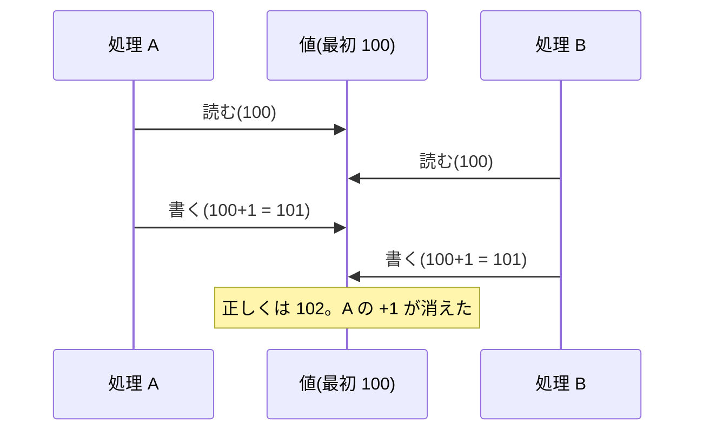
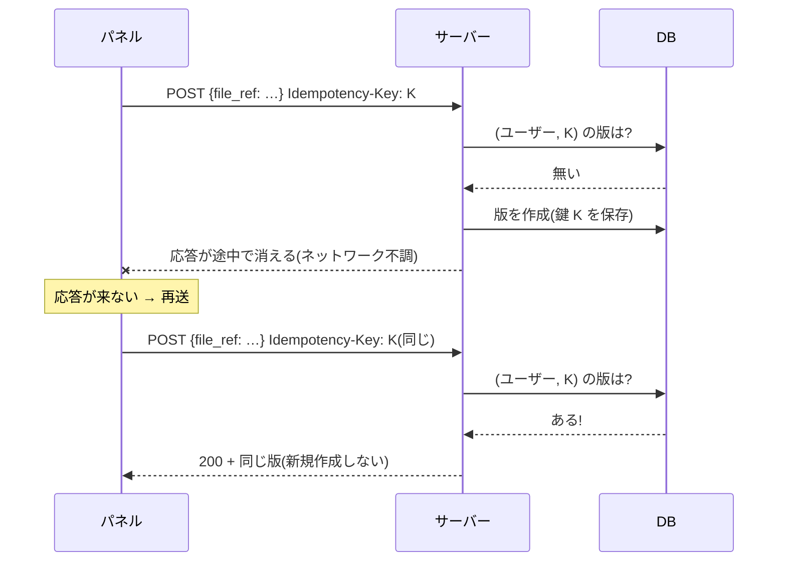
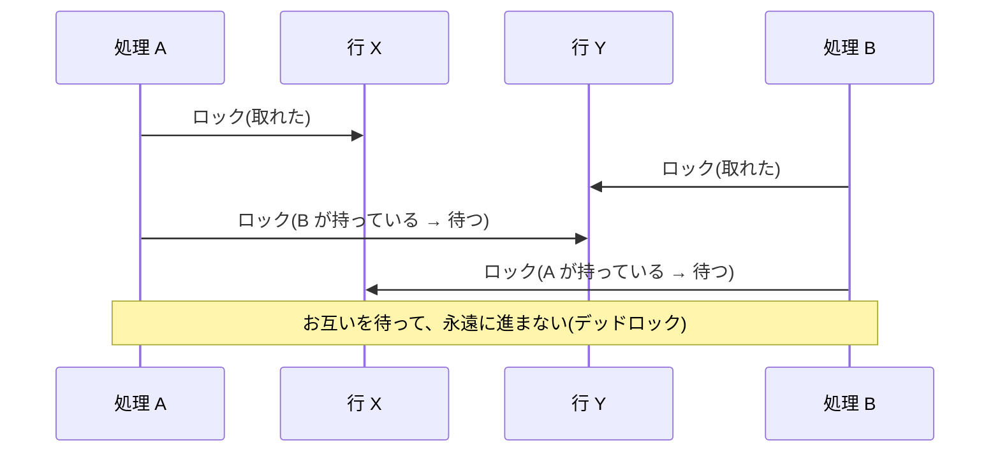

# L08 アルゴリズム③ 並行制御と冪等性 ― 「同時に」「何度も」届く処理を壊さずに扱う

**この回の目標**
- **競合状態**(race condition)と**更新の消失**を、全ての実行順序を数え上げて説明できる
- **悲観的ロック**・**楽観的(一意制約 + リトライ)**・**アトミック更新**の違いと使い分けを言える
- **冪等性**の定義と、`Idempotency-Key` の仕組みを実装できる
- 版番号の採番・取り込みの置き換えが、**なぜ壊れないか**をコードで説明できる

前提: [L03](L03-database.md)(トランザクション)、[L05](L05-drf.md)。

---

## 1. なぜ難しいのか
サーバーは、**同時に**複数のリクエストを処理します。そして、ネットワークは**不確実**です。応答が届かなければ、クライアントは**同じ要求を再送**します。

| 現実 | 起きること |
|---|---|
| 2 人が同時に「版を登録」 | 同じ番号(`number = 3`)を 2 つ作りかねない |
| 2 つの処理が同じ行を読み、それぞれ書く | 片方の変更が消える(**更新の消失**) |
| 応答が届かず、パネルが再送 | 同じ版が 2 つできる |
| 取り込みを 2 回同時に送る | 「削除 → 作成」の間に割り込まれて、重複・エラー |

どれも、**1 つのリクエストだけを見ていたらバグに見えない**のが厄介です。テストで再現しにくく、本番で時々だけ起きます。

## 2. 競合を「全ての順序」で数え上げる
並行処理の問題は、**命令が交互に実行される順序**で決まります。例: 2 つの処理が、それぞれ「**読む → 書く**」(+1 する)をする。



「どんな順序で交互になりうるか」を、**全部数え上げて**みましょう(L06 のモデル検査と同じ発想)。

<!-- test -->
```python
from itertools import combinations


def interleavings(steps_a, steps_b):
    """A と B の命令を、それぞれの中の順序を保ったまま交互に並べる全ての方法。"""
    total = len(steps_a) + len(steps_b)
    for positions in combinations(range(total), len(steps_a)):     # A の命令を置く位置を選ぶ
        order, a, b = [], iter(steps_a), iter(steps_b)
        for i in range(total):
            order.append(next(a) if i in positions else next(b))
        yield order


def run(order, use_lock):
    """order の順に命令を実行して、最終的な値を返す。"""
    value, local, lock_owner = 100, {}, None
    for who, op in order:
        if op == "lock":
            if lock_owner is not None:
                return None                      # ロックが取れない(この順序は、実際にはありえない = 待つ)
            lock_owner = who
        elif op == "unlock":
            lock_owner = None
        elif op == "read":
            local[who] = value
        elif op == "write":
            value = local[who] + 1
    return value


steps = lambda who, use_lock: ([(who, "lock")] if use_lock else []) + [(who, "read"), (who, "write")] + ([(who, "unlock")] if use_lock else [])  # noqa: E731

for use_lock in (False, True):
    results = []
    for order in interleavings(steps("A", use_lock), steps("B", use_lock)):
        value = run(order, use_lock)
        if value is not None:                    # ロック中に他方が lock しようとした順序は、待つので除外
            results.append(value)
    print(f"ロック{'あり' if use_lock else 'なし'}: 順序 {len(results)} 通り / 結果 {sorted(set(results))} / 正しい(102)の割合 {results.count(102)}/{len(results)}")
```

<!-- output -->
```text
ロックなし: 順序 6 通り / 結果 [101, 102] / 正しい(102)の割合 2/6
ロックあり: 順序 2 通り / 結果 [102] / 正しい(102)の割合 2/2
```

**ロックなし**では、6 通りの順序のうち、**2 通りだけが正しい**(A の読み書きが終わってから B が始まる、またはその逆)。残り 4 通りは、片方の +1 が消えます。
**ロックあり**では、ロックを取れた順序は全て 102(正しい)。「**重なる順序が、そもそも起きない**」ようにするのが、ロックです。

## 3. 解決策の 3 系統
| 方式 | 仕組み | 長所 | 短所 | このアプリの例 |
|---|---|---|---|---|
| **悲観的ロック** | 先に**ロックを取って**、他を待たせる | 確実・分かりやすい | 待ちが出る・ロックの取り合い(デッドロック)に注意 | 状態遷移・版の採番 |
| **アトミック更新** | 「読んで書く」を **1 つの SQL**にする(`UPDATE ... SET n = n + 1`) | 速い・ロック不要 | 単純な計算にしか使えない | (使っていない) |
| **楽観的(制約 + 失敗の処理)** | ぶつからない前提で進め、**一意制約に違反したら失敗**として扱う | ロックなしで速い | 失敗の処理(リトライ・再取得)が要る | Idempotency-Key・取り込み |

## 4. 悲観的ロック ― 版番号の採番
「タスク内で `1, 2, 3, …` と版番号を付ける」には、**最大値 + 1** を計算します。ここが競合の温床です。2 人が同時に最大値 `2` を読めば、2 人とも `3` を付けてしまう。

<!-- excerpt: backend/tracker/models.py -->
```python
@classmethod
def create_for_task(cls, task: Task, **fields) -> "Version":
    """版番号をタスク内で連番にして作る。タスク行をロックして同時作成を直列化する。"""
    with transaction.atomic():
        Task.objects.select_for_update().get(pk=task.pk)
        last = cls.objects.filter(task=task).aggregate(m=Max("number"))["m"] or 0
        return cls.objects.create(task=task, number=last + 1, **fields)
```

| 行 | 何をしているか |
|---|---|
| `transaction.atomic()` | 全部成功か、全部取り消し |
| `Task.objects.select_for_update().get(...)` | **タスクの行をロック**(`SELECT ... FOR UPDATE`)。他の処理は、このトランザクションが終わるまで**待つ** |
| `aggregate(m=Max("number"))` | 今の最大番号(無ければ `None` → `or 0`) |
| `create(number=last + 1)` | その次の番号で作成 |

**なぜ「版の行」でなく「タスクの行」をロックするのか。** 版が 0 件のとき、ロックすべき行が**存在しない**から。親(タスク)は必ず存在するので、親をロックの「錠」にします。

**最後の砦**: `(task, number)` の**一意制約**。万一ロックが効かなくても、同じ番号は DB が拒否します(エラーになるが、**データは壊れない**)。

> **SQLite では `select_for_update` は何もしません**(ファイル全体を 1 つずつ書くため)。ロックの効果は PostgreSQL でしか確かめられません。だから、このアプリのテストは**両方の DB で流します**。

<!-- test:django -->
```python
from django.db import IntegrityError, transaction

from tracker.models import Entity, Project, Step, Task, Version

project = Project.objects.create(code="DEMO", name="デモ")
entity = Entity.objects.create(project=project, name="crate")
task = Task.objects.create(entity=entity, step=Step.objects.get(code="fx"))

numbers = [Version.create_for_task(task, file_ref=f"v{i}").number for i in range(3)]
print("採番:", numbers)

# 一意制約(最後の砦): 同じ (task, number) は DB が拒否する
try:
    with transaction.atomic():
        Version.objects.create(task=task, number=2, file_ref="dup")
except IntegrityError:
    print("同じ番号は IntegrityError(DB が拒否した)")
print("版の数:", Version.objects.filter(task=task).count())
```

<!-- output -->
```text
採番: [1, 2, 3]
同じ番号は IntegrityError(DB が拒否した)
版の数: 3
```

## 5. 楽観的 ― 一意制約に任せて、失敗を処理する
ロックを取らず、「たぶんぶつからない」と進め、**ぶつかったら DB が一意制約で止める**。止められた側は、「相手が先に作った」と判断して、**その結果を受け取る**。

これが、次の節の `Idempotency-Key` の仕組みです。

## 6. 冪等性
**冪等**(idempotent)とは、「**同じ操作を何回やっても、1 回やったのと結果が同じ**」こと。

| 操作 | 冪等? |
|---|---|
| `x = 5`(代入) | ○ 何回でも `x` は 5 |
| `x = x + 1` | × 回数だけ増える |
| `DELETE /tasks/12/` | ○ 1 回目で消え、2 回目以降も「無い」まま |
| `POST /versions/`(そのまま) | × 回数だけ版ができる |

`POST` を冪等にするのが **Idempotency-Key** です。クライアントが、**操作ごとに一意な鍵**(例: ファイルのハッシュ + 版番号)を付けて送る。サーバーは、**同じ鍵を見たら、新規に作らず、前の結果を返す**。



実際のコードを読みます。

<!-- excerpt: backend/tracker/views.py -->
```python
def replay():
    existing = Version.objects.filter(created_by=request.user, idempotency_key=key).first()
    if existing is None:
        return None
    if existing.task_id != task.pk:
        raise IdempotencyConflict("同じ Idempotency-Key が別のタスクの版に使われています。")
    return Response(self.get_serializer(existing).data, status=200)
```

| 場合 | 結果 | 理由 |
|---|---|---|
| 鍵が初めて | 作成して **201** | 通常の作成 |
| 同じ鍵・同じタスク | **200** + 前と同じ版 | 再送。新規作成しない |
| 同じ鍵・**別のタスク** | **409** `idempotency_conflict` | 鍵の使い回し(クライアントのバグ)。黙って別の版を返すと、データを取り違える |
| 鍵なし | 毎回作成 | 冪等にしたいなら鍵を付ける |

**鍵はユーザーごとに一意**(`(created_by, idempotency_key)` の一意制約)です。他人の鍵を偶然使っても、他人の版が見えることはありません。

### 同時に 2 つの再送が来たら
「鍵があるか調べる」→「なければ作る」の間に、**もう一方が割り込む**ことがあります(検査と作成の間の隙間、**TOCTOU**)。
そこで、一意制約が働きます。負けた側は `IntegrityError` になり、**その鍵の版を引き直して返す**。

<!-- excerpt: backend/tracker/views.py -->
```python
try:
    version = Version.create_for_task(task, created_by=request.user, idempotency_key=key, **data)
except IntegrityError:
    # 同じ鍵の同時送信に負けた場合
    response = replay() if key else None
    if response is None:
        raise
    return response
```

**「先に調べる」だけでは不十分で、「制約で止めて、失敗を処理する」まで書いて初めて、同時実行に耐えます。**

### 冪等な「保存庫」を、自分で作ってみる
考え方だけを抜き出した、小さな実装です。

<!-- test -->
```python
class IdempotencyConflict(Exception):
    pass


class VersionStore:
    """鍵ごとに結果を覚え、同じ鍵なら新規作成しない(ユーザーごと)。"""

    def __init__(self):
        self.versions = []
        self.by_key = {}                                    # (ユーザー, 鍵) → 版

    def register(self, user, task, file_ref, key=None):
        if key is not None:
            existing = self.by_key.get((user, key))
            if existing is not None:
                if existing["task"] != task:
                    raise IdempotencyConflict("同じ鍵が別のタスクに使われている")
                return 200, existing                        # 再送: 同じものを返す
        version = {"id": len(self.versions) + 1, "task": task, "file_ref": file_ref,
                   "number": 1 + sum(1 for v in self.versions if v["task"] == task)}
        self.versions.append(version)
        if key is not None:
            self.by_key[(user, key)] = version
        return 201, version


store = VersionStore()
print(store.register("alice", 1, "v1.hip", key="K1"))        # 新規
print(store.register("alice", 1, "v1.hip", key="K1"))        # 再送 → 同じ版
print(store.register("alice", 1, "v2.hip", key="K2"))        # 別の鍵 → 次の番号
print(store.register("bob", 1, "x.hip", key="K1"))           # 鍵はユーザーごと: bob の K1 は別物
try:
    store.register("alice", 2, "other.hip", key="K1")        # 同じ鍵を別のタスクに
except IdempotencyConflict as error:
    print("409:", error)
print("版の総数:", len(store.versions))
```

<!-- output -->
```text
(201, {'id': 1, 'task': 1, 'file_ref': 'v1.hip', 'number': 1})
(200, {'id': 1, 'task': 1, 'file_ref': 'v1.hip', 'number': 1})
(201, {'id': 2, 'task': 1, 'file_ref': 'v2.hip', 'number': 2})
(201, {'id': 3, 'task': 1, 'file_ref': 'x.hip', 'number': 3})
409: 同じ鍵が別のタスクに使われている
版の総数: 3
```

再送した 2 回目は、**版の総数が増えていません**(3 つのまま。alice の K1・K2 と bob の K1)。

### 本物の API で確かめる
<!-- test:django -->
```python
from django.contrib.auth import get_user_model
from rest_framework.test import APIClient

from tracker.models import Entity, Project, ProjectMember, Step, Task, Version

user = get_user_model().objects.create_user("panel", password="pw-12345")
project = Project.objects.create(code="DEMO", name="デモ")
ProjectMember.objects.create(project=project, user=user, role="artist")
entity = Entity.objects.create(project=project, name="crate")
task1 = Task.objects.create(entity=entity, step=Step.objects.get(code="fx"))
task2 = Task.objects.create(entity=entity, step=Step.objects.get(code="rig"))

client = APIClient()
client.force_authenticate(user)
body = {"task": task1.id, "file_ref": "P:/fx/fluid_v012.hip"}

first = client.post("/api/v1/versions/", body, format="json", headers={"Idempotency-Key": "hash-v012"})
again = client.post("/api/v1/versions/", body, format="json", headers={"Idempotency-Key": "hash-v012"})
print(first.status_code, again.status_code, first.json()["id"] == again.json()["id"], first.json()["number"])
print("版の数:", Version.objects.filter(task=task1).count())

other = client.post("/api/v1/versions/", {"task": task2.id, "file_ref": "x"}, format="json", headers={"Idempotency-Key": "hash-v012"})
print("同じ鍵を別のタスクに:", other.status_code, other.json()["code"])

nokey = [client.post("/api/v1/versions/", body, format="json").status_code for _ in range(2)]
print("鍵なしで 2 回:", nokey, "→ 版の数", Version.objects.filter(task=task1).count())
```

<!-- output -->
```text
201 200 True 1
版の数: 1
同じ鍵を別のタスクに: 409 idempotency_conflict
鍵なしで 2 回: [201, 201] → 版の数 3
```

## 7. 取り込みの「置き換え」 ― 削除 → 再作成を安全に
品質の取り込みは、`(project, scan_run_id)` の**行を全て削除して、作り直す**(置き換え)ことで冪等にしています。

```text
同じ実行を再送 → 古い行を全部消して、新しい行を作る → 何回送っても結果は同じ
```

ところが、**同時に 2 回**送られると、「削除 → 作成」の間にもう一方が入り込み、**一意制約違反(500)**になりえました。対策は、**先に、プロジェクトの行をロック**すること。

<!-- excerpt: backend/tracker/ingest.py -->
```python
# 同じ (project, scan_run_id) の同時再送を直列化する(削除 → 再作成の間に割り込まれて一意制約違反になるのを防ぐ)
Project.objects.select_for_update().get(pk=project.pk)
```

版の採番と同じく、**親(プロジェクト)の行を「錠」**にします。ロックを取った処理が終わるまで、もう一方は待ち、**待ったあとは「先の結果の上に」置き換える**(結果は同じ)。

## 8. 落とし穴 ― デッドロック
2 つの処理が、**逆の順序で**ロックを取ろうとすると、永遠に待ち合います。



対策は、**ロックを取る順序を、全員で同じにする**こと。このアプリは、取るロックを**1 つ**(タスク行、プロジェクト行)に絞り、順序の問題が起きにくい設計にしています。
(DB は、デッドロックを検出して片方を失敗させる。でも、**起きない設計**のほうが良い。)

| 指針 | 理由 |
|---|---|
| ロックは**短く** | トランザクションの中で、遅い処理(外部への通信)をしない |
| 取る**順序をそろえる** | デッドロックを避ける |
| ロックの代わりに**一意制約**で済むなら、そちらも | 待ちが無い |

## よくある間違い
| 間違い | 正しくは |
|---|---|
| 「調べて、無ければ作る」だけで済ます | 同時に来ると両方が「無い」と判断する。**一意制約で止め、失敗を処理**する |
| 最大値 + 1 を、ロックなしで採番 | 親の行をロックして直列化。一意制約を最後の砦に |
| SQLite のテストだけで安心する | SQLite は `select_for_update` が無効。**PostgreSQL でも流す** |
| `POST` を再送可能にしない | 重要な作成は `Idempotency-Key` |
| 鍵を全員で共有 | **ユーザーごと**に一意に。他人の鍵で他人の結果が見えないように |
| ロックを取ったまま外部の API を呼ぶ | 他の処理が待たされ続ける。ロックは短く |

## 確認問題
1. 「更新の消失」を、`+1` する 2 つの処理で説明せよ。ロックなしで正しい結果になる順序は、全体のどれくらいか。
2. 悲観的ロックと楽観的(一意制約)の違いを、それぞれの使いどころとともに述べよ。
3. 版番号の採番で、「版の行」でなく「タスクの行」をロックするのはなぜか。
4. 同じ `Idempotency-Key` を、別のタスクに使うと、なぜ 409 にするのか。
5. 「鍵があるか調べる」だけでは、同時再送に耐えない理由は。
6. SQLite のテストだけでは、何が確かめられないか。

## 答え
1. 両方が同じ値(100)を読み、それぞれ +1 して書くと、結果が 101 になり、片方の +1 が消える。このモデルでは 6 通りの順序のうち、正しい(102)のは 2 通り(A が終わってから B、またはその逆)。
2. 悲観的: 先にロックして他を待たせる。確実で、状態遷移・採番のような「必ず直列にしたい」処理向き。楽観的: ぶつからない前提で進め、一意制約違反を失敗として処理する。ロックの待ちが無く、再送・取り込みのような「同じものが重なる」処理向き。
3. 版が 0 件のとき、ロックすべき版の行が存在しないから。必ず存在する親(タスク)を錠にする。
4. 鍵の使い回し(クライアントのバグ)の可能性が高く、黙って別のタスクの版を返すと、データを取り違えるから。
5. 調べた直後、作る前に、もう一方が割り込んで同じ鍵で作ると、両方が「無い」と判断して重複するから。一意制約で止め、失敗した側が前の結果を返す処理が要る。
6. `select_for_update` によるロックの効果(SQLite では何もしない)と、同時実行での制約違反。PostgreSQL でも流す必要がある。

## 次へ
[L09 アルゴリズム④ 認証と暗号](L09-security-crypto.md) ― パスワード・CSRF・JWT・レート制限の仕組みを、手を動かして学びます。
