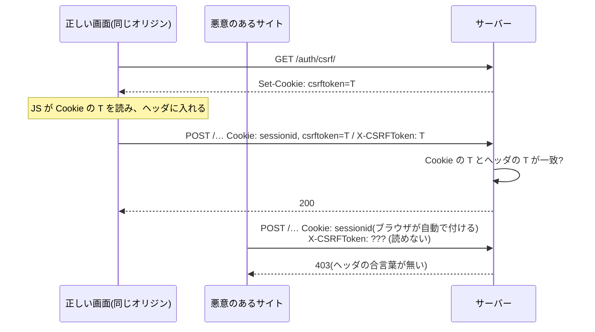
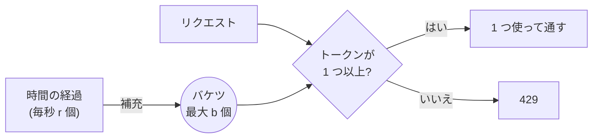

# L09 アルゴリズム④ 認証と暗号 ― ハッシュ・CSRF・定数時間比較・JWT・レート制限

**この回の目標**
- **ハッシュ**の性質と、パスワードに**遅いハッシュ + ソルト**を使う理由を説明できる
- **定数時間比較**が必要な理由(タイミング攻撃)を、手を動かして理解する
- **署名**(HMAC・RS256)で「改ざんされていない」を確かめる仕組みを実装・検証できる
- **JWT** の構造と、よくある落とし穴(`alg=none`・宛先違い・期限切れ)を挙げられる
- **レート制限**の 3 つのアルゴリズムを実装し、違いを説明できる

前提: [L01](L01-web.md)(Cookie・CSRF)、[L05](L05-drf.md)。

> **大原則: 暗号を自分で作らない。** この回では、仕組みを**理解する**ために小さく作ります。実際のアプリでは、必ず Django・PyJWT・`hmac` などの**検証済みの部品**を使います。

---

## 1. 認証と認可
| 言葉 | 問い | このアプリ |
|---|---|---|
| **認証**(authentication) | あなたは**誰**か | ログイン・トークン・API キー・Cloudflare Access の JWT |
| **認可**(authorization) | あなたは**それをしてよい**か | プロジェクトの役割・`visible_*` |

認証が破られると、**他人になりすませます**。だから、この回の技術は「本人であることを、**偽造できない形**で確かめる」ためのものです。


## 2. ハッシュ関数
**ハッシュ関数**は、どんな長さのデータからも、**決まった長さの「指紋」**を作る関数です。

| 性質 | 意味 |
|---|---|
| 決定的 | 同じ入力 → 常に同じ出力 |
| 一方向 | 出力から入力を**復元できない** |
| 雪崩効果 | 入力が 1 文字違うだけで、出力が**全く違う** |
| 衝突しにくい | 同じ出力になる別の入力を、見つけにくい |

<!-- test -->
```python
import hashlib

for text in ["password", "password.", "Password"]:
    digest = hashlib.sha256(text.encode()).hexdigest()
    print(f"{text:10} → {digest[:24]}…  ({len(digest) * 4} ビット)")
```

<!-- output -->
```text
password   → 5e884898da28047151d0e56f…  (256 ビット)
password.  → 16509e6c8f9fea485604023f…  (256 ビット)
Password   → e7cf3ef4f17c3999a94f2c6f…  (256 ビット)
```

`password` と `password.`(ピリオドが 1 つ増えただけ)で、出力は**まるで別物**です。

### パスワードを「そのまま」保存してはいけない
DB が漏れたとき、パスワードが読めたら、利用者は**他のサイトでも**被害を受けます(多くの人が使い回すため)。だから、**ハッシュにして**保存し、ログイン時は「入力をハッシュにして、保存済みと比べる」。

ただし、**普通のハッシュ(SHA-256 など)をそのまま使うのは不十分**です。理由は 2 つ。

| 問題 | 説明 | 対策 |
|---|---|---|
| **速すぎる** | SHA-256 は 1 秒に何十億回も計算できる。攻撃者は、よく使われるパスワード(`password`、`123456`…)のハッシュを**事前に大量に計算**して、突き合わせる | **わざと遅い**ハッシュ(PBKDF2・bcrypt・Argon2)。1 回に何十万回も繰り返す |
| 同じパスワード → 同じハッシュ | 2 人が同じパスワードなら、ハッシュも同じ。1 つ破れば、同じ人が全員分かる | **ソルト**(ユーザーごとのランダムな文字列)を混ぜる |

<!-- test -->
```python
import hashlib

password = b"correct horse battery staple"
fast = hashlib.sha256(password).hexdigest()

# PBKDF2: ソルトを混ぜ、HMAC-SHA256 を iterations 回繰り返す(Django の既定のパスワードハッシュ)
def pbkdf2(salt, iterations):
    return hashlib.pbkdf2_hmac("sha256", password, salt, iterations).hex()

a = pbkdf2(b"salt-of-alice", 1000)
b = pbkdf2(b"salt-of-bob", 1000)
print("ソルトが違えば、同じパスワードでも別のハッシュ:", a != b)
print("同じソルト・同じ回数なら、再現できる(ログインの照合に使える):", a == pbkdf2(b"salt-of-alice", 1000))
print("SHA-256 そのままとは別物:", a != fast, "/ 長さ", len(a) * 4, "ビット")
```

<!-- output -->
```text
ソルトが違えば、同じパスワードでも別のハッシュ: True
同じソルト・同じ回数なら、再現できる(ログインの照合に使える): True
SHA-256 そのままとは別物: True / 長さ 256 ビット
```

Django が DB に保存する形は、`アルゴリズム$繰り返し回数$ソルト$ハッシュ` です。

<!-- test -->
```python
from django.contrib.auth.hashers import PBKDF2PasswordHasher

hasher = PBKDF2PasswordHasher()
encoded = hasher.encode("correct horse battery staple", salt="exampleSalt", iterations=1000)
print(encoded)
print(hasher.verify("correct horse battery staple", encoded), hasher.verify("wrong", encoded))
```

<!-- output -->
```text
pbkdf2_sha256$1000$exampleSalt$JNOJgWyNB0Xyi38jhiyyxNIvFs/lX5uhQUGnGRyFcPI=
True False
```

(本番の繰り返し回数は 100 万回前後。ここでは動作を速くするために 1000 にしています。)
**回数を保存しておく**のは、将来、回数を増やしたとき、古いパスワードも**ログイン時に作り直せる**ようにするためです。

## 3. 定数時間比較 ― 比べる時間から、答えが漏れる
API キーを比べる、一番単純な書き方は `==` です。ところが、`==` は、**最初に違った文字の所で打ち切る**ことがあります。

```text
正解:   "s3cr3t-key"
入力 A: "xxxxxxxxxx"  → 1 文字目で違う   → すぐ「違う」
入力 B: "s3cr3t-xxx"  → 7 文字目まで一致 → 少し遅れて「違う」
```

攻撃者は、**応答時間の差**から「何文字目まで合っているか」を推測できます(**タイミング攻撃**)。1 文字ずつ当てていけば、長い鍵も解読できてしまう。
対策は、**全体を必ず最後まで比べる**(**定数時間比較**)こと。Python では `secrets.compare_digest` / `hmac.compare_digest` を使います。

<!-- test -->
```python
import secrets


def naive_equal(a, b):
    """最初に違う所で打ち切る比較。比べた文字数(= 手数)を返す。"""
    steps = 0
    for x, y in zip(a, b):
        steps += 1
        if x != y:
            return False, steps
    return len(a) == len(b), steps


secret = "s3cr3t-key"
for guess in ["xxxxxxxxxx", "s3xxxxxxxx", "s3cr3t-xxx", "s3cr3t-key"]:
    ok, steps = naive_equal(secret, guess)
    print(f"{guess}  一致={ok!s:5}  比べた文字数={steps}")        # 手数から、合っている長さが分かってしまう

print(secrets.compare_digest(secret.encode(), b"s3cr3t-key"), secrets.compare_digest(secret.encode(), b"s3cr3t-xxx"))
```

<!-- output -->
```text
xxxxxxxxxx  一致=False  比べた文字数=1
s3xxxxxxxx  一致=False  比べた文字数=3
s3cr3t-xxx  一致=False  比べた文字数=8
s3cr3t-key  一致=True   比べた文字数=10
True False
```

手数(= 時間)が、**一致した長さに比例**しています。これが漏れる情報です。`compare_digest` は、どこで違っても、同じ手数(時間)で答えます。

このアプリの API キー認証は、**定数時間比較**を使っています。

<!-- excerpt: backend/tracker/auth.py -->
```python
# 鍵が未設定なら常に拒否(fail closed)。比較は定数時間で行う。
for key in settings.INGEST_API_KEYS:
    if secrets.compare_digest(supplied.encode(), key.encode()):
        return IngestPrincipal(), supplied
raise exceptions.AuthenticationFailed("API キーが正しくありません。")
```

2 つの設計に注目:
- **fail closed**: 鍵が 1 つも設定されていないとき、ループは何もせず、**常に拒否**に落ちる。「設定し忘れ = 誰でも通れる」にならない。
- `IngestPrincipal` は、**ユーザーではない**。API キーで通った外部ツールは、画面の API(ユーザー向け)を呼べない。

## 4. 署名 ― 「改ざんされていない」を確かめる
**署名**は、データに**付ける印**です。印が合わなければ、データが改ざんされたと分かります。

### HMAC(共通の秘密鍵)
**HMAC** は、「**秘密鍵 + データ**」からハッシュを作ります。同じ鍵を知っている者だけが、正しい印を作れる・確かめられる。
セッション Cookie や CSRF の仕組みは、この考え方に基づいています。

<!-- test -->
```python
import hashlib
import hmac

KEY = b"server-only-secret-key"


def sign(message: bytes) -> str:
    return hmac.new(KEY, message, hashlib.sha256).hexdigest()


def verify(message: bytes, signature: str) -> bool:
    return hmac.compare_digest(sign(message), signature)           # 比較は定数時間で


message = b"user=alice&role=viewer"
signature = sign(message)
print("正しい署名      :", verify(message, signature))
print("内容を改ざん    :", verify(b"user=alice&role=reviewer", signature))
print("署名を偽造      :", verify(message, "0" * 64))
```

<!-- output -->
```text
正しい署名      : True
内容を改ざん    : False
署名を偽造      : False
```

利用者が Cookie の `role=viewer` を `role=reviewer` に書き換えても、**署名が合わなくなる**ので、サーバーは見抜けます(秘密鍵を知らないと、正しい署名は作れない)。

### 非対称な署名(RS256) ― 公開鍵で確かめる
HMAC は、**確かめる側も秘密鍵を持つ**必要があります。確かめる側が多いと(複数のサーバー)、鍵が漏れやすい。
**公開鍵暗号**は、**鍵が 2 本**です。

| 鍵 | 持つ人 | できること |
|---|---|---|
| **秘密鍵** | 署名する側だけ | 署名を**作る** |
| **公開鍵** | 誰でも | 署名を**確かめる**だけ(作れない) |

Cloudflare Access は、秘密鍵で JWT に署名し、**公開鍵を公開**します(`/cdn-cgi/access/certs`)。このアプリは、公開鍵で確かめるだけ。**公開鍵が漏れても、偽造はできません**。

## 5. JWT
**JWT**(JSON Web Token)は、**署名つきの JSON** です。`ヘッダ.ペイロード.署名` の 3 部分を `.` でつなぎます。

```text
eyJhbGciOiJSUzI1NiJ9 . eyJlbWFpbCI6ImFsaWNlQC4uLiJ9 . MEUCIQD…
└────── ヘッダ ─────┘   └────── ペイロード ──────┘   └─ 署名 ─┘
 {"alg":"RS256"}         {"email":"alice@…","exp":…,"aud":[…]}
```

最初の 2 つは **Base64URL でエンコードしただけ**(暗号化ではない)で、**誰でも読めます**。守られているのは、**署名**(改ざんできない)だけ。
だから、JWT に**秘密の情報を入れてはいけません**。

主な項目(クレーム):

| クレーム | 意味 | 確かめること |
|---|---|---|
| `iss` | 発行者 | 期待した発行者か(別の会社のトークンを弾く) |
| `aud` | 宛先(どのアプリ向けか) | **自分のアプリ向けか**(別のアプリ向けのトークンの流用を弾く) |
| `exp` | 期限 | 過ぎていないか |
| `iat` | 発行時刻 | |
| `email` | 利用者 | これでアプリのユーザーに対応づける |

### JWT を手で作って、検証する(HS256)
<!-- test -->
```python
import base64
import hashlib
import hmac
import json

import jwt                                  # PyJWT(本物の部品)

SECRET = "x" * 32                           # HS256 の秘密鍵(32 バイト以上)


def b64url_decode(text):
    return base64.urlsafe_b64decode(text + "=" * (-len(text) % 4))


def verify_hs256(token, secret):
    """署名を手で確かめる(本番では jwt.decode を使う)。"""
    header_b64, payload_b64, signature_b64 = token.split(".")
    expected = hmac.new(secret.encode(), f"{header_b64}.{payload_b64}".encode(), hashlib.sha256).digest()
    ok = hmac.compare_digest(expected, b64url_decode(signature_b64))
    return ok, json.loads(b64url_decode(payload_b64))


token = jwt.encode({"email": "alice@example.com", "aud": "app"}, SECRET, algorithm="HS256")
header_b64, payload_b64, _ = token.split(".")
print("ヘッダ    :", json.loads(b64url_decode(header_b64)))          # 誰でも読める
print("ペイロード:", json.loads(b64url_decode(payload_b64)))          # 誰でも読める

ok, claims = verify_hs256(token, SECRET)
print("署名の検証:", ok)

# 改ざん: ペイロードを書き換えて(role を足して)、署名はそのまま
forged_payload = base64.urlsafe_b64encode(json.dumps({"email": "alice@example.com", "aud": "app", "role": "admin"}).encode()).rstrip(b"=").decode()
forged = f"{header_b64}.{forged_payload}.{token.split('.')[2]}"
print("改ざん後  :", verify_hs256(forged, SECRET)[0])
```

<!-- output -->
```text
ヘッダ    : {'alg': 'HS256', 'typ': 'JWT'}
ペイロード: {'email': 'alice@example.com', 'aud': 'app'}
署名の検証: True
改ざん後  : False
```

ペイロードは**読める**(暗号化ではない)。でも、**書き換えると署名が合わなくなる**。これが署名の役割です。

### RS256 と、検証の落とし穴
このアプリは、`jwt.decode` に**許可するアルゴリズムを 1 つだけ**渡します。

<!-- excerpt: backend/tracker/cf_access.py -->
```python
key,
algorithms=["RS256"],  # これ以外(none / HS256 など)は受け付けない
audience=settings.CF_ACCESS_AUD,
issuer=f"https://{domain}",
options={"require": ["exp", "iat", "iss", "aud"]},
```

| 設定 | 防ぐ攻撃 |
|---|---|
| `algorithms=["RS256"]` | **アルゴリズムの差し替え**。`alg: none`(署名なし)や、公開鍵を HS256 の「秘密鍵」として使わせる攻撃 |
| `audience=…` | **別のアプリ向けのトークン**の流用 |
| `issuer=…` | **別の発行者**のトークン |
| `require: [exp, …]` | **期限なし**のトークン(永久に使える)を許さない |

実際に、これらの攻撃が弾かれることを確かめましょう(RSA の鍵を作って、署名する側・確かめる側を両方演じます)。

<!-- test -->
```python
import time

import jwt
from cryptography.hazmat.primitives.asymmetric import rsa

private = rsa.generate_private_key(public_exponent=65537, key_size=2048)       # 署名する側の秘密鍵
public = private.public_key()                                                  # 公開鍵(誰でも持てる)
attacker = rsa.generate_private_key(public_exponent=65537, key_size=2048)      # 攻撃者の鍵

now = int(time.time())
base = {"email": "alice@example.com", "iss": "https://team.example", "aud": ["app-1"], "iat": now, "exp": now + 300}


def attempt(label, token, **overrides):
    options = {"algorithms": ["RS256"], "audience": "app-1", "issuer": "https://team.example", "options": {"require": ["exp", "iat", "iss", "aud"]}}
    options.update(overrides)
    try:
        jwt.decode(token, public, **options)
        print(f"{label:28} → 通った")
    except jwt.PyJWTError as error:
        print(f"{label:28} → 拒否 ({type(error).__name__})")


attempt("正しいトークン", jwt.encode(base, private, algorithm="RS256"))
attempt("攻撃者の鍵で署名", jwt.encode(base, attacker, algorithm="RS256"))
attempt("別のアプリ向け(aud)", jwt.encode({**base, "aud": ["app-2"]}, private, algorithm="RS256"))
attempt("別の発行者(iss)", jwt.encode({**base, "iss": "https://evil.example"}, private, algorithm="RS256"))
attempt("期限切れ(exp)", jwt.encode({**base, "exp": now - 10}, private, algorithm="RS256"))
attempt("期限なし", jwt.encode({k: v for k, v in base.items() if k != "exp"}, private, algorithm="RS256"))
attempt("alg=none(署名なし)", jwt.encode(base, key=None, algorithm="none"))
```

<!-- output -->
```text
正しいトークン                      → 通った
攻撃者の鍵で署名                     → 拒否 (InvalidSignatureError)
別のアプリ向け(aud)                 → 拒否 (InvalidAudienceError)
別の発行者(iss)                   → 拒否 (InvalidIssuerError)
期限切れ(exp)                    → 拒否 (ExpiredSignatureError)
期限なし                         → 拒否 (MissingRequiredClaimError)
alg=none(署名なし)               → 拒否 (InvalidAlgorithmError)
```

**どれも、検証の設定を 1 つ欠いただけで通ってしまう**ものです(たとえば `audience` を渡さないと、別のアプリ向けも通る)。**全部を明示する**のが、検証の正しい書き方です。

### アプリのユーザーへの対応づけ
署名が正しくても、**そのメールのユーザーがアプリにいるか**は別の話です。`user_for` は、次のようにしています。

| 状況 | 結果 | 理由 |
|---|---|---|
| メールが 1 人に一致 | そのユーザー | |
| 一致なし | **403** | Cloudflare は通ったが、アプリに未登録(自動作成しない = 最小権限) |
| 一致が複数 | **403** | どの人か決められない(誰かになりすませる状態を作らない) |

## 6. CSRF トークンの仕組み
[L01](L01-web.md) で、CSRF は「ブラウザが `sessionid` Cookie を自動で付ける」ことを悪用する攻撃だと学びました。対策は、**Cookie とは別に、JavaScript だけが付けられる合言葉**を要求することです。



他のサイトの JavaScript は、**同一オリジンポリシー**のため、あなたのサイトの Cookie を**読めません**。だから `X-CSRFToken` を付けられない。
Django は、さらに**トークンを毎回ランダムに「マスク」**して、応答の内容からトークンが推測される攻撃(BREACH)を避けます。仕組みの要点だけ作ってみましょう。

<!-- test -->
```python
import random

rng = random.Random(7)                                        # 実験の再現のため種を固定(本物は安全な乱数)
SECRET = bytes(rng.randrange(256) for _ in range(8))          # サーバーが持つ(Cookie に入る)秘密


def make_token():
    """秘密を、毎回ちがう乱数でマスクして、トークンにする。"""
    mask = bytes(rng.randrange(256) for _ in range(len(SECRET)))
    masked = bytes(s ^ m for s, m in zip(SECRET, mask))
    return (mask + masked).hex()


def check(token):
    raw = bytes.fromhex(token)
    mask, masked = raw[: len(SECRET)], raw[len(SECRET):]
    return bytes(m ^ k for m, k in zip(masked, mask)) == SECRET       # マスクを外して、秘密と比べる


t1, t2 = make_token(), make_token()
print("毎回ちがうトークン:", t1 != t2)
print("どちらも有効      :", check(t1), check(t2))
print("でたらめな値      :", check("00" * 16))
```

<!-- output -->
```text
毎回ちがうトークン: True
どちらも有効      : True True
でたらめな値      : False
```

トークンは**毎回違う**のに、どれも**同じ秘密に戻せる**ので有効です(実際の Django は、さらに別の検査も加えます)。

## 7. レート制限のアルゴリズム
**レート制限**は、「一定時間に何回まで」と制限します。総当たり(パスワードを何千回も試す)や、バグによる連打から守ります。
超えたら **429**。主なアルゴリズムは 3 つです。

### ① 固定窓(Fixed Window)
「毎分 0 秒にリセット」。1 分ごとの窓で数える。**単純**だが、窓の境目で**倍の量が通る**欠点がある。

### ② スライディングログ(Sliding Window Log)
**全てのリクエストの時刻を覚え**、「直近 1 分間の数」を数える。**正確**だが、時刻を全部持つのでメモリを使う。**DRF の `SimpleRateThrottle` はこの方式**です(履歴のリストから、古い時刻を捨てて、残りの数を見る)。

### ③ トークンバケツ(Token Bucket)
バケツに**一定の速さでトークンが溜まる**(上限あり)。1 リクエストごとに 1 つ使う。空なら拒否。**バーストを許しつつ、平均を守る**。



3 つを実装して、**同じ入力で**違いを比べます。時刻は「引数で渡す」ので、実行は毎回同じです(テストしやすい書き方)。

<!-- test -->
```python
class FixedWindow:
    def __init__(self, limit, seconds):
        self.limit, self.seconds, self.counts = limit, seconds, {}

    def allow(self, now):
        window = int(now // self.seconds)                      # 何番目の窓か
        self.counts[window] = self.counts.get(window, 0) + 1
        return self.counts[window] <= self.limit


class SlidingLog:
    def __init__(self, limit, seconds):
        self.limit, self.seconds, self.history = limit, seconds, []

    def allow(self, now):
        self.history = [t for t in self.history if t > now - self.seconds]   # 古い時刻を捨てる
        if len(self.history) >= self.limit:
            return False
        self.history.append(now)
        return True


class TokenBucket:
    def __init__(self, capacity, refill_per_second):
        self.capacity, self.rate, self.tokens, self.last = capacity, refill_per_second, capacity, 0.0

    def allow(self, now):
        self.tokens = min(self.capacity, self.tokens + (now - self.last) * self.rate)   # 経過時間ぶん補充
        self.last = now
        if self.tokens >= 1:
            self.tokens -= 1
            return True
        return False


# 「1 分に 5 回まで」。窓の境目(59.0 秒付近)に、5 回 + 5 回を集中させる
times = [58.0, 58.2, 58.4, 58.6, 58.8, 60.0, 60.2, 60.4, 60.6, 60.8]
for name, limiter in [("固定窓      ", FixedWindow(5, 60)), ("スライディング", SlidingLog(5, 60)), ("トークンバケツ", TokenBucket(5, 5 / 60))]:
    result = "".join("○" if limiter.allow(t) else "×" for t in times)
    print(f"{name} {result}  通った数 {result.count('○')}")
```

<!-- output -->
```text
固定窓       ○○○○○○○○○○  通った数 10
スライディング ○○○○○×××××  通った数 5
トークンバケツ ○○○○○×××××  通った数 5
```

**窓の境目**(58 秒台と 60 秒台)に 10 回を集中させると、**固定窓は 10 回全部通します**(窓が切り替わって数がリセットされるため)。「1 分に 5 回」のはずが、**わずか 3 秒間に 10 回**。
スライディングとトークンバケツは、**直近の量**で見るので、5 回で止めます。

| 方式 | 長所 | 短所 |
|---|---|---|
| 固定窓 | 実装が簡単・メモリが少ない | 境目で倍の量が通る |
| スライディングログ | 正確 | 時刻を全て保存(メモリ) |
| トークンバケツ | 平均とバーストを調整できる | パラメータ(容量・補充速度)の設計が要る |

**このアプリの限界**: DRF のスロットルのカウンタは**プロセスごと**(既定のキャッシュ)です。gunicorn のワーカーが 4 つなら、実質の上限は最大 4 倍に緩みます。厳密にするなら、Redis など**共有のキャッシュ**を使います([セキュリティ点検](../security.md) の F6)。

## 8. まとめ ― このアプリの認証の層
| 層 | 仕組み | 使った技術 |
|---|---|---|
| 画面のログイン | セッション Cookie + CSRF + ログインの回数制限 | HMAC 署名・CSRF トークン・レート制限 |
| パスワード | PBKDF2 + ソルト | 遅いハッシュ |
| 外部ツール | `X-API-Key` | 定数時間比較・fail closed |
| DCC パネル | ユーザー別トークン | (期限なし。要確認) |
| Cloudflare Access | JWT(RS256) | 公開鍵による署名の検証 |

## よくある間違い
| 間違い | 正しくは |
|---|---|
| パスワードを SHA-256 だけで保存 | PBKDF2 / bcrypt / Argon2 + ソルト(遅く・ユーザーごとに違う) |
| `==` で秘密を比べる | `compare_digest`(定数時間) |
| JWT のペイロードに秘密を入れる | ペイロードは誰でも読める。署名は「改ざん防止」だけ |
| `jwt.decode(token, key)` だけ | `algorithms`・`audience`・`issuer`・必須クレームを**全て指定** |
| 認証エラーの理由を詳しく返す | 「確認できません」だけ。詳細はログに |
| レート制限を「窓」だけで考える | 境目のバーストに注意。スライディングやバケツも検討 |
| 暗号を自作する | 検証済みの部品を使う |

## 確認問題
1. SHA-256 だけでパスワードを保存してはいけない理由を 2 つ挙げよ。
2. `==` で API キーを比べると、何が漏れるのか。
3. JWT のペイロードは暗号化されているか。署名は何を守るのか。
4. `jwt.decode` に `algorithms=["RS256"]` を明示する理由は。
5. CSRF トークンが、他のサイトには作れない理由は。
6. 「1 分に 5 回」で、固定窓の欠点を、境目の例で説明せよ。
7. API キーが 1 つも設定されていないとき、取り込み API はどうなるか。それはなぜ安全か。

## 答え
1. ①速すぎて、よく使われるパスワードのハッシュを事前に大量計算した表で突き合わされる(総当たり)。②同じパスワードなら同じハッシュで、1 つ破れば同じ人が全員分かる(ソルトが無い)。
2. 一致した文字数(最初に違った位置)が、応答時間の差から推測できる(タイミング攻撃)。1 文字ずつ当てていける。
3. 暗号化されていない(Base64URL なので誰でも読める)。署名は、内容が改ざんされていないこと(と、秘密鍵を持つ発行者が作ったこと)を守る。
4. `alg=none`(署名なし)や、公開鍵を共通鍵として使わせる攻撃など、アルゴリズムの差し替えを防ぐため。
5. 合言葉(トークン)は Cookie に入っており、他のサイトの JavaScript は同一オリジンポリシーで、あなたのサイトの Cookie を読めないから。ヘッダに入れられない。
6. 窓が切り替わる境目(58〜60 秒)に 5 回 + 5 回を集中させると、窓ごとの数は 5 回ずつで制限内なので、約 3 秒に 10 回通ってしまう。
7. 常に 401 で拒否する(fail closed)。設定し忘れでも、誰でも通れる状態にならない。

## 次へ
[L10 JavaScript / TypeScript の基礎](L10-javascript-typescript.md) ― 画面側のコードを読むための言語を学びます。
