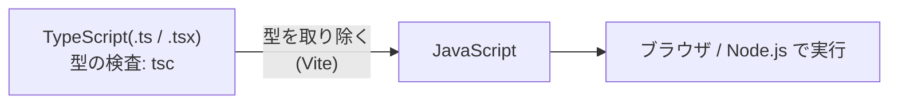
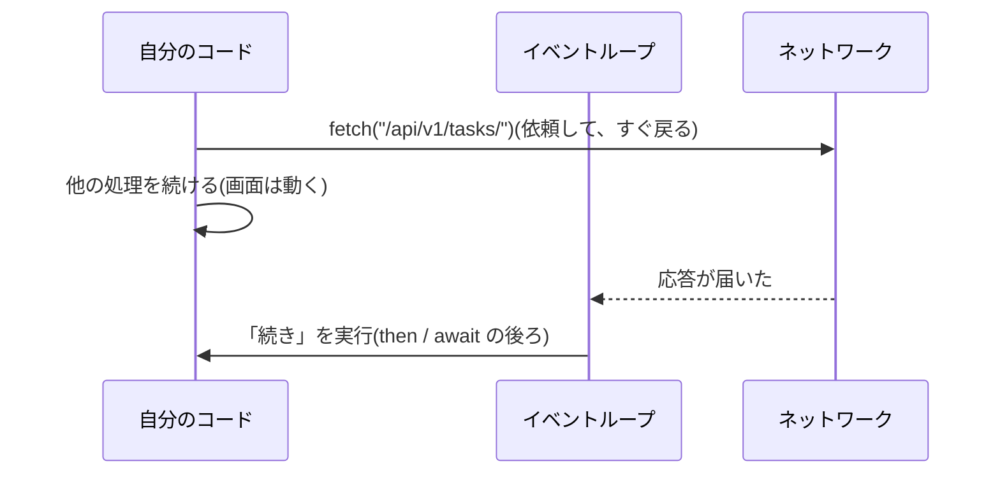

# L10 JavaScript / TypeScript の基礎 ― 値・関数・非同期・型

**この回の目標**
- JavaScript の値・関数・配列・オブジェクトを読み書きできる
- **非同期**(`Promise` / `async` / `await`)の考え方を説明でき、`fetch` で API を呼べる
- TypeScript の**型**が、バグを実行前に見つける仕組みを理解する
- このアプリの `api/client.ts` を、1 行ずつ読み解ける

前提: [L01](L01-web.md)(HTTP・JSON)、[L02](L02-python.md)(Python の基礎。比べながら読む)。

> この回のコードは、**Node.js で実際に実行**して確かめてあります。`../../frontend/src/...` から、**このアプリの本物のソースを読み込んで**動かす例もあります。

---

## 1. JavaScript と TypeScript
| | 何か |
|---|---|
| **JavaScript(JS)** | ブラウザで動く言語。サーバー側(Node.js)でも動く |
| **TypeScript(TS)** | JS に**型**を足した言語。実行前に型の間違いを見つけ、最後は JS に変換される |



**型は実行時には存在しません**(変換で消える)。型は「**書いた人とツールへの約束**」で、実行前に `tsc`(型検査)が間違いを教えます。
このアプリでは、`npm run build` が型検査 + ビルド、`npm test` がテストです。

## 2. 値と変数
<!-- test:node -->
```javascript
// const: 再代入できない(基本はこれ)。let: 再代入できる。var: 使わない
const name = "リグ";
let count = 0;
count += 1;

// 型: number, string, boolean, null, undefined, object(配列も)
console.log(typeof 42, typeof "x", typeof true, typeof null, typeof undefined, typeof [], typeof {});
console.log(Array.isArray([]));

// 比較は === (型も含めて等しいか)。== は型を変換して比べるので、使わない
console.log(1 === 1, "1" === 1, "1" == 1, null === undefined, null == undefined);

// 文字列: テンプレートリテラル(バッククォート)
console.log(`${name} は ${count} 件`);

// 真偽: false になる値(falsy)は 0, "", null, undefined, NaN, false だけ
console.log([0, "", null, undefined, NaN, [], {}].map((v) => Boolean(v)).join(" "));
```

<!-- output -->
```text
number string boolean object undefined object object
true
true false true false true
リグ は 1 件
false false false false false true true
```

**注意点(Python との違い)**
| | Python | JavaScript |
|---|---|---|
| 「無い」 | `None` | `null`(意図して無い)と `undefined`(未定義)の **2 つ** |
| 空の配列・オブジェクトの真偽 | 偽 | **真**(`[]` も `{}` も truthy) |
| 等しさ | `==` が値の比較 | `===`(`==` は型変換するので避ける) |
| 整数・小数 | `int` / `float` | `number` のみ(全て浮動小数点) |

## 3. 関数と配列・オブジェクト
<!-- test:node -->
```javascript
// アロー関数: (引数) => 式。このアプリの画面のコードは、ほぼこの形
const double = (n) => n * 2;
function add(a, b = 10) { return a + b; }                // 既定値
console.log(double(4), add(1), add(1, 2));

// 配列のメソッド: for ループの代わりに、「変換」を宣言する
const tasks = [
  { id: 1, step: "model", status: "done", due: "2026-10-01" },
  { id: 2, step: "texture", status: "review", due: "2026-10-20" },
  { id: 3, step: "rig", status: "todo", due: null },
];
console.log(tasks.map((t) => t.step));                                   // 変換
console.log(tasks.filter((t) => t.status !== "done").map((t) => t.id));  // 絞り込み
console.log(tasks.find((t) => t.due === null)?.step);                    // 最初の 1 件(?. は「無ければ undefined」)
console.log(tasks.some((t) => t.status === "review"), tasks.every((t) => t.id > 0));
console.log(tasks.reduce((sum, t) => sum + t.id, 0));                    // 畳み込み

// 分割代入とスプレッド
const { step, status } = tasks[0];                  // オブジェクトから取り出す
const [first, ...rest] = tasks;                     // 配列の先頭と残り
const updated = { ...tasks[1], status: "done" };    // コピーして一部だけ変える(元は変えない)
console.log(step, status, first.id, rest.length, updated.status, tasks[1].status);

// ?? は「null / undefined のときだけ」既定値(|| は 0 や "" でも既定値にしてしまう)
console.log(0 || 5, 0 ?? 5, null ?? 5);
```

<!-- output -->
```text
8 11 3
[ 'model', 'texture', 'rig' ]
[ 2, 3 ]
rig
true true
6
model done 1 2 done review
5 0 5
```

**「元を変えず、新しいものを作る」**(`{ ...tasks[1], status: "done" }`)は、React の鉄則です([L11](L11-react.md))。React は「新しい値になったか」で、画面を更新するかを決めるからです。

### クロージャ ― 関数が、作られた場所の変数を覚えている
<!-- test:node -->
```javascript
function makeCounter() {
  let count = 0;                       // この関数の中の変数
  return () => { count += 1; return count; };   // 返した関数が、count を覚えている
}
const a = makeCounter();
const b = makeCounter();               // 別の count を持つ
console.log(a(), a(), a(), b());
```

<!-- output -->
```text
1 2 3 1
```

React のフック(`useState`)や、イベントのコールバックは、このクロージャの仕組みに支えられています。

## 4. 非同期 ― 「待つ」を、止まらずに扱う
ネットワークの通信は、**時間がかかります**。その間、画面が固まっては困る。JavaScript は、**待っている間に他の処理を進める**(非同期)ように作られています。



「あとで結果が届く約束」を表すのが **Promise** です。状態は 3 つ: 待機中 → 成功(fulfilled)/ 失敗(rejected)。

<!-- test:node -->
```javascript
const wait = (ms, value) => new Promise((resolve) => setTimeout(() => resolve(value), ms));

// 1. then でつなぐ(古い書き方)
wait(10, "A").then((v) => console.log("then:", v));

// 2. async / await: 同期のように読める(基本はこちら)
async function main() {
  const v = await wait(20, "B");              // ここで「待つ」が、他の処理は止まらない
  console.log("await:", v);

  // 3. 並列: 2 つを同時に待つ(順に待つと 2 倍かかる)
  const [x, y] = await Promise.all([wait(30, "X"), wait(30, "Y")]);
  console.log("all:", x, y);

  // 4. 失敗は例外。try / catch で受ける
  try {
    await Promise.reject(new Error("通信に失敗"));
  } catch (error) {
    console.log("catch:", error.message);
  }
}

console.log("1 先に実行される(await を待たない)");
await main();
console.log("終わり");
```

<!-- output -->
```text
1 先に実行される(await を待たない)
then: A
await: B
all: X Y
catch: 通信に失敗
終わり
```

**実行順序に注目**: `then` の「A」は、`console.log("1 …")` の**後**に出ます。`await` も同じで、待っている間、**後ろのコードが先に進みます**。
この「順序が直感と違う」ことが、非同期のバグの源です。

### fetch で API を呼ぶ
`fetch` は、HTTP を送って、`Promise<Response>` を返します。**ステータスが 4xx / 5xx でも、`fetch` 自体は失敗しません**(通信ができた、という意味)。`res.ok` を自分で見る必要があります。

<!-- test:node -->
```javascript
// fetch を偽物に差し替えて、API の応答を再現する(本物のサーバーは使わない)
globalThis.fetch = async (url, init) => {
  if (url.includes("/tasks/12/transition/")) {
    return new Response(JSON.stringify({ code: "invalid_transition", detail: "「未着手」から「完了」へは移行できません。" }), { status: 409 });
  }
  return new Response(JSON.stringify({ id: 12, status: "todo" }), { status: 200 });
};

const ok = await fetch("/api/v1/tasks/12/");
console.log(ok.status, ok.ok, await ok.json());

const ng = await fetch("/api/v1/tasks/12/transition/", { method: "POST" });
console.log(ng.status, ng.ok);                  // fetch は成功(例外にならない)。ok が false
console.log(await ng.json());
```

<!-- output -->
```text
200 true { id: 12, status: 'todo' }
409 false
{ code: 'invalid_transition', detail: '「未着手」から「完了」へは移行できません。' }
```

だから、このアプリの `request` 関数は、`res.ok` を見て、**自分で `ApiError` を投げます**(次の節)。

## 5. TypeScript の型
型は、**値の形の約束**です。

```ts
type TaskStatus = "todo" | "in_progress" | "review" | "done";   // ユニオン型: この 4 つのどれか

interface Task {
  id: number;
  status: TaskStatus;
  due: string | null;          // 文字列か null
  assignee?: number;           // ? は「無くてもよい」
}
```

| 型の道具 | 意味 | このアプリの例 |
|---|---|---|
| ユニオン `A \| B` | どちらか | `"todo" \| "done"`、`string \| null` |
| `Record<K, V>` | キー K の全てに値 V がある辞書 | `Record<TaskStatus, ...>`(**全ての状態を書かないと型エラー**) |
| ジェネリクス `Page<T>` | 型を引数にする | `Page<Task>`(Task の一覧)、`Page<Version>` |
| `unknown` | 「何か分からない」。使う前に検査が要る | `catch` で受けた値 |
| 型の絞り込み | `if (x !== null)` の中では `x` は null でない | |

**Record は、書き忘れを防ぐ**道具です。状態を 1 つ足したとき、`Record<TaskStatus, ...>` の表に書き忘れると、**コンパイルが通りません**(実行する前に気づく)。

<!-- excerpt: frontend/src/api/types.ts -->
```ts
export type TaskStatus = "todo" | "in_progress" | "review" | "done";
export type Priority = "low" | "normal" | "high" | "urgent";
```

<!-- excerpt: frontend/src/api/types.ts -->
```ts
export interface Page<T> {
  count: number;
  next: string | null;
  previous: string | null;
  results: T[];
}
```

`Page<T>` は、API の一覧の形(`{count, next, previous, results}`)です。`T` を `Task` にすれば `results` は `Task[]` になります。**1 つの定義を、全ての一覧で使い回せる**。

## 6. 本物のコードを読む ― `api/client.ts`
このアプリの、サーバーとの通信は、ほぼ全部が 1 つのファイルを通ります。

### エラーを表すクラス
<!-- excerpt: frontend/src/api/client.ts -->
```ts
export class ApiError extends Error {
  constructor(
    public status: number,
    public code: string,
    public detail: string,
    public errors?: Record<string, unknown>,
  ) {
    super(detail);
    this.name = "ApiError";
  }
}
```

| 部分 | 意味 |
|---|---|
| `extends Error` | 標準のエラーを継承(`try / catch` で受けられる) |
| `constructor(public status: number, ...)` | 引数に `public` を付けると、**同名のプロパティが自動で作られる**(省略記法) |
| `errors?:` | 無くてもよい |
| `super(detail)` | 親の `Error` に、メッセージを渡す |

サーバーの `{code, detail}`([L05](L05-drf.md))を、そのまま持てる形です。画面は `error.detail` を**そのままトーストに出し**、`error.code` で処理を分けられます。

### 1 つの関数で、全ての通信を
<!-- excerpt: frontend/src/api/client.ts -->
```ts
export async function request<T>(method: string, path: string, body?: unknown, query?: Query): Promise<T> {
  const headers: Record<string, string> = { Accept: "application/json" };
  if (body !== undefined) headers["Content-Type"] = "application/json";
  if (method !== "GET") {
    const csrf = readCookie("csrftoken");
    if (csrf) headers["X-CSRFToken"] = csrf;
  }
```

読み解き:
1. `Promise<T>` — 「`T` 型の値が、あとで届く」(ジェネリクス)。呼ぶ側が `request<Task>(...)` と書けば、結果が `Task` 型になる。
2. 本文があるときだけ `Content-Type: application/json`(L01)。
3. **`GET` 以外には、CSRF トークンを付ける**([L09](L09-security-crypto.md))。`csrftoken` Cookie から読んで、`X-CSRFToken` ヘッダへ。

続き(通信とエラー処理):

<!-- excerpt: frontend/src/api/client.ts -->
```ts
  } catch {
    throw new ApiError(0, "network_error", "サーバーに接続できません。");
  }
  if (!res.ok) {
    const err = await toError(res);
    if (res.status === 401 && onUnauthorized) onUnauthorized();
    throw err;
  }
  if (res.status === 204) return undefined as T;
  return (await res.json()) as T;
```

| 場合 | 処理 |
|---|---|
| 通信自体の失敗(サーバーに届かない) | `ApiError(0, "network_error", …)`(ステータス 0) |
| `res.ok` でない(4xx / 5xx) | サーバーのエラー本文を `ApiError` にして **投げる**。**401 なら、ログイン画面へ戻す合図**(`onUnauthorized`)も出す |
| 204(本文なし) | `undefined` を返す |
| 成功 | JSON を読んで返す |

実際に動かしてみましょう。**本物の `client.ts` を読み込んで**、`fetch` だけを偽物にします。

<!-- test:node -->
```javascript
import { request, ApiError, withQuery, readCookie } from "../../frontend/src/api/client.ts";

globalThis.document = { cookie: "csrftoken=tok123; other=1" };       // ブラウザの Cookie を再現
const sent = [];
globalThis.fetch = async (url, init) => {
  sent.push({ url, method: init.method, csrf: init.headers["X-CSRFToken"] ?? null });
  if (url.includes("conflict")) {
    return new Response(JSON.stringify({ code: "invalid_transition", detail: "「未着手」から「完了」へは移行できません。" }), { status: 409 });
  }
  if (url.includes("boom")) throw new TypeError("network down");
  return new Response(JSON.stringify({ id: 1 }), { status: 200 });
};

console.log(await request("GET", "/tasks/1/"));
await request("POST", "/tasks/1/transition/", { to: "review" });
console.log(sent.map((s) => `${s.method} ${s.url} csrf=${s.csrf}`).join("\n"));   // GET には無く、POST には付く

for (const path of ["/conflict/", "/boom/"]) {
  try {
    await request("POST", path, {});
  } catch (error) {
    console.log(error instanceof ApiError, error.status, error.code, "|", error.detail);
  }
}

console.log(withQuery("/tasks/", { status: "todo", q: "", entity: undefined, page: 2 }));   // 空の値は付けない
console.log(readCookie("csrftoken", "a=1; csrftoken=xyz; b=2"));
```

<!-- output -->
```text
{ id: 1 }
GET /api/v1/tasks/1/ csrf=null
POST /api/v1/tasks/1/transition/ csrf=tok123
true 409 invalid_transition | 「未着手」から「完了」へは移行できません。
true 0 network_error | サーバーに接続できません。
/tasks/?status=todo&page=2
xyz
```

**読み方**:
- `GET` には CSRF ヘッダが付かず、`POST` には付く。
- サーバーの 409 は `ApiError` になり、`status`・`code`・`detail` を保つ。**画面は `detail` をそのままトーストに出す**。
- 通信の失敗は `status = 0`、`code = "network_error"`。**全ての失敗が `ApiError` に揃う**ので、呼ぶ側は 1 種類の例外だけ処理すればよい。

### 一覧を全部読む(`getAll`)
ページネーション([L01](L01-web.md))の一覧を、**全ページ分**読む関数です。

<!-- excerpt: frontend/src/api/client.ts -->
```ts
export async function getAll<T>(path: string, query?: Query, maxPages = 10): Promise<{ items: T[]; count: number }> {
  const items: T[] = [];
  let count = 0;
  for (let page = 1; page <= maxPages; page++) {
    const res = await get<Page<T>>(path, { ...query, page, page_size: 200 });
    items.push(...res.results);
    count = res.count;
    if (!res.next) break;
  }
  return { items, count };
}
```

- `for` の中で `await` — **1 ページずつ順に**読む(次のページの有無は、前の応答で分かる)。
- `if (!res.next) break` — 次のページが無ければ終わり。
- `maxPages = 10` — **上限**。サーバーが壊れて `next` が永遠に続いても、無限ループにならない(防御的な書き方)。

<!-- test:node -->
```javascript
import { getAll } from "../../frontend/src/api/client.ts";

// 205 件を、200 件ずつ 2 ページで返すサーバーを再現
const all = Array.from({ length: 205 }, (_, i) => ({ id: i + 1 }));
let calls = 0;
globalThis.fetch = async (url) => {
  calls += 1;
  const page = Number(new URL(url, "http://x").searchParams.get("page"));
  const results = all.slice((page - 1) * 200, page * 200);
  const next = page * 200 < all.length ? "…next" : null;
  return new Response(JSON.stringify({ count: all.length, next, previous: null, results }), { status: 200 });
};

const { items, count } = await getAll("/tasks/");
console.log("取得した件数:", items.length, "/ サーバーの件数:", count, "/ 通信回数:", calls);

// サーバーが壊れて、next が永遠に続く場合でも、上限(10 ページ)で止まる
calls = 0;
globalThis.fetch = async () => {
  calls += 1;
  return new Response(JSON.stringify({ count: 1, next: "…", previous: null, results: [{ id: 1 }] }), { status: 200 });
};
const capped = await getAll("/tasks/");
console.log("暴走しても止まる: 通信回数", calls, "/ 件数", capped.items.length);
```

<!-- output -->
```text
取得した件数: 205 / サーバーの件数: 205 / 通信回数: 2
暴走しても止まる: 通信回数 10 / 件数 10
```

## 7. モジュール
JS のファイルも**モジュール**です(L02 の Python と同じ考え方)。

```ts
export function formatDate(...) { ... }       // 外へ出す
import { formatDate } from "../domain/format"; // 使う
import type { Page } from "./types";           // 型だけの import(実行時には消える)
```

`import type` は「型だけ」と明示でき、変換後に**import が丸ごと消えます**。このアプリの `domain/format.ts` は、画面に依存しない**純粋な関数**なので、そのまま動かせます。

<!-- test:node -->
```javascript
import { formatDate, formatDateTime, formatPercent, symbolOf } from "../../frontend/src/domain/format.ts";

console.log(formatDate("2026-10-11"), "|", formatDate(null), "|", formatPercent(0.4286), "|", symbolOf("demo"));
console.log(formatDate("2026-10-11T12:00:00+09:00").length, formatDateTime("2026-10-11T12:00:00+09:00").length);   // 形式は固定(10 文字 / 16 文字)
```

<!-- output -->
```text
2026-10-11 | — | 43% | DE
10 16
```

**日付は `2026-10-11` 形式に統一**([ui-rules.md](../ui-rules.md))。日付だけの文字列(`"2026-10-11"`)を `new Date()` にかけると、**時間帯でずれる**ことがあるので、そのまま返す設計です。

## よくある間違い
| 間違い | 正しくは |
|---|---|
| `==` を使う | `===`(型も含めて比べる) |
| `fetch` が失敗しない = 成功と思う | **`res.ok` を見る**(4xx / 5xx でも `fetch` は成功する) |
| `await` を付け忘れる | `Promise` のまま(まだ結果ではない)が返る |
| `[]` を偽だと思う | JS では `[]` も `{}` も**真**。空かは `.length` で |
| 配列・オブジェクトを直接書き換える | コピーして新しいものを作る(`{...a, x: 1}`)。React が変化を検知できない |
| `catch (e)` の `e` を型検査なしに使う | `e` は `unknown`。`instanceof` で絞る |
| `any` で型を黙らせる | `unknown` にして、検査してから使う |

## 確認問題
1. `null`・`undefined`・`0`・`""`・`[]` のうち、`if (x)` が偽になるのはどれか。
2. `await` の後ろのコードは、いつ実行されるか。`await` の**前**に書いた `console.log` は、どの順に出るか。
3. `fetch` が 404 を返したとき、例外は投げられるか。
4. `Record<TaskStatus, Meta>` が、状態の追加で役に立つのは、なぜか。
5. `getAll` に `maxPages = 10` の上限があるのは、なぜか。
6. `request` が、全ての失敗を `ApiError` に揃えている利点は。

## 答え
1. `null`・`undefined`・`0`・`""` が偽。`[]` は真(空の配列も真)。
2. `await` の対象の Promise が完了した後(他の処理は、その間も進む)。`await` の前のコードは、書いた順に、すぐ出る(`await` で一旦、制御が呼び出し元へ戻る)。
3. 投げられない(通信は成功したため)。`res.ok` が `false` になるだけ。だから `request` は自分で `ApiError` を投げる。
4. キー(全ての状態)の値を**全て書かないと型エラー**になる。状態を足して、表への追加を忘れても、実行前に気づける。
5. サーバーの不具合で `next` が永遠に続いても、無限ループ(と、通信の連打)にならないように。
6. 呼ぶ側は `ApiError` の `status`・`code`・`detail` だけを見ればよく、通信失敗かサーバーのエラーかを、同じ書き方で扱える。

## 次へ
[L11 React の基礎](L11-react.md) ― 画面を「状態の関数」として作る考え方。
