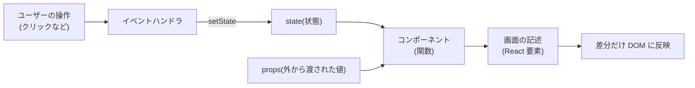
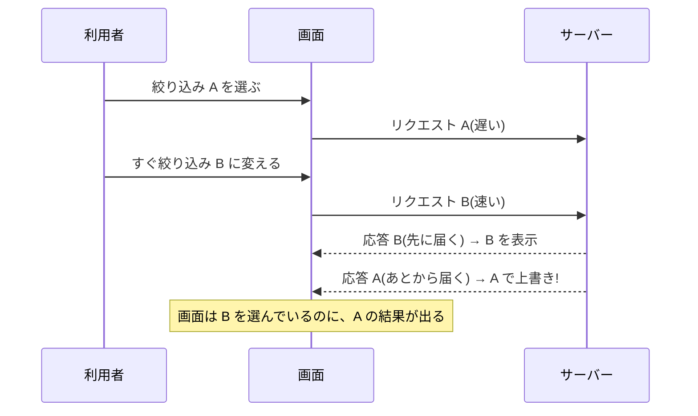
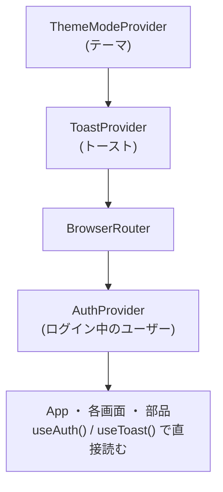

# L11 React の基礎 ― コンポーネント・state・effect・フック

**この回の目標**
- 「画面 = 状態の関数」という React の考え方を説明できる
- コンポーネント・props・**state**・**effect** の役割を区別し、書ける
- `useState` の更新の落とし穴(古い値を使う)と、`useEffect` の**後始末**を理解する
- **古い応答を捨てる**(競合)考え方を、実際の `useResource` で説明できる
- このアプリの画面の部品を、読み解ける

前提: [L10](L10-javascript-typescript.md)。

> この回の React のコードは、**本物の React を Node の中で動かして**確かめてあります(`docs/tools/react_demo.mjs` が、`frontend/node_modules` の React と jsdom を使います。先に `cd frontend && npm ci`)。

---

## 1. 宣言的な UI ― 「どうする」でなく「どうなっていてほしいか」
画面を作る 2 つの流儀です。

| 流儀 | 書き方 | 問題 |
|---|---|---|
| **命令的**(素の DOM) | 「このボタンが押されたら、あの文字を書き換えて、この色を変えて…」 | 変更が増えると、**どこで何が変わるか追えず**、表示が食い違う |
| **宣言的**(React) | 「状態がこうなら、画面はこう」と**対応を書く**。更新は React に任せる | |

<!-- test:node -->
```javascript
// 命令的: 状態を変えるたびに、画面(の文字)も自分で直す。直し忘れると食い違う
const view = { text: "" };
let count = 0;
function increment() {
  count += 1;
  view.text = `count ${count}`;          // ← 状態を変えたら、ここも必ず直す
}
increment(); increment();
console.log("命令的:", view.text);

// 宣言的: 「状態 → 画面」の対応(関数)だけ書く。画面は、状態から毎回作り直す
const render = (count) => `count ${count}`;
let state = 0;
state += 1; state += 1;
console.log("宣言的:", render(state));
```

<!-- output -->
```text
命令的: count 2
宣言的: count 2
```

React のコンポーネントは、この `render` にあたります。**状態が変わったら、React が `render` を呼び直し、前との差分だけを DOM に反映**します(仮想 DOM による差分更新)。



## 2. コンポーネントと props
**コンポーネント**は、「画面の一部を返す関数」です。**props**(プロパティ)は、親から渡される引数です。

```tsx
function Greeting({ name }: { name: string }) {
  return <p>こんにちは、{name} さん</p>;
}
// 使う側: <Greeting name="alice" />
```

`<Greeting name="alice" />` という書き方(**JSX**)は、実は **`createElement` の呼び出し**の見た目を整えたものです。

<!-- test:node -->
```javascript
import { h, mount } from "../tools/react_demo.mjs";

function Greeting({ name }) {
  return h("p", { className: "greet" }, "こんにちは、", name, " さん");   // JSX: <p className="greet">こんにちは、{name} さん</p>
}

const app = await mount(h(Greeting, { name: "alice" }));
console.log(app.html());
await app.render(h(Greeting, { name: "bob" }));        // props が変わると、描き直される
console.log(app.html());
await app.unmount();
```

<!-- output -->
```text
<p class="greet">こんにちは、alice さん</p>
<p class="greet">こんにちは、bob さん</p>
```

**props は読み取り専用**です(子が書き換えてはいけない)。値を変えたいときは、**親が持つ state を変える**。

このアプリの部品も、同じ形です。

<!-- excerpt: frontend/src/components/StatusLabel.tsx -->
```tsx
export function StatusLabel({ status }: { status: TaskStatus }) {
  const { label, Icon } = TASK_STATUS_META[status];
  return (
    <span className={`status status--${status}`}>
      <Icon fontSize="small" aria-hidden />
      {label}
    </span>
  );
}
```

読み解き:
1. `{ status }: { status: TaskStatus }` — props の分割代入と型。`status` は 4 つの文字列のどれか。
2. `TASK_STATUS_META[status]` — 状態から、文言とアイコンを引く(**表の引き**)。
3. `className={`status status--${status}`}` — 状態ごとの CSS クラス(`status--review` など)で色を変える。
4. **色 + アイコン + 文字**の 3 点セット([ui-rules.md](../ui-rules.md))。

**このコンポーネントは「状態を持たない」**(純粋)。同じ props なら、必ず同じ見た目。こういう部品が、一番テストしやすく、安全です。

## 3. state ― 変わる値
**state** は、コンポーネントが覚えている値です。変わると、画面が更新されます。`useState` で作ります。

```tsx
const [count, setCount] = useState(0);   // [今の値, 更新する関数]
```

<!-- test:node -->
```javascript
import { React, h, mount } from "../tools/react_demo.mjs";

function Counter() {
  const [count, setCount] = React.useState(0);
  return h("button", { onClick: () => setCount(count + 1) }, `押した回数: ${count}`);
}

const app = await mount(h(Counter));
console.log(app.text("button"));
await app.click("button");
await app.click("button");
console.log(app.text("button"));
await app.unmount();
```

<!-- output -->
```text
押した回数: 0
押した回数: 2
```

### 落とし穴① 更新は「次の描画」で反映される
`setCount(count + 1)` を**同じイベントの中で 3 回**書くと、どうなるでしょう。

<!-- test:node -->
```javascript
import { React, h, mount } from "../tools/react_demo.mjs";

function Counter() {
  const [stale, setStale] = React.useState(0);
  const [fresh, setFresh] = React.useState(0);
  const addThree = () => {
    setStale(stale + 1); setStale(stale + 1); setStale(stale + 1);       // 3 回とも「今の stale(0)+1」を渡している
    setFresh((n) => n + 1); setFresh((n) => n + 1); setFresh((n) => n + 1);   // 「直前の値 + 1」を 3 回
  };
  return h("button", { onClick: addThree }, `古い値: ${stale} / 関数で更新: ${fresh}`);
}

const app = await mount(h(Counter));
await app.click("button");
console.log(app.text("button"));
await app.unmount();
```

<!-- output -->
```text
古い値: 1 / 関数で更新: 3
```

`stale` は **1** にしかなりません。`count` は、**その描画の時点の値**(クロージャで固定された値)だからです。3 回とも `0 + 1` を渡している。
**「直前の値を元に更新する」ときは、関数形(`n => n + 1`)**を使います。React が、その時点の最新の値を渡してくれます。

### 落とし穴② state は「直接書き換えない」
```tsx
tasks.push(newTask);         // ✗ 配列そのものを変えても、React は気づかない(同じ配列に見える)
setTasks([...tasks, newTask]); // ○ 新しい配列を作って渡す
```

React は「**前の値と、新しい値が別物か**」で、更新するかを決めます。だから、**コピーして新しいものを作る**(L10 の `{ ...a, x: 1 }`)。
このアプリのかんばんの「先に動かす」(楽観的更新)も、新しい配列を作って `setData` に渡しています([L13](L13-kanban.md))。

## 4. effect ― 描画の「外」とつなぐ
画面の表示だけでなく、**描画の外の世界**(API の取得・タイマー・イベントの購読)とつなぐことがあります。これが**副作用**で、`useEffect` に書きます。

```tsx
useEffect(() => {
  // 描画のあとに実行される
  return () => { /* 後始末(次の実行の前、または消えるとき) */ };
}, [依存する値]);   // 依存する値が変わったときだけ、再実行
```

| 依存配列 | いつ実行されるか |
|---|---|
| `[]` | 最初の 1 回だけ(消えるとき後始末) |
| `[a, b]` | 最初と、`a` か `b` が変わったとき |
| 書かない | **毎回の描画のあと**(ほとんど不要・危険) |

<!-- test:node -->
```javascript
import { React, h, mount } from "../tools/react_demo.mjs";

function Watcher({ id }) {
  React.useEffect(() => {
    console.log(`  effect: id=${id} を購読する`);
    return () => console.log(`  cleanup: id=${id} の購読をやめる`);    // 後始末
  }, [id]);
  return h("span", null, `id ${id}`);
}

console.log("最初の描画");
const app = await mount(h(Watcher, { id: 1 }));
console.log("同じ id で描き直し(依存が変わらない → effect は走らない)");
await app.render(h(Watcher, { id: 1 }));
console.log("id を変える");
await app.render(h(Watcher, { id: 2 }));
console.log("画面から消す");
await app.unmount();
```

<!-- output -->
```text
最初の描画
  effect: id=1 を購読する
同じ id で描き直し(依存が変わらない → effect は走らない)
id を変える
  cleanup: id=1 の購読をやめる
  effect: id=2 を購読する
画面から消す
  cleanup: id=2 の購読をやめる
```

**順序が大切**: 依存が変わると、**先に前回の後始末(cleanup)、次に新しい effect**。購読の付けっぱなし(メモリリーク)や、二重の購読が起きないようにするためです。

### 開発中の「二重実行」
このアプリは `<StrictMode>` で動かしています。**開発中だけ**、effect を「実行 → 後始末 → 実行」と**わざと 2 回**回して、後始末の書き忘れを見つけます。

<!-- test:node -->
```javascript
import { React, h, mount } from "../tools/react_demo.mjs";

function Timer() {
  React.useEffect(() => {
    console.log("  effect: タイマー開始");
    return () => console.log("  cleanup: タイマー停止");
  }, []);
  return h("i", null, "timer");
}

console.log("StrictMode で最初の 1 回の描画:");
const app = await mount(h(React.StrictMode, null, h(Timer)));
await app.unmount();
```

<!-- output -->
```text
StrictMode で最初の 1 回の描画:
  effect: タイマー開始
  cleanup: タイマー停止
  effect: タイマー開始
  cleanup: タイマー停止
```

「開始 → 停止 → 開始」までが StrictMode のわざとの二重実行で、最後の「停止」は `unmount()`(画面から消した)の分です。**後始末が正しければ、2 回目も同じ状態になる**ので問題なし。書き忘れていたら(タイマーが 2 本走るなど)、ここで気づけます。

## 5. 競合を防ぐ ― `useResource` の「古い応答を捨てる」
effect でデータを取りに行くとき、**よく起きるバグ**があります。



**あとから届いた古い応答**が、新しい表示を上書きしてしまう(競合)。対策は、**「自分が最新の要求か」を毎回確かめ、古ければ捨てる**こと。
このアプリの `useResource` は、**連番**でこれを実現しています。

<!-- excerpt: frontend/src/hooks/useResource.ts -->
```ts
const seq = useRef(0);
```

<!-- excerpt: frontend/src/hooks/useResource.ts -->
```ts
const reload = useCallback(async () => {
  const mine = ++seq.current;
  setLoading(true);
  try {
    const result = await run();
    if (mine !== seq.current) return;
    setDataState(result);
    setError(undefined);
```

読み解き:
1. `seq` は `useRef`(**描画をまたいで残る箱**。変えても再描画されない)。
2. `const mine = ++seq.current` — 要求を出すたびに連番を増やし、**自分の番号 `mine`** を覚える(クロージャ)。
3. `await run()` の**あと**、`mine !== seq.current` なら、**もっと新しい要求が出ている**ので、結果を捨てる(`return`)。
4. 消える(アンマウント)ときも `seq.current++` で、**進行中の要求を無効にする**(`useEffect` の後始末)。

同じ仕組みを、本物の React で再現して、**ガードの有無**を比べましょう。

<!-- test:node -->
```javascript
import { React, h, mount, tick } from "../tools/react_demo.mjs";

// 偽の API: id=1 は遅く(60ms)、id=2 は速く(10ms)返す
const fetchItem = (id) => new Promise((resolve) => setTimeout(() => resolve(`結果 ${id}`), id === 1 ? 60 : 10));

function useData(id, guarded) {
  const [data, setData] = React.useState("(なし)");
  const seq = React.useRef(0);
  React.useEffect(() => {
    const mine = ++seq.current;
    fetchItem(id).then((result) => {
      if (guarded && mine !== seq.current) return;      // 古い応答を捨てる
      setData(result);
    });
  }, [id, guarded]);
  return data;
}

function View({ id, guarded }) {
  return h("p", null, useData(id, guarded));
}

for (const guarded of [false, true]) {
  const app = await mount(h(View, { id: 1, guarded }));
  await app.render(h(View, { id: 2, guarded }));      // すぐ id=2 に切り替える
  await tick(100);                                    // 両方の応答が届くまで待つ
  console.log(guarded ? "ガードあり:" : "ガードなし:", "画面の表示 =", app.text("p"), "(選んだのは id=2)");
  await app.unmount();
}
```

<!-- output -->
```text
ガードなし: 画面の表示 = 結果 1 (選んだのは id=2)
ガードあり: 画面の表示 = 結果 2 (選んだのは id=2)
```

**ガードなし**だと、遅れて届いた「結果 1」が、新しい選択(id=2)の表示を上書きします。**ガードあり**なら、古い応答は捨てられて「結果 2」のまま。

> **教訓**: 非同期の結果は、**届いた時点でまだ有効か**を確かめる。`useResource` は、この確認を **1 か所に集めて**、画面ごとに書かなくて済むようにしています。

## 6. フックの規則と、自作フック
**フック**(`useState`・`useEffect`・…)には**規則**があります。

| 規則 | 理由 |
|---|---|
| コンポーネント(と、他のフック)の**一番外側**でだけ呼ぶ。`if` やループの中で呼ばない | React は「呼ばれた**順番**」で、どの state かを覚えている |
| 名前は `use` で始める | 規則を検査するツールが、フックだと見分けられる |

**自作フック**は、「フックを組み合わせた、再利用できる処理」です。このアプリには、次のものがあります。

| フック | 役割 |
|---|---|
| `useResource` | データの取得(読み込み中・失敗・再読み込み・古い応答の破棄) |
| `useTaskTransition` | 状態変更(確認モーダル + 先行更新 + トースト) |
| `useTaskParam` | 開いているタスクを URL の `?task=` に持つ |
| `usePrefersReducedMotion` | OS の「動きを減らす」設定を読む |

小さな例として、`usePrefersReducedMotion` を読みましょう。

<!-- excerpt: frontend/src/hooks/usePrefersReducedMotion.ts -->
```ts
export function usePrefersReducedMotion(): boolean {
  const read = () => typeof window !== "undefined" && typeof window.matchMedia === "function" && window.matchMedia(QUERY).matches;
  const [reduced, setReduced] = useState(read);

  useEffect(() => {
    if (typeof window.matchMedia !== "function") return;
    const mql = window.matchMedia(QUERY);
    const onChange = () => setReduced(mql.matches);
    mql.addEventListener("change", onChange);
    return () => mql.removeEventListener("change", onChange);
  }, []);

  return reduced;
}
```

読み解き:
- `useState(read)` — 初期値に**関数**を渡すと、最初の 1 回だけ呼ばれる(毎回計算しない)。
- effect で、**設定が変わったら**(`change` イベント)state を更新。→ 画面が追従する。
- **後始末**で `removeEventListener`。付けたものは、必ず外す。
- `typeof window.matchMedia !== "function"` — テスト環境(`matchMedia` が無い)でも落ちない、**防御的な書き方**。

これを使うのが ASCII モチーフ(`AsciiPlant`)です。「動きを減らす」設定なら**静止画 1 枚**、そうでなければ 0.9 秒ごとに切り替えます。

<!-- excerpt: frontend/src/components/AsciiPlant.tsx -->
```tsx
useEffect(() => {
  if (reduced || frames.length < 2) {
    setIndex(0);
    return;
  }
  const timer = window.setInterval(() => {
    if (!document.hidden) setIndex((i) => (i + 1) % frames.length);
  }, FRAME_INTERVAL_MS);
  return () => window.clearInterval(timer);
}, [reduced, frames]);
```

- `setIndex((i) => (i + 1) % frames.length)` — **関数形**の更新(落とし穴①の対策)。`%` で、最後まで行ったら最初へ戻る。
- `document.hidden` — タブが隠れている間は動かさない(描画負荷を使わない)。
- **後始末で `clearInterval`** — 消えるとき、タイマーが残らない。

## 7. Context ― 深い所へ値を届ける
アプリ全体で使う値(ログイン中のユーザー・テーマ・トースト)を、**props で何段も受け渡す**のは面倒です。**Context** は、「ここから下の全員が、直接読める」仕組みです。



<!-- test:node -->
```javascript
import { React, h, mount } from "../tools/react_demo.mjs";

const ToastContext = React.createContext(() => {});          // 既定値: 何もしない
const useToast = () => React.useContext(ToastContext);

function ToastProvider({ children }) {
  const [message, setMessage] = React.useState("");
  return h(ToastContext.Provider, { value: setMessage }, h("output", null, message), children);
}

function DeepButton() {                                       // 何段下でも、props を受け渡さずに使える
  const notify = useToast();
  return h("button", { onClick: () => notify("保存しました") }, "保存");
}

const app = await mount(h(ToastProvider, null, h("div", null, h("div", null, h(DeepButton)))));
console.log("前:", JSON.stringify(app.text("output")));
await app.click("button");
console.log("後:", JSON.stringify(app.text("output")));
await app.unmount();
```

<!-- output -->
```text
前: ""
後: "保存しました"
```

## 8. リストと `key`
配列から要素を並べるときは、**`key`**(兄弟の中で一意で、並べ替えても変わらない値)を付けます。

```tsx
{tasks.map((task) => <TaskRow key={task.id} task={task} />)}   // key = ID(配列の添字は使わない)
```

React は `key` で「どの要素が、前のどれか」を照合します。**添字を key にすると**、並べ替えや途中の削除で、別の要素の state(入力中の文字など)が**取り違えられる**ことがあります。

## 9. ルーティング(React Router)
画面の切り替えは、URL で決めます([L01](L01-web.md) の「URL は資源」)。

<!-- excerpt: frontend/src/App.tsx -->
```tsx
<Route path="/projects/:code" element={<ProjectLayout />}>
  <Route index element={<OverviewPage />} />
  <Route path="board" element={<BoardPage />} />
  <Route path="entities/:id" element={<EntityPage />} />
</Route>
```

- `:code` は**URL の一部を変数に**(`/projects/DEMO` の `DEMO`)。`useParams()` で読む。
- **入れ子**: `ProjectLayout` が外側の枠(プロジェクトを 1 回だけ読み込む)で、中の `<Outlet />` に、子の画面が入る。
- `?task=12` のような**クエリ**も、画面の状態として使える(`useSearchParams`)。リンクで共有でき、戻るボタンで閉じられる。

## よくある間違い
| 間違い | 正しくは |
|---|---|
| state を直接書き換える(`list.push(x)`) | 新しい配列・オブジェクトを作って、`setState` に渡す |
| `setX(x + 1)` を連続して呼ぶ | 直前の値が必要なら `setX(n => n + 1)` |
| effect の後始末を書かない | タイマー・購読は `return () => ...` で必ず外す |
| 依存配列を空のままにして、古い値を使い続ける | effect の中で使う値を、依存に入れる |
| 非同期の結果を、無条件に state に入れる | **届いた時点で有効か**を確かめる(連番・中止) |
| リストの `key` に添字を使う | ID のような、一意で変わらない値 |
| コンポーネントの中でフックを `if` で呼ぶ | 一番外側で、必ず同じ順に呼ぶ |
| props を子で書き換える | props は読み取り専用。親の state を変える |

## 確認問題
1. 命令的な UI と、宣言的な UI の違いを述べよ。
2. 同じイベントの中で `setCount(count + 1)` を 3 回書くと、なぜ +1 にしかならないか。直し方は。
3. `useEffect` の依存配列が `[id]` のとき、`id` が変わると、何がどの順に実行されるか。
4. StrictMode が、開発中に effect を 2 回実行する理由は。
5. `useResource` の `seq`(連番)は、何のためか。`useRef` を使うのはなぜか。
6. リストの `key` に添字を使うと、何が起きうるか。
7. Context は、何を解決するか。

## 答え
1. 命令的は「状態が変わるたびに、画面の各所を自分で書き換える」(食い違いやすい)。宣言的は「状態 → 画面」の対応を書き、更新は React に任せる。
2. `count` は、その描画の時点の値に固定されている(3 回とも `0 + 1`)。直前の値を元に更新したいときは `setCount((n) => n + 1)`。
3. 前回の effect の**後始末(cleanup)**が先、次に**新しい effect**。
4. 後始末の書き忘れ(タイマー・購読の付けっぱなし)を、開発中に見つけるため。後始末が正しければ、2 回目も同じ結果になる。
5. 古い(遅れて届いた)応答が、新しい表示を上書きするのを防ぐ。`useRef` は描画をまたいで値が残り、変えても再描画を起こさない箱だから。
6. 並べ替え・途中の削除で、別の要素の state(入力中の文字など)が取り違えられる。
7. 離れた階層の部品へ、props を何段も受け渡さずに、値(ユーザー・テーマ・トースト)を届ける。

## 次へ
[L12 画面づくり](L12-ui-css.md) ― CSS・Sass・デザイントークン・アクセシビリティ。
