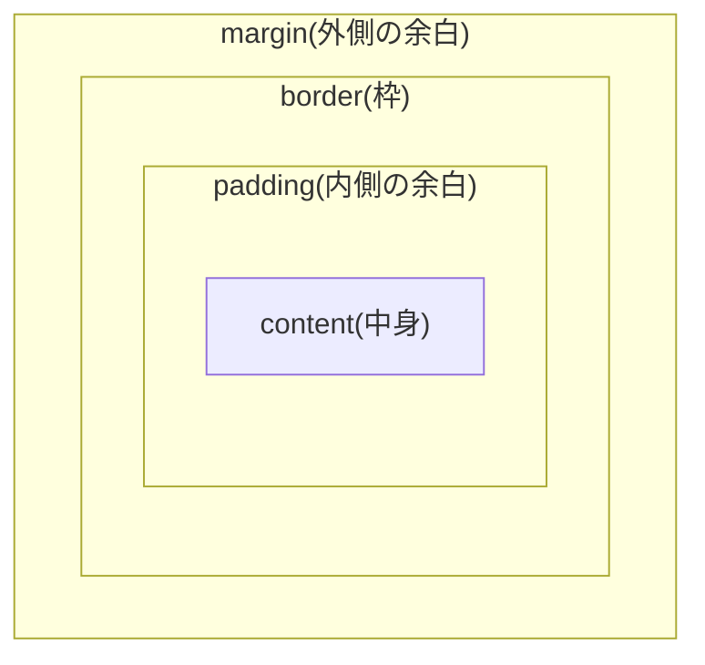
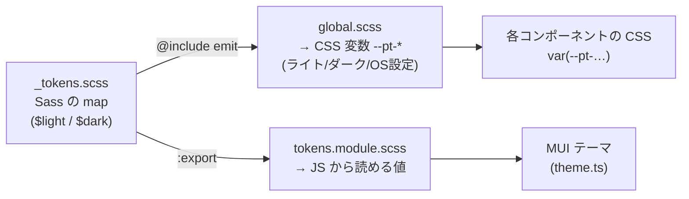
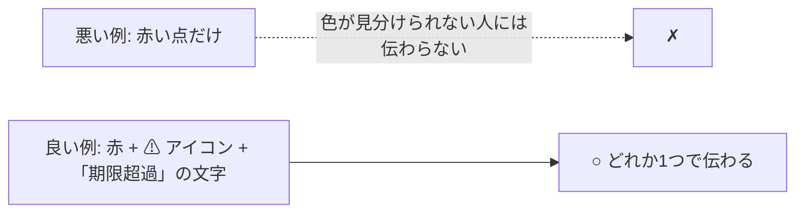

# L12 画面づくり ― CSS・Sass・デザイントークン・アクセシビリティ

**この回の目標**
- CSS の「カスケード・ボックス・レイアウト(Flex/Grid)」を説明できる
- **CSS 変数**と**デザイントークン**で、色や間隔を 1 か所で管理する理由を説明できる
- Sass がこのアプリで担う仕事(トークンの出力・MUI への受け渡し)を追える
- **コントラスト比**を自分で計算し、トークンが基準(4.5:1)を満たすか確かめられる
- 「色だけに頼らない」「動きを減らす」「キーボードで操作できる」の実装を読める

前提: [L11](L11-react.md)。

---

## 1. CSS の最低限 ― 3 つの考え方

### 1-1. カスケード(どの指定が勝つか)
同じ要素に複数の指定が当たったとき、**詳細度(specificity)が高い方、同じなら後に書いた方**が勝ちます。

| セレクタ | 詳細度の目安 |
|---|---|
| `p`(要素) | 低い |
| `.card`(クラス) | 中 |
| `#main`(ID) | 高い |
| `style="…"`(インライン) | もっと高い |

**運用上のコツ**: クラスだけで書く(ID は使わない)。詳細度を競わせない。`!important` は最後の手段。

### 1-2. ボックスモデル
すべての要素は箱で、内側から **content → padding → border → margin** です。



このアプリは `* { box-sizing: border-box; }` を指定しています。**`width` に padding と border を含める**ので、計算が直感どおりになります(`width: 100%` と `padding` を足しても、はみ出さない)。

### 1-3. レイアウト ― Flexbox と Grid
| 使い分け | 道具 |
|---|---|
| **一方向**に並べる(横 1 列・縦 1 列、ボタンの列) | Flexbox(`display: flex`) |
| **縦横の格子**(かんばんの列、カード一覧) | Grid(`display: grid`) |

```css
.board {
  display: grid;
  grid-template-columns: repeat(4, minmax(0, 1fr));  /* 4 列。minmax(0, …) で中身に押されて広がるのを防ぐ */
  gap: 12px;
}
```

`minmax(0, 1fr)` の `0` は**重要**です。Grid/Flex の子は、既定では「中身の最小幅」より小さくならない(`min-width: auto`)ので、長い文字列があると列が**はみ出します**。`0` や `min-width: 0` で「縮んでよい」と伝えます(このアプリで幅 360px でも横スクロールが出ない理由)。

## 2. CSS 変数 ― 実行時に切り替えられる値
```css
:root { --pt-primary: #2150c4; }
.button { background: var(--pt-primary); }
:root[data-theme='dark'] { --pt-primary: #8fb0ff; }   /* 値だけ差し替え → すべての利用箇所が追従 */
```

Sass の変数(`$x`)は**ビルド時に消える**のに対し、CSS 変数(`--x`)は**ブラウザが実行時に解決**します。だから、ライト/ダークのような**切り替え**に使えます。

## 3. デザイントークン ― 「意味のある名前」で値を持つ
**トークン**は、「`#2150c4`」ではなく「`primary`(主要色)」という**役割の名前**で値を管理する考え方です。

| 良くない | 良い |
|---|---|
| `color: #85550a;` を各所に直書き | `color: var(--pt-status-review);` |
| 色を変えるたびに全ファイルを検索 | トークンの 1 行を変える |
| ダークモードで全部書き直し | 変数の値の組を切り替えるだけ |

このアプリのトークンは `frontend/src/styles/_tokens.scss` に**唯一の出どころ**として定義されています。

<!-- excerpt: frontend/src/styles/_tokens.scss -->
```scss
$light: (
  'bg': #f4f6f9,
  'surface': #ffffff,
  'surface-2': #eceff4,
  'text': #1b1f27,
  'text-muted': #4f5a6b,
  'border': #ccd2dc,
  'primary': #2150c4,
  'on-primary': #ffffff,
  'danger': #b3261e,
  'status-todo': #525c6e,
  'status-in-progress': #1b5fc9,
  'status-review': #85550a,
  'status-done': #17743a,
  'drag-shadow': '0 12px 28px rgb(20 30 50 / 28%)',
);
```

## 4. Sass の役割 ― 「同じ値を、複数の場所へ」
このアプリでは、Sass は次の仕事だけをします(使いすぎない)。



- **map**(`$light: ( 'bg': #f4f6f9, … )`)は、名前 → 値の辞書。
- **mixin**(`@mixin emit($tokens)`)は、map を `--pt-名前: 値;` に展開する。

<!-- excerpt: frontend/src/styles/_tokens.scss -->
```scss
@mixin emit($tokens) {
  @each $name, $value in $tokens {
    --pt-#{$name}: #{$value};
  }
}
```

- `#{ … }` は**補間**(文字列に値を埋め込む)。
- `global.scss` が、ライト・ダーク・「OS がダークのとき(明示でライトにしていなければ)」の 3 通りに出し分けます。

<!-- excerpt: frontend/src/styles/global.scss -->
```scss
:root {
  @include t.emit(t.$light);
  color-scheme: light;
}

@media (prefers-color-scheme: dark) {
  :root:not([data-theme='light']) {
    @include t.emit(t.$dark);
    color-scheme: dark;
  }
}

:root[data-theme='dark'] {
  @include t.emit(t.$dark);
  color-scheme: dark;
}
```

読み解き(優先順位):
1. 既定はライト。
2. OS の設定がダークで、かつ利用者が**明示的にライトを選んでいない**なら、ダーク。
3. 利用者が `data-theme='dark'` を明示したら、ダーク(OS の設定に関わらず)。

→ 「**OS に従う** + **手動で上書き**できる」。利用者の選択は `localStorage` に保存します(L10)。

### トークンを足す手順
1. `_tokens.scss` の `$light` と `$dark` の**両方**に、同じ名前で足す。
2. 使う側で `var(--pt-新しい名前)`。
3. MUI で使うなら `tokens.module.scss` の `:export` にも足す。
4. **コントラスト**を確かめる(次の節)。

## 5. アクセシビリティ(a11y)― 誰でも使える

### 5-1. コントラスト比を計算する
WCAG は、文字と背景の**輝度の比**で読みやすさを測ります。通常の文字は **4.5:1 以上**が基準です。計算は次のとおり。

1. 各色(0〜255)を 0〜1 にして、**ガンマ補正を外す**(線形化):
   `c ≤ 0.03928 ? c / 12.92 : ((c + 0.055) / 1.055) ** 2.4`
2. **相対輝度** `L = 0.2126·R + 0.7152·G + 0.0722·B`(緑が一番明るく感じる、という目の特性)
3. **コントラスト比** `(明るい方の L + 0.05) / (暗い方の L + 0.05)`

実際に、このアプリのトークンを `_tokens.scss` から**読み込んで**計算してみます。

<!-- test:node -->
```javascript
import { readFileSync } from "node:fs";

const scss = readFileSync(new URL("../../frontend/src/styles/_tokens.scss", import.meta.url), "utf8");

// $light: ( ... ); / $dark: ( ... ); の中の 'name': #rrggbb を取り出す
function readMap(name) {
  const body = scss.match(new RegExp(`\\$${name}: \\(([\\s\\S]*?)\\n\\);`))[1];
  return Object.fromEntries([...body.matchAll(/'([\w-]+)':\s*(#[0-9a-fA-F]{6})/g)].map((m) => [m[1], m[2]]));
}

const channel = (c) => { c /= 255; return c <= 0.03928 ? c / 12.92 : ((c + 0.055) / 1.055) ** 2.4; };
function luminance(hex) {
  const [r, g, b] = [1, 3, 5].map((i) => channel(parseInt(hex.slice(i, i + 2), 16)));
  return 0.2126 * r + 0.7152 * g + 0.0722 * b;
}
function contrast(a, b) {
  const [hi, lo] = [luminance(a), luminance(b)].sort((x, y) => y - x);
  return (hi + 0.05) / (lo + 0.05);
}

console.log("白 と 黒:", contrast("#ffffff", "#000000").toFixed(2));

const pairs = ["text", "text-muted", "primary", "danger", "status-todo", "status-in-progress", "status-review", "status-done"];
for (const theme of ["light", "dark"]) {
  const t = readMap(theme);
  console.log(`[${theme}]`);
  for (const key of pairs) {
    const ratio = contrast(t[key], t.surface);
    console.log(`  ${key.padEnd(20)} ${ratio.toFixed(2)}  ${ratio >= 4.5 ? "OK" : "NG"}`);
  }
}
```

<!-- output -->
```text
白 と 黒: 21.00
[light]
  text                 16.51  OK
  text-muted           6.98  OK
  primary              6.98  OK
  danger               6.54  OK
  status-todo          6.74  OK
  status-in-progress   5.95  OK
  status-review        6.36  OK
  status-done          5.84  OK
[dark]
  text                 13.68  OK
  text-muted           7.73  OK
  primary              7.64  OK
  danger               8.01  OK
  status-todo          8.64  OK
  status-in-progress   7.77  OK
  status-review        9.91  OK
  status-done          8.74  OK
```

どれも **4.5 以上(OK)**。**この確認を自動化**しておけば、色を変えたときに基準割れへ気づけます(演習 L17 で、これをテストにします)。

> **ポイント**: 「白と黒」は最大の **21:1**。色がありそうでなさそうでも、**数値で確かめる**。見た目の印象は当てになりません。

### 5-2. 色だけに頼らない
色覚の違い(色の見え方)や、白黒の画面・印刷でも伝わるよう、**状態は「色 + アイコン + 文字」の 3 点セット**で示します(`StatusLabel`、L11)。



### 5-3. キーボードだけで操作できる
- ボタンは `<button>`、リンクは `<a>` を使う(`<div onClick>` は **Tab で届かない・Enter で押せない**)。
- フォーカスが見えること:

<!-- excerpt: frontend/src/styles/global.scss -->
```scss
:focus-visible {
  outline: 2px solid var(--pt-primary);
  outline-offset: 2px;
}
```

`:focus-visible` は、**キーボード操作のときだけ**枠を出します(マウスのクリックでは出ない)。
- ドラッグ操作には、**キーボードの代替**を必ず用意する([L13](L13-kanban.md))。
- 装飾は読み上げ対象から外す: `aria-hidden`(アイコンや ASCII モチーフ)。画面に出さず読み上げだけ欲しい文字は `.visually-hidden`。

### 5-4. 動きを減らす
動きで気分が悪くなる人がいます。OS の「視覚効果を減らす」を、CSS と JS の両方で尊重します。

<!-- excerpt: frontend/src/styles/global.scss -->
```scss
@media (prefers-reduced-motion: reduce) {
  .card--dragging { transform: none; } // 傾けない(影は残す)
  .card--stagger { animation: none; }
  .column { transition: none; }
}
```

- CSS では `@media (prefers-reduced-motion: reduce)` で、アニメーションを止める。
- JS では `usePrefersReducedMotion`(L11)で、ASCII モチーフを静止画にする。

## 6. ASCII モチーフを「データ」として読む
植物の成長モチーフ(種 → 芽 → 花 → 実)は、**画像でなく文字列の配列**です。

<!-- test:node -->
```javascript
import { GROWTH_FRAMES, GROWTH_STAGE_OF_STATUS } from "../../frontend/src/domain/motif.ts";

console.log("状態 → 段階:", JSON.stringify(GROWTH_STAGE_OF_STATUS));
for (const stage of ["seed", "sprout", "flower", "fruit"]) {
  console.log(`--- ${stage} (コマ 0) ---`);
  console.log(GROWTH_FRAMES[stage][0].join("\n"));
}
```

<!-- output -->
```text
状態 → 段階: {"todo":"seed","in_progress":"sprout","review":"flower","done":"fruit"}
--- seed (コマ 0) ---
         
         
    o    
~~~~~~~~~
--- sprout (コマ 0) ---
         
   \ /   
    |    
~~~~~~~~~
--- flower (コマ 0) ---
   (*)   
    |    
   \|/   
~~~~~~~~~
--- fruit (コマ 0) ---
   \|/   
  o-|-o  
    |    
~~~~~~~~~
```

- 状態(`todo/in_progress/review/done`)→ 段階への対応は `Record` 型。**状態を足して書き忘れると、型エラー**になる([L06](L06-state-machine.md) と同じ「網羅性」の発想)。
- 幅 9 文字・高さ 4 行にそろえる(ずれると列がガタつく)→ これもテストで守っています(`motif.test.ts`)。
- 等幅フォント(`$font-mono`)で表示する。画像と違い、**テーマの色にそのまま追従**し、軽い。

## 7. MUI との付き合い方
MUI は、ボタンやダイアログなどの**部品の集まり**です。このアプリでは、次の方針です。

| 方針 | 理由 |
|---|---|
| 色・フォントは**トークンから**テーマに渡す(`theme.ts`) | 見た目の唯一の出どころを保つ |
| 独自のスタイルは、**クラス + `var(--pt-…)`** で書く | ダーク/ライトが自動で追従 |
| MUI の部品は、既定のアクセシビリティ(フォーカス・ARIA)を活かす | ゼロから作らない |

## よくある間違い
| 間違い | 正しくは |
|---|---|
| 色を `#xxxxxx` で各所に直書き | トークン(`var(--pt-…)`)を使う |
| ライトだけトークンを足す | `$light` と `$dark` の**両方**に足す |
| Grid/Flex の子が、長い文字でレイアウトを壊す | `min-width: 0` / `minmax(0, 1fr)` |
| 状態を色だけで示す | 色 + アイコン + 文字 |
| `<div onClick>` をボタン代わりにする | `<button>` を使う |
| `outline: none` でフォーカス枠を消す | 消すなら、代わりの目印を必ず用意する |
| コントラストを目で見て判断する | 計算して、4.5:1 以上を確かめる |

## 確認問題
1. `box-sizing: border-box` は、何を変えるか。
2. Sass の変数と CSS 変数の違いは。ダークモードに使えるのはどちらか。
3. このアプリのトークンの、唯一の出どころはどこか。新しいトークンを足す手順は。
4. コントラスト比の計算の手順を 3 段階で述べよ。通常の文字の基準は。
5. `:focus-visible` は、`:focus` と何が違うか。
6. 状態を「色だけ」で示してはいけないのは、なぜか。

## 答え
1. `width`/`height` に padding と border を**含める**ようになる(足し算で、はみ出さない)。
2. Sass の変数はビルド時に消える。CSS 変数はブラウザが実行時に解決する。ダークモードの切り替えには CSS 変数。
3. `frontend/src/styles/_tokens.scss`。`$light` と `$dark` の両方に足す → `var(--pt-名前)` で使う → MUI なら `:export` にも足す → コントラストを確かめる。
4. ①各色を 0〜1 にして線形化 ②`L = 0.2126R + 0.7152G + 0.0722B` ③`(明るい L + 0.05) / (暗い L + 0.05)`。基準は **4.5:1**。
5. `:focus-visible` は、キーボード操作などで「枠が必要なとき」だけ出す(マウスのクリックでは出さない)。
6. 色の見え方が違う人、白黒の画面・印刷では、伝わらないから。アイコンと文字を併用する。

## 次へ
[L13 かんばん](L13-kanban.md) ― イベント・ドラッグ&ドロップ・楽観的更新。
