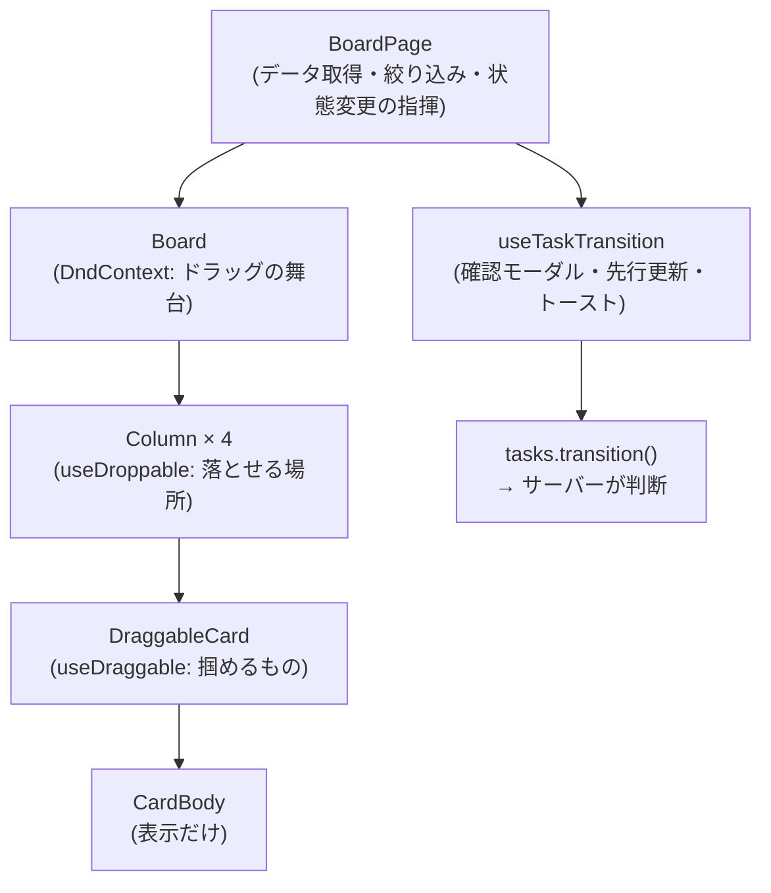
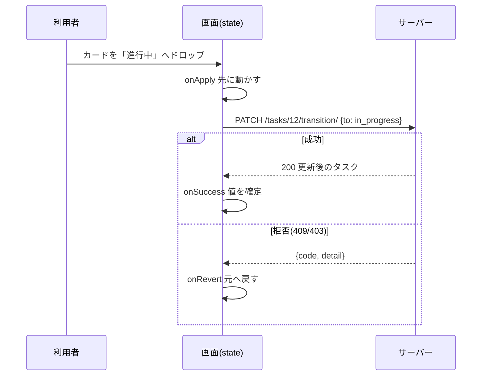

# L13 かんばん ― イベント・ドラッグ&ドロップ・楽観的更新

**この回の目標**
- DOM イベントの**バブリング**と、React のイベントの扱いを説明できる
- **楽観的更新**(先に画面を動かし、失敗したら戻す)の流れと、その危うさを説明できる
- ドラッグ&ドロップ(`@dnd-kit`)の部品の役割を読み解ける
- ドラッグにたよらない**キーボードの代替操作**を実装・テストできる
- 「画面は判断せず、サーバーが判断する」という責務の分け方を説明できる

前提: [L06 状態遷移](L06-state-machine.md)・[L11 React](L11-react.md)。

---

## 1. この画面の全体像
かんばんは、タスクを**状態の列**(未着手/進行中/レビュー/完了)に並べ、カードを動かして状態を変えます。



**責務の分け方**(ここが設計の核心):

| 部品 | 責務 | やらないこと |
|---|---|---|
| `Board` / `Column` / `Card` | 表示と、操作の**受け付け**(`onMove(task, to)` を呼ぶ) | 遷移の可否を判断しない |
| `useTaskTransition` | 確認・先行更新・結果の通知 | 遷移ルールを持たない |
| **サーバー**(`Task.transition_to`) | 遷移の可否を**唯一**判断(409/403) | |

> 画面にも「todo→done は不可」と書けば、一見親切です。しかし**ルールが 2 か所**になり、変えたときに食い違います。画面は常に `onMove` で聞き、サーバーの答え(409 とその理由)をそのまま見せる ― これが [L06](L06-state-machine.md) の「ルールを 1 か所に」の画面側の姿です。

## 2. DOM イベントの基礎

### 2-1. バブリング
クリックなどのイベントは、**押された要素から親へ**順に伝わります(バブリング)。

<!-- test:node -->
```javascript
import { h, mount } from "../tools/react_demo.mjs";

const log = [];
const app = await mount(
  h("article", { onClick: () => log.push("カード(article)") },
    h("button", { onClick: (e) => { log.push("ボタン"); } }, "メニュー")),
);
await app.click("button");
console.log("1. そのまま     :", log.join(" → "));

log.length = 0;
await app.render(
  h("article", { onClick: () => log.push("カード(article)") },
    h("button", { onClick: (e) => { e.stopPropagation(); log.push("ボタン"); } }, "メニュー")),
);
await app.click("button");
console.log("2. stopPropagation:", log.join(" → "));
await app.unmount();
```

<!-- output -->
```text
1. そのまま     : ボタン → カード(article)
2. stopPropagation: ボタン
```

カード全体のクリックが「詳細を開く」で、その中のメニューボタンが「状態を変更」のとき、**何もしないとメニューを押すたびに詳細も開いてしまう**。`stopPropagation()` で、親へ伝わるのを止めます(`StatusMenu` はこれをしています)。

### 2-2. `target` と `currentTarget`
- `e.target`: 実際に押された(イベントが起きた)要素。
- `e.currentTarget`: そのハンドラを**付けた**要素。

`Board.tsx` のキー操作は、この違いを使っています。

<!-- excerpt: frontend/src/components/Board.tsx -->
```tsx
  function onKeyDown(e: KeyboardEvent<HTMLElement>) {
    if (e.target !== e.currentTarget) return;
    if (e.key === "Enter") onOpen(task);
    if (canWrite && e.shiftKey && (e.key === "ArrowRight" || e.key === "ArrowLeft")) {
      e.preventDefault();
      const to = adjacentStatus(task.status, e.key === "ArrowRight" ? 1 : -1);
      if (to) onMove(task, to);
    }
  }
```

読み解き:
1. `e.target !== e.currentTarget` なら無視 ― カードの**中**のボタンなどで押した Enter を、カード自身の「詳細を開く」と取り違えない。
2. `e.shiftKey` — Shift が押されているか。**Shift + ← / →** で隣の列へ。
3. `e.preventDefault()` — ブラウザ既定の動き(スクロールなど)を止める。
4. `adjacentStatus(...)` — 列の並び順で「隣」を引く。端なら `null`(何もしない)。

## 3. キーボードの代替操作を試す
ドラッグ&ドロップは**マウス・タッチの操作**です。キーボードだけの人、スクリーンリーダーの人には使えません。だから**同じことができる別の入口**を必ず用意します(WCAG の考え方)。

`adjacentStatus` と同じ仕組みを、本物の React で動かして確かめます。

<!-- test:node -->
```javascript
import { h, mount } from "../tools/react_demo.mjs";

const STATUSES = ["todo", "in_progress", "review", "done"];          // 列の並び順
const adjacent = (status, dir) => STATUSES[STATUSES.indexOf(status) + dir] ?? null;

function Card({ task, onMove }) {
  function onKeyDown(e) {
    if (e.target !== e.currentTarget) return;
    if (e.shiftKey && (e.key === "ArrowRight" || e.key === "ArrowLeft")) {
      e.preventDefault();
      const to = adjacent(task.status, e.key === "ArrowRight" ? 1 : -1);
      if (to) onMove(task, to);
    }
  }
  return h("article", { tabIndex: 0, onKeyDown }, task.name);
}

const moves = [];
const onMove = (task, to) => moves.push(`${task.status}→${to}`);
const app = await mount(h(Card, { task: { name: "modeling", status: "todo" }, onMove }));

await app.key("article", "ArrowRight", { shiftKey: true });                // Shift + →
await app.key("article", "ArrowRight");                                    // Shift なし → 何も起きない
await app.key("article", "ArrowLeft", { shiftKey: true });                 // 左端(todo)の左は無い → 何も起きない
console.log("todo のカード:", JSON.stringify(moves));

moves.length = 0;
await app.render(h(Card, { task: { name: "modeling", status: "review" }, onMove }));
await app.key("article", "ArrowRight", { shiftKey: true });
await app.key("article", "ArrowLeft", { shiftKey: true });
console.log("review のカード:", JSON.stringify(moves));
await app.unmount();
```

<!-- output -->
```text
todo のカード: ["todo→in_progress"]
review のカード: ["review→done","review→in_progress"]
```

読み取りのポイント:
- `todo` のカード: Shift + → だけが `todo→in_progress` を呼ぶ。Shift なしは無視、左端の左は `null` で何もしない。
- `review` のカード: 左右とも隣があるので、`review→done` と `review→in_progress` の両方を呼ぶ。

> **注意**: 「隣の列」は**列の見た目の順序**で、**遷移表とは別物**です。たとえば `done`(右端)の左隣は `review` ですが、遷移表で `done` から行けるのは `in_progress` だけです。UI は「隣へ動かしたい」と `onMove` を呼ぶだけで、**許されるかどうかはサーバーが 409 で答えます**。画面はその理由をそのまま見せ、カードを元の列へ戻します(次の節)。

## 4. 楽観的更新(optimistic update)

### 4-1. なぜ先に動かすか
カードを落として、サーバーの応答を待って(数百 ms)から動かすと、**もっさり**します。そこで、**成功する前提で先に画面を動かし**、失敗したら戻す ― これが楽観的更新です。



### 4-2. 実装を読む
`useTaskTransition`(再掲・L11)の核心です。

<!-- excerpt: frontend/src/hooks/useTaskTransition.tsx -->
```tsx
  const run = useCallback(
    async (task: Task, to: TaskStatus) => {
      onApply?.(task, to);
      try {
        const updated = await tasks.transition(task.id, to);
        onSuccess(updated);
        notify(`「${task.entity_name} / ${task.step_name}」を「${TASK_STATUS_META[to].label}」にしました。`, "success");
      } catch (e) {
        onRevert?.(task);
        notify(e instanceof ApiError ? e.detail : "状態を変更できませんでした。", "error");
      }
    },
    [notify, onApply, onRevert, onSuccess],
  );
```

呼び出し側(`BoardPage`)は、state を**コピーして**書き換えます(L11 の「直接書き換えない」)。

<!-- excerpt: frontend/src/pages/BoardPage.tsx -->
```tsx
  const patchTask = useCallback(
    (id: number, patch: Partial<Task> | ((t: Task) => Task)) =>
      res.setData((d) => d && { ...d, items: d.items.map((t) => (t.id === id ? (typeof patch === "function" ? patch(t) : { ...t, ...patch }) : t)) }),
    [res.setData],
  );

  const transition = useTaskTransition({
    onApply: (task, to) => patchTask(task.id, { status: to }), // 先に動かす
    onRevert: (task) => patchTask(task.id, { status: task.status }), // 拒否されたら元の列へ戻す
```

- `{ ...d, items: d.items.map(...) }` — **新しい配列・新しいオブジェクト**を作る。対象の 1 件だけ `{ ...t, ...patch }` で差し替え、他は同じものを使い回す(無駄な再描画を避ける)。
- `onRevert` が戻す値は `task.status` — `run` に渡された**動かす前の `task`**(クロージャが覚えている)。だから、戻し先を別途保存しなくてよい。

### 4-3. 小さな模型で、成功/拒否の両方を確かめる
サーバー側の遷移表([L06](L06-state-machine.md))を持つ偽 API と、先行更新+巻き戻しを、純粋な関数で再現します。

<!-- test:node -->
```javascript
// サーバー: 遷移表を持ち、許されない移動は 409 相当のエラーを投げる
const TRANSITIONS = {
  todo: ["in_progress"],
  in_progress: ["review"],
  review: ["in_progress", "done"],
  done: ["in_progress"],
};
const serverTransition = async (task, to) => {
  await new Promise((r) => setTimeout(r, 5));             // 通信の時間
  if (!TRANSITIONS[task.status].includes(to)) {
    const err = new Error(`「${task.status}」から「${to}」へは変更できません。`);
    err.status = 409;
    throw err;
  }
  return { ...task, status: to };
};

// 画面の state(配列)。更新は常に新しい配列を作る
let items = [{ id: 1, status: "todo" }, { id: 2, status: "review" }];
const patch = (id, change) => { items = items.map((t) => (t.id === id ? { ...t, ...change } : t)); };
const show = (label) => console.log(`[${label}]`, items.map((t) => `${t.id}:${t.status}`).join("  "));

async function move(task, to) {
  patch(task.id, { status: to });                         // onApply: 先に動かす
  show("先行更新後");
  try {
    const updated = await serverTransition(task, to);
    patch(updated.id, updated);                           // onSuccess: サーバーの値で確定
    show("成功");
  } catch (e) {
    patch(task.id, { status: task.status });              // onRevert: 動かす前の値へ戻す
    show("拒否→戻す");
    console.log("  理由:", e.message);
  }
}

console.log("--- 1: todo → in_progress(許される) ---");
await move(items[0], "in_progress");
console.log("--- 2: review → todo(許されない) ---");
await move(items[1], "todo");
```

<!-- output -->
```text
--- 1: todo → in_progress(許される) ---
[先行更新後] 1:in_progress  2:review
[成功] 1:in_progress  2:review
--- 2: review → todo(許されない) ---
[先行更新後] 1:in_progress  2:todo
[拒否→戻す] 1:in_progress  2:review
  理由: 「review」から「todo」へは変更できません。
```

### 4-4. 楽観的更新の「危うさ」
| 危うさ | 起きること | このアプリの対策 |
|---|---|---|
| 失敗の戻し忘れ | 画面と実際の状態が食い違う | `onRevert` を必ず呼ぶ(`catch` の中) |
| 連続操作 | 同じカードを素早く 2 回動かすと、2 回目が 1 回目の結果に依存する | 成功時は**サーバーが返した値で置き換える**(`onSuccess`)。サーバーが最終的な真実 |
| 他の人が同時に変更 | 画面が古い | 成功/失敗後に再読み込み(`reloadProject`)。サーバー側は**行ロック**で整合性を守る([L08](L08-concurrency.md)) |
| 「完了」は取り消しにくい | 誤操作の影響が大きい | **確認モーダル**を挟み、先行更新しない(下) |

`request` は、完了にする前に確認を挟みます。

<!-- excerpt: frontend/src/hooks/useTaskTransition.tsx -->
```tsx
  const request = useCallback(
    (task: Task, to: TaskStatus) => {
      if (task.status === to) return;
      if (to === "done") setPending(task);
      else void run(task, to);
    },
    [run],
  );
```

- 同じ列へのドロップ(`task.status === to`)は何もしない。
- `done` なら `pending` に入れて**モーダルを出す**だけ(まだ `run` しない)。OK されたら `run(task, "done")`。

## 5. ドラッグ&ドロップ(`@dnd-kit/core`)
自分で作るとマウス・タッチ・座標計算で大変なので、ライブラリを使います。部品は 4 つです。

| 部品 | 役割 | このアプリでは |
|---|---|---|
| `DndContext` | ドラッグ全体の舞台。開始・終了を知らせる | `Board` の外側 |
| `useDraggable` | 「掴める」ものにする | `DraggableCard`(権限がなければ `disabled`) |
| `useDroppable` | 「落とせる」場所にする | `Column`(`id` = 状態) |
| `DragOverlay` | ドラッグ中に指/ポインタに付いて動く見た目 | `CardBody dragging` |

ポイントは `id` の付け方です。**列の `id` を状態の文字列**(`"in_progress"` など)にしてあるので、ドロップ時に「どの列に落ちたか」がそのまま「行き先の状態」になります。

<!-- excerpt: frontend/src/components/Board.tsx -->
```tsx
  function dragEnd(e: DragEndEvent) {
    setActiveId(null);
    const task = tasks.find((t) => t.id === e.active.id);
    const to = e.over?.id as TaskStatus | undefined;
    if (task && to && TASK_STATUSES.includes(to)) onMove(task, to);
  }
```

- `e.active.id` = 掴んだカード(タスク ID)。`e.over?.id` = 落とした先の列(**列の外なら `undefined`**。`?.` で安全に)。
- `TASK_STATUSES.includes(to)` — **想定外の `id`**(将来別の落とし先を足したとき)で誤って動かさない、**入口の検査**。

### クリックとドラッグを区別する
カードは**クリックで詳細**も開きます。ほんの少しの手ぶれでドラッグ扱いにならないよう、**しきい値**を設けます。

<!-- excerpt: frontend/src/components/Board.tsx -->
```tsx
  const sensors = useSensors(
    useSensor(MouseSensor, { activationConstraint: { distance: 6 } }), // クリックとドラッグを区別
    useSensor(TouchSensor, { activationConstraint: { delay: 200, tolerance: 8 } }), // 長押しでドラッグ(スクロールを妨げない)
  );
```

- マウス: **6px 以上動いたら**ドラッグ開始。それ未満はクリック。
- タッチ: **200ms の長押し**でドラッグ開始(すぐに指を動かせば、普通のスクロール)。8px まではぶれを許す。

しきい値の判定は、要するに次の関数です。

<!-- test:node -->
```javascript
// 押した位置からの移動距離が distance 以上ならドラッグ、未満ならクリック
function classify(start, end, distance = 6) {
  const moved = Math.hypot(end.x - start.x, end.y - start.y);   // 2 点間の距離(ピタゴラス)
  return moved >= distance ? "ドラッグ" : "クリック";
}
console.log("3px 動いた :", classify({ x: 100, y: 100 }, { x: 102, y: 102 }));
console.log("斜め 5px   :", classify({ x: 100, y: 100 }, { x: 103, y: 104 }));
console.log("30px 動いた:", classify({ x: 100, y: 100 }, { x: 130, y: 100 }));
```

<!-- output -->
```text
3px 動いた : クリック
斜め 5px   : クリック
30px 動いた: ドラッグ
```

## 6. 絞り込みは「計算」で表す
絞り込み(担当・優先度・期限切れ・検索語)は、**state を増やして画面を書き換える**のではなく、**元のデータから毎回計算**します(`useMemo`)。

<!-- excerpt: frontend/src/pages/BoardPage.tsx -->
```tsx
  const filtered = useMemo(
    () =>
      all.filter((t) => {
        if (assignee === "me" && t.assignee !== user?.id) return false;
        if (assignee === "none" && t.assignee !== null) return false;
        if (priorities.length && !priorities.includes(t.priority)) return false;
        if (overdueOnly && !t.is_overdue) return false;
        if (q && !`${t.entity_name} ${t.step_name}`.toLowerCase().includes(q.toLowerCase())) return false;
        return true;
      }),
    [all, assignee, priorities, overdueOnly, q, user?.id],
  );
```

- 「**早期 return で落とす**」書き方。条件を 1 つずつ足せる。
- 状態は「**元データ**」と「**条件**」だけ。`filtered` は派生値なので、**state にしない**(二重管理を避ける。L11)。
- `useMemo` の第 2 引数は effect と同じ**依存配列**。依存が変わったときだけ再計算。

> **原則**: 計算で出せる値は、state にしない。state が増えるほど、食い違う組み合わせが増える。

## 7. テストする
`Board.test.tsx` が、この回の内容を守っています(L14 でも扱います)。

| テスト | 守っていること |
|---|---|
| 状態ごとの列に分け、件数と空の列の案内を出す | 列分け・件数 |
| Shift + 右矢印で隣の列へ | キーボードの代替操作 |
| 書き込み権限が無いと、メニューもショートカットも出ない | `canWrite` |
| Enter で詳細を開く | キーボードで開く |
| 読み込み中はスケルトンを出す | ローディング表示 |

ドラッグそのものは、ブラウザの座標計算を伴うため単体テストでは扱いません。代わりに、**ドラッグの終わりが呼ぶ `onMove`** と、**サーバーが判断する遷移**を、それぞれ別の層でテストします(責務を分けたおかげ)。

## よくある間違い
| 間違い | 正しくは |
|---|---|
| 画面側で「この移動は不可」と判断・禁止する | `onMove` を呼び、サーバーの 409 と理由を見せる |
| 先行更新して、失敗時に戻さない | `catch` で必ず `onRevert` |
| 子のクリックが親にも伝わる | `stopPropagation()` |
| ドラッグだけで操作を提供する | キーボードの代替(Shift + 矢印・メニュー)を用意 |
| 落とし先の `id` を検査せず、そのまま使う | `TASK_STATUSES.includes(to)` で検査 |
| 計算で出せる値を state に持つ | 元データ + 条件から `useMemo` で計算 |
| 「完了」を確認なしで先行更新 | 確認モーダルを挟んでから実行 |

## 確認問題
1. バブリングとは何か。`stopPropagation()` は、いつ必要か。
2. `onKeyDown` の `e.target !== e.currentTarget` は、何を防いでいるか。
3. 楽観的更新の 3 つの段階(`onApply` / `onSuccess` / `onRevert`)は、それぞれいつ呼ばれるか。
4. 「画面でも遷移ルールを判断すればよい」という案の問題は。
5. `useDroppable({ id: status })` のように、列の `id` を状態の文字列にする利点は。
6. 絞り込み後のリスト(`filtered`)を `useState` で持たないのは、なぜか。

## 答え
1. イベントが、押された要素から親へ順に伝わること。子の操作(ボタン)で親のハンドラ(カードの詳細表示)まで動かしたくないとき。
2. カードの**中**の要素(ボタンなど)で押されたキーを、カード自身の操作(Enter で詳細、Shift+矢印で移動)と取り違えること。
3. `onApply`: 送信の直前(先に画面を動かす)。`onSuccess`: サーバーが成功を返したとき(サーバーの値で確定)。`onRevert`: 拒否・失敗のとき(動かす前の値へ戻す)。
4. ルールが画面とサーバーの 2 か所になり、変更時に食い違う。画面側の判断はすり抜けも可能(直接 API を叩けば)なので、結局サーバーの検査が必要で、二重管理になる。
5. ドロップされた先の `id` が、そのまま行き先の状態になり、変換の表が要らない。
6. 元データと条件から計算で出せる派生値だから。state にすると、元データや条件が変わったとき更新を忘れて食い違う。

## 次へ
[L14 テスト](L14-testing.md) ― pytest・fixture・パラメータ化・ファズ・Vitest。
