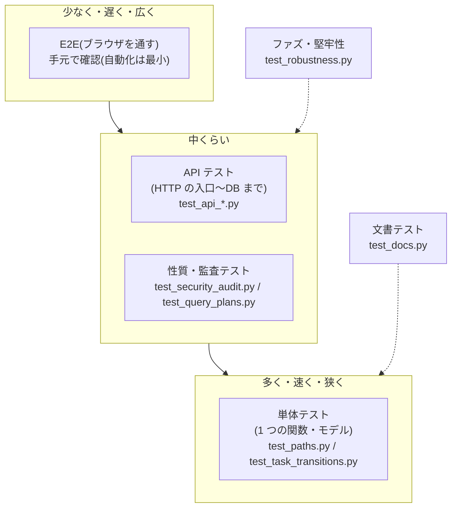
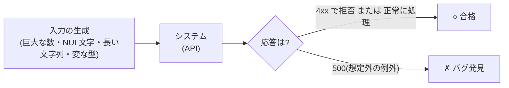

# L14 テスト ― 何を・どう守るか(pytest・fixture・パラメータ化・ファズ・Vitest)

**この回の目標**
- 「テストは何のためにあるか」を説明できる
- `assert`・fixture・パラメータ化・`pytest.raises` の仕組みを、最小の例で理解する
- このアプリのテストの**層**(単体・API・性質・ファズ・文書)を区別し、新しい機能に**どの層のテストを足すか**決められる
- ファズ(でたらめな入力)テストの考え方を説明できる
- フロントエンド(Vitest + Testing Library)のテストの読み書きができる

前提: [L02 Python](L02-python.md)・[L05 DRF](L05-drf.md)・[L06 状態遷移](L06-state-machine.md)。

---

## 1. テストは何のためにあるか
| 目的 | 説明 |
|---|---|
| **仕様の記録** | 「こう動くべき」を、実行できる形で残す。文書は古びるが、テストは落ちて教えてくれる |
| **変更の安全網** | リファクタリングや機能追加で、壊したことにすぐ気づける |
| **設計の圧力** | テストしにくいコードは、たいてい責務が混ざっている(L06 の「ルールを 1 か所に」) |

**テストが守るべき順序**(価値が高い順):
1. 壊れると**被害が大きい**もの(権限・認証・データの整合性・状態遷移)
2. **一度バグが出た**ところ(同じ穴に二度落ちない=回帰テスト)
3. 仕様が複雑で**人間の頭で追いにくい**もの

> すべてを同じ密度でテストしない。**リスクの大きさに比例**させる。

## 2. 層で考える(テストのピラミッド)


| 層 | 何を確かめるか | このアプリの例 |
|---|---|---|
| 単体 | 1 つの関数・メソッドの入出力 | `normalize_path`(`test_paths.py`)、`Task.transition_to`(`test_task_transitions.py`) |
| API | HTTP の入口から DB まで通して、ステータスコード・JSON・権限 | `test_api_entities_tasks.py` ほか |
| 監査 | 設計上の約束を、表で横断検査(OWASP API Top 10 など) | `test_security_audit.py`、`test_query_plans.py`(索引が使われるか) |
| ファズ | でたらめな入力で **500 を出さない** | `test_robustness.py` |
| 文書 | 文書内のコードが**本当に動き**、出力が一致する | `test_docs.py`(この講義資料も対象) |
| フロント単体 | 画面部品の振る舞い | `*.test.tsx`(Vitest) |

## 3. pytest の最小の仕組み

### 3-1. `assert` と、失敗の読み方
pytest は、**`test_` で始まる関数**を見つけて実行し、`assert` が偽なら失敗とします。

<!-- test -->
```python
import os
import subprocess
import sys
import tempfile
from pathlib import Path

# 外側の Django 設定(DJANGO_SETTINGS_MODULE など)を引き継がない、まっさらな環境で pytest を動かす
CLEAN_ENV = {k: v for k, v in os.environ.items() if not k.startswith(("DJANGO", "PYTEST"))}

CODE = '''
def add(a, b):
    return a + b

def test_add_ok():
    assert add(2, 3) == 5

def test_add_wrong_on_purpose():
    assert add(2, 3) == 6
'''

with tempfile.TemporaryDirectory() as tmp:
    Path(tmp, "test_sample.py").write_text(CODE, encoding="utf-8")
    run = subprocess.run(
        [sys.executable, "-m", "pytest", "-q", "--no-header", "-p", "no:cacheprovider", "--rootdir", tmp, tmp],
        capture_output=True, text=True, cwd=tmp, env=CLEAN_ENV,
    )

# 実行時間などの毎回変わる行を除いて、読むべき部分だけ出す
for line in run.stdout.splitlines():
    if line.startswith(("E ", ">", "FAILED")) or "passed" in line and "failed" in line:
        print(line.split(" in ")[0] if " in " in line else line)
```

<!-- output -->
```text
>       assert add(2, 3) == 6
E       assert 5 == 6
E        +  where 5 = add(2, 3)
FAILED test_sample.py::test_add_wrong_on_purpose - assert 5 == 6
1 failed, 1 passed
```

- `>` の行が**失敗した行**、`E` の行が**何と何が食い違ったか**(`assert 5 == 6`)。
- 2 つのテストの片方だけ失敗し、もう片方は通る(**テストは互いに独立**)。

### 3-2. fixture ― 「準備」を共有する
テストの**前準備**(ユーザー作成・DB のデータ)は、**fixture**(`@pytest.fixture`)として名前を付けて共有します。テスト関数は、**引数の名前**で欲しい fixture を指定します(依存性の注入)。

<!-- test -->
```python
import os
import subprocess
import sys
import tempfile
from pathlib import Path

# 外側の Django 設定(DJANGO_SETTINGS_MODULE など)を引き継がない、まっさらな環境で pytest を動かす
CLEAN_ENV = {k: v for k, v in os.environ.items() if not k.startswith(("DJANGO", "PYTEST"))}

CODE = '''
import pytest

@pytest.fixture
def project():
    print("[準備] project を作る")
    yield {"code": "DEMO"}          # yield の前が準備、後が後片付け
    print("[後片付け] project を消す")

@pytest.fixture
def artist(project):                # fixture が別の fixture を使える
    return {"name": "alice", "project": project["code"]}

def test_artist_belongs_to_project(artist):
    assert artist["project"] == "DEMO"
'''

with tempfile.TemporaryDirectory() as tmp:
    Path(tmp, "test_fx.py").write_text(CODE, encoding="utf-8")
    run = subprocess.run(
        [sys.executable, "-m", "pytest", "-q", "-s", "--no-header", "-p", "no:cacheprovider", "--rootdir", tmp, tmp],
        capture_output=True, text=True, cwd=tmp, env=CLEAN_ENV,
    )
for line in run.stdout.splitlines():
    if "[" in line:
        print(line[line.index("["):])
```

<!-- output -->
```text
[準備] project を作る
[後片付け] project を消す
```

実際の `conftest.py`(全テストで共有する fixture の置き場)を読みましょう。

<!-- excerpt: backend/tracker/tests/conftest.py -->
```python
@pytest.fixture
def project(db):
    return ProjectFactory(code="DEMO", name="デモ")


def _client_for(user):
    client = APIClient()
    client.force_authenticate(user)
    return client


@pytest.fixture
def make_user(project):
    """プロジェクトに `role` で参加するユーザーと、そのログイン済みクライアントを作る。"""

    def make(role="artist", **kwargs):
        user = UserFactory(**kwargs)
        if role:
            MemberFactory(project=project, user=user, role=role)
        return user

    return make
```

読み解き:
1. `db` fixture(pytest-django 提供)— 「このテストは DB を使う」宣言。テストごとに**トランザクションを巻き戻す**ので、テスト同士が汚し合わない。
2. `make_user` は**ファクトリを返す fixture**(関数を返す)。テストの中で `make_user("reviewer")` のように、役割を変えて何人でも作れる。
3. `reviewer`・`artist`・`viewer` は、これを呼ぶだけの小さな fixture。テストは `def test_...(task, reviewer)` と**書くだけで**状況が揃う。

### 3-3. ファクトリ(factory_boy)― テストデータを手短に作る
モデルを毎回 `Model.objects.create(...)` で作ると、必須の項目が増えるたびに全テストを直すことになります。**ファクトリ**に必要な既定値を持たせ、テストでは**関心のある値だけ**を指定します。

<!-- excerpt: backend/tracker/tests/factories.py -->
```python
class UserFactory(factory.django.DjangoModelFactory):
    class Meta:
        model = User

    username = factory.Sequence(lambda n: f"user{n}")
    password = "pass-12345"

    @classmethod
    def _create(cls, model_class, *args, **kwargs):
        # パスワードをハッシュ化して保存する(ログインのテストで使う)
        return model_class.objects.create_user(*args, **kwargs)
```

- `Sequence(lambda n: f"user{n}")` — 呼ぶたびに `user0`, `user1`…と**重複しない名前**を作る(一意制約に引っかからない)。
- `_create` を上書き — 素の `objects.create(password=...)` は**平文のまま保存**してしまうので、`create_user`(ハッシュ化する)を使う。これは過去に実際にあった落とし穴です。

### 3-4. パラメータ化 ― 表から大量のテストを作る
**同じ検査を、入力だけ変えて繰り返す**ときは `@pytest.mark.parametrize`。

<!-- test -->
```python
import os
import subprocess
import sys
import tempfile
from pathlib import Path

# 外側の Django 設定(DJANGO_SETTINGS_MODULE など)を引き継がない、まっさらな環境で pytest を動かす
CLEAN_ENV = {k: v for k, v in os.environ.items() if not k.startswith(("DJANGO", "PYTEST"))}

CODE = '''
import pytest

ALLOWED = {("todo", "in_progress"), ("in_progress", "review"), ("review", "in_progress"), ("review", "done"), ("done", "in_progress")}
STATUSES = ["todo", "in_progress", "review", "done"]
ALL_PAIRS = [(a, b) for a in STATUSES for b in STATUSES]

def can_move(src, dst):
    return (src, dst) in ALLOWED

@pytest.mark.parametrize("src,dst", ALL_PAIRS)
def test_every_pair(src, dst):
    assert can_move(src, dst) == ((src, dst) in ALLOWED)
'''

with tempfile.TemporaryDirectory() as tmp:
    Path(tmp, "test_pairs.py").write_text(CODE, encoding="utf-8")
    run = subprocess.run(
        [sys.executable, "-m", "pytest", "-q", "--no-header", "-p", "no:cacheprovider", "--rootdir", tmp, tmp],
        capture_output=True, text=True, cwd=tmp, env=CLEAN_ENV,
    )
print(run.stdout.splitlines()[-1].split(" in ")[0])
```

<!-- output -->
```text
16 passed
```

4×4 = **16 通りが 1 つの関数で 16 個のテスト**になりました。このアプリの本物は、遷移の**全組み合わせ**を検査しています。

<!-- excerpt: backend/tracker/tests/test_task_transitions.py -->
```python
@pytest.mark.parametrize("src,dst", ALL_PAIRS)
def test_transition_table_matches_design(task, reviewer, src, dst):
    """4x4 の全組み合わせ。表にあるものだけ通り、他は InvalidTransition。"""
    task.status = src
    task.save()
    VersionFactory.create(task)  # 「完了」の条件(版が1つ以上)を満たしておく

    if (src, dst) in ALLOWED:
        task.transition_to(dst, reviewer)
        task.refresh_from_db()
        assert task.status == dst
    else:
        with pytest.raises(InvalidTransition):
            task.transition_to(dst, reviewer)
        task.refresh_from_db()
        assert task.status == src
```

読み解き:
- `ALLOWED` は、**テスト側に持つ「正解の表」**。実装の `Task.TRANSITIONS` と**別に**書くのが肝(同じ表を読み込んだら、両方間違っていても通ってしまう)。**設計書を写した独立の表**と実装を突き合わせる。
- 許されない組み合わせでは `pytest.raises(InvalidTransition)` で**例外が出ること**を確かめ、そのあと `refresh_from_db()` で**状態が変わっていない**ことも確かめる(失敗してもデータが壊れない)。

### 3-5. `pytest.raises` ― 「失敗すること」をテストする
<!-- test -->
```python
import pytest

def divide(a, b):
    return a / b

with pytest.raises(ZeroDivisionError) as info:
    divide(1, 0)
print("例外が出た:", type(info.value).__name__, "-", info.value)

# 例外が出なかったら、テストが失敗する(Failed)ことの確認
try:
    with pytest.raises(ZeroDivisionError):
        divide(4, 2)
except pytest.fail.Exception as e:
    print("出なかったので失敗:", e)
```

<!-- output -->
```text
例外が出た: ZeroDivisionError - division by zero
出なかったので失敗: DID NOT RAISE ZeroDivisionError
```

## 4. 「何を assert するか」の型
良いテストは、**結果**だけでなく**副作用がないこと**も確かめます。

| 確かめること | 例 |
|---|---|
| 戻り値・ステータスコード | `assert res.status_code == 409` |
| 応答の形 | `assert res.json()["code"] == "invalid_transition"` |
| **データが変わっていない**(拒否時) | `task.refresh_from_db(); assert task.status == src` |
| **件数**(重複や漏れ) | `assert Task.objects.count() == 1` |
| **クエリ数**(N+1 でない) | `django_assert_num_queries(3)`([L04](L04-django.md)) |
| ログ・通知に**秘密が出ない** | `assert "password" not in caplog.text` |

> **コツ**: テスト名は「何が・どうなる」を日本語でもよいので文にする(`test_only_reviewer_can_approve`)。失敗したとき、**名前を読むだけで何が壊れたか**分かるように。

## 5. ファズ(でたらめな入力)― 想定外を探す
人間が書くテストは、**想定した入力**しか試せません。ファズは、**想定外の入力を大量にぶつけて、落ちない(500 を出さない)こと**を確かめます。



このアプリの `test_robustness.py` の考え方は、1 つのルールです。

<!-- excerpt: backend/tracker/tests/test_robustness.py -->
```python
def ok_or_client_error(res):
    assert res.status_code < 500, f"{res.status_code}: {res.content[:200]!r}"
```

「**入力が悪いのはクライアントの責任(4xx)であって、サーバーが壊れて(5xx)はいけない**」。そして、悪い入力の**一覧**を表にして、すべての窓口に掛け合わせます(`parametrize` の積)。

<!-- excerpt: backend/tracker/tests/test_robustness.py -->
```python
LIST_PATHS = ["projects", "entities", "tasks", "versions", "steps", "quality-reports", "visual-results"]
BAD_QUERIES = [
    "page=abc", "page=0", "page=-1", f"page={HUGE}", "page_size=abc", "page_size=-5", "page_size=0", f"page_size={HUGE}",
    "ordering=", "ordering=%00", "ordering=-", "q=%00", "q=%25", "q=" + "x" * 20000,
    f"project={HUGE}", f"entity={HUGE}", f"assignee={HUGE}", f"task={HUGE}", f"version={HUGE}",
    "project=%00", "status=%00", "assignee=me,me", "overdue=maybe",
]
```

7 つの窓口 × 23 通りの悪いクエリ = **161 ケース**が自動で生まれます。

### 自分でファズを書く(乱数に種を与える)
ランダムな入力を使うときは、**種(seed)を固定**します。失敗したとき、**同じ入力を再現**できるように。

<!-- test -->
```python
import random

def normalize(path: str) -> str:
    """素朴な実装: 連続する / を 1 つにし、前後の / を除く。"""
    parts = [p for p in path.split("/") if p]
    return "/".join(parts)

rng = random.Random(2026)                       # 種を固定 → 毎回同じ入力列
alphabet = ["a", "b", "/", "/", ".", " "]        # / を多めにして、境界を突く

failures = []
for _ in range(2000):
    s = "".join(rng.choice(alphabet) for _ in range(rng.randint(0, 8)))
    once = normalize(s)
    # 性質: 正規化を 2 回かけても結果は変わらない(冪等)
    if normalize(once) != once:
        failures.append(s)
    # 性質: 結果に // は含まれない
    if "//" in once:
        failures.append(s)

print("試した数: 2000 / 性質に反した数:", len(failures))
```

<!-- output -->
```text
試した数: 2000 / 性質に反した数: 0
```

これは**性質ベーステスト**(property-based testing)の考え方です。「この入力ならこの出力」ではなく、「**どんな入力でも成り立つ性質**」(冪等・往復して元に戻る・長さが変わらない…)を検査する。[L07](L07-strings-paths.md) の `normalize_path` も、この性質で守られています。

> 本格的にやるなら `hypothesis` というライブラリが、入力の生成と、失敗した入力の**自動縮小**(最小の再現例に絞る)までしてくれます。このアプリでは依存を増やさないため、表と種付き乱数で足りる範囲に留めています。

## 6. 副作用のある場所をテストしやすくする
テストしにくいもの(時刻・乱数・ネットワーク・外部サービス)は、**外から差し替えられる形**にします。

| 難しいもの | 差し替え方 |
|---|---|
| 現在時刻 | 引数で受け取る(`today` を渡す)/ `freezegun` 等 |
| 外部への送信(Sentry・メール) | 設定で空にする(`SENTRY_DSN = ""`、`settings_test.py`) |
| 遅いパスワードのハッシュ | テストだけ MD5 に(`PASSWORD_HASHERS`、`settings_test.py`) |
| スロットル(回数制限) | テストだけ上限を大きく |
| DB | テスト用 DB(SQLite 既定。`POSTGRES_HOST` で PostgreSQL でも同じテストが走る) |

<!-- excerpt: backend/config/settings_test.py -->
```python
PASSWORD_HASHERS = ["django.contrib.auth.hashers.MD5PasswordHasher"]
ALLOWED_HOSTS = [*ALLOWED_HOSTS, "testserver"]  # noqa: F405
INGEST_API_KEYS = ["test-ingest-key"]
SENTRY_DSN = ""
```

> **やってはいけない**: 本番の設定を壊すこと。`settings_test.py` は**テストでだけ**読み込まれ、`pytest.ini` が `DJANGO_SETTINGS_MODULE = config.settings_test` と指定しています。

## 7. 2 つの DB でテストする理由
SQLite は寛容です。PostgreSQL は **NUL 文字**や**範囲外の整数**を例外にします。つまり「SQLite で通った」は「本番(PostgreSQL)で通る」を保証しません。

```text
$ cd backend && pytest                                   # SQLite(速い・既定)
$ POSTGRES_HOST=localhost POSTGRES_DB=... pytest         # PostgreSQL(本番と同じ)
```

どちらも**緑**であることを、完了の条件にしています(`test_robustness.py` の冒頭にもその注記)。

## 8. 文書もテストする
この講義資料の中のコードブロックは、**本当に実行されて**います(`test_docs.py`)。

| 印 | 意味 |
|---|---|
| `<!-- test -->` | Python として実行(エラーなく終わること) |
| `<!-- test:django -->` | Django の設定を読み込んで実行(DB を使える) |
| `<!-- test:node -->` | Node.js で実行(`.ts` もそのまま import できる) |
| `<!-- output -->` | 直前のコードの標準出力と**一致**すること |
| `<!-- excerpt: パス -->` | 実際のソースファイルに**そのまま含まれている**こと |

だから、ソースを変えて抜粋が合わなくなれば、**テストが落ちて**文書の修正を促します。「文書が古びる」を、仕組みで防いでいます。出力の `?` は `docs/tools/fill_outputs.py` が埋めます。

## 9. フロントエンドのテスト(Vitest + Testing Library)
考え方は同じですが、画面部品を**利用者の目線**でテストします。

| 道具 | 役割 |
|---|---|
| **Vitest** | テスト実行(`describe` / `it` / `expect`)。Vite と同じ設定で動く |
| **Testing Library** | 部品を描画し、**役割(role)やラベルで探す**。実装の詳細(クラス名など)に頼らない |
| **user-event** | 実際の利用者のように、クリック・キー入力を行う |
| **jsdom** | ブラウザの代わりに、DOM を模す(Node の中で動く) |

<!-- excerpt: frontend/src/components/Board.test.tsx -->
```tsx
  it("Shift + 右矢印で隣の列へ(キーボードの代替操作)", async () => {
    const user = userEvent.setup();
    const t = task(1, "in_progress");
    render(<Board {...base} canWrite tasks={[t]} />);
    screen.getByRole("article").focus();
    await user.keyboard("{Shift>}{ArrowRight}{/Shift}");
    expect(base.onMove).toHaveBeenCalledWith(t, "review");
    await user.keyboard("{Shift>}{ArrowLeft}{/Shift}");
    expect(base.onMove).toHaveBeenCalledWith(t, "todo"); // 列の並びで隣へ。可否の判断はサーバー(409)
  });
```

読み解き:
1. `render(<Board ... />)` — 部品を描画。
2. `screen.getByRole("article")` — **役割で探す**(`<article>`)。アクセシビリティの良い画面ほどテストしやすい(ラベルが無いと探せない)。
3. `user.keyboard("{Shift>}{ArrowRight}{/Shift}")` — Shift を押しながら →。
4. `expect(base.onMove).toHaveBeenCalledWith(t, "review")` — **見えない結果**(コールバックが呼ばれたか)を確認。`base.onMove` は `vi.fn()`(呼び出しを記録する偽の関数=**モック**)。

> **テストの範囲を分ける**: このテストは「`onMove` が呼ばれる」までを確認し、「遷移が許されるか」は確認しません。それはサーバー側のテストの責務です([L13](L13-kanban.md))。

### 偽の API(モック)で、画面と通信を切り離す
`client.test.ts` は `fetch` を**差し替え**て、通信なしで API クライアントを試します(L10 で扱った)。**本物のサーバーを立てずに**、`Idempotency-Key`・CSRF・エラー整形を検査できます。

## 10. 新しい機能を足すときのテストの型
| 足すもの | 足すテスト |
|---|---|
| モデルの状態遷移を 1 つ足す | `ALLOWED` の表に足す(4×4 の全検査が自動で効く)+ 権限・条件のテスト |
| API のエンドポイントを足す | 正常系(200/201)・権限なし(403)・存在しない(404)・入力が悪い(400)・認証なし(401/403) |
| クエリのパラメータを足す | `BAD_QUERIES` に悪い値を足す(ファズ)+ `test_query_plans.py`(索引) |
| 一覧を足す | クエリ数の固定(N+1 でない) |
| 画面の部品を足す | 役割で探すテスト、キーボード操作、権限別の表示 |
| 設定・運用の手順を足す | 文書に書いて、`<!-- test -->` で動かす |
| バグを直す | **まず、そのバグを再現するテストを書いて落とす → 直す → 緑**(回帰テスト) |

## よくある間違い
| 間違い | 正しくは |
|---|---|
| 実装の表をそのままテストに読み込む | **独立した「正解の表」**を設計書から写す |
| 成功だけを確かめる | 拒否時に**データが変わらない**ことも確かめる |
| テスト同士が順番に依存する | 各テストは独立(fixture で毎回準備、DB は巻き戻る) |
| 乱数のテストに種がない | 種を固定して再現可能にする |
| 実装の詳細(クラス名・内部の state)を assert | 利用者から見える結果(role・文言・呼び出し)を assert |
| SQLite だけで確かめる | PostgreSQL でも同じテストを流す |
| バグを直すだけでテストを足さない | 再現テストを先に書く |

## 確認問題
1. fixture と、テスト関数の引数の関係を説明せよ。
2. `ALLOWED`(テスト側の表)を、実装の `Task.TRANSITIONS` から作らないのはなぜか。
3. 拒否の検査で `pytest.raises` に加えて `refresh_from_db()` で状態を確かめるのは、なぜか。
4. ファズテストの「合格」とは何か。500 が出たらなぜバグなのか。
5. 乱数を使うテストで、種を固定する理由は。
6. SQLite と PostgreSQL の両方でテストする理由は。
7. バグ修正のときの、テストを書く順序は。

## 答え
1. テスト関数は、**引数の名前**で欲しい fixture を指定する。pytest が fixture を実行して、その戻り値を引数に渡す(準備の共有・依存性の注入)。
2. 同じ表を使うと、実装が間違っていてもテストも同じ間違いで通ってしまう。設計書を写した独立の正解と突き合わせるから、実装の誤りに気づける。
3. 例外が出ても、**途中まで書き換わっていないか**(データが壊れていないか)を確かめるため。
4. 4xx で拒否するか、正常に扱うこと。500 は「想定していない例外」で、サーバーの側の欠陥(悪い入力をちゃんと検査していない)だから。
5. 失敗したとき、同じ入力を再現して原因を調べられるから。
6. SQLite は寛容で、PostgreSQL は NUL 文字や範囲外の整数を例外にするなど挙動が違う。本番は PostgreSQL なので、両方で通ることを確認する。
7. まず**バグを再現するテストを書き、落ちることを確認**する → 修正 → テストが緑になる(回帰テストが残る)。

## 次へ
[L15 スクリプトを読む](L15-scripts.md) ― シェル・バックアップ・取り込みスクリプト。
