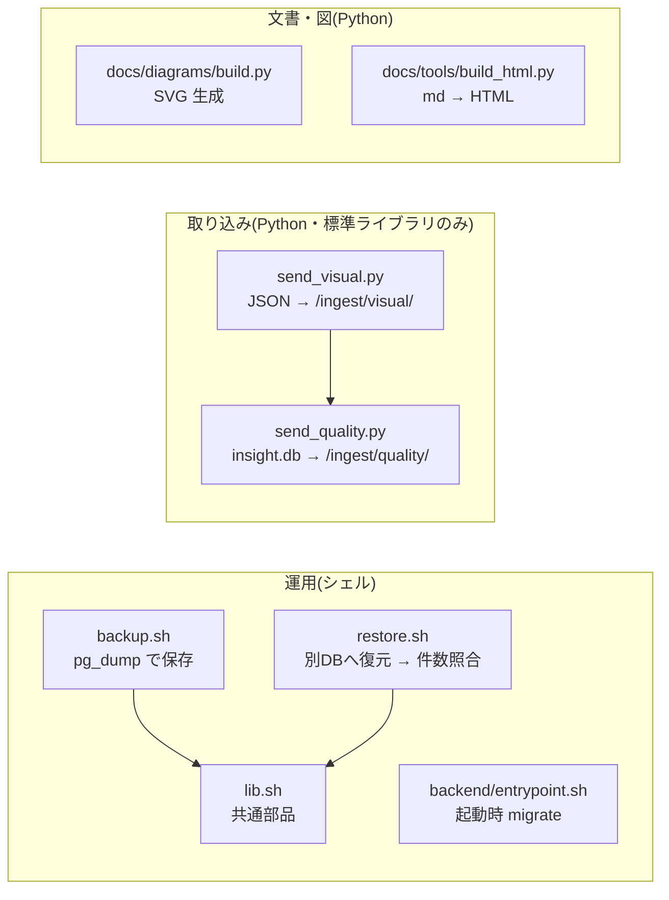
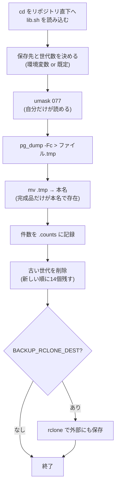
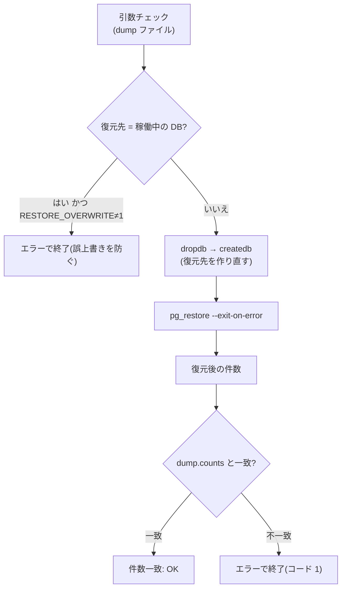
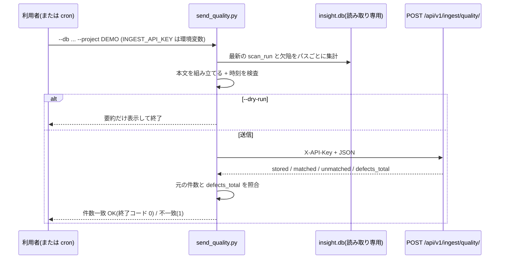

# L15 スクリプトを読む ― シェル・バックアップ・取り込み・図の生成

**この回の目標**
- シェルスクリプトの**安全な書き方**(`set -euo pipefail`・クォート・既定値)を説明できる
- `backup.sh` / `restore.sh` を 1 行ずつ読み、**なぜその順序・その作り**かを説明できる
- 取り込みスクリプト(`send_quality.py`)の**入力検査・終了コード・冪等性**を読み解ける
- 自分で小さな運用スクリプトを、同じ流儀で書ける
- 図(SVG)を「コードから生成する」利点を説明できる

前提: [L02 Python](L02-python.md)・[L03 データベース](L03-database.md)・[L09 暗号](L09-security-crypto.md)。

---

## 0. このアプリのスクリプト一覧


共通の方針:
1. **失敗したら黙って進まない**(止まる/非ゼロで終わる)。
2. **秘密はコマンドラインに載せない**(環境変数で渡す)。
3. **確認できる終わり方**(件数が合うか、を最後に確かめる)。
4. **既定は安全側**(上書きは明示したときだけ)。

## 1. シェルスクリプトの基礎
以下の例は、本物の `bash` で実行して確かめています(`subprocess` で呼び出し)。

### 1-1. 終了コードと `set -e`
コマンドは終わると**終了コード**(`$?`)を返します。`0` が成功、それ以外が失敗です。

<!-- test -->
```python
import re
import subprocess

def sh(script: str, env=None) -> str:
    """bash でスクリプトを実行し、出力(標準出力 + 標準エラー)と、成功/失敗を文字列で返す。"""
    run = subprocess.run(["bash", "-c", script], capture_output=True, text=True, env=env)
    text = re.sub(r"^bash: (-c: )?line \d+: (\d+: )?", "", (run.stdout + run.stderr).strip(), flags=re.M)
    return (text or "(出力なし)") + ("  → 成功" if run.returncode == 0 else "  → 失敗(終了コードは 0 以外)")

print("--- set -e なし: 途中で失敗しても進んでしまう ---")
print(sh("false; echo '最後まで行った'"))
print("--- set -e あり: 失敗したところで止まる ---")
print(sh("set -e; false; echo '最後まで行った'"))
```

<!-- output -->
```text
--- set -e なし: 途中で失敗しても進んでしまう ---
最後まで行った  → 成功
--- set -e あり: 失敗したところで止まる ---
(出力なし)  → 失敗(終了コードは 0 以外)
```

`false` は常に失敗するコマンドです。`set -e` が無いと、**失敗に気づかず後続を実行**してしまいます(たとえば「ダンプに失敗したのに、古いバックアップを消す」…)。

### 1-2. `set -u` と `pipefail`
<!-- test -->
```python
import re
import subprocess

def sh(script: str, env=None) -> str:
    """bash でスクリプトを実行し、出力(標準出力 + 標準エラー)と、成功/失敗を文字列で返す。"""
    run = subprocess.run(["bash", "-c", script], capture_output=True, text=True, env=env)
    text = re.sub(r"^bash: (-c: )?line \d+: (\d+: )?", "", (run.stdout + run.stderr).strip(), flags=re.M)
    return (text or "(出力なし)") + ("  → 成功" if run.returncode == 0 else "  → 失敗(終了コードは 0 以外)")

print("--- set -u: 未定義の変数を使うと止まる(打ち間違いの検出) ---")
print(sh('set -u; echo "削除先: $DIRR/old"'))
print("--- パイプの途中の失敗は、既定では見逃される ---")
print(sh("set -e; false | cat; echo '続行してしまった'"))
print("--- pipefail: パイプのどこかが失敗したら全体が失敗 ---")
print(sh("set -eo pipefail; false | cat; echo '続行してしまった'"))
```

<!-- output -->
```text
--- set -u: 未定義の変数を使うと止まる(打ち間違いの検出) ---
DIRR: unbound variable  → 失敗(終了コードは 0 以外)
--- パイプの途中の失敗は、既定では見逃される ---
続行してしまった  → 成功
--- pipefail: パイプのどこかが失敗したら全体が失敗 ---
(出力なし)  → 失敗(終了コードは 0 以外)
```

| 指定 | 意味 |
|---|---|
| `set -e` | コマンドが失敗したら、スクリプトを止める |
| `set -u` | 未定義の変数を使ったら、エラー(`$DIRR` のような打ち間違いを検出) |
| `set -o pipefail` | `a | b | c` のどれかが失敗したら、全体を失敗にする(既定は最後のコマンドの結果だけ) |

`pg_dump ... | gzip > file` のようなパイプで、`pg_dump` が失敗しても `gzip` は成功するため、**`pipefail` が無いと失敗が隠れます**。3 つ揃えた `set -euo pipefail` が、このアプリのすべてのスクリプトの冒頭にある理由です。

### 1-3. 変数・既定値・クォート
<!-- test -->
```python
import re
import subprocess

def sh(script: str, env=None) -> str:
    """bash でスクリプトを実行し、出力(標準出力 + 標準エラー)と、成功/失敗を文字列で返す。"""
    run = subprocess.run(["bash", "-c", script], capture_output=True, text=True, env=env)
    text = re.sub(r"^bash: (-c: )?line \d+: (\d+: )?", "", (run.stdout + run.stderr).strip(), flags=re.M)
    return (text or "(出力なし)") + ("  → 成功" if run.returncode == 0 else "  → 失敗(終了コードは 0 以外)")

# ${NAME:-既定値}: 未設定(または空)なら既定値
print(sh('echo "${BACKUP_KEEP:-14}"', env={}))
print(sh('echo "${BACKUP_KEEP:-14}"', env={"BACKUP_KEEP": "3"}))
# ${NAME:?メッセージ}: 未設定ならエラーで止まる(必須の引数)
print(sh('dump="${1:?使い方: restore.sh <dump>}"; echo "$dump"'))

# クォートしないと、空白を含む名前が 2 つに割れる
print("--- クォートなし ---")
print(sh('f="my backup.dump"; printf "[%s]\\n" $f'))
print("--- クォートあり ---")
print(sh('f="my backup.dump"; printf "[%s]\\n" "$f"'))
```

<!-- output -->
```text
14  → 成功
3  → 成功
使い方: restore.sh <dump>  → 失敗(終了コードは 0 以外)
--- クォートなし ---
[my]
[backup.dump]  → 成功
--- クォートあり ---
[my backup.dump]  → 成功
```

| 書き方 | 意味 | このアプリでの使用 |
|---|---|---|
| `${X:-既定}` | 未設定なら既定値 | `${BACKUP_DIR:-./backups}` |
| `${X:?メッセージ}` | 未設定ならメッセージを出して止まる | `dump="${1:?使い方: …}"`(必須の第 1 引数) |
| `"$x"` | **常にダブルクォート**で囲む | 空白・`*` を含んでも 1 つの値として扱う |
| `$(コマンド)` | コマンドの出力を値にする | `stamp="$(date +%Y%m%d-%H%M%S)"` |

> **原則**: 変数の展開は、特別な理由がなければ**必ず `"$x"`**。クォート漏れは、ファイル名に空白が入った途端に壊れる、典型的なバグです。

### 1-4. リダイレクトとパイプ
| 記号 | 意味 |
|---|---|
| `a > file` | a の標準出力をファイルに**書き込む**(上書き) |
| `a < file` | ファイルを a の標準入力に渡す |
| `a \| b` | a の出力を b の入力に渡す |
| `a 2> file` / `>&2` | 標準エラー出力の向き先(エラーメッセージは `>&2` で stderr へ) |
| `a && b` / `a \|\| b` | a が成功したら b / a が失敗したら b |

エラーメッセージは `echo "…" >&2` で **stderr** に出します。stdout は「結果」、stderr は「診断」と分けておくと、`script > result.txt` で結果だけを取り出せます。

## 2. `lib.sh` ― 共通部品
`backup.sh` と `restore.sh` が共通で使う部品です。

<!-- excerpt: scripts/lib.sh -->
```bash
if [ -n "${PGHOST:-}" ]; then
  export PGUSER="${PGUSER:-$POSTGRES_USER}"
  run_pg() { "$@"; }
else
  run_pg() { docker compose exec -T db "$@"; }
fi
```

読み解き:
- `run_pg` は**関数**。呼び出し側は `run_pg pg_dump …` と書くだけで、**どこで動かすか**を意識しない。
  - 通常(`PGHOST` なし): `docker compose exec -T db pg_dump …`(db コンテナの中で実行)。`-T` は疑似端末を割り当てない(パイプ・リダイレクトを壊さない)。
  - `PGHOST` あり: ホストの `pg_dump` を直接(復元の検証などに使う)。
- `"$@"` は「関数に渡された引数を、**そのまま**(空白を壊さずに)並べる」。

**関数で包む利点**: 実行場所を変える要件が出たとき、直す場所は 1 か所です。

<!-- excerpt: scripts/lib.sh -->
```bash
row_counts() { # $1 = DB 名
  run_pg psql -U "$POSTGRES_USER" -d "$1" -At -F ' ' -c "$COUNT_SQL"
}
```

- `psql -At -F ' '` — `-A` 整列なし、`-t` 見出し・件数行なし、`-F ' '` 区切りは空白。**機械が比較しやすい形**にする。
- 出力は `project 1` のような「名前 件数」の行(`ORDER BY 1` で順序を固定)。**同じ内容なら必ず同じ文字列**になるので、後で `=` で文字列比較できる。

## 3. `backup.sh` を読む


注目点を 1 つずつ:

<!-- excerpt: scripts/backup.sh -->
```bash
umask 077  # バックアップには全データが入る。自分だけが読めるようにする
run_pg pg_dump -U "$POSTGRES_USER" -d "$POSTGRES_DB" -Fc > "$file.tmp"
mv "$file.tmp" "$file"
```

1. **`umask 077`** — 作るファイルの権限から「グループ・他人」の権限を引く。ファイルは `600`(所有者だけ読み書き)になる。バックアップは**全データのコピー**なので、読める人を絞る。
2. **`> "$file.tmp"` → `mv`** — いきなり本名で書かず、**一時名に書いて、完成してから名前を変える**。同じファイルシステム内の `mv` は**一瞬で完了(原子的)**なので、途中で止まっても「半端なダンプが本名で存在する」ことがない。これは L08 の「中途半端な状態を見せない」と同じ発想です。
3. **`-Fc`** — カスタム形式(圧縮・部分復元ができ、`pg_restore` で復元する)。

世代管理の 1 行を、実際に動かして理解しましょう。

<!-- excerpt: scripts/backup.sh -->
```bash
ls -1t "$dir"/pt-*.dump 2>/dev/null | tail -n +"$((keep + 1))" | while read -r old; do
```

- `ls -1t` — 1 行に 1 ファイル、**新しい順**。
- `tail -n +N` — **N 行目から最後まで**を出す(`keep + 1` 行目以降 = 古い方)。
- `while read -r old; do …` — 1 行ずつ受け取って削除。

<!-- test -->
```python
import subprocess
import tempfile
from pathlib import Path

script = r'''
set -euo pipefail
cd "$1"
keep=3
for n in 1 2 3 4 5; do touch -d "2026-10-0$n 09:00" "pt-2026100$n.dump"; done
echo "--- 新しい順 ---"
ls -1t pt-*.dump
echo "--- 古いので消す(keep=$keep) ---"
ls -1t pt-*.dump 2>/dev/null | tail -n +"$((keep + 1))" | while read -r old; do
  echo "削除: $old"; rm -f "$old"
done
echo "--- 残り ---"
ls -1t pt-*.dump
'''
with tempfile.TemporaryDirectory() as tmp:
    run = subprocess.run(["bash", "-c", script, "bash", tmp], capture_output=True, text=True)
    print(run.stdout.strip())
```

<!-- output -->
```text
--- 新しい順 ---
pt-20261005.dump
pt-20261004.dump
pt-20261003.dump
pt-20261002.dump
pt-20261001.dump
--- 古いので消す(keep=3) ---
削除: pt-20261002.dump
削除: pt-20261001.dump
--- 残り ---
pt-20261005.dump
pt-20261004.dump
pt-20261003.dump
```

5 つのうち、新しい 3 つが残り、古い 2 つが消えました。ファイル名に日時を入れてあるので、`ls -t`(更新時刻順)でも名前順でも同じ並びになります。

> **危うい点(知っておく)**: `ls` の出力を `while read` で処理する方法は、ファイル名に**改行**が入ると壊れます。ここでは名前を自分で `pt-日時.dump` と決めているので問題になりませんが、**他人が付けた名前**を扱うなら `find -print0` と `xargs -0` を使います。

## 4. `restore.sh` を読む ― 「復元できないバックアップは、バックアップではない」
バックアップは取るだけでは不十分で、**復元できることを確かめて**はじめて意味があります。`restore.sh` は、**別の DB に復元して、件数を照合**します。



<!-- excerpt: scripts/restore.sh -->
```bash
if [ "$target" = "$POSTGRES_DB" ] && [ "${RESTORE_OVERWRITE:-0}" != "1" ]; then
  echo "稼働中の DB($POSTGRES_DB)への上書きは RESTORE_OVERWRITE=1 を付けたときだけ行います。" >&2
  exit 2
fi
```

- **既定は安全側**: 復元先を省略すると `<DB名>_restore`(別の DB)。稼働中の DB を上書きするには、`RESTORE_OVERWRITE=1` と**わざわざ**書く。
- 終了コードの使い分け: `2` = 使い方の誤り、`1` = 照合の不一致。呼び出し元(cron や CI)が**失敗の種類**を区別できる。

<!-- excerpt: scripts/restore.sh -->
```bash
restored="$(row_counts "$target")"
echo "$restored"
if [ -f "$dump.counts" ]; then
  if [ "$restored" = "$(cat "$dump.counts")" ]; then
    echo "件数一致: OK(バックアップ時と同じ)"
  else
```

- `.counts` は `backup.sh` が**ダンプと同時に**記録した件数。復元後の件数とを**文字列として比較**する(それで足りるよう、`row_counts` が出力形式を固定してある)。

> **限界を知る**: 件数が合うことは「行が欠けていない」ことしか保証しません。中身の同一性まで確かめるなら、ハッシュ(各表の `md5(string_agg(...))` など)を比較します。**どこまで確かめるかは、被害の大きさとの兼ね合い**です。

## 5. `entrypoint.sh` ― 起動時の準備
<!-- excerpt: backend/entrypoint.sh -->
```sh
set -e
python manage.py migrate --noinput
python manage.py ensure_admin
exec "$@"
```

- **コンテナが起動するたび**に、マイグレーションを適用し、管理者ユーザーを用意してから本体を起動する。
- **`exec "$@"`** — 引数(`gunicorn …` など本来のコマンド)で**このシェルを置き換える**。こうすると本体が PID 1 になり、Docker の停止シグナル(SIGTERM)が**直接届いて**、きれいに終了できる(シェルが間に挟まると届かないことがある)。
- `migrate` が失敗したら `set -e` で止まる=壊れた状態で起動しない。
- マイグレーションは**自動で走る**ので、適用前のバックアップを忘れずに(手順は [operations.md](../operations.md))。

## 6. 取り込みスクリプト `send_quality.py` を読む
外部ツール(AssetDataInsightSuite)の SQLite(`insight.db`)を読み、ProductionTracker の API へ送ります。



### 6-1. 識別子の検査 ― SQL に「名前」を埋め込む
値は `?` プレースホルダーで安全に渡せますが、**表名・列名は `?` にできません**。このスクリプトは、名前を変えられる(`--runs-table` など)ので、f 文字列で SQL に埋め込みます。そこで**識別子として安全か**を先に検査します([L03](L03-database.md) の SQL インジェクション)。

<!-- excerpt: scripts/send_quality.py -->
```python
def _ident(name: str) -> str:
    """表名・列名は識別子のみ許可(SQL に埋め込むため)。"""
    if not name.replace("_", "").isalnum():
        raise ValueError(f"不正な識別子です: {name!r}")
    return name
```

実際に動かしてみます(本物のスクリプトを読み込みます)。

<!-- test -->
```python
import importlib.util
import sys
from pathlib import Path

root = Path.cwd()
while not (root / "scripts" / "send_quality.py").exists():
    root = root.parent
sys.path.insert(0, str(root / "scripts"))
spec = importlib.util.spec_from_file_location("send_quality", root / "scripts" / "send_quality.py")
sq = importlib.util.module_from_spec(spec)
spec.loader.exec_module(sq)

print(sq._ident("scan_runs"))
for evil in ["scan_runs; DROP TABLE x", "a b", "x'--", ""]:
    try:
        sq._ident(evil)
        print("通ってしまった:", repr(evil))
    except ValueError as e:
        print("拒否:", e)
```

<!-- output -->
```text
scan_runs
拒否: 不正な識別子です: 'scan_runs; DROP TABLE x'
拒否: 不正な識別子です: 'a b'
拒否: 不正な識別子です: "x'--"
拒否: 不正な識別子です: ''
```

空文字 `""` は `"".isalnum()` が偽なので拒否されます。

### 6-2. 元データは読み取り専用で開く
<!-- excerpt: scripts/send_quality.py -->
```python
    con = sqlite3.connect(f"file:{db_path}?mode=ro", uri=True)  # 元データは読み取り専用で開く
```

`mode=ro` で、**バグや想定外の入力があっても元の DB を壊せない**ようにする(最小権限の原則)。

### 6-3. 時刻 ― 黙って補わない
`scanned_at` にタイムゾーンが無い値(`2026-10-11T10:00:00`)は、日本時間なのか UTC なのか**分かりません**。黙って UTC とみなすと、**9 時間ずれても気づけない**。そこで、**明示されたときだけ補い、無ければエラー**にします。

<!-- test -->
```python
import importlib.util
import sys
from pathlib import Path

root = Path.cwd()
while not (root / "scripts" / "send_quality.py").exists():
    root = root.parent
spec = importlib.util.spec_from_file_location("send_quality", root / "scripts" / "send_quality.py")
sq = importlib.util.module_from_spec(spec)
spec.loader.exec_module(sq)

print(sq._as_iso("2026-10-11T10:00:00+09:00"))
print(sq._as_iso("2026-10-11T01:00:00Z"))
print(sq._as_iso(1760000000))
print(sq._as_iso("2026-10-11T10:00:00", "+09:00"))
try:
    sq._as_iso("2026-10-11T10:00:00")
except ValueError as e:
    print("エラー:", e)
```

<!-- output -->
```text
2026-10-11T10:00:00+09:00
2026-10-11T01:00:00+00:00
2025-10-09T08:53:20+00:00
2026-10-11T10:00:00+09:00
エラー: scanned_at '2026-10-11T10:00:00' にタイムゾーンがありません。--naive-offset(例: +09:00)で記録時の時差を指定してください。
```

- 文字列(ISO 8601)・UNIX 秒・`Z`(UTC)を受け付ける。
- タイムゾーンなしは `--naive-offset +09:00` を**自分で指定**したときだけ通る。

> **原則**: 情報が足りないとき、**推測で埋めて進めない**。止まって、人に聞く。

### 6-4. 一式を小さな DB で試す
`insight.db` の実スキーマは設計書に記載がないため、**表名・列名を引数で変えられる**作りにしてあります。ここでは、仮のスキーマで動作を確かめます。

<!-- test -->
```python
import importlib.util
import json
import sqlite3
import tempfile
from pathlib import Path

root = Path.cwd()
while not (root / "scripts" / "send_quality.py").exists():
    root = root.parent
spec = importlib.util.spec_from_file_location("send_quality", root / "scripts" / "send_quality.py")
sq = importlib.util.module_from_spec(spec)
spec.loader.exec_module(sq)

with tempfile.TemporaryDirectory() as tmp:
    path = str(Path(tmp, "insight.db"))
    con = sqlite3.connect(path)
    con.executescript("""
        CREATE TABLE scan_runs (id INTEGER PRIMARY KEY, scanned_at TEXT);
        CREATE TABLE defect_records (scan_run_id INTEGER, asset_path TEXT);
        INSERT INTO scan_runs VALUES (1, '2026-10-10T09:00:00+09:00'), (2, '2026-10-11T09:00:00+09:00');
        INSERT INTO defect_records VALUES (1, 'assets/props/crate'), (2, 'assets/props/crate'), (2, 'assets/props/crate'), (2, 'assets/chars/hero');
    """)
    con.commit()
    con.close()

    payload, total = sq.build_quality_payload(path, "DEMO")        # scan_run_id を省略 → 最新(2)
    print(json.dumps(payload, ensure_ascii=False, indent=2))
    print("元 DB の欠陥件数:", total)
    print("終了コード(--dry-run):", sq.main(["--db", path, "--project", "DEMO", "--dry-run"]))
```

<!-- output -->
```text
{
  "project": "DEMO",
  "scan_run_id": 2,
  "scanned_at": "2026-10-11T09:00:00+09:00",
  "results": [
    {
      "asset_path": "assets/chars/hero",
      "defects": 1
    },
    {
      "asset_path": "assets/props/crate",
      "defects": 2
    }
  ]
}
元 DB の欠陥件数: 3
scan_run_id=2 アセットパス 2 件 / 欠陥 3 件(元 DB)
終了コード(--dry-run): 0
```

- 最新の実行(`id=2`)だけが対象で、パスごとに**集計**(`crate` は 2 件)。
- 結果の `defects` を足すと元の件数(3)に一致する → 受け側でもこの合計を照合する(`defects_total`)。

### 6-5. 終了コードと照合 ― 「送った」ではなく「正しく入った」まで
<!-- excerpt: scripts/send_quality.py -->
```python
    if body["defects_total"] != source_total:
        print(f"件数が一致しません: 元 {source_total} / 取り込み {body['defects_total']}", file=sys.stderr)
        return 1
    print("件数一致: OK")
    return 0
```

| 終了コード | 意味 | 呼び出し元の動き |
|---|---|---|
| `0` | 取り込み成功、件数も一致 | 何もしない |
| `1` | 送信失敗、または件数不一致 | 通知・再実行を検討 |
| `2` | 引数・入力の誤り(`INGEST_API_KEY` 未設定を含む) | 設定を直す |

**冪等**であることも大切です。サーバー側は `(プロジェクト, scan_run_id, パス)` で上書きするので、**ネットワークが切れて再実行しても二重に入りません**([L08](L08-concurrency.md))。

### 6-6. API キーの渡し方
<!-- excerpt: scripts/send_quality.py -->
```python
    api_key = os.environ.get("INGEST_API_KEY", "")
    if not api_key:
        print("環境変数 INGEST_API_KEY を設定してください。", file=sys.stderr)
        return 2
```

`--api-key xxxx` のようにコマンドラインで渡すと、**シェルの履歴や `ps` の一覧に残ります**。環境変数なら残りません。[L09](L09-security-crypto.md) の「秘密を持ち歩く場所」の話です。

## 7. `send_visual.py` ― 入力検査の最小形
こちらは、JSON ファイルを読んで送るだけの小さなスクリプトです。入力検査の書き方を読みましょう。

<!-- excerpt: scripts/send_visual.py -->
```python
REQUIRED = ("run_id", "version", "verdict", "diff_ratio", "captured_at")


def load_results(path: str) -> list[dict]:
    with open(path, encoding="utf-8") as f:
        data = json.load(f)
    items = data if isinstance(data, list) else [data]
    for i, item in enumerate(items):
        missing = [k for k in REQUIRED if k not in item]
        if missing:
            raise ValueError(f"{i + 1} 件目に必須項目がありません: {', '.join(missing)}")
    return items
```

- **1 件でも配列でも**受け付ける(`data if isinstance(data, list) else [data]`)。
- 必須項目を**まとめて**検査し、「何件目の何が足りないか」を人間に分かる形で返す。
- 見つからないファイルや壊れた JSON は `main` が `OSError`/`ValueError` で捕まえ、終了コード 2。

<!-- test -->
```python
import json
import sys
import tempfile
from pathlib import Path

root = Path.cwd()
while not (root / "scripts" / "send_visual.py").exists():
    root = root.parent
sys.path.insert(0, str(root / "scripts"))
import send_visual  # noqa: E402

with tempfile.TemporaryDirectory() as tmp:
    good = Path(tmp, "good.json")
    good.write_text(json.dumps([{"run_id": "r1", "version": 1, "verdict": "pass", "diff_ratio": 0.01, "captured_at": "2026-10-11T10:00:00+09:00"}]))
    bad = Path(tmp, "bad.json")
    bad.write_text(json.dumps({"run_id": "r2", "verdict": "fail"}))
    print("OK のファイル:", len(send_visual.load_results(str(good))), "件")
    try:
        send_visual.load_results(str(bad))
    except ValueError as e:
        print("NG のファイル:", e)
```

<!-- output -->
```text
OK のファイル: 1 件
NG のファイル: 1 件目に必須項目がありません: version, diff_ratio, captured_at
```

## 8. 図を「コードから作る」(`docs/diagrams/build.py`)
構成図は SVG ファイルですが、**手で描かず、Python のコードで生成**しています。

| 手で描く | コードで生成 |
|---|---|
| 修正のたびに全体の位置を目で調整 | 座標・文言を直して再実行 |
| 差分が読めない(巨大な XML) | `build.py` の差分がレビューできる |
| 色・フォントがばらつく | 部品(`tile`/`group`/`edge`)で統一 |
| 再現できない | 同じ入力 → **同じ SVG**(決定的) |

`Diagram` クラスの部品(タイル・グループ・矢印)を組み合わせます。

<!-- excerpt: docs/diagrams/build.py -->
```python
    d.group(250, 130, 360, 490, "画面 (frontend)", "Vite · React 19 · TypeScript", "blue")
    d.tile(430, 245, "画面とルーティング", "React Router\npages / components", "layers")
    d.edge([(142, 375), (250, 375)], "HTTPS")
```

最小の「コードで図を作る」を体験しましょう。

<!-- test -->
```python
def box(x, y, w, h, label):
    return (f'<rect x="{x}" y="{y}" width="{w}" height="{h}" rx="8" fill="#eef2ff" stroke="#2150c4"/>'
            f'<text x="{x + w / 2}" y="{y + h / 2 + 5}" text-anchor="middle" font-size="14">{label}</text>')

def arrow(x1, y, x2):
    return f'<line x1="{x1}" y1="{y}" x2="{x2}" y2="{y}" stroke="#1b1f27" marker-end="url(#a)"/>'

parts = [box(10, 20, 100, 40, "画面"), arrow(110, 40, 190), box(190, 20, 100, 40, "API"), arrow(290, 40, 370), box(370, 20, 100, 40, "DB")]
svg = ('<svg xmlns="http://www.w3.org/2000/svg" width="480" height="80">'
       '<defs><marker id="a" markerWidth="8" markerHeight="8" refX="7" refY="4" orient="auto"><path d="M0,0 L8,4 L0,8 z"/></marker></defs>'
       + "".join(parts) + "</svg>")
print(len(svg), "文字の SVG")
print(svg.count("<rect"), "個の箱 /", svg.count("<line"), "本の矢印")
```

<!-- output -->
```text
822 文字の SVG
3 個の箱 / 2 本の矢印
```

(本物は、文字の幅の計算・矢印の経路・衝突回避など、もっと多くの工夫があります。`docs/diagrams/diagram.py` を読んでみてください。)

### 図を直す手順
1. `docs/diagrams/build.py` の該当する関数を直す。
2. `python docs/diagrams/build.py` で SVG を再生成。
3. 画面で確かめる(重なり・はみ出し・矢印が文字を貫いていないか)。
4. `python docs/tools/build_html.py` で HTML 版も作り直す(SVG は HTML に埋め込まれる)。

## 9. 自分でスクリプトを書くときのチェックリスト
| 項目 | 確認 |
|---|---|
| 先頭 | `set -euo pipefail`(シェル)/ `argparse` と `main()` と `sys.exit(main())`(Python) |
| 引数 | 必須の引数は `${1:?…}` / `required=True`。使い方を示す |
| 既定値 | **安全側**(上書き・削除は明示したときだけ) |
| 秘密 | コマンドラインでなく環境変数。ログに出さない |
| 変数の展開 | 必ず `"$x"` |
| 一時ファイル | 一時名に書いて、完成したら `mv` |
| 失敗の知らせ方 | stderr に診断、終了コードで種類を区別(0 / 1 / 2) |
| 最後 | **結果を確かめる**(件数照合・復元テスト) |
| 再実行 | 二度走っても壊れない(冪等) |
| 文書 | 先頭のコメントに「使い方・環境変数・終了コード」 |

## よくある間違い
| 間違い | 正しくは |
|---|---|
| `set -e` なしで、失敗しても進む | `set -euo pipefail` |
| `$file` をクォートしない | `"$file"` |
| 本名のファイルに直接書き込む(途中で止まると半端が残る) | 一時名 → `mv` |
| バックアップを取るだけで、復元を試さない | 別 DB へ復元して照合する |
| API キーを引数に書く(履歴に残る) | 環境変数 |
| 稼働中のものを既定で上書きする | 別名が既定。上書きは明示 |
| 表名・列名を検査せず SQL に埋め込む | 識別子の検査(または固定の許可リスト) |
| タイムゾーン不明の時刻を、黙って UTC とみなす | 明示を求め、無ければエラー |

## 確認問題
1. `set -euo pipefail` の 3 つの指定は、それぞれ何を防ぐか。
2. バックアップを `.tmp` に書いてから `mv` で本名にするのは、なぜか。
3. `restore.sh` が、既定で別の DB へ復元するのは、なぜか。
4. 取り込みスクリプトが、送信後に「元の件数」と「受け取った件数」を照合するのは、なぜか。
5. 表名や列名を `?` で渡せないのは、なぜか。どう守っているか。
6. `exec "$@"` を entrypoint の最後に書く理由は。
7. 図を SVG の手書きでなくコードで生成する利点を 2 つ挙げよ。

## 答え
1. `-e`: 失敗に気づかず後続を実行すること。`-u`: 変数名の打ち間違い(未定義の変数が空になること)。`pipefail`: パイプの途中の失敗の見逃し。
2. 途中で止まっても、半端なダンプが本名で存在しないようにするため。同じファイルシステム内の `mv` は一瞬で終わる(原子的)。
3. 稼働中のデータを誤って上書きしないため。復元の検証が、本番に影響しない。上書きは `RESTORE_OVERWRITE=1` で明示したときだけ。
4. 「送れた」でなく「正しく入った」ことを確かめるため。欠落や重複があれば終了コード 1 で気づける。
5. プレースホルダー(`?`)は「値」にだけ使え、構文上の名前には使えないから。`_ident` で、英数字と `_` だけの識別子であることを検査してから埋め込む。
6. シェルを本体のコマンドで置き換え、本体を PID 1 にするため。Docker の停止シグナルが本体に直接届き、きれいに終了できる。
7. 例: 差分がレビューできる/部品で見た目が統一される/同じ入力から同じ SVG が再現できる/直して再実行するだけで済む。

## 次へ
[L16 運用](L16-operations.md) ― Docker・Cloudflare・Sentry・ログ・監査。
