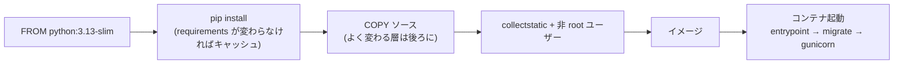
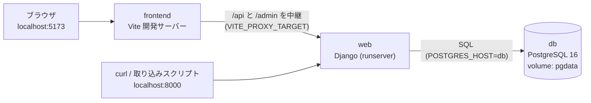
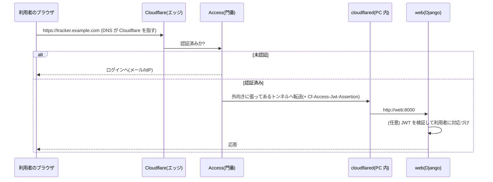
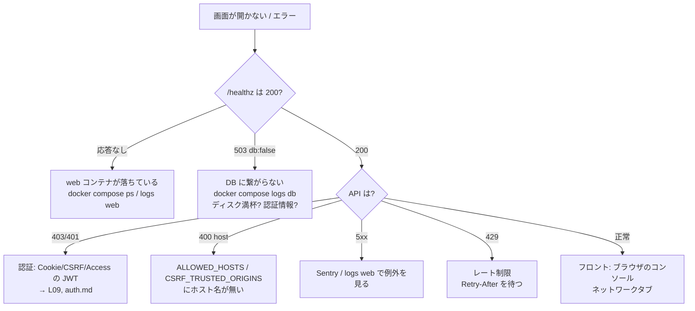
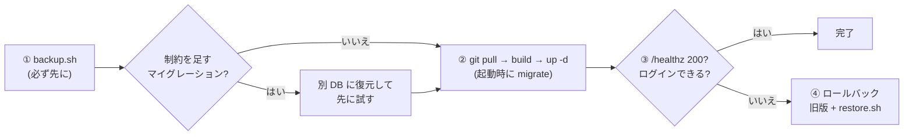
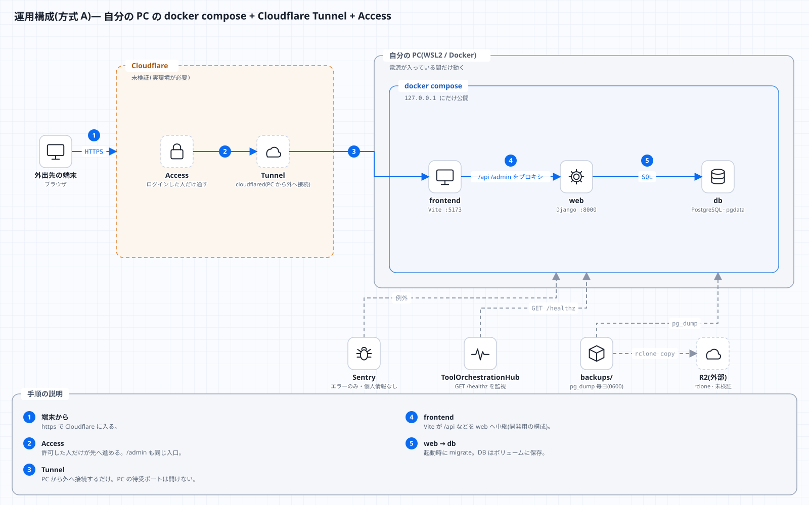
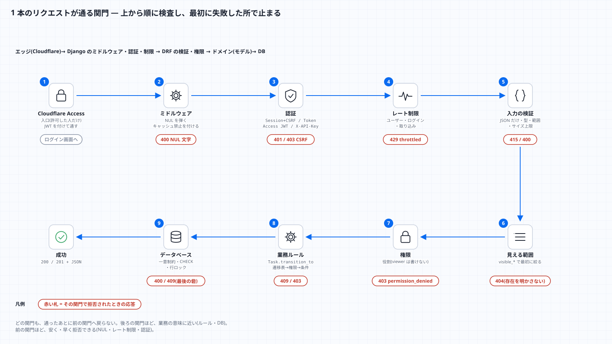

# L16 運用 ― Docker・設定・Cloudflare・ログ・Sentry・障害対応

**この回の目標**
- コンテナ(Docker)と `docker compose` の考え方を説明し、このアプリの `docker-compose.yml` を読める
- 設定を**環境変数**で持つ理由と、安全側の既定値の設計を説明できる
- 外部公開の経路(Cloudflare Tunnel + Access)で、**どこで何が守られるか**を図で説明できる
- ログ・ヘルスチェック・Sentry を使って、**障害の切り分け**ができる
- 更新・ロールバック・バックアップの手順を、理由とともに説明できる

前提: [L01 Web](L01-web.md)・[L09 暗号](L09-security-crypto.md)・[L15 スクリプト](L15-scripts.md)。

> 正直に: Docker デーモンや Cloudflare の実環境がない場所で作ったため、**`docker compose up` の通し・Sentry への実送信・Cloudflare Access の実機検証は未検証**です([operations.md](../operations.md) に明記)。この回では、**検証した部分は実際に動かし**、未検証の部分は「どう確かめるか」を示します。

---

## 1. コンテナとは何か
アプリを動かすには、OS・言語・ライブラリの**特定の版**が要ります。「私の PC では動く」問題を避けるため、**必要なものを全部まとめた箱**(コンテナ)で動かします。

| 用語 | 意味 | 例え |
|---|---|---|
| **イメージ** | 箱の設計図(読み取り専用) | レシピ |
| **コンテナ** | イメージを実行している箱 | 料理 |
| **Dockerfile** | イメージの作り方 | レシピの手順書 |
| **ボリューム** | コンテナを消しても残るデータ置き場 | 冷凍庫(皿を洗っても残る) |
| **compose** | 複数のコンテナをまとめて起動・接続する | 献立 |

コンテナは**軽い仮想マシン**ではなく、ホストの OS を共有しつつ、プロセス・ファイル・ネットワークを**隔離**したものです。

## 2. Dockerfile を読む(`backend/Dockerfile`)
<!-- excerpt: backend/Dockerfile -->
```dockerfile
FROM python:3.13-slim

ENV PYTHONDONTWRITEBYTECODE=1 PYTHONUNBUFFERED=1
WORKDIR /app

COPY requirements.txt .
RUN pip install --no-cache-dir -r requirements.txt

COPY . .
RUN DJANGO_ALLOW_INSECURE_KEY=1 python manage.py collectstatic --noinput \
 && useradd --create-home app && chown -R app /app
USER app

ENTRYPOINT ["/app/entrypoint.sh"]
```

1行ずつ:
| 行 | 意味と狙い |
|---|---|
| `FROM python:3.13-slim` | 土台のイメージ。`slim` は余計なものが少なく小さい(=攻撃対象も小さい) |
| `ENV PYTHONUNBUFFERED=1` | 出力を溜めずに**すぐ出す**(ログが遅れない) |
| `COPY requirements.txt .` → `RUN pip install` | **先に依存だけ**入れる。ソースが変わっても、依存が変わらなければこの層は**キャッシュされ再利用**される(ビルドが速い) |
| `COPY . .` | その後でソースを入れる |
| `collectstatic` | 静的ファイルを 1 か所に集める(WhiteNoise が配る)。ビルド時は秘密鍵が無いので `DJANGO_ALLOW_INSECURE_KEY=1` を**この 1 コマンドにだけ**付ける |
| `useradd app` + `USER app` | **root で動かさない**(万一侵入されても、できることが少ない=最小権限) |
| `ENTRYPOINT` | 起動のたびに `entrypoint.sh`([L15](L15-scripts.md))を通す |



> **層の順序の原則**: 変わりにくいものを先に、変わりやすいものを後ろに。逆にすると、ソースを 1 文字直すたびに依存を全部入れ直します。

## 3. `docker-compose.yml` を読む
このアプリは 3 つのコンテナでできています。



注目点:

<!-- excerpt: docker-compose.yml -->
```yaml
    depends_on:
      db:
        condition: service_healthy
```

`depends_on` + `service_healthy` は、「`db` が**健康になってから**起動する」。単に「先に起動した」だけでは、PostgreSQL がまだ接続を受け付けず、`migrate` が失敗します。

<!-- excerpt: docker-compose.yml -->
```yaml
    healthcheck:
      test: ["CMD-SHELL", "pg_isready -U $${POSTGRES_USER} -d $${POSTGRES_DB}"]
      interval: 3s
      timeout: 3s
      retries: 20
```

- **ヘルスチェック**は「プロセスが生きている」ではなく「**仕事ができる状態か**」を確かめる(`pg_isready`)。
- `$${…}` — compose 自身の変数展開を避けて、**コンテナの中のシェルに**変数を渡す(`$` を 2 つ)。

<!-- excerpt: docker-compose.yml -->
```yaml
    ports:
      - "127.0.0.1:${WEB_PORT:-8000}:8000"
```

- **`127.0.0.1:` を付ける**と、PC 自身からしか見えない(LAN の他の端末からは届かない)。外部への公開は Cloudflare Tunnel の役目で、**ポートを直接開けない**。
- `${WEB_PORT:-8000}` — 環境変数があればそれ、なければ 8000(L15 のシェルと同じ書き方)。

<!-- excerpt: docker-compose.yml -->
```yaml
    logging: &logging
      driver: json-file
      options: { max-size: "10m", max-file: "3" }  # ログのローテーションは Docker 側
```

- **ログを溜め続けるとディスクが埋まる**。1 ファイル 10MB・3 世代で上限を付ける。`&logging` は YAML の**アンカー**(名前を付けて、`*logging` で使い回す)。

### よく使うコマンド
| やりたいこと | コマンド |
|---|---|
| 起動(ビルドも) | `docker compose up --build` |
| 裏で起動 | `docker compose up -d` |
| ログを見る | `docker compose logs -f web` |
| 状態 | `docker compose ps` |
| コンテナの中でコマンド | `docker compose exec web python manage.py shell` |
| 止める(データは残る) | `docker compose down` |
| **データも消す** | `docker compose down -v`(**`pgdata` が消える。バックアップ後に**) |

## 4. 設定は環境変数で(Twelve-Factor)
コードは同じで、**設定だけ**を環境ごとに変える ― 開発・本番で別のファイルを書き換えるより、**環境変数**で外から渡します。理由:
1. **秘密をコードに入れない**(Git に残らない)。
2. 同じイメージを、開発・検証・本番で**そのまま**使い回せる。
3. 設定の変更にコードの再ビルドが要らない。

`settings.py` の読み取りの部品を読みましょう。

<!-- excerpt: backend/config/settings.py -->
```python
def env_bool(name: str, default: bool = False) -> bool:
    value = os.environ.get(name)
    if value is None:
        return default
    return value.strip().lower() in {"1", "true", "yes", "on"}


def env_list(name: str, default: str = "") -> list[str]:
    return [v.strip() for v in os.environ.get(name, default).split(",") if v.strip()]
```

<!-- test -->
```python
import os

def env_bool(name, default=False):
    value = os.environ.get(name)
    if value is None:
        return default
    return value.strip().lower() in {"1", "true", "yes", "on"}

def env_list(name, default=""):
    return [v.strip() for v in os.environ.get(name, default).split(",") if v.strip()]

os.environ["DEMO_FLAG_A"] = "1"
os.environ["DEMO_FLAG_B"] = "False"
os.environ["DEMO_FLAG_C"] = " YES "
os.environ["DEMO_HOSTS"] = "localhost, 127.0.0.1 ,,web"
print("A:", env_bool("DEMO_FLAG_A"), "/ B:", env_bool("DEMO_FLAG_B"), "/ C:", env_bool("DEMO_FLAG_C"))
print("未設定(既定 False):", env_bool("DEMO_FLAG_NONE"), "/ 未設定(既定 True):", env_bool("DEMO_FLAG_NONE", True))
print("ホスト一覧:", env_list("DEMO_HOSTS"))
print("空:", env_list("DEMO_HOSTS_NONE"))
```

<!-- output -->
```text
A: True / B: False / C: True
未設定(既定 False): False / 未設定(既定 True): True
ホスト一覧: ['localhost', '127.0.0.1', 'web']
空: []
```

- 環境変数は**すべて文字列**。`"False"` は文字列なので、そのまま `if` に入れると**真**になる(Python では空でない文字列は真)。だから `env_bool` で「真とみなす語」の集合と照合する。
- 空白・空要素の混入(`"a, b ,,c"`)を吸収する。

### 安全側の既定
<!-- excerpt: backend/config/settings.py -->
```python
SECRET_KEY = os.environ.get("DJANGO_SECRET_KEY", "")
if not SECRET_KEY:
    if not (DEBUG or env_bool("DJANGO_ALLOW_INSECURE_KEY", False)):
        raise RuntimeError("DJANGO_SECRET_KEY が未設定です(開発時は DJANGO_DEBUG=1 を指定)。")
    SECRET_KEY = "insecure-dev-key-do-not-use-in-production"
```

- `DEBUG` の既定は **False**(忘れても本番として安全な側に倒れる)。
- 本番(`DEBUG=0`)で秘密鍵が無ければ、**起動を拒否**する。「危険な設定のまま黙って動く」よりずっとよい(fail closed)。

### 設定の一覧(主なもの)
| 変数 | 役割 | 既定 |
|---|---|---|
| `DJANGO_SECRET_KEY` | 署名用の秘密鍵 | (本番は必須) |
| `DJANGO_DEBUG` | デバッグ | 0 |
| `DJANGO_ALLOWED_HOSTS` | 受け付ける Host | localhost 等 |
| `DJANGO_CSRF_TRUSTED_ORIGINS` | 信頼するオリジン | 空 |
| `DJANGO_SECURE_COOKIES` | Cookie に Secure | 0(https で公開するとき 1) |
| `DJANGO_BEHIND_PROXY` | `X-Forwarded-Proto` を信じる | 0(Tunnel の背後で 1) |
| `POSTGRES_*` | DB 接続 | compose の既定 |
| `INGEST_API_KEYS` | 取り込み API のキー(複数可) | 空 |
| `SENTRY_*` | 監視 | DSN が空なら無効 |

## 5. 公開の経路 ― Cloudflare Tunnel と Access
自分の PC をインターネットに**直接さらす**(ルーターのポートを開ける)のは危険です。**Cloudflare Tunnel** は、PC から Cloudflare へ**外向きの接続**を張り、外からの通信をその中を通して受け取ります。**Access** は、その前に「**誰か**」を確かめる門番です。



守りが**多層**になっていることに注目してください。

| 層 | 守るもの | 無いと |
|---|---|---|
| Tunnel(外向き接続のみ) | PC のポートを開けない | ルーターに穴が開く |
| Access | 未認証者を門前払い | 誰でもログイン画面に到達 |
| (任意)JWT 検証 | **Access を通っていない**通信を拒否 | Tunnel を迂回した通信を信じてしまう |
| Django の認証・権限 | ユーザーごと・役割ごとの操作 | ログイン後は何でもできる |
| `127.0.0.1` バインド | 直接アクセスの禁止 | 同じ LAN から直接叩かれる |

> **「Access を信じる」の落とし穴**: `Cf-Access-Authenticated-User-Email` のようなヘッダを**そのまま信じる**と、Access を迂回した通信で偽装できます。このアプリは**署名つきの JWT(`Cf-Access-Jwt-Assertion`)を検証**する設計です([L09](L09-security-crypto.md)・[auth.md](../auth.md))。

公開するときに変える設定:
1. Tunnel のホスト名を `DJANGO_ALLOWED_HOSTS` / `DJANGO_CSRF_TRUSTED_ORIGINS` / `VITE_ALLOWED_HOSTS` に入れる。
2. `DJANGO_SECURE_COOKIES=1`、`DJANGO_BEHIND_PROXY=1`(Tunnel が TLS を終端するため)。
3. `/admin/` は Access でも保護する。
4. 秘密(`DJANGO_SECRET_KEY` / `POSTGRES_PASSWORD` / `INGEST_API_KEYS`)を**必ず**変える。

`DJANGO_BEHIND_PROXY` の意味:

<!-- excerpt: backend/config/settings.py -->
```python
if env_bool("DJANGO_BEHIND_PROXY", False):
    SECURE_PROXY_SSL_HEADER = ("HTTP_X_FORWARDED_PROTO", "https")
```

Tunnel が TLS(https)を終えて、Django には http で渡す。Django は自分が https かどうか分からないので、プロキシが付ける `X-Forwarded-Proto` を信じさせる。**信用できるプロキシの背後でだけ**有効にする(直接公開しているなら偽装できてしまう)。

## 6. 健康診断(`/healthz`)
<!-- excerpt: backend/tracker/health.py -->
```python
@never_cache
@require_GET
def healthz(request):
    """死活監視(認証なし)。DB 接続の可否のみ返し、例外の中身は返さない。"""
    try:
        with connection.cursor() as cursor:
            cursor.execute("SELECT 1")
            cursor.fetchone()
    except Exception:
        logger.exception("healthz: database check failed")
        return JsonResponse({"status": "error", "db": False}, status=503)
    return JsonResponse({"status": "ok", "db": True})
```

読み解き:
1. **本当に DB に問い合わせる**(`SELECT 1`)。アプリが生きていても DB に繋がらなければ「健康ではない」。
2. 失敗は **503**(一時的に提供できない)。監視ツールが検知できる。
3. 例外の**中身は返さない**(`logger.exception` でログにだけ残す)。認証なしで見える窓口に、内部情報(接続先・エラー文)を出さない。
4. `never_cache` — 古い「正常」をキャッシュに返さない。

<!-- test:django -->
```python
from django.test import Client

res = Client().get("/healthz", HTTP_HOST="localhost")
print(res.status_code, res.json(), "| Cache-Control:", res["Cache-Control"])
```

<!-- output -->
```text
200 {'status': 'ok', 'db': True} | Cache-Control: max-age=0, no-cache, no-store, must-revalidate, private
```

## 7. ログ ― 機械が読める形で
ログは 1 行 1 JSON で標準出力へ出します。

<!-- excerpt: backend/config/logging_json.py -->
```python
class JsonFormatter(logging.Formatter):
    def format(self, record: logging.LogRecord) -> str:
        payload = {
            "time": datetime.fromtimestamp(record.created, tz=timezone.utc).isoformat(),
            "level": record.levelname,
            "logger": record.name,
            "message": record.getMessage(),
        }
        if record.exc_info:
            payload["exc"] = self.formatException(record.exc_info)
        return json.dumps(payload, ensure_ascii=False)
```

<!-- test:django -->
```python
import json
import logging

from config.logging_json import JsonFormatter

record = logging.LogRecord("tracker.demo", logging.WARNING, "demo.py", 1, "状態を変更できません: %s", ("task=12",), None)
line = JsonFormatter().format(record)
parsed = json.loads(line)
print(sorted(parsed))
print(parsed["level"], parsed["logger"], parsed["message"])

try:
    1 / 0
except ZeroDivisionError:
    import sys
    err = logging.LogRecord("tracker.demo", logging.ERROR, "demo.py", 1, "失敗", (), sys.exc_info())
    parsed = json.loads(JsonFormatter().format(err))
    print("例外つき:", "exc" in parsed, "|", parsed["exc"].splitlines()[-1])
```

<!-- output -->
```text
['level', 'logger', 'message', 'time']
WARNING tracker.demo 状態を変更できません: task=12
例外つき: True | ZeroDivisionError: division by zero
```

**なぜ JSON か**: `grep` や `jq` で絞り込め、ログ基盤へそのまま取り込める。メッセージ内の改行(スタックトレース)も `exc` フィールドに収まり、**1 行が 1 件**を保てる。

**何をログに出さないか**:
- パスワード・トークン・API キー・Cookie(ログは広く読まれ、長く残る)。
- 個人情報は最小限(`send_default_pii=False`)。

### ログレベルの使い分け
| レベル | 使いどころ |
|---|---|
| ERROR | 人が対応すべき失敗(Sentry へも飛ぶ) |
| WARNING | 異常だが継続できる(認証の失敗が続く等) |
| INFO | 通常の重要な出来事(起動・取り込み完了) |
| DEBUG | 開発時の詳細(本番では出さない。`LOG_LEVEL` で切替) |

## 8. Sentry ― 例外を集めて通知する
エラー監視サービスです。DSN(送信先)を設定したときだけ有効になります。

<!-- excerpt: backend/config/settings.py -->
```python
    sentry_sdk.init(
        dsn=SENTRY_DSN,
        environment=os.environ.get("SENTRY_ENVIRONMENT", "development" if DEBUG else "production"),
        release=os.environ.get("SENTRY_RELEASE") or None,
        send_default_pii=False,  # 個人情報(ユーザー名・IP・Cookie 等)を送らない
        traces_sample_rate=float(os.environ.get("SENTRY_TRACES_SAMPLE_RATE", "0")),
        sample_rate=float(os.environ.get("SENTRY_SAMPLE_RATE", "1.0")),  # 無料枠対策のサンプリング
        before_send=scrub_event,
    )
```

| 設定 | 意味 |
|---|---|
| `environment` | `development` / `production` を分ける(通知の絞り込み) |
| `release` | どの版で起きたか(原因の特定) |
| `send_default_pii=False` | 個人情報を送らない |
| `sample_rate` | エラーを送る割合(量・費用の調整) |
| `traces_sample_rate` | 性能計測の割合(既定 0 = 送らない) |
| `before_send=scrub_event` | **送る直前に機密を落とす最後の関所** |

その「関所」が `scrub_event` です。

<!-- excerpt: backend/tracker/sentry.py -->
```python
def scrub_event(event, hint=None):
    request = event.get("request")
    if request:
        headers = request.get("headers")
        if isinstance(headers, dict):
            for name in list(headers):
                if name.lower() in SENSITIVE_HEADERS:
                    headers[name] = "[Filtered]"
        request.pop("cookies", None)
        request.pop("data", None)  # リクエスト本文(コメント・パスなど)は送らない
    return event
```

<!-- test:django -->
```python
from tracker.sentry import scrub_event

event = {
    "message": "boom",
    "request": {
        "url": "https://tracker.example.com/api/v1/tasks/12/transition/",
        "headers": {"Authorization": "Token abc", "X-API-Key": "k", "Cookie": "sessionid=s", "User-Agent": "curl", "x-csrftoken": "t"},
        "cookies": {"sessionid": "s"},
        "data": {"comment": "社外秘のメモ"},
    },
}
cleaned = scrub_event(event)
print(cleaned["request"]["headers"])
print("cookies あり:", "cookies" in cleaned["request"], "/ data あり:", "data" in cleaned["request"])
print("URL は残る:", cleaned["request"]["url"])
```

<!-- output -->
```text
{'Authorization': '[Filtered]', 'X-API-Key': '[Filtered]', 'Cookie': '[Filtered]', 'User-Agent': 'curl', 'x-csrftoken': '[Filtered]'}
cookies あり: False / data あり: False
URL は残る: https://tracker.example.com/api/v1/tasks/12/transition/
```

- 機密のヘッダは値だけ `[Filtered]` に(**ヘッダがあったこと**は残り、調査の手がかりになる)。
- 大文字小文字の違いを `name.lower()` で吸収する(`X-API-Key` も `x-csrftoken` も)。
- Cookie と本文は丸ごと削除。
- ここで落とし漏らしがあれば、**秘密が外部サービスに残る**ので、ヘッダの種類を増やしたら `SENSITIVE_HEADERS` に必ず足す。

## 9. 障害の切り分け(ランブック)
症状から、**範囲を狭めていく**のが基本です。



| 症状 | まず見る場所 | よくある原因 |
|---|---|---|
| 起動直後に web が落ちる | `docker compose logs web` | `DJANGO_SECRET_KEY` 未設定/`migrate` の制約違反(既存データ) |
| `DisallowedHost` / 400 | 例外メッセージの Host | `DJANGO_ALLOWED_HOSTS` にドメインが無い |
| ログインできるのに操作が 403 | ブラウザのネットワークタブ | CSRF の信頼オリジン、Cookie の `Secure` 設定の不整合 |
| 取り込みが 401/403 | スクリプトの出力 | `INGEST_API_KEY` と `INGEST_API_KEYS` の不一致 |
| 取り込みが 429 | `Retry-After` | 取り込みの上限(`INGEST_THROTTLE_RATE`) |
| 画面が古い・更新されない | `Cache-Control` | Cloudflare のキャッシュ規則(`/api/*` は no-store に) |
| ディスクが埋まる | `docker system df` | ログのローテーション無し/古いイメージ/バックアップの溜めすぎ |

> **心得**: まず**読む**(ログ・エラーメッセージ)。推測で設定を触り始めない。1 回に 1 つだけ変えて、結果を見る。

## 10. 更新・ロールバック・バックアップ
詳細は [operations.md](../operations.md)。手順の**理由**を押さえます。



| 手順 | 理由 |
|---|---|
| ① 先にバックアップ | マイグレーションは**前方のみ**。失敗しても DB を戻せる唯一の方法 |
| 制約を足すときは別 DB で試す | 既存データが新しい制約に違反していると失敗する(例: `demo` と `DEMO`)。本番で初めて知るのを避ける |
| ③ 健康診断を確かめる | 「起動した」と「動いている」は別 |
| ④ ロールバックは DB ごと | コードだけ戻しても、**進んだスキーマ**とずれる |
| 数か月に 1 回、復元を試す | 取れているだけでは不十分([L15](L15-scripts.md)) |

## 11. セキュリティの運用面(OWASP API Top 10 との対応)
設計と実装は [security.md](../security.md) に、検証は `test_security_audit.py` にあります。運用で意識するのは次の点です。

| 観点 | 運用で |
|---|---|
| 認証の壊れ | 弱い鍵・初期パスワードを**必ず**変える。API キーは定期的に差し替える |
| 設定の誤り | `DEBUG=0`、`ALLOWED_HOSTS` を絞る、`manage.py check --deploy` を実行 |
| 資源の制限 | レート制限・ページサイズ上限・リクエスト本文の上限 |
| 機密の漏洩 | ログ・Sentry・エラー応答に秘密を出さない |
| 在庫管理 | どのエンドポイントがあるかを把握(`docs/` と監査テストの表) |
| 依存の更新 | 脆弱性情報の確認と、アップグレードの定期実施 |

```bash
cd backend
DJANGO_DEBUG=0 DJANGO_SECRET_KEY="$(python -c 'import secrets; print(secrets.token_urlsafe(64))')" python manage.py check --deploy
```

## 12. 全体のマップ(図)
運用に関わる図は [docs/diagrams/](../diagrams/README.md) にあります。





## よくある間違い
| 間違い | 正しくは |
|---|---|
| `down -v` を気軽に打つ(データが消える) | バックアップしてから。普段は `down` |
| ポートをホスト全体に公開する | `127.0.0.1:` を付ける。公開は Tunnel |
| Access のヘッダ(メールなど)をそのまま信じる | 署名つき JWT を検証する |
| 本番で `DEBUG=1` | `DEBUG=0`。秘密鍵が無ければ起動しない設計を保つ |
| 設定を環境変数でなくコードに書く | 環境変数。秘密は `.env`(Git に入れない) |
| ログに秘密を出す / Sentry に本文を送る | `scrub_event` とログの方針で落とす |
| 更新前にバックアップしない | 必ず先に `backup.sh` |
| 原因を推測で設定変更する | ログを読み、1 つずつ変える |

## 確認問題
1. イメージとコンテナ、ボリュームの違いを述べよ。
2. Dockerfile で `requirements.txt` だけ先にコピーして `pip install` するのはなぜか。
3. `depends_on: condition: service_healthy` が無いと、何が起きうるか。
4. `ports: "127.0.0.1:8000:8000"` と `"8000:8000"` の違いは。
5. 環境変数の `"False"` を `if` にそのまま渡すとなぜ危険か。このアプリはどう扱うか。
6. `/healthz` が、例外の中身を返さないのはなぜか。
7. `scrub_event` で `name.lower()` を使うのはなぜか。
8. 更新の前に必ずバックアップを取るのはなぜか。

## 答え
1. イメージ=設計図、コンテナ=それを実行している箱、ボリューム=コンテナを消しても残るデータ置き場。
2. 依存が変わらない限りこの層はキャッシュされ、ソースを直すたびに依存を入れ直さずに済む(ビルドが速い)。
3. DB がまだ接続を受け付けないうちに web が起動して、`migrate` が失敗する。
4. 前者は PC 自身からしか届かない。後者は同じネットワークの他の端末からも直接届く。
5. 環境変数は文字列で、空でない文字列は真になるため、「False」が真として扱われる。`env_bool` が「真とみなす語」の集合と照合する。
6. 認証なしで見える窓口に内部情報(接続先・エラー文)を出さないため。詳細はログにだけ残す。
7. `Authorization` と `authorization` のように大文字小文字が違っても同じヘッダとして扱い、落とし漏らしを防ぐため。
8. マイグレーションは前方のみで、失敗したときに DB を元に戻す確実な方法がバックアップだけだから。

## 次へ
[L17 総合演習](L17-capstone.md) ― 学んだことを使って、機能を足してみる。
