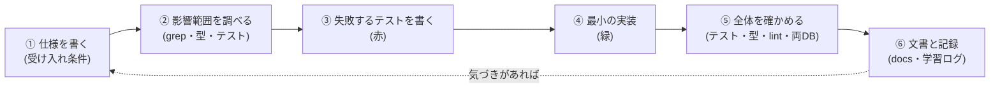

# L17 総合演習 ― 機能を 1 つ足す(設計 → テスト → 実装 → 文書)

**この回の目標**
- これまでの講義を使って、**小さな機能を 1 つ、最初から最後まで**自力で足す
- 「仕様 → 失敗するテスト → 実装 → 全体の確認 → 文書」という**手順**を身につける
- 変更の**影響範囲**を見積もり、**やらないこと**も決められる

前提: L00〜L16(特に L06・L07・L12・L14)。

---

## 1. 進め方 ― 6 つの工程


| 工程 | やること | よくある失敗 |
|---|---|---|
| ① 仕様 | 「何ができたら完成か」を、**確かめられる文**で書く。**やらないこと**も書く | 曖昧なまま始める(終わりが分からない) |
| ② 影響範囲 | その名前・概念を使っている所を全部探す(`grep`・型エラー・既存テスト) | 1 か所だけ直して他を忘れる |
| ③ 赤 | 先に**失敗するテスト**を書き、**赤くなる理由が正しい**ことを確認 | テストが最初から緑(何も確かめていない) |
| ④ 緑 | テストを通す**最小**の変更。ついでの改造はしない | 範囲が膨らむ |
| ⑤ 確認 | テスト全部・型・lint・(DB が絡むなら)PostgreSQL でも | 自分の変更だけ試して終わる |
| ⑥ 文書 | 仕様・設計判断・学んだことを残す | コードだけ直して、文書が古くなる |

> **大切なこと**: ①〜④ を行ったり来たりしてよい。ただし**⑤⑥を飛ばさない**。

## 2. テーマを選ぶ
自分の目的に合う 1 つを選んで挑戦します。難しさ: ★ = 1〜2 時間 / ★★ = 半日 / ★★★ = 1 日。

| # | テーマ | 難しさ | 主な学び | 触る場所 |
|---|---|---|---|---|
| A | **パスの NFC 正規化**(macOS の濁点ずれを吸収) | ★ | 文字列・テスト先行([L07](L07-strings-paths.md)) | `tracker/paths.py`・`test_paths.py` |
| B | **コントラスト比を自動検査するテスト** | ★ | 計算・トークン([L12](L12-ui-css.md)) | `frontend/src/styles/`・Vitest |
| C | **タスクに説明(description)を足す** | ★★ | モデル→API→画面を縦に通す | models・migration・serializers・types・drawer |
| D | **`ordering=priority`(優先度順)** | ★★ | ORM の `Case/When`・ファズ([L04](L04-django.md)・[L14](L14-testing.md)) | views・テスト |
| E | **取り込みスクリプトに `--since` を足す** | ★★ | スクリプト・冪等([L15](L15-scripts.md)) | `send_quality.py` |
| F | **状態「保留(blocked)」を足す** | ★★★ | 状態機械・全組み合わせ([L06](L06-state-machine.md)) | models・migration・画面全体 |

C・D・F は [実践ガイドの演習](../learning/07-exercises.md) と [レシピ](../learning/04-recipes.md) に、手順と答えの方針があります。ここでは、**A を最後まで通した見本**を示します。

---

## 3. 見本: テーマ A「パスの NFC 正規化」

### 3-1. ① 仕様を書く
**背景**([L07](L07-strings-paths.md))。macOS のファイル名は、`が` を「か + 濁点(結合文字)」の **NFD** で持つことがある。登録済みの Entity のパス(NFC)と、取り込まれたパス(NFD)が、**見た目は同じなのに一致しない**。

**受け入れ条件**
1. NFD で来たパスが、NFC で登録された Entity と一致する(逆も)。
2. 既存の挙動(区切りの統一・大文字小文字の無視・最長一致)は**変わらない**。
3. 英数字だけのパスの結果は変わらない(回帰がない)。

**やらないこと**
- 全角英数を半角にする(NFKC)こと。別の文字を同一視してしまい、**意図しない一致**を生む恐れがある。今回は「同じ文字の別表現」だけを吸収する(NFC)。
- 登録時の Entity.path を書き換える移行(必要なら別の作業にする)。

### 3-2. ② 影響範囲を調べる
パスの比較は、すべて `tracker/paths.py` の `_key` を通ります。呼び出し元を確認します。

<!-- test:django -->
```python
import subprocess
from pathlib import Path

root = Path.cwd()
while not (root / "backend" / "tracker" / "paths.py").exists():
    root = root.parent

# normalize_path / match_entity を使っている Python ファイル(テスト以外)
out = subprocess.run(
    ["grep", "-rlE", "normalize_path|match_entity", "backend/tracker", "--include=*.py", "--exclude-dir=tests", "--exclude-dir=migrations"],
    cwd=root, capture_output=True, text=True,
).stdout.split()
print(sorted(out))
```

<!-- output -->
```text
['backend/tracker/ingest.py', 'backend/tracker/paths.py', 'backend/tracker/serializers.py']
```

`paths.py` 自身と、それを使う側(`ingest.py`・`serializers.py`)の 3 つだけが出ます。使う側は関数を呼ぶだけなので、**変更を `paths.py` の中に閉じ込められる**(`_key` だけ直せばよい)ことが分かりました。これが「1 か所に集める」設計の恩恵です。

### 3-3. ③ 失敗するテストを書く(赤)
**今の実装で**、問題が再現することを確かめます。

<!-- test:django -->
```python
import unicodedata

from tracker.paths import match_entity

composed = "assets/props/が"                          # NFC
decomposed = unicodedata.normalize("NFD", composed)    # NFD(濁点が別の文字になる)
print("見た目は同じ:", composed, decomposed, "| 文字列として等しい:", composed == decomposed)

entities = [(1, composed)]
print("NFC で登録 → NFD で検索:", match_entity(decomposed, entities))
```

<!-- output -->
```text
見た目は同じ: assets/props/が assets/props/が | 文字列として等しい: False
NFC で登録 → NFD で検索: None
```

`None`(一致しない)― バグを**再現できました**。これをテストとして書きます(実際に足すなら `test_paths.py` へ)。

```python
def test_nfd_and_nfc_paths_match():
    composed = "assets/props/が"
    decomposed = unicodedata.normalize("NFD", composed)
    assert match_entity(decomposed, [(1, composed)]) == 1
    assert match_entity(composed, [(1, decomposed)]) == 1
```

> このテストは、**今は失敗する**(赤)。赤くなる理由が「一致しない」であることが、仕様と合っているかを確かめる ― 別の理由(タイプミスなど)で赤くなっていないか。

### 3-4. ④ 最小の実装(緑)
`_key` の 1 行を直します。**本物のファイルは変えず**、ここでは同じ関数を手元で作って確かめます。

<!-- test:django -->
```python
import unicodedata

from tracker.paths import normalize_path

def key_nfc(path: str) -> str:
    # 変更点はここだけ: NFC にそろえてから、これまでどおり正規化 → casefold
    return normalize_path(unicodedata.normalize("NFC", path)).casefold()

def match_entity_nfc(asset_path, candidates):
    target = key_nfc(asset_path)
    best_id, best_len = None, -1
    for entity_id, entity_path in candidates:
        prefix = key_nfc(entity_path)
        if not prefix:
            continue
        if (target == prefix or target.startswith(prefix + "/")) and len(prefix) > best_len:
            best_id, best_len = entity_id, len(prefix)
    return best_id

composed = "assets/props/が"
decomposed = unicodedata.normalize("NFD", composed)
print("NFC 登録 / NFD 検索:", match_entity_nfc(decomposed, [(1, composed)]))
print("NFD 登録 / NFC 検索:", match_entity_nfc(composed, [(1, decomposed)]))
```

<!-- output -->
```text
NFC 登録 / NFD 検索: 1
NFD 登録 / NFC 検索: 1
```

### 3-5. ⑤ 回帰がないか確かめる(受け入れ条件 2・3)
「**変えないはずのもの**が変わっていない」ことを、**元の実装と新しい実装を突き合わせて**確かめます。ランダムなパスを大量に流し、結果が同じであることを見ます(種を固定)。

<!-- test:django -->
```python
import random
import unicodedata

from tracker.paths import match_entity, normalize_path

def key_nfc(path):
    return normalize_path(unicodedata.normalize("NFC", path)).casefold()

def match_entity_nfc(asset_path, candidates):
    target = key_nfc(asset_path)
    best_id, best_len = None, -1
    for entity_id, entity_path in candidates:
        prefix = key_nfc(entity_path)
        if not prefix:
            continue
        if (target == prefix or target.startswith(prefix + "/")) and len(prefix) > best_len:
            best_id, best_len = entity_id, len(prefix)
    return best_id

rng = random.Random(7)
parts = ["assets", "props", "Props", "crate", "chars", "hero", ".", "", "x y"]   # ASCII 中心(日本語は含めない)
def random_path():
    sep = rng.choice(["/", "\\", "//"])
    return sep.join(rng.choice(parts) for _ in range(rng.randint(1, 4)))

differences = 0
for _ in range(5000):
    candidates = [(i, random_path()) for i in range(rng.randint(0, 4))]
    target = random_path()
    if match_entity(target, candidates) != match_entity_nfc(target, candidates):
        differences += 1
print("ASCII のパス 5000 組で、元と新しい実装の結果が違った数:", differences)
```

<!-- output -->
```text
ASCII のパス 5000 組で、元と新しい実装の結果が違った数: 0
```

**0 件** ― 英数字のパスの挙動は変わっていません(受け入れ条件 3)。

> **補足**: これは**差分テスト**(differential testing)の考え方です。「正解」が分からなくても、「**変えないはずの部分が元と同じ**」なら確かめられます。リファクタリングで特に強力です。

### 3-6. ⑥ 文書と記録
- `paths.py` の先頭の説明に「NFC にそろえる」と追記する。
- [L07](L07-strings-paths.md) の「既知の限界」を更新する。
- `docs/decisions.md` に判断を残す(**なぜ NFC で NFKC ではないか**)。
- `docs/learning-log.md` に、詰まった点や気づきを書く。

判断の記録は、**未来の自分(や他の人)が「なぜこうなっているのか」を調べる手がかり**です。コードに書けない「やらなかったこと」と、その理由を残します。

---

## 4. 自分のテーマで進めるときの手引き

### 4-1. 仕様のテンプレート
```text
テーマ: （一行で）
背景:   （何が困っているか。誰が困るか）
受け入れ条件:
  1. …（確かめられる文で）
  2. …
  3. 既存の挙動は変わらない（回帰）
やらないこと:
  - …
影響範囲:
  - 触るファイル: …
  - 影響を受けるテスト: …
危うい点（失敗しうること）:
  - …
```

### 4-2. 影響範囲の調べ方
| 方法 | 使いどころ |
|---|---|
| `grep -rn "名前" backend frontend/src docs` | その名前の全使用箇所 |
| `npm run typecheck`(TypeScript) | 型を変えたとき、直す場所を機械が教えてくれる |
| テストを先に全部走らせる | 変更前に緑であることを確認(元から赤を混ぜない) |
| `git log -p -- ファイル` | 過去に同じ所を直した理由 |
| ドキュメントの検索 | 設計判断(`decisions.md`)に反していないか |

### 4-3. 完成のチェックリスト
**コード**
- [ ] 受け入れ条件の**すべて**にテストがある(正常・異常・境界)。
- [ ] 拒否するときに**データが変わらない**ことを確かめた。
- [ ] 権限(閲覧者・部外者・未ログイン)を確かめた。
- [ ] 悪い入力で 500 にならない(ファズの表に足した)。
- [ ] N+1 が起きない(一覧を足したなら、クエリ数を固定した)。

**確認**
- [ ] バックエンド: `pytest`(SQLite)/ PostgreSQL でも緑。`ruff` が通る。
- [ ] フロントエンド: `npm run typecheck` と `npm test` が緑。
- [ ] マイグレーションを足したなら、`makemigrations --check` で差分なし、**既存データがあっても通る**。
- [ ] 画面を足したなら、キーボードだけで操作できる。360px で横スクロールが出ない。ライト/ダークで読める。

**文書**
- [ ] 仕様・設計判断を記録した(`decisions.md`)。
- [ ] 変更した挙動を、関係する文書に反映した(図も)。
- [ ] 文書内のコードは、テストを通る(`pytest tracker/tests/test_docs.py`)。HTML 版を作り直した(`python docs/tools/build_html.py`)。
- [ ] 学習ログに、気づきを 1 つ以上残した。

### 4-4. 評価の観点(自己採点用)
| 観点 | 4(優れている) | 2(あと一歩) | 0(不足) |
|---|---|---|---|
| 仕様 | 条件が確かめられる文。やらないことも明記 | 条件が曖昧な箇所がある | 仕様がない |
| テスト | 赤→緑を踏んだ。正常・異常・境界・権限・回帰 | 正常系だけ | テストがない |
| 設計 | 変更が 1 か所に集まる。既存の流儀に沿う | 一部に重複・例外扱いがある | 流儀を無視 |
| 安全 | 入力検査・権限・秘密・失敗時の整合を考えた | 一部だけ | 考慮がない |
| 影響範囲 | 他への影響を調べ、回帰を確かめた | 一部だけ | 調べていない |
| 文書 | 判断の理由まで残した | コードの説明だけ | なし |

---

## 5. 発展: 次に挑戦できること
| テーマ | 内容 |
|---|---|
| テーマ B の実装 | `_tokens.scss` を読み、全トークンの組合せのコントラストを検査するテスト(Vitest か Node)を書く。L12 の計算がそのまま使える |
| 権限の追加 | 新しい役割(例: コーディネーター)を足す。権限の表([security.md](../security.md))とテストの表を同時に更新 |
| 新しい取り込み口 | 別ツールの結果を取り込む API。冪等・API キー・入力検査・件数照合を、`ingest.py` の流儀で |
| 国際化 | 画面の文言を辞書に分け、英語を足す(React の Context が使える) |
| 性能 | 1 万件のタスクで一覧が遅い → `test_query_plans.py`・索引・ページネーションの見直し |
| ブラウザテスト | Playwright で、ログイン → 移動 → 完了の流れを自動化 |

## 6. 振り返り ― 学んだことを言葉にする
最後に、自分の言葉で次を書いてみましょう(`docs/learning-log.md` の形式で)。
1. **何を作ったか**(一文)。
2. **一番詰まったところ**と、どう解決したか。
3. **最初の想定と違ったこと**。
4. **次に同じことをするなら、変えること**。
5. **まだ分からないこと**(次の学習の入口)。

> 「分からないこと」を書き出せることが、保守・拡張できる人の条件です。分からないことを**分からないと認識できている**なら、調べる道筋はもう見えています。

## 確認問題
1. 「失敗するテストを先に書く」のは、なぜか。赤くなる理由まで確かめるのは、なぜか。
2. 見本のテーマ A で、NFKC でなく NFC を選んだ理由は。
3. 差分テスト(元の実装との突き合わせ)は、どんな場面で有効か。
4. 「やらないこと」を仕様に書くのは、なぜか。
5. 変更が 1 か所(`_key`)に閉じ込められたのは、設計のどんな工夫のおかげか。

## 答え
1. 本当にそのバグ(要件)を検出できるテストか確かめるため。テストが最初から緑なら何も確かめていない。赤い理由が別(タイプミスなど)だと、直しても要件を満たした保証にならない。
2. NFKC は全角/半角など**別の文字**まで同一視し、意図しない一致を生む恐れがある。今回は「同じ文字の別表現」だけを吸収すればよい。
3. 「変えないはずの挙動」を守りたいとき(リファクタリング・小さな改修)。正解が分からなくても、元の実装との一致を確認できる。
4. 範囲の膨張を防ぎ、終わりを明確にするため。また、やらなかった理由が判断の記録になる。
5. パスの比較を `_key` に集め、すべての呼び出しがそれを通る設計(ルールを 1 か所に)。

## おわりに
ここまでで、**Web の仕組みから、画面・API・データベース・アルゴリズム・テスト・運用まで**を一通り扱いました。
- 迷ったら、まず**テストと文書を読む**(動くコードが、いちばん正確な仕様です)。
- 分からない言葉は [用語集](glossary.md) へ。
- 手順を知りたいときは [実践ガイド](../learning/README.md) へ。

あなたの変更が、次の人の学習資料になります。
