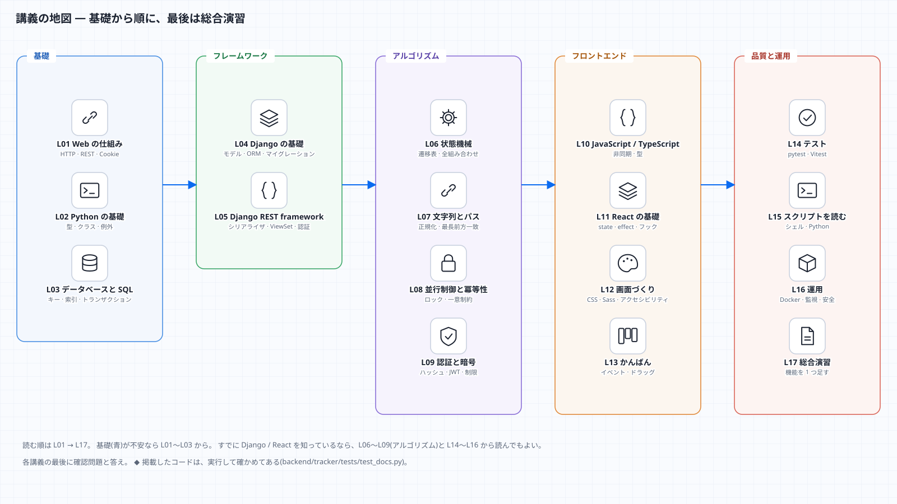

# 講義資料 ― 基礎から、保守・拡張できるところまで

この資料は、**ProductionTracker を題材にした講義**です。プログラミングの基礎(Web の仕組み・Python・データベース)から始めて、
フレームワーク(Django・React)、アルゴリズム(状態機械・文字列・並行制御・暗号)、テスト、運用まで、**1 つの実物のアプリ**で順に学びます。
最後には、自分で機能を 1 つ足せるようになることがゴールです。

## 講義の一覧

| 回 | 題名 | 学ぶこと | 目安 |
|---|---|---|---|
| [L00](L00-intro.md) | はじめに | 学習の進め方・環境づくり・リポジトリの歩き方 | 60 分 |
| [L01](L01-web.md) | Web の仕組み | HTTP・URL・ステータスコード・JSON・Cookie・REST | 90 分 |
| [L02](L02-python.md) | Python の基礎 | 値と型・関数・クラス・例外・内包表記・テキストの扱い | 120 分 |
| [L03](L03-database.md) | データベースと SQL | 表・キー・正規化・SELECT / JOIN・索引・トランザクション | 120 分 |
| [L04](L04-django.md) | Django の基礎 | MTV・設定・モデルと ORM・マイグレーション・ミドルウェア | 120 分 |
| [L05](L05-drf.md) | Django REST framework | シリアライザ・ViewSet・認証・権限・スロットル・例外処理 | 120 分 |
| [L06](L06-state-machine.md) | アルゴリズム① 状態機械 | 遷移表・全組み合わせの検証・形式的な考え方 | 90 分 |
| [L07](L07-strings-paths.md) | アルゴリズム② 文字列とパス | 正規化・最長前方一致・計算量・トライ木 | 90 分 |
| [L08](L08-concurrency.md) | アルゴリズム③ 並行制御と冪等性 | 競合・ロック・一意制約・Idempotency-Key | 90 分 |
| [L09](L09-security-crypto.md) | アルゴリズム④ 認証と暗号 | ハッシュ・CSRF・定数時間比較・JWT・レート制限 | 120 分 |
| [L10](L10-javascript-typescript.md) | JavaScript / TypeScript の基礎 | 値・関数・非同期(Promise)・fetch・型 | 120 分 |
| [L11](L11-react.md) | React の基礎 | コンポーネント・state・effect・フック・自作フック | 120 分 |
| [L12](L12-ui-css.md) | 画面づくり | CSS・Sass・デザイントークン・アクセシビリティ・コントラストの計算 | 120 分 |
| [L13](L13-kanban.md) | かんばんを作る | イベント・ドラッグ&ドロップ・先行更新と巻き戻し・キーボード操作 | 90 分 |
| [L14](L14-testing.md) | テストの理論と実践 | pytest・fixture・parametrize・壊れた入力・Vitest | 120 分 |
| [L15](L15-scripts.md) | スクリプトを読む | シェル・Python のスクリプト・図の生成 | 90 分 |
| [L16](L16-operations.md) | 運用 | Docker・バックアップ・Cloudflare・Sentry・OWASP | 90 分 |
| [L17](L17-capstone.md) | 総合演習 | 機能を 1 つ足す(設計 → テスト → 実装 → 文書) | 半日 |
| [付録](glossary.md) | 用語集 | 本文に出てくる用語の一覧 | |

合計で約 30 時間。**1 回 = 1〜2 時間**で区切れるようにしてある。

## 各回の形
どの回も、同じ順で進みます。

1. **この回の目標** と、前提(前の回のどこを使うか)
2. **考え方** — まず言葉と図で。「なぜそうするのか」から
3. **コードを読む** — このアプリの**実際のコード**の抜粋
4. **手を動かす** — 実行できる小さなコード(結果つき)
5. **よくある間違い**
6. **確認問題** と、答え

## この資料の約束
- **掲載したコードは、実行して確かめてある。** `<!-- test -->` の印が付いたコードは、テスト(`backend/tracker/tests/test_docs.py`)が毎回実行し、
  「実行結果」と一致することを確かめる。`<!-- excerpt: パス -->` の印が付いた抜粋は、そのファイルに本当にある行かを確かめる。
  つまり、**この資料のコードは、書いてあるとおりに動く**。ソースを直して文書が古くなると、テストが落ちる。
- 図は、**Markdown だけで読める mermaid 記法**と、`docs/diagrams/` の SVG の両方で載せている。HTML 版([docs/html/index.html](../html/index.html))もある。
- 本文の「このアプリでは」は、ProductionTracker の実際の設計を指す。一般論と区別して読むこと。
- 分からない言葉は [用語集](glossary.md) へ。

## 読み方のおすすめ
| あなたは | おすすめの順 |
|---|---|
| プログラミングが初めて | L00 → L01 → L02 → L03 → L04 → … を順に。**手を動かす**を必ず実行する |
| Python は書けるが Web は初めて | L01 → L03 → L04 → L05 → L06〜L09 |
| Django / React は使ったことがある | L06〜L09(アルゴリズム)→ L14(テスト)→ L16(運用)→ L17 |
| 保守・機能追加だけ急ぎたい | [実践ガイド](../learning/README.md)(レシピ)を先に。分からない所で、対応する講義へ戻る |

## 関連
- [実践ガイド(保守・拡張)](../learning/README.md) — 手順書。レシピ・テスト・トラブルシューティング
- [設計・仕様](../er.md) — データモデル・API の契約・セキュリティの点検結果
