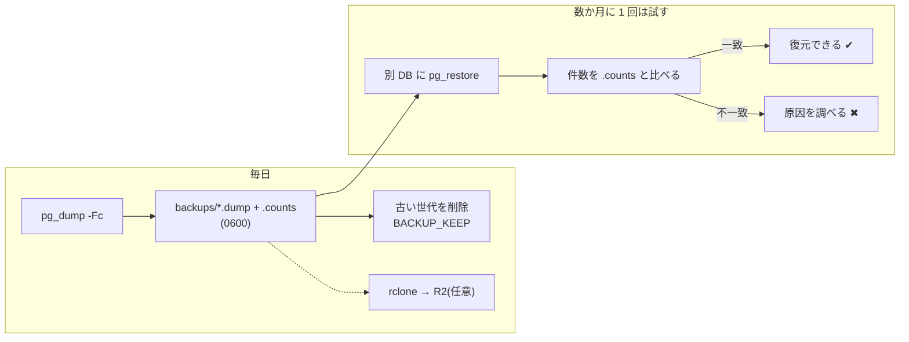
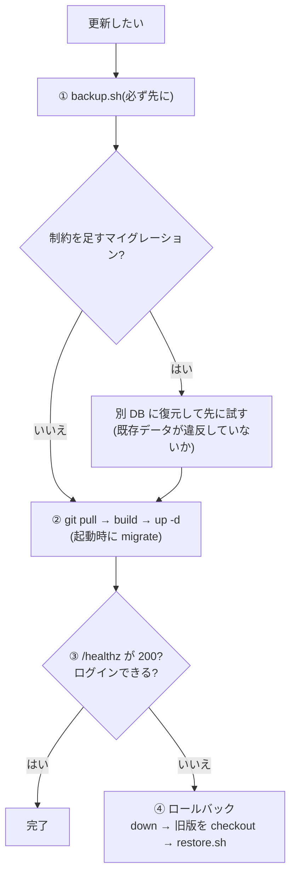

# 運用手順(Phase 7)

方式 A(自分の PC の `docker compose` + Cloudflare Tunnel + Access)を前提にした手順。**PC の電源が入っている間のみ**動く。

> **検証状況**: バックアップ → 別 DB への復元 → 件数一致は、PostgreSQL 16 に対してホストの `pg_dump` / `pg_restore` で実際に 1 回通した。
> `docker compose` 経由の経路(既定)と rclone / R2 への保存、Tunnel + Access は、この開発環境に Docker デーモンも Cloudflare 環境もないため**未検証**。

## 秘密情報
- `.env` は Git に入れない(`.gitignore` 済み)。雛形は `.env.example`。
- 公開する前に必ず変える: `DJANGO_SECRET_KEY`, `POSTGRES_PASSWORD`, `INGEST_API_KEYS`, `DJANGO_SUPERUSER_PASSWORD`。
  `DJANGO_DEBUG=0` のとき `DJANGO_SECRET_KEY` が空だと起動しない。
- API キー・トークンは環境変数から読む。送信スクリプトは鍵をコマンドライン引数で受けない(`INGEST_API_KEY`)。
- Sentry へ送る前にヘッダ(Authorization / X-API-Key / Cookie / X-CSRFToken)・クッキー・リクエスト本文を落とす(Django: `tracker/sentry.py`、React: `src/sentry.ts`)。
- **Houdini パネルの設定ファイル(JSON)にトークンを平文で書かない**(パネル側の実装時の約束事。環境変数か OS の資格情報ストアから読む)。

## バックアップ
```bash
./scripts/backup.sh                          # backups/pt-YYYYmmdd-HHMMSS.dump と .counts(件数)
BACKUP_KEEP=30 ./scripts/backup.sh           # 残す世代数(既定 14)
BACKUP_RCLONE_DEST=r2:my-bucket/pt ./scripts/backup.sh   # rclone で R2 にも保存(rclone の設定が別途必要)
```
- 毎日 cron(WSL なら Windows のタスクスケジューラ → `wsl ./scripts/backup.sh`)で取る。ファイルは所有者のみ読める(umask 077)。
- `backups/` は Git に入れない。

## 復元(別の DB に戻して確認する)
```bash
./scripts/restore.sh backups/pt-20261025-090000.dump       # 復元先は <POSTGRES_DB>_restore
```
復元後、バックアップ時の件数(`.counts`)と一致すれば `件数一致: OK`、違えば終了コード 1。
稼働中の DB を上書きするときだけ、web を止めてから `RESTORE_OVERWRITE=1 ./scripts/restore.sh <dump> "$POSTGRES_DB"`。
**数か月ごとに 1 回、実際に復元を試す**こと(取れているだけでは不十分)。

## `manage.py check --deploy` の結果
`DJANGO_DEBUG=0` で実行して出る警告と、このリポジトリの扱い:

| 警告 | 扱い |
|---|---|
| W004 `SECURE_HSTS_SECONDS` | 既定は無効。https だけで公開するなら `DJANGO_HSTS_SECONDS`(短い値から。一度配ると戻しにくい) |
| W008 `SECURE_SSL_REDIRECT` | 既定は無効。Tunnel が TLS を終端するので通常は不要。必要なら `DJANGO_SSL_REDIRECT=1` |
| W012 / W016 Secure クッキー | `DJANGO_SECURE_COOKIES=1`(https で公開するとき) |
| W009 `SECRET_KEY` が短い | 50 文字以上のランダム値を `DJANGO_SECRET_KEY` に(`python -c "import secrets; print(secrets.token_urlsafe(64))"`) |



## 更新(マイグレーションを伴うとき)



1. `./scripts/backup.sh`(**必ず先に**)。マイグレーション `0003` は DB に制約を足す。**既存データが違反していると失敗する**(例: `demo` と `DEMO` が両方ある、見積が負)ので、バックアップから別 DB に復元して先に試すと安全
2. `git pull` → `docker compose build` → `docker compose up -d`(起動時に `migrate` が走る)
3. `curl http://localhost:8000/healthz` が `200` であること、画面でログインできること
4. 失敗したらロールバック: `docker compose down` → 旧バージョンに `git checkout` → 必要なら `restore.sh` で DB を戻す(マイグレーションは前方のみの変更なので、DB はバックアップから戻すのが確実)

## 監視
- `/healthz` を ToolOrchestrationHub から監視(`docs/integration.md`)。
- ログは JSON で標準出力へ。ローテーションは Docker 側(compose で `max-size: 10m`, `max-file: 3`)。
- Sentry: DSN を設定したときだけ有効。通知は重大なものだけにするのは Sentry 側のルール設定で行う。
  `SENTRY_SAMPLE_RATE`(エラーのサンプリング)と `SENTRY_TRACES_SAMPLE_RATE`(既定 0)で量を抑える。
  **無料枠の条件(月 5,000 エラー・1 ユーザーとされる情報)は第三者サイト由来で未確認**。公式の料金ページで確認すること。

## レート制限とキャッシュ
- **レート制限**: ユーザーごと `API_THROTTLE_RATE`(既定 1200/min)、ログイン `LOGIN_THROTTLE_RATE`(10/min)、取り込み全体 `INGEST_THROTTLE_RATE`(120/min)。超えると `429`。カウンタはプロセスごとなので、ワーカーが増えると実質の上限は緩くなる([security.md](security.md) の F6)。
- **キャッシュ**: API の応答には `Cache-Control: no-store` を付ける。Cloudflare のキャッシュ規則で `/api/*` を「キャッシュしない」にしておくと二重に安全。

## 公開(Cloudflare Tunnel + Access)
- Access の JWT をアプリ側でも検証できる(任意): [auth.md](auth.md) の「Cloudflare Access(OIDC)で認証する」。
- Tunnel のホスト名を `DJANGO_ALLOWED_HOSTS` / `DJANGO_CSRF_TRUSTED_ORIGINS` / `VITE_ALLOWED_HOSTS` に入れ、`DJANGO_SECURE_COOKIES=1`・`DJANGO_BEHIND_PROXY=1` にする。
- `/admin/` は Access で保護する。API はセッション or ユーザー別トークン、取り込み API は `X-API-Key`。
- **直接アクセスができない設定**(compose は `127.0.0.1` にだけ公開)と、外部端末からの認証つきアクセスは、実環境での確認が必要(未検証)。
- 現在の compose は**開発用**(Vite 開発サーバーと Django `runserver`)。本番相当にするなら `frontend` を `npm run build` の成果物配信に、`web` を Dockerfile 既定の gunicorn に替える(Dockerfile は gunicorn + WhiteNoise 済み)。
