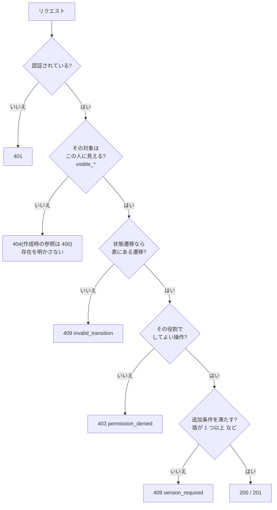

# セキュリティ点検(OWASP API Security Top 10 : 2023)

設計書の追補「第4弾の外部資料(Z32 Web API)」に従った点検。基準は OWASP API Security Top 10(2023)。
**点検は自動テストにしてある**(`backend/tracker/tests/test_security_audit.py` ほか)。この文書は、その結果と、テストで守れないことの一覧。

結果の区分は、設計書の X2(セキュリティ点検)の書き方に合わせた: **確定**(問題があり、直した)/ **要確認**(今は直せない・実環境が要る)/ **却下**(問題ではないと確かめた)。

## 結果の一覧
| # | リスク | 状態 | 対策・根拠(テスト) |
|---|---|---|---|
| API1 | オブジェクト単位の認可の不備(BOLA) | 対策済み | 全ての QuerySet は `visible_*` から始める。別プロジェクトの ID を知っていても **404**(`test_objects_of_another_project_are_invisible`)。タスク作成時に他人のアセットを指定しても 400 |
| API2 | 認証の不備 | 一部 **要確認** | セッション + CSRF、ログインの試行制限(10 回/分)、パスワード検証、Cloudflare Access(任意)。**トークンに期限が無い**(下の F5) |
| API3 | オブジェクトのプロパティ単位の認可の不備 | 対策済み | 読み取り専用の項目(`status`・`number`・`created_by`・`id` など)は書き込めない(`test_read_only_fields_cannot_be_written`)。応答に出す利用者情報は必要最小限(`test_responses_do_not_leak_sensitive_fields`) |
| API4 | 資源の無制限な消費 | **確定**(直した) | ユーザーごと 1200 回/分・取り込み 120 回/分のレート制限、ページ上限 200、自由記述の上限(コメント 5000 字・`dcc`/`conditions` 20000 字)、JSON 以外の本文は 415、NUL・巨大な数は 400 |
| API5 | 機能単位の認可の不備 | 対策済み | ロール別の認可の一覧をテストにした(下の表。`test_authorization_matrix` ほか)。承認はレビュアーだけ(管理者でも不可) |
| API6 | 重要な業務フローへの無制限なアクセス | 対策済み(範囲内) | 承認・完了の条件はモデルに集約。版の登録は Idempotency-Key で重複しない + レート制限 |
| API7 | サーバー側リクエストフォージェリ(SSRF) | **却下** | `thumbnail` / `file_ref` は **保存するだけでサーバーは取りに行かない**。画面は `http(s)` と相対パスのときだけ `` にする(`referrerPolicy="no-referrer"`)。外部の画像を指せば閲覧者の IP が相手に見えうる(追跡ピクセル)ので、信頼できる場所の URL だけを登録する運用 |
| API8 | セキュリティの設定ミス | **確定**(直した) | API の応答に `Cache-Control: no-store`(CDN・プロキシに残さない)。`check --deploy` の結果は [operations.md](operations.md)。エラーはスタックトレースを返さない(`test_error_responses_do_not_leak_internals`)。**画面を配る側の CSP などのヘッダは要確認**(F9) |
| API9 | 在庫(エンドポイント)管理の不備 | 対策済み | **全てのエンドポイントは、未認証だと 401**。公開するものは許可リストに理由つきで書く(`test_every_api_endpoint_requires_authentication`)。新しい URL を足すと、このテストが自動で対象にする。デバッグ用エンドポイントは環境変数 + 管理者のみ |
| API10 | 他の API の安全でない利用 | 対策済み | 外部から受け取るのは取り込み(検証してから保存)だけ。Sentry へは認証情報を除去して送る。外部 API をサーバーから呼ぶことはしない |

## 関門(防御の層)


## 401 と 403 と 404 の使い分け
どのステータスを返すかは、次の順で決める。



設計書「401 と 403 を使い分ける」に対する実装:

| 状況 | HTTP | 理由 |
|---|---|---|
| 認証されていない(セッション切れ・キーなし・トークン不正) | **401** | 「誰か分からない」。画面はログインへ戻す |
| 認証されているが、権限が無い(閲覧者が書く・アーティストが承認) | **403** | 「誰かは分かるが、してはいけない」 |
| 見えない対象(メンバーでないプロジェクトの ID) | **404**(作成時の参照は 400) | **存在を明かさない**。403 を返すと「その ID は存在する」と教えてしまう |
| 表にない状態遷移 | **409** | 状態の衝突。権限の有無より先に判定する(誰でも同じ結果) |
| CSRF の失敗 | **403** | |

## ロール別の認可の一覧(最小権限)
`test_authorization_matrix` / `test_task_transition_matrix` / `test_version_approval_matrix` が、この表そのものを検証している。

| 操作 | 非メンバー | viewer | artist | reviewer | 管理者(`is_staff`) |
|---|---|---|---|---|---|
| プロジェクトを見る・メンバー一覧 | 404 | ○ | ○ | ○ | ○(全て見える) |
| プロジェクトを更新 | 404 | 403 | 403 | ○ | ○ |
| アセット・タスク・版・ノートを作る / 更新 | 400 / 404 | 403 | ○ | ○ | ○ |
| ノートを読む | 404 | ○ | ○ | ○ | ○ |
| タスクの状態遷移(承認以外) | 404 | 403 | ○ | ○ | ○ |
| **承認(レビュー待ち → 完了)** | 404 | 403 | **403** | ○ | **403** |
| **版の承認・却下** | 404 | 403 | **403** | ○ | **403** |
| 表にない遷移(未着手 → 完了) | 404 | 409 | 409 | 409 | 409 |

最小権限として意識した点:
- **承認は、管理者でもレビュアーの役割が要る。** 管理者権限(全プロジェクトを見られる)と、業務上の承認権限を分けている。
- **取り込み用の API キーでは、画面の API を一切呼べない**(逆も同じ)。キーは取り込みのためだけ。
- Cloudflare Access で自動作成したユーザーは、**どのプロジェクトのメンバーでもない**ので、何も見えない(管理者がメンバーにするまで)。

## 見つけたこと(F: Finding)
| # | 区分 | 内容 | 対応 |
|---|---|---|---|
| F1 | 確定 | ログイン以外にレート制限が無かった(API4) | ユーザーごと・取り込み用の制限を追加。環境変数 `API_THROTTLE_RATE` / `INGEST_THROTTLE_RATE` |
| F2 | 確定 | API の応答がキャッシュされうる(API8)。Cloudflare を前に置くと特に問題 | `Cache-Control: no-store` を全 API 応答に付ける(ミドルウェア) |
| F3 | 確定 | 自由記述(コメント・`dcc`・`conditions`)に上限が無く、本文の上限(2.5MB)まで保存できた(API4) | コメント 5000 字、JSON は 20000 字まで |
| F4 | 確定 | 索引の不備(値の種類が少ない `status` 単独の索引、`iexact` が `LOWER` の索引を使わない)。詳細は [database.md](database.md) | 前者は削除、後者は式をそろえた |
| F5 | **要確認** | DRF のトークンは **期限が無く、平文で DB に保存**される(API2) | ユーザーごとのトークン + `drf_create_token -r` で再発行できる、までが現状。期限つきトークン(または Cloudflare Access のサービストークン / JWT)への移行を検討 |
| F6 | **要確認** | レート制限のカウンタはプロセスごと(LocMemCache)。gunicorn のワーカー数だけ緩くなる | 厳密に要るなら Redis など共有キャッシュ。Cloudflare 側のレート制限(WAF)と併用するのが現実的 |
| F7 | **要確認** | 取り込み用の API キーは全ツールで共通で、ツール別の無効化ができない | `INGEST_API_KEYS` は複数持てる(ローテーションは「新旧を併記 → 送り手を切り替え → 旧を削除」)。ツール別にするなら鍵ごとに名前を付ける拡張 |
| F8 | 却下 | SSRF(API7)。サーバーは `thumbnail` / `file_ref` を取りに行かない | 運用の注意だけ(上の表) |
| F9 | **要確認** | 画面(フロント)を配るホストの CSP・`X-Content-Type-Options` などのヘッダ。compose は開発用の Vite を使っていて、本番の配り方が未定 | 本番の配信方法を決めるときに、CSP(`default-src 'self'`、`img-src` は必要な範囲)を入れる |
| F10 | **要確認** | Cloudflare Access の JWT 検証は、手元で作った鍵でのテストのみ。**実際の Cloudflare では未検証** | 実環境で AUD・チームのドメインを設定して 1 回確認する([auth.md](auth.md)) |

## OWASP の資料の外(別に設計したこと)
設計書は「レート制限・入力検証は資料の外なので別に設計する」としていた。次のようにした。
- **レート制限**: 3 種類の枠(ユーザー / ログイン / 取り込み)。超えると `429 {"code": "throttled"}`。値は環境変数で変える。
- **入力検証**: 受け付ける形式は JSON だけ(415)。文字列は NUL を拒否(PostgreSQL が保存できないため)、数は bigint の範囲、日時はタイムゾーン必須、自由記述と JSON は上限つき。選択肢のあるクエリは、選択肢にない値を 400。
- **壊しにいくテスト**: `tests/test_robustness.py`(約 215 ケース)。「変な入力で 500 を出さない」を PostgreSQL でも流す。

## 点検の再実行
```bash
cd backend
pytest -q tracker/tests/test_security_audit.py tracker/tests/test_robustness.py tracker/tests/test_cf_access.py
ruff check . --select S,B     # 静的解析(セキュリティ系のルール)
python manage.py check --deploy
```
新しいエンドポイントを足したら、まず `test_security_audit.py` が通るか(未認証で 401)を見る。許可リスト(`PUBLIC`)に足すときは、**理由を書く**。
